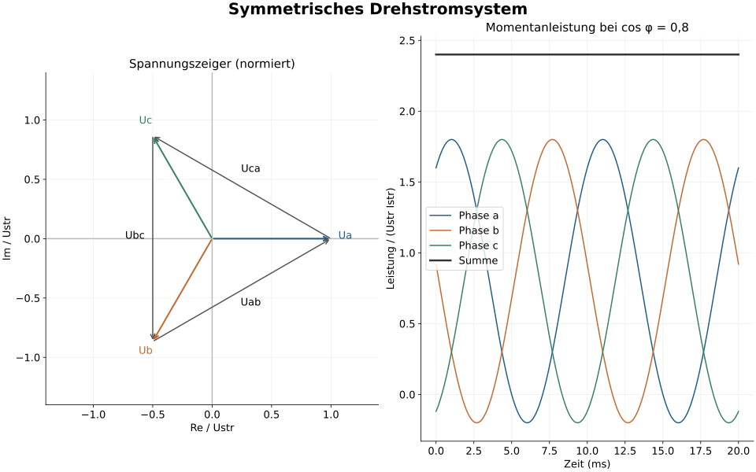

# M29-L1 – Dreiphasenrechnung, Wirk- und Blindleistung: Standortbestimmung am symmetrischen Netz {#L1}

**Kursbereich:** M29 – Bachelor–Master-Brücke: Übergang Leistungselektronik und elektrische Maschinen

**Niveau:** Bachelor · Bachelor–Master-Brücke

**Vorwissen:** [M1-L6](M1-L6.md), [M1-L7](M1-L7.md), [M10-L2](M10-L2.md).

**Lernziel:** Dreiphasige Größen und Leistungsbilanzen sicher in Strang- und Leitergrößen ausdrücken.

## Diagnostischer Selbsttest {#S1}

Bearbeite zunächst ohne Hilfsmittel: 1. Ist 400 V im üblichen 230/400-V-System die Strangspannung gegen Neutralleiter? 2. Ist die Blindleistung eine dauerhaft verbrauchte Energie pro Zeit? 3. Ist bei symmetrischer Last der Neutralleiterstrom null? 4. Welche Einheit hat die Scheinleistung?

**Antworten:** 1. Nein, Leiter-Leiter-Effektivwert. 2. Nein, sie beschreibt den periodischen Energieaustausch im sinusförmigen Modell. 3. Ja, für symmetrische sinusförmige Ströme. 4. VA. Bei Lücken die genannten Grundlagen wiederholen.

## Zeiger und Anschlussart {#S2}

Für positive Phasenfolge seien die Effektivwertzeiger $U_a=U$, $U_b=Ue^{-j2\pi/3}$ und $U_c=Ue^{j2\pi/3}$. Die Leiterspannung folgt durch Subtraktion:

$$U_{ab}=U_a-U_b=\sqrt3 Ue^{j\pi/6}.$$

In Sternschaltung gelten $U_{LL}=\sqrt3 U_{str}$ und $I_L=I_{str}$, in Dreieckschaltung $U_{LL}=U_{str}$ und $I_L=\sqrt3 I_{str}$ (jeweils Beträge für symmetrischen Betrieb). Im Dreieck entsteht der Leiterstrom als Differenz zweier Strangströme. Die Anschlussart ist entscheidend: Mit gleicher Impedanz je Strang erhält ein Dreieck am gleichen Netz die dreifache Gesamtleistung des Sterns. Das ist keine Empfehlung, beliebige Wicklungen umzuschalten.

{alt="Zeiger von Strang- und Leiterspannungen, momentane Phasenleistungen und deren konstante Summe."}

## Komplexe Leistung und konstante Momentanleistung {#S3}

Mit passiver Vorzeichenkonvention und Effektivwertzeigern gilt $\underline S=3\underline U_{str}\underline I_{str}^*=P+jQ$. Damit

$$P=\sqrt3 U_{LL} I_L\cos\varphi,\qquad Q=\sqrt3 U_{LL} I_L\sin\varphi,\qquad |S|=\sqrt{P^2+Q^2}.$$

Für induktive Last ist $\varphi>0$ und $Q>0$. Aus $u_a=\sqrt2U\cos(\omega t)$ und $i_a=\sqrt2I\cos(\omega t-\varphi)$ folgt $p_a=UI[\cos\varphi+\cos(2\omega t-\varphi)]$. Die um jeweils 120° versetzten Phasen liefern doppelfrequente Terme, deren Summe null ist. Die Gesamtleistung ist deshalb zeitlich konstant. Unsymmetrie oder Oberschwingungen können pulsierende Gesamtleistung erzeugen.

## Rechenbeispiel und Leistungsfaktor {#S4}

Ein symmetrischer Motor nimmt 12 A bei 400 V und $\cos\varphi=0{,}8$ induktiv auf. Es ergeben sich 8,314 kVA, 6,651 kW und 4,988 kvar. Die Strangspannung im Stern beträgt 230,94 V; $|Z|=19{,}25$ Ohm, $R=15{,}40$ Ohm, $X=11{,}55$ Ohm. Die stationäre mechanische Abgabeleistung ist kleiner als die Wirkleistung. Bei einer Abgabeleistung von 5,6 kW beträgt der Wirkungsgrad 84,2 %. Leistungsfaktor und Wirkungsgrad sind unterschiedliche Größen.

Bei verzerrtem Strom ist der Gesamtleistungsfaktor $P/(\sqrt3 U_{LL}I_L)$ nicht zwingend der Kosinus der Grundschwingungsverschiebung. Für sinusförmige Spannung ist er das Produkt aus Verschiebungsfaktor und Grundschwingungsanteil am Strom-Effektivwert. Die Bemessung von Strompfaden muss den gesamten Effektivwert beachten.

## Übungen mit Lösungen {#S5}

1. 400 V, 10 A, Leistungsfaktor 0,9 induktiv: **Lösung:** 6,235 kW, 3,020 kvar.
2. Gleiche Impedanz in Stern und Dreieck: Warum steigt der Strom? **Lösung:** Strangspannung und Strangstrom steigen jeweils um Faktor $\sqrt3$; der Dreieck-Leiterstrom zusätzlich um $\sqrt3$, insgesamt Faktor drei.
3. An welcher Grenze wird $Q$ negativ? **Lösung:** Bei voreilendem Strom (kapazitiv) unter der genannten Verbraucher-Konvention.
4. Warum kann ein idealer DC-Zwischenkreis trotz Motorblindleistung Leistung übertragen? **Lösung:** Nur die mittlere Wirkleistung muss bei idealem Umrichter netto von der DC-Seite kommen; Blindstrom beansprucht dennoch die Halbleiter.

## Quellen {#S6}

- [MIT OpenCourseWare – 6.061 Introduction to Electric Power Systems, Readings](https://ocw.mit.edu/courses/6-061-introduction-to-electric-power-systems-spring-2011/pages/readings/) · Kapitelübersicht 3: Mehrphasennetze; Kapiteltext hier nicht erneut geprüft. · Zuletzt abgerufen: 2026-11-25
