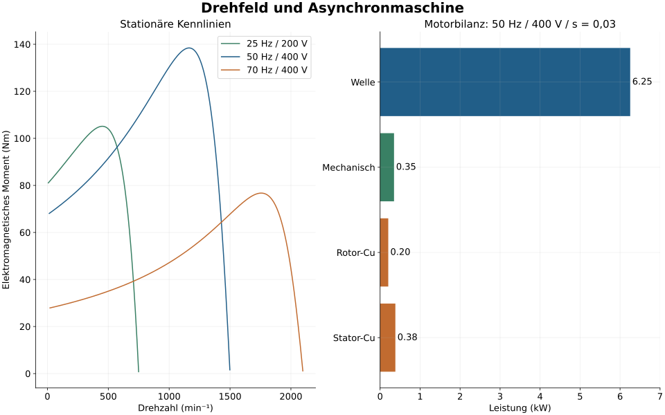

# M29-L2 – Elektrische Maschinen: Drehfeld, Drehmoment und Ersatzschaltbild {#L2}

**Kursbereich:** M29 – Bachelor–Master-Brücke: Übergang Leistungselektronik und elektrische Maschinen

**Niveau:** Bachelor · Bachelor–Master-Brücke

**Vorwissen:** [M29-L1](M29-L1.md), [M9-L1](M9-L1.md).

**Lernziel:** Schlupf, Drehmoment und Rotorverluste aus einem stationären Ersatzschaltbild berechnen.

## Drehfeld und Schlupf {#S1}

Drei räumlich um 120 elektrische Grad verschobene sinusförmig gespeiste Wicklungen erzeugen im Grundwellenmodell eine umlaufende magnetomotorische Kraft mit konstantem Betrag. Bei $p$ Polpaaren gelten $\omega_s=2\pi f/p$ und $n_s=60 f/p$ in min$^{-1}$. Die elektrische Rotorfrequenz im motorischen Betrieb ist $sf$ mit $s=(n_s-n)/n_s$. Bei 50 Hz und zwei Polpaaren ist die synchrone Drehzahl 1500 min$^{-1}$, bei 1455 min$^{-1}$ ist $s=0{,}03$. Die Rotorspannung wird durch die Relativbewegung induziert. Bei synchroner Drehzahl verschwindet die Rotorinduktion im idealen stationären Modell.

## Einphasiges Ersatzschaltbild {#S2}

Für eine symmetrische Asynchronmaschine wird je Strang mit Effektivwerten gerechnet, alle Rotorgrößen sind auf die Statorseite bezogen. Die Statorimpedanz ist $Z_1=R_1+jX_1$, der Rotorzweig $Z_2=R'_2/s+jX'_2$ und der Magnetisierungszweig $Z_m=jX_m$. Eisenverluste werden in diesem Modell weggelassen.

$$I_1=\frac{U_{str}}{Z_1+(Z_2^{-1}+Z_m^{-1})^{-1}},\quad E=U_{str}-Z_1I_1,\quad I'_2=E/Z_2.$$

Der Schlupfwiderstand enthält zwei Anteile: $R'_2/s=R'_2+R'_2(1-s)/s$. Nur der erste entspricht Rotor-Kupferverlusten; der zweite repräsentiert mechanische Umwandlung. Es handelt sich nicht um einen tatsächlich eingebauten Widerstand.

## Energiepfad und Drehmoment {#S3}

$$P_{Cu1}=3R_1|I_1|^2,\quad P_\delta=3\frac{R'_2}{s}|I'_2|^2,\quad P_{Cu2}=sP_\delta,$$

$$P_{um}=(1-s)P_\delta,\quad M_e=P_\delta/\omega_s,\quad P_{Welle}=P_{um}-P_{mech}.$$

Die mechanische Leistung ergibt sich auch aus $M_e\omega$ mit $\omega=(1-s)\omega_s$. Bei Beschleunigung ist zusätzlich $J\dot\omega=M_e-M_{Last}-M_{Reib}$ zu lösen; die stationäre Kennlinie allein bestimmt keine Zeitantwort. Für den Lehrmotor gelten bei 50 Hz $R_1=0{,}8$, $R'_2=0{,}6$, $X_1=X'_2=1{,}3$, $X_m=35$ Ohm. Bei 400 V, Stern und $s=0{,}03$ ergibt sich $|I_1|=12{,}612$ A, $P_\delta=6805{,}95$ W, $M_e=43{,}33$ Nm und $P_{Cu2}=204{,}18$ W. Die Statorverluste betragen 381,73 W. Reibungs- und Lüfterverluste werden in [M29-L5](M29-L5.md) separat modelliert.

{alt="Drehmoment-Drehzahl-Kennlinien bei drei Frequenzen und aufgeteilte Wirkleistung am Beispielarbeitspunkt."}

## Frequenzvariation und Modellgrenzen {#S4}

Die Reaktanzen sind im linearen Modell proportional zu $f$. Für konstante Flussverkettung wird näherungsweise $U/f$ konstant gehalten, weil die induzierte Spannung proportional zu Frequenz und Fluss ist. Bei kleiner Frequenz wird der Spannungsabfall an $R_1$ relativ groß; ein konstantes Klemmenspannungs-Verhältnis garantiert daher keinen konstanten Fluss. Oberhalb der Grundfrequenz begrenzt die verfügbare Spannung den Fluss (Feldschwächung). Sättigung, Skin-Effekt und Temperaturabhängigkeit fehlen hier. Bei großen Schlupfwerten kann der Rotorwiderstand frequenzabhängig sein. Der stationäre Berechnungspunkt ist nur dann ein tatsächlicher Arbeitspunkt, wenn das Lastdrehmoment dazu passt.

## Übungen mit Lösungen {#S5}

1. Vier Polpaare, 60 Hz: **Lösung:** 900 min$^{-1}$ synchron.
2. 50 Hz, zwei Polpaare, 1410 min$^{-1}$: **Lösung:** $s=0{,}06$, Rotorfrequenz 3 Hz.
3. $P_\delta=5$ kW und $s=0{,}04$: **Lösung:** 200 W Rotor-Kupferverlust, 4,8 kW umgewandelte Leistung vor mechanischen Verlusten.
4. Warum hat ein Motor bei Stillstand trotz Drehmoment keine Wellenleistung? **Lösung:** $\omega=0$; im idealisierten Asynchronmodell wird bei $s=1$ die Luftspaltleistung im Rotor in Wärme umgesetzt.

## Quellen {#S6}

- [MIT OpenCourseWare – 6.685 Electric Machines, Course Notes](https://ocw.mit.edu/courses/6-685-electric-machines-fall-2013/pages/course-notes/) · Kapitelübersicht 4, 8 und 10: Synchron- und Asynchronmaschinen sowie Regelung; keine erneute Kapitelprüfung. · Zuletzt abgerufen: 2026-11-25
