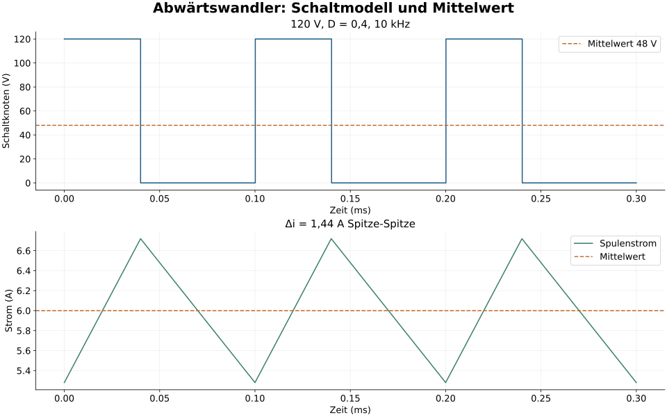

# M29-L3 – Gleichstromwandler: Schaltzustände, Tastgrad und gemitteltes Modell {#L3}

**Kursbereich:** M29 – Bachelor–Master-Brücke: Übergang Leistungselektronik und elektrische Maschinen

**Niveau:** Bachelor · Bachelor–Master-Brücke

**Vorwissen:** [M9-L3](M9-L3.md), [M12-L2](M12-L2.md).

**Lernziel:** Schalt- und Mittelwertmodelle eines idealen Buck-Wandlers unterscheiden und ihre Voraussetzungen prüfen.

## Zwei Schaltzustände {#S1}

Eine ideale DC-Quelle $V_g$ speist über einen Schalter eine Spule $L$, einen Ausgangskondensator $C$ und eine resistive Last $R$. Der Freilaufzweig stellt bei ausgeschaltetem Hauptschalter den Strompfad bereit. Für kontinuierlichen Spulenstrom und ideale Elemente gilt mit $q\in\{0,1\}$:

$$L\dot i=qV_g-v,\qquad C\dot v=i-v/R.$$

Die Zustände sind $i$ und $v$; der Schaltzustand bestimmt die Spannung am Spuleneingang. Das ideale Modell besitzt keine Schaltverluste. Für eine Diode gilt der Ausschaltzustand nur solange der Strom positiv ist. Bei Strom null kann ein dritter Zustand auftreten.

## Periodische Bilanz {#S2}

Mit Schaltperiode $T_s=1/f_s$ und Tastgrad $D=t_{on}/T_s$ erzwingt periodischer Spulenstrom die verschwindende mittlere Spulenspannung:

$$0=\int_0^{T_s}(qV_g-v)\,dt/T_s=DV_g-\bar v.$$

Bei geringer Spannungswelligkeit folgt $\bar v=DV_g$ und näherungsweise

$$\Delta i_{pp}=(V_g-\bar v)DT_s/L=\bar v(1-D)T_s/L.$$

Beispiel: 120 V Eingang, 48 V Ausgang, $L=2$ mH, 10 kHz. $D=0{,}4$, $\Delta i_{pp}=1{,}44$ A. Bei 6 A Mittelwert liegen die Stromgrenzen bei 5,28 und 6,72 A; bei 0,5 A Mittelwert wäre die kontinuierliche Annahme für einen diodenbasierten Buck verletzt. Bei 100 µF und idealem Kondensator liefert die Dreiecksnäherung $\Delta v_{pp}\approx\Delta i_{pp}/(8f_sC)=0{,}18$ V. Diese Näherung vernachlässigt den Serienwiderstand und die Rückwirkung der Spannungswelligkeit auf den Strom.

{alt="Schaltknotenspannung und periodischer dreieckförmiger Spulenstrom bei konstant angenommener Ausgangsspannung."}

## Gemitteltes Zustandsmodell {#S3}

Für langsam im Vergleich zur Schaltperiode veränderliche Größen ersetzen wir $q$ durch $d(t)$:

$$\dot{\bar i}=(dV_g-\bar v)/L,\qquad \dot{\bar v}=(\bar i-\bar v/R)/C.$$

Am Arbeitspunkt $D_0,V_{g0}$ gilt $V_0=D_0V_{g0}$, $I_0=V_0/R$. Bei kleiner Abweichung ist

$$L\delta\dot i=V_{g0}\delta d+D_0\delta V_g-\delta v,\qquad C\delta\dot v=\delta i-\delta v/R.$$

Für konstanten Eingang ergibt sich $G_{vd}(s)=V_{g0}/(LCs^2+(L/R)s+1)$. Das Modell eignet sich zur langsamen Reglerauslegung, nicht zur Bestimmung von Schaltflanken, elektromagnetischer Verträglichkeit oder Spitzenbelastung. Ein Tastgrad außerhalb von null bis eins ist nicht verfügbar.

## Modellvergleich und Energie {#S4}

Der momentane Speicherinhalt lautet $W=Li^2/2+Cv^2/2$. Aus den Schaltgleichungen folgt $\dot W=qV_gi-v^2/R$. Über eine Periode im eingeschwungenen Zustand ist die Änderung null, also stimmt die mittlere Eingangsleistung mit der Lastleistung überein. Das gemittelte Modell erhält eine vergleichbare Bilanz für seine geglätteten Zustände, bildet aber zusätzliche RMS-Verluste durch Welligkeit nicht ab. Für dreieckförmige Welligkeit gilt $I_{rms}^2=\bar I^2+\Delta i_{pp}^2/12$. Bei 6 A und 1,44 A Spitze-Spitze beträgt der Effektivwert 6,014 A.

## Übungen mit Lösungen {#S5}

1. 120 V auf 36 V: **Lösung:** $D=0{,}3$ im idealen kontinuierlichen Betrieb.
2. Verdopple die Frequenz bei den Beispieldaten: **Lösung:** 0,72 A Stromwelligkeit, unter gleicher Spannungsannahme.
3. Wie lautet die stationäre Last bei 48 V, 6 A? **Lösung:** 8 Ohm und 288 W; der ideale mittlere Eingangsstrom ist 2,4 A.
4. Warum ist ein gemitteltes Modell bei einer Schaltfrequenzanalyse ungeeignet? **Lösung:** Die Trägerfrequenz und ihre Spektrallinien sind aus den Zuständen entfernt.

## Quellen {#S6}

- [MIT OpenCourseWare – 6.622 Power Electronics, Vorlesungen 5, 6, 19 und 23](https://ocw.mit.edu/courses/6-622-power-electronics-spring-2023/video_galleries/video-lectures/) · Videovorlesungen 5–8 (Übersicht): DC/DC-Wandler. · Zuletzt abgerufen: 2026-11-25
