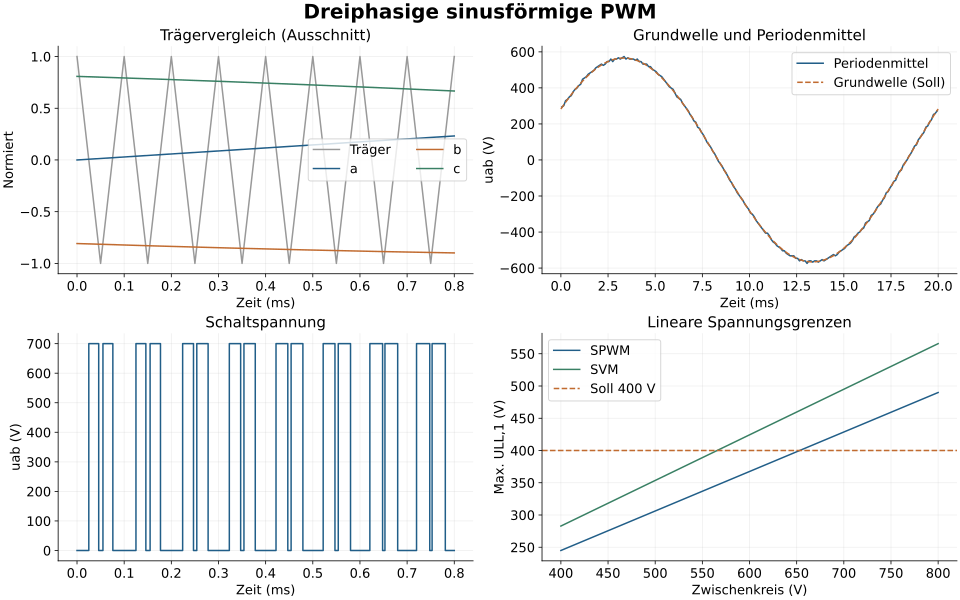

# M29-L4 – Wechselrichter und elektrische Antriebe: Grundschwingung, PWM und Modellgrenzen {#L4}

**Kursbereich:** M29 – Bachelor–Master-Brücke: Übergang Leistungselektronik und elektrische Maschinen

**Niveau:** Bachelor · Bachelor–Master-Brücke

**Vorwissen:** [M29-L1](M29-L1.md), [M29-L3](M29-L3.md), [M9-L4](M9-L4.md).

**Lernziel:** Die erreichbare Grundwellenspannung aus dem Zwischenkreis ableiten und den Gültigkeitsbereich der PWM einordnen.

## Zweipunktbrücke {#S1}

Drei Halbbrücken werden von einem DC-Zwischenkreis $V_{dc}$ gespeist. Der obere Schaltzustand $q_k=1$ verbindet den jeweiligen Leiter ideal mit der positiven Schiene, $q_k=0$ mit der negativen. Bezogen auf die negative Schiene ist $v_{k-}=q_kV_{dc}$. Die Leiter-Leiter-Spannung $v_{ab}=(q_a-q_b)V_{dc}$ nimmt die Werte $-V_{dc},0,+V_{dc}$ an. In einer symmetrischen Sternlast ohne Neutralleiteranschluss verschiebt sich das Sternpunktpotential; die Polspannung ist nicht die Motorspannung gegen den Sternpunkt. Die idealisierte Darstellung enthält keine realen Schaltverzögerungen.

## Sinusförmige Trägermodulation {#S2}

Mit einem normierten symmetrisch dreieckförmigen Träger zwischen -1 und +1 werden drei Referenzen $r_a=m\sin\omega t$, $r_b=m\sin(\omega t-2\pi/3)$ und $r_c=m\sin(\omega t+2\pi/3)$ verglichen. Der obere Schalter ist im idealen Vergleichsmodell aktiv, wenn die Referenz größer als der Träger ist. Im linearen Bereich $0\le m\le1$ ergibt sich bei hinreichend hoher Trägerfrequenz näherungsweise $d_k=(1+r_k)/2$. Die Grundschwingung der Polspannung gegen Zwischenkreismitte hat Spitzenwert $mV_{dc}/2$. Durch Subtraktion zweier Phasen ergibt sich

$$U_{LL,1}=\frac{\sqrt3}{2\sqrt2}mV_{dc},\qquad m=\frac{2\sqrt2 U_{LL,1}}{\sqrt3 V_{dc}}.$$

Bei 700 V Zwischenkreis sind maximal 428,66 V Leiter-Leiter-Grundschwingung (Effektivwert) verfügbar. Für 400 V ist $m=0{,}933$. Bei 540 V wären maximal 330,68 V möglich; 400 V verlangen $m=1{,}210$ und sind mit linearer SPWM nicht darstellbar. Raumzeigermodulation beziehungsweise gezielte Nullsystemeinspeisung vergrößert die linear nutzbare Spannung auf $V_{dc}/\sqrt2$ (hier 381,84 V bei 540 V), was in diesem Beispiel ebenfalls nicht ausreicht. Übermodulation verändert die Grundwelle und Oberschwingungen und wird nicht als lineares Verfahren behandelt.

{alt="Referenzen und Träger, Leiter-Leiter-Schaltspannung, ihre Grundschwingung sowie lineare Spannungsgrenze."}

## Vom Spannungsimpuls zum Motorstrom {#S3}

Die Maschineninduktivitäten begrenzen die Stromänderung, nicht die Spannungssprünge. In einem einfachen Strangmodell folgt $L\dot i=v-Ri-e$, wobei $e$ die induzierte Spannung repräsentiert. Eine kürzere Schaltperiode reduziert bei ähnlichen Arbeitspunkten die Stromwelligkeit. Gleichzeitig steigen bei ungefähr gleicher Energie je Schaltvorgang die Schaltverluste proportional zur Schaltfrequenz. Eine höhere Trägerfrequenz ist also nicht kostenlos. Das Grundwellen-Ersatzschaltbild aus [M29-L2](M29-L2.md) kann mittlere Wirk- und Blindleistung schätzen, nicht aber Lagerströme, Spitzenspannungen, Oberschwingungsverluste oder Drehmomentwelligkeit.

## Energiebilanz und reale Grenzen {#S4}

Ein idealer Wandler erfüllt $\overline{V_{dc}I_{dc}}=P_{AC}$; reale Verluste ergänzen die rechte Seite. Blindleistung der Maschine verursacht keine zusätzliche mittlere Nettoenergie im idealen DC-Eingang, erhöht aber die Halbleiterstrombeanspruchung. Totzeit verhindert gleichzeitiges Einschalten beider Schalter eines Zweiges und beeinflusst die mittlere Spannung stromrichtungsabhängig. Temperatur, Halbleiterkennlinien und Zwischenkreiswelligkeit müssen bei realen Verlust- und Sicherheitsnachweisen berücksichtigt werden. Hier werden nur mathematische Modelle gerechnet, keine Ansteueranleitung für einen Netzspannungsaufbau gegeben.

## Übungen mit Lösungen {#S5}

1. 600 V Zwischenkreis, $m=0{,}8$: **Lösung:** 293,94 V Leiter-Leiter-Grundwellen-Effektivwert.
2. Minimaler DC-Betrag für 400 V lineare SPWM: **Lösung:** $2\sqrt2\cdot400/\sqrt3=653{,}20$ V.
3. Warum sind 400 V Effektivwert kein 400-V-Spitzenwert? **Lösung:** Sinus-Spitzenwert ist $\sqrt2$ mal Effektivwert.
4. Weshalb reicht eine Grundwellenrechnung nicht zur Auslegung der Zwischenkreiskondensatoren? **Lösung:** Sie sagt nichts über hochfrequente Pulsströme und entsprechende RMS-Belastung aus.

## Quellen {#S6}

- [MIT OpenCourseWare – 6.622 Power Electronics, Vorlesungen 5, 6, 19 und 23](https://ocw.mit.edu/courses/6-622-power-electronics-spring-2023/video_galleries/video-lectures/) · Videovorlesungen 17–19 und 23 (Übersicht): Wechselrichter. · Zuletzt abgerufen: 2026-11-25
- [MIT OpenCourseWare – 6.685 Electric Machines, Course Notes](https://ocw.mit.edu/courses/6-685-electric-machines-fall-2013/pages/course-notes/) · Kapitelübersicht 9–10: Maschinenmodelle und Antriebsregelung; PWM wird separat durch 6.622 eingeordnet. · Zuletzt abgerufen: 2026-11-25
