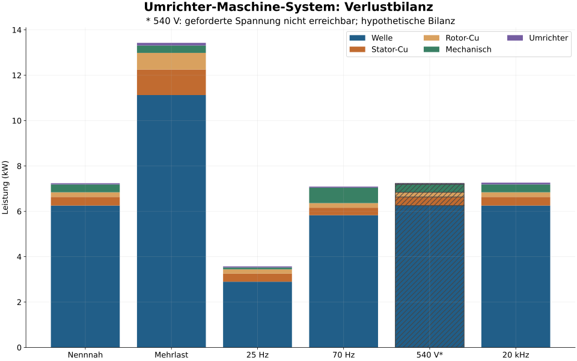

# M29-L5 – Arbeitsprobe: Leistungs- und Verlustbilanz eines idealisierten Umrichter-Maschine-Systems {#L5}

**Kursbereich:** M29 – Bachelor–Master-Brücke: Übergang Leistungselektronik und elektrische Maschinen

**Niveau:** Bachelor · Bachelor–Master-Brücke

**Vorwissen:** [M29-L1](M29-L1.md) bis [M29-L4](M29-L4.md), [M9-L5](M9-L5.md).

**Lernziel:** Ein stationäres Antriebssystem berechnen, die Bilanz schließen und die Umsetzbarkeit getrennt bewerten.

## Aufgabenstellung und Annahmen {#S1}

Ein Umrichter speist eine symmetrische Asynchronmaschine mit zwei Polpaaren. Nutze die Parameter aus [M29-L2](M29-L2.md), eine mechanische Verlustleistung $P_{mech}=b\omega^2$ mit $b=0{,}015$ Nm s und das folgende vereinfachte Inverter-Verlustmodell. Die Eingangsquelle liefert eine konstante Zwischenkreisspannung. Die Frequenz, die Leiter-Leiter-Grundwellenspannung und der Schlupf sind vorgegeben; damit wird kein geschlossener Drehzahlregelkreis simuliert. Das notwendige Lastdrehmoment wird durch $P_{Welle}/\omega$ bestimmt.

Für das didaktische Verlustmodell sei

$$P_{inv}=3R_{eff}|I_1|^2+6f_s E_0\frac{V_{dc}}{700\,\mathrm V}\frac{|I_1|}{10\,\mathrm A},$$

mit $R_{eff}=0{,}05$ Ohm und $E_0=0{,}35$ mJ als effektivem Energieparameter pro Zweig-Schaltvorgang (sechs Vorgänge je Trägerperiode im Modell). Das ist keine Datenblatt-Auslegung: Schaltstrom, Temperatur, Freilaufpfade und die konkrete Modulation werden nicht einzeln integriert. Eisenverluste und zusätzliche PWM-Verluste der Maschine sind nicht enthalten.

## Bilanz und Bewertung {#S2}

Die stationäre Wirkleistung des Motors ist $P_{AC}=3\operatorname{Re}(U_{str}I_1^*)$. Es muss gelten:

$$P_{AC}=P_{Cu1}+P_{Cu2}+P_{mech}+P_{Welle},\qquad P_{DC}=P_{AC}+P_{inv}.$$

Der Gesamtwirkungsgrad lautet $\eta=P_{Welle}/P_{DC}$; der Leistungsfaktor der Maschine ist dagegen $P_{AC}/|S|$. Für die lineare SPWM ist zusätzlich $m\le1$ notwendig. Ein ausgeglichenes Leistungsbudget beweist daher noch nicht, dass der Wandler die geforderte Spannung liefern kann. Ein niedrigerer Zwischenkreis wird als hypothetischer Sollpunkt geprüft; seine berechneten Leistungswerte sind keine real erreichbaren Betriebswerte.

Setze als Vergleichsgrenzen 16 A Grundwellenstrom und 700 V Zwischenkreis im Normalmodell. Die 16-A-Grenze ist rein didaktisch; sie ist kein Geräte-Nennstrom oder Nachweis der thermischen Belastbarkeit.

## Reproduzierbares Berechnungsmodell {#S3}

Das Programm benötigt Python und NumPy. Es berechnet sechs stationäre Fälle und prüft je Fall die Motor- und Gesamtleistungsbilanz. Die zusätzliche Buck-Rechnung prüft die Übereinstimmung der Stromänderung in beiden Schaltzuständen. Alle Fälle verwenden 700 V und 10 kHz, sofern nicht anders angegeben.

```python
import numpy as np
# Balanced induction machine, per-phase RMS, parameters at 50 Hz
R1,R2,X1,X2,Xm=0.8,0.6,1.3,1.3,35.0
p=2

def point(f,U,s,Vdc=700,fs=10000):
    assert f>0 and 0<s<1
    k=f/50; w=2*np.pi*f/p; V=U/np.sqrt(3)
    Z1=R1+1j*X1*k; Z2=R2/s+1j*X2*k; Zm=1j*Xm*k
    I=V/(Z1+1/(1/Z2+1/Zm)); E=V-I*Z1; J=E/Z2
    S=3*V*np.conj(I); Pcu1=3*R1*abs(I)**2; Pgap=3*R2/s*abs(J)**2; Pcu2=s*Pgap
    Pconv=(1-s)*Pgap; omega=(1-s)*w; T=Pgap/w
    Pmech=0.015*omega**2; Pshaft=Pconv-Pmech
    # simplified total inverter conduction + switching loss (effective model)
    Pinv=3*0.05*abs(I)**2+6*0.00035*(Vdc/700)*(abs(I)/10)*fs
    Pdc=S.real+Pinv; m=2*np.sqrt(2)*V/Vdc
    assert np.isclose(S.real,Pcu1+Pgap) and np.isclose(Pdc,Pshaft+Pcu1+Pcu2+Pmech+Pinv)
    return dict(f=f,U=U,s=s,I=abs(I),P=S.real,Q=S.imag,PF=S.real/abs(S),n=omega*60/(2*np.pi),T=T,Pshaft=Pshaft,Pcu1=Pcu1,Pcu2=Pcu2,Pmech=Pmech,Pinv=Pinv,Pdc=Pdc,eta=Pshaft/Pdc,m=m)

cases=[('Nennnah',50,400,.03,700,10000),('Mehrlast',50,400,.06,700,10000),('Teildrehzahl',25,200,.06,700,10000),('Feldschwächung',70,400,.03,700,10000),('Niedriger Zwischenkreis',50,400,.03,540,10000),('Hohe Schaltfrequenz',50,400,.03,700,20000)]
if __name__=='__main__':
    for name,*args in cases:
        r=point(*args);print(name, ' '.join(f'{k}={r[k]:.3f}' for k in ['I','P','Q','PF','n','T','Pshaft','Pcu1','Pcu2','Pmech','Pinv','Pdc','eta','m']))
    # ideal buck, triangular ripple: exact periodic current at constant output voltage
    Vg,Vo,L,fs=120,48,.002,10000; D=Vo/Vg; Ts=1/fs
    di=(Vg-Vo)*D*Ts/L
    assert np.isclose(di,Vo*(1-D)*Ts/L)
    print('buck',D,di)
```

## Ergebnisse und Interpretation {#S4}

| Fall | I (A) | n (min⁻¹) | $M_e$ (Nm) | Welle (W) | Umrichterverlust (W) | DC (W) | $\eta$ (%) | m |
| --- | ---: | ---: | ---: | ---: | ---: | ---: | ---: | ---: | ---: |
| Nennnah | 12,61 | 1455 | 43,33 | 6253,5 | 50,3 | 7238,0 | 86,40 | 0,933 |
| Mehrlast | 21,68 | 1410 | 77,57 | 11125,9 | 116,0 | 13428,0 | 82,86 | 0,933 |
| Teildrehzahl | 12,17 | 705 | 40,35 | 2897,2 | 47,8 | 3572,4 | 81,10 | 0,467 |
| Feldschwächung | 11,79 | 2037 | 30,52 | 5827,4 | 45,6 | 7090,4 | 82,19 | 0,933 |
| Niedriger Zwischenkreis | 12,61 | 1455 | 43,33 | 6253,5 | 44,3 | 7232,0 | 86,47 | 1,210 |
| Hohe Schaltfrequenz | 12,61 | 1455 | 43,33 | 6253,5 | 76,8 | 7264,5 | 86,08 | 0,933 |

{alt="Elektrische Eingangsleistung, Wellenleistung und Verlustanteile in sechs Arbeitspunkten; Zwischenkreisfall als unzulässiger Sollpunkt markiert."}

Im nennnahen Fall gehen von 7238,02 W insgesamt 984,49 W als modellierte Verluste ab. Der Motor benötigt 7187,68 W Wirkleistung und 4968,24 var Blindleistung; der Leistungsfaktor ist 0,823. Das Lastdrehmoment ist kleiner als das elektromagnetische Drehmoment, weil die mechanischen Verluste abgezogen werden. Mehrlast erhöht den Strom auf 21,68 A, verletzt damit die gewählte 16-A-Grenze und erhöht besonders die statorseitigen Kupferverluste. Bei 25 Hz und 200 V wird trotz ähnlicher Drehmomentgröße weniger Wellenleistung abgegeben. Bei 70 Hz und 400 V sinkt das Drehmoment im Vergleich zum 50-Hz-Punkt bei gleich gewähltem Schlupf; die hohe Drehzahl erhöht die mechanischen Verluste. Die Verdopplung der Schaltfrequenz verändert die Grundwellenwerte im Modell nicht, erhöht die Umrichterverluste aber um rund 26,49 W. Der 540-V-Fall ist mit der geforderten Grundwellenspannung unzulässig; der scheinbar höhere Wirkungsgrad ist daher nicht als erreichbare Verbesserung zu interpretieren.

Eine unabhängige Plausibilitätsprüfung vergleicht $P_{um}$ mit $M_e\omega$, prüft die Einheit Nm = W/(rad/s) und kontrolliert, dass $P_{Cu2}/P_\delta=s$ gilt. Die Energiebeziehung gilt stationär; beim Hochlauf wären Änderungen der magnetischen, elektrischen und mechanischen Speicher zu erfassen. Eine reale Validierung würde Messwerte von DC-Leistung, dreiphasiger Wirkleistung, Drehzahl und Wellenmoment bei definiertem thermischem Zustand erfordern. Modell- und Messunsicherheit müssen dann getrennt ausgewiesen werden.

## Arbeitsprobe und Lösungen {#S5}

1. Rechne den Normalfall nach und bestimme das Lastdrehmoment. **Lösung:** $\omega=152{,}37$ rad/s, $M_{Last}=6253{,}53/152{,}37\approx41{,}04$ Nm. Die Differenz zu $M_e$ beträgt rund 2,29 Nm.
2. Welche Mindest-Zwischenkreisspannung wäre bei 540 V Istwert für die verlangten 400 V mit SPWM nötig? **Lösung:** 653,20 V; die Differenz beträgt 113,20 V.
3. Bestimme im Normalfall die DC-Stromaufnahme bei konstanter Spannung. **Lösung:** 7238,02 W / 700 V = 10,34 A im Mittel.
4. Variiere $R_1$ um +20 % bei konstanten Sollgrößen und stelle den resultierenden Strom, Wirkungsgrad und Drehmoment dem Ausgangsfall gegenüber. Erkläre, warum eine reine nachträgliche Verlustkorrektur nicht reicht. **Lösung:** Das Ersatzschaltbild verändert zugleich den Strom und die Spannung am Parallelzweig. Die neue Bilanz muss vollständig gerechnet werden. Setze im Programm `R1 = 0.96` und rufe `point(50,400,0.03)` auf. Ergebnis: 12,52 A, 85,43 % und 42,71 Nm.
5. Abnahmekriterien für die Arbeitsprobe: dokumentierte Eingaben, geschlossenes Leistungsbudget, korrekte Einheiten, separate Kennzeichnung unzulässiger Betriebspunkte und benannte fehlende Verlustmechanismen. Ein realer Anlagenentwurf verlangt zusätzlich Mess- und Schutzkonzept; diese Rechnung ist keine Hardwarefreigabe.

## Quellen {#S6}

- [MIT OpenCourseWare – 6.685 Electric Machines, Course Notes](https://ocw.mit.edu/courses/6-685-electric-machines-fall-2013/pages/course-notes/) · Kapitelübersicht 3 und 8–10: Verlustmechanismen und Maschinenmodelle; eigene Bilanzrechnung der Lektion. · Zuletzt abgerufen: 2026-11-25
- [MIT OpenCourseWare – 6.622 Power Electronics, Vorlesungen 5, 6, 19 und 23](https://ocw.mit.edu/courses/6-622-power-electronics-spring-2023/video_galleries/video-lectures/) · Videovorlesungen 15–16 (Übersicht): Schaltverluste und thermische Modelle; Teilaspekt. · Zuletzt abgerufen: 2026-11-25
