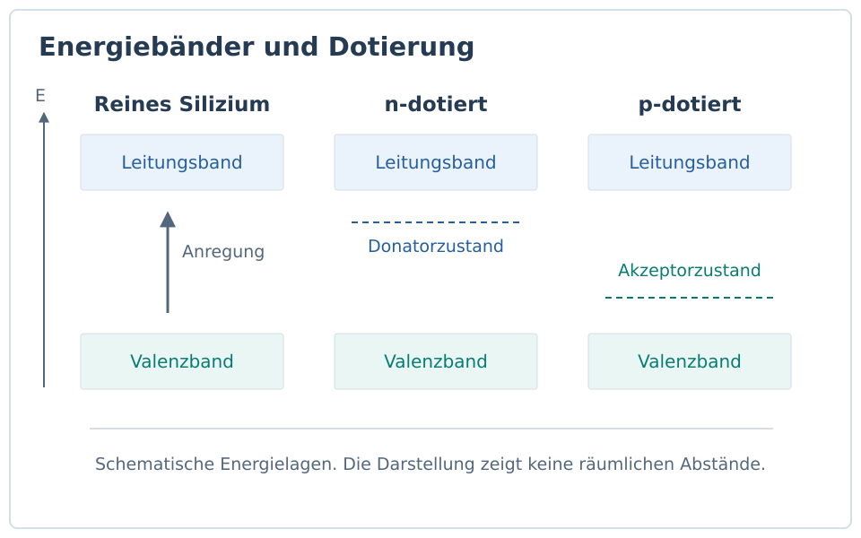

# M3-L1 – Leitfähigkeit, Ladungsträger und Halbleiter {#L1}

**Kursbereich:** M3 – Bachelor: Halbleiter, analoge Elektronik und Digitaltechnik

**Niveau:** Bachelor

**Vorwissen:** [Strom und Ladung](M1-L1.md) sowie [Widerstand und spezifischer Widerstand](M1-L2.md).

**Lernziel:** Du erklärst den Unterschied zwischen Elektronen und Löchern, ordnest Dotierstoffe als Donatoren oder Akzeptoren ein und berechnest die Leitfähigkeit aus Dichten und Beweglichkeiten der Ladungsträger.

## Warum Silizium beide Rollen übernehmen kann {#S1}

Eine Siliziumprobe kann bei gleicher Geometrie einen hohen oder einen deutlich geringeren Widerstand haben. Entscheidend ist, wie viele bewegliche Ladungsträger verfügbar sind. Durch gezielt eingebrachte Fremdatome lässt sich diese Zahl verändern. Damit können Teile eines Kristalls unterschiedliche elektrische Eigenschaften erhalten. Der spätere pn-Übergang nutzt genau diese Möglichkeit.

Im **Valenzband** befinden sich bei niedriger Temperatur die meisten Elektronen, die an den Bindungen im Kristall beteiligt sind. Im **Leitungsband** können Elektronen zur Stromleitung beitragen. Zwischen beiden liegt die **Bandlücke**, ein Energiebereich ohne erlaubte Zustände des ungestörten Kristalls. Die Abbildung ordnet Zustände nach Energie. Ihre horizontale Richtung zeigt hier keine Ortskoordinate.

{alt="Energiebänder von reinem, n-dotiertem und p-dotiertem Silizium. Donatorzustände liegen unterhalb des Leitungsbands, Akzeptorzustände oberhalb des Valenzbands."}

In einem reinen Halbleiter kann thermische Anregung ein Elektron aus dem Valenzband in das Leitungsband überführen. Im Valenzband bleibt eine freie Stelle zurück. Benachbarte Elektronen können diese Stelle besetzen und hinterlassen dabei jeweils an anderer Stelle eine neue Lücke. Für den Transport lässt sich die Lücke als **Loch** mit positiver Ladung beschreiben. Bei der Entstehung eines Elektron-Loch-Paars sind beide Teilchendichten im reinen Halbleiter gleich.

## Donatoren und Akzeptoren {#S2}

Ein Donator im Silizium stellt bei ausreichender thermischer Anregung ein Elektron für das Leitungsband bereit. Das ionisierte Donatoratom bleibt ortsfest und positiv geladen. Elektronen sind in diesem **n-dotierten** Gebiet die Mehrheitsträger. Ein Akzeptor kann ein Elektron aus dem Valenzband aufnehmen. Das bleibt als negative Ladung am ortsfesten Akzeptor gebunden, während ein bewegliches Loch zurückbleibt. In einem **p-dotierten** Gebiet sind Löcher die Mehrheitsträger.

Ein n-dotiertes Gebiet besitzt deshalb im Volumen gewöhnlich keine negative Überschussladung. Die beweglichen Elektronen und die ionisierten, ortsfesten Dotieratome tragen gemeinsam zur Ladungsbilanz bei. Durch thermische Erzeugung gibt es auch in dotierten Proben Minderheitsträger. Deren Zahl kann für Bauelemente entscheidend sein, obwohl sie für die Leitfähigkeit einer gleichmäßig stark dotierten Probe oft wenig beitragen.

## Elektronen- und Lochstrom im Zahlenmodell {#S3}

Für ein homogenes Material bei kleinem Feld verwenden wir positive Beweglichkeiten $\mu_n$ für Elektronen und $\mu_p$ für Löcher. Beide Strombeiträge haben konventionell die Feldrichtung. Beim Elektron drehen sowohl die negative Ladung als auch die entgegengesetzte Drift das Vorzeichen um. Mit $q=1{,}602\cdot 10^{-19}\,\mathrm C$, Elektronendichte $n$ und Lochdichte $p$ ergibt sich die Leitfähigkeit

$$
\sigma=q(n\mu_n+p\mu_p).
$$

Bei Dichten in $\mathrm{m^{-3}}$ und Beweglichkeiten in $\mathrm{m^2/(V\,s)}$ erhältst du $\sigma$ in $\mathrm{S/m}$. Der spezifische Widerstand ist $\rho=1/\sigma$. Für Länge $\ell$ und Querschnitt $A$ folgt $R=\ell/(\sigma A)$.

Nimm für ein vereinfachtes Vergleichsmodell $\mu_n=0{,}135\,\mathrm{m^2/(V\,s)}$ und $\mu_p=0{,}048\,\mathrm{m^2/(V\,s)}$. Die intrinsische Probe habe $n=p=10^{16}\,\mathrm{m^{-3}}$. Dann ist $\sigma\approx 2{,}93\cdot 10^{-4}\,\mathrm{S/m}$. Für eine n-dotierte Probe mit $n=10^{21}\,\mathrm{m^{-3}}$ und vernachlässigbarem Lochanteil folgt $\sigma\approx21{,}6\,\mathrm{S/m}$. Eine p-dotierte Probe mit $p=10^{21}\,\mathrm{m^{-3}}$ kommt bei vernachlässigbarem Elektronenanteil auf $7{,}69\,\mathrm{S/m}$. Gleich viele Mehrheitsträger können also wegen unterschiedlicher Beweglichkeit unterschiedlich gut leiten.

## Selbstkontrolle {#S4}

1. Berechne für die n-dotierte Probe den Widerstand bei $\ell=1\,\mathrm{mm}$ und $A=0{,}01\,\mathrm{mm^2}$. Welcher Strom folgt im Modell bei $0{,}10\,\mathrm V$?
2. Eine p-dotierte Probe enthält doppelt so viele bewegliche Löcher wie im Beispiel. Was folgt, wenn die Beweglichkeit gleich bleibt? Welcher Teil dieser Annahme kann bei höherer Dotierung scheitern?

### Lösungen

**1.** $A=10^{-8}\,\mathrm{m^2}$. Einsetzen gibt $R\approx4{,}62\,\mathrm{k\Omega}$ und mit $I=U/R$ ungefähr $21{,}6\,\mathrm{\mu A}$.

**2.** Bei vernachlässigbarem Elektronenanteil verdoppelt sich $\sigma$ auf etwa $15{,}4\,\mathrm{S/m}$. In einer realen Probe hängt die Beweglichkeit unter anderem von Streuung an Fremdatomen und von der Temperatur ab. Eine Verdopplung der Dichte allein erzwingt dann keine Verdopplung der Leitfähigkeit.

## Wo das Modell endet {#S5}

Wir behandeln Dichten und Beweglichkeiten als vorgegebene, ortsunabhängige Größen. Kontaktwiderstände, Diffusion, Rekombination und hohe Felder sind im Vergleich ausgeklammert. Sobald p- und n-Gebiete zusammentreffen, können sich Ladungsträger schon ohne äußere Spannung umverteilen. Das untersucht [die Lektion über pn-Übergang und Gleichrichtung](M3-L2.md).

## Quellen {#S6}

- [OpenStax, University Physics Volume 3, § 9.6 „Semiconductors and Doping“](https://openstax.org/books/university-physics-volume-3/pages/9-6-semiconductors-and-doping) · Abschnitt 9.6 – Leitungsband, Löcher und Dotierung. · Zuletzt abgerufen: 2026-11-25
- [MIT OpenCourseWare, 6.012 „Microelectronic Devices and Circuits“, Vorlesungsnotizen](https://ocw.mit.edu/courses/6-012-microelectronic-devices-and-circuits-fall-2005/pages/lecture-notes/) · Ladungsträger, Drift und Halbleitergrundlagen. · Zuletzt abgerufen: 2026-11-25
