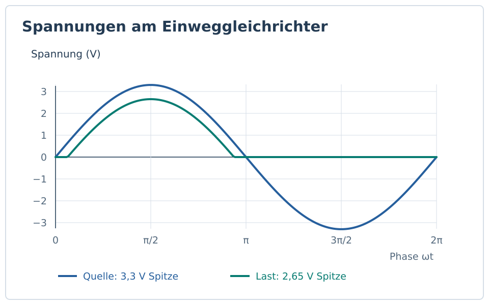

# M3-L2 – pn-Übergang, Diode und Gleichrichtung {#L2}

**Kursbereich:** M3 – Bachelor: Halbleiter, analoge Elektronik und Digitaltechnik

**Niveau:** Bachelor

**Vorwissen:** [Ladungsträger und Dotierung](M3-L1.md), [Ohmsches Gesetz](M1-L2.md) und [Maschenregel](M1-L3.md).

**Lernziel:** Du erkennst Sperr- und Durchlassrichtung, wählst ein passendes Diodenmodell und berechnest Spitzenwert und Mittelwert einer Einweggleichrichtung.

## Was an der Grenzfläche geschieht {#S1}

Beim Kontakt zwischen p- und n-Gebiet diffundieren Elektronen und Löcher zunächst aufgrund ihrer Konzentrationsunterschiede über den Übergang. In dessen Nähe rekombiniert ein Teil von ihnen. Auf der n-Seite bleiben ortsfeste, positiv ionisierte Donatoren zurück, auf der p-Seite negativ ionisierte Akzeptoren. Die so entstehende **Raumladungszone** enthält vergleichsweise wenige mobile Träger. Das elektrische Feld der ortsfesten Ladungen bewirkt eine Drift, die der Diffusion entgegenwirkt. Im thermischen Gleichgewicht verschwindet der Nettostrom.

Für die pn-Diode heißen p-Anschluss und n-Anschluss **Anode** und **Kathode**. Wir definieren $u_D=u_A-u_K$ und zählen $i_D$ von der Anode zur Kathode positiv. Bei äußerer positiver Spannung sinkt die Potentialbarriere des Übergangs. Der Durchlassstrom kann stark ansteigen. Bei negativer Spannung wächst die Sperrwirkung. Ein kleiner Sperrstrom und bei genügend großer Sperrspannung ein möglicher Durchbruch gehören zum realen Verhalten.

## Drei Rechenmodelle {#S2}

| Modell | Durchlass | Sperren | Einsatz |
| --- | --- | --- | --- |
| Idealer Schalter | $u_D=0$, $i_D\ge0$ | $i_D=0$, $u_D\le0$ | Strompfade und Polung bestimmen |
| Konstanter Durchlassabfall | $u_D=U_F$, $i_D\ge0$ | $i_D=0$, $u_D\le U_F$ | Überschlag in einem vorgegebenen Strombereich |
| Exponentialkennlinie | Strom wächst mit $u_D$ | kleiner negativer Strom vor dem Durchbruch | Arbeitspunkte und Stromänderungen untersuchen |

Die **Shockley-Gleichung** ist im passenden Bereich

$$
i_D=I_S\left(\exp\!\left(\frac{u_D}{\eta U_T}\right)-1\right),
\qquad U_T=\frac{k_\mathrm{B}T}{q}.
$$

Dabei bezeichnet $I_S$ den Sättigungsstrom, $\eta$ den Idealitätsfaktor, $T$ die absolute Temperatur und $U_T$ die Temperaturspannung. Bei $T$ nahe $300\,\mathrm K$ ist $U_T\approx25{,}85\,\mathrm{mV}$. Unabhängig vom folgenden Gleichrichtermodell liefern $I_S=10\,\mathrm{nA}$, $\eta=2$ und $u_D=0{,}60\,\mathrm V$ einen Strom von etwa $1{,}10\,\mathrm{mA}$. Ein konstanter Abfall ist damit eine Näherung für einen bestimmten Arbeitsbereich und keine scharfe Materialkonstante.

## Beispiel: Einweggleichrichter {#S3}

Eine ideale Quelle mit $u_s(t)=3{,}3\,\mathrm V\sin(\omega t)$ speist eine Reihenschaltung aus Diode und Last $R=1{,}0\,\mathrm{k\Omega}$. Die Anode liegt an der Quelle, die Kathode am oberen Anschluss der Last. Der untere Lastanschluss führt zurück zur Quelle. Verwende das Modell $U_F=0{,}65\,\mathrm V$.

{alt="Quellspannung und Lastspannung über eine Periode. Der Ausgang folgt dem positiven Teil der Quelle abzüglich 0,65 Volt, soweit das Ergebnis positiv ist."}

Für $u_s>U_F$ ergibt die Masche $u_R=u_s-U_F$. In der Sperrphase gibt es keinen Strom durch die Last, also ist $u_R=0$. Zusammen

$$
u_R(t)=\max\!\left(0,u_s(t)-U_F\right),\qquad i_R(t)=\frac{u_R(t)}R.
$$

Die Spitzenwerte sind $2{,}65\,\mathrm V$ und $2{,}65\,\mathrm{mA}$. Für den Mittelwert setzt du $\alpha=\arcsin(U_F/U_m)$ mit $U_m=3{,}3\,\mathrm V$. Der leitende Winkelbereich ist $\alpha<\omega t<\pi-\alpha$. Das Integral über eine ganze Periode liefert

$$
\overline{u_R}=
\frac{2U_m\cos\alpha-U_F(\pi-2\alpha)}{2\pi}
\approx0{,}746\,\mathrm V.
$$

Der Ausgang ist pulsierend. Einen Speicher zur Glättung enthält dieses Modell noch nicht.

## Selbstkontrolle {#S4}

1. Die Last wird auf $2{,}0\,\mathrm{k\Omega}$ erhöht. Bestimme im konstanten Durchlassmodell den Spitzenstrom und den mittleren Strom.
2. Eine ideale Brückentopologie nutzt bei jeder Halbwelle zwei leitende Dioden. Bestimme bei unveränderter Quelle und Last $1{,}0\,\mathrm{k\Omega}$ die Ausgangsspitze für $U_F=0{,}65\,\mathrm V$ je Diode.
3. Warum sperrt die Diode bei der Quellspannung $-3{,}3\,\mathrm V$ im Einweggleichrichter? Gib $u_D$ an.

### Lösungen

1. Die Ausgangsspannung bleibt im gewählten Modell gleich. Der Spitzenstrom halbiert sich auf $1{,}325\,\mathrm{mA}$, der Mittelwert auf $0{,}373\,\mathrm{mA}$.
2. Im Lastzweig bleiben $3{,}3\,\mathrm V-2\cdot0{,}65\,\mathrm V=2{,}0\,\mathrm V$.
3. Bei null Laststrom liegt die Kathode am unteren Bezugspotential. Damit ist $u_D=-3{,}3\,\mathrm V$ und die Sperrbedingung erfüllt.

## Grenzen und nächster Schritt {#S5}

Durchlassspannung, Sperrstrom und Schaltverhalten ändern sich mit Temperatur, Strom und Frequenz. Ein realer Gleichrichter kann außerdem durch die Quellimpedanz belastet werden. Bei abweichenden Anforderungen muss das Bauteilmodell diese Effekte erfassen. [Die nächste Lektion über Transistoren](M3-L3.md) ergänzt eine dritte Klemme, über die sich ein Strompfad steuern lässt.

## Quellen {#S6}

- [OpenStax, University Physics Volume 3, § 9.7 „Semiconductor Devices“](https://openstax.org/books/university-physics-volume-3/pages/9-7-semiconductor-devices) · Abschnitt 9.7 – Raumladungszone, Vorspannung und Diodenkennlinie. · Zuletzt abgerufen: 2026-11-25
- [MIT OpenCourseWare, 6.071J „Introduction to Electronics, Signals, and Measurement“, Vorlesungen 22–23](https://ocw.mit.edu/courses/6-071j-introduction-to-electronics-signals-and-measurement-spring-2006/pages/lecture-notes/) · nichtlineare Bauelemente und Diodenschaltungen. · Zuletzt abgerufen: 2026-11-25
