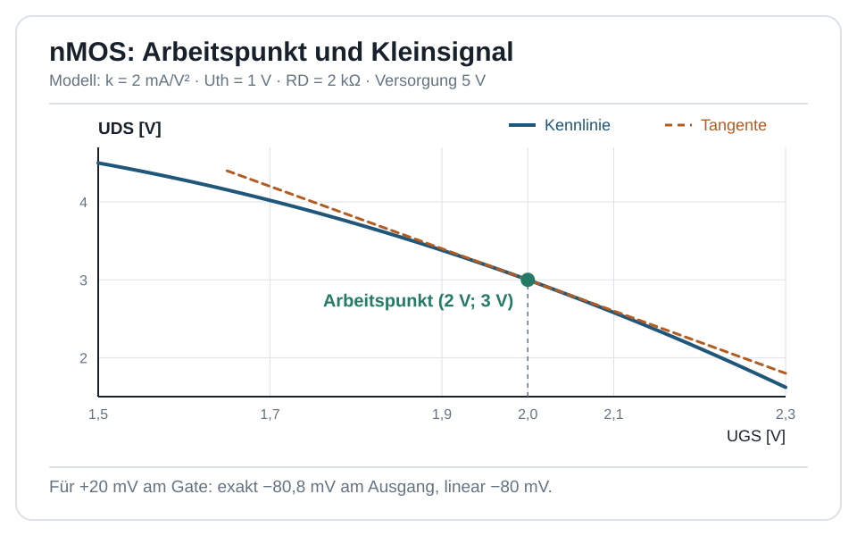

# M3-L3 – Transistoren als Schalter und Verstärker {#L3}

**Kursbereich:** M3 – Bachelor: Halbleiter, analoge Elektronik und Digitaltechnik

**Niveau:** Bachelor

**Vorwissen:** [Diodenkennlinien und Modellbereiche](M3-L2.md) sowie [Maschen- und Knotenregeln](M1-L3.md).

**Lernziel:** Du vergleichst BJT und MOSFET, prüfst den Betriebsbereich vor dem Rechnen und bestimmst für einen Verstärker Arbeitspunkt und kleine Signaländerung.

## Zwei Bauelemente mit drei Klemmen {#S1}

Am NPN-Bipolartransistor (BJT) heißen die Anschlüsse Basis, Kollektor und Emitter. Eine vorwärts gepolte Basis-Emitter-Strecke injiziert Ladungsträger. Bei rückwärts gepolter Basis-Kollektor-Strecke sammelt der Kollektor die meisten dieser Träger ein. In diesem vorwärtsaktiven Bereich ist $I_C\approx\beta I_B$ ein einfaches Modell mit Stromverstärkung $\beta$. Sinkt die Kollektorspannung zu weit, kann auch die Basis-Kollektor-Strecke vorwärts gepolt sein. Der BJT erreicht dann die **Sättigung**. Die Beziehung $I_C=\beta I_B$ sagt dort den Kollektorstrom nicht mehr voraus.

Beim n-Kanal-Anreicherungs-MOSFET steuert ein elektrisches Feld am isolierten Gate die Ausbildung eines Kanals zwischen Drain und Source. Das einfache Gleichstrommodell setzt den Gatestrom zu null. Beim Umschalten muss die Gatekapazität dennoch geladen oder entladen werden. Mit $u_{GS}$ unterhalb der Modellschwelle $U_\mathrm{th}$ sperrt der nMOS näherungsweise. Oberhalb der Schwelle hängt das Verhalten auch von $u_{DS}$ ab.

| Rolle | BJT | nMOS mit $u_{DS}\ge0$ |
| --- | --- | --- |
| Ausgeschalteter Schalter | kein nennenswerter Basis- oder Kollektorstrom | vereinfacht $u_{GS}<U_\mathrm{th}$ |
| Leitender Schalter mit kleinem Spannungsabfall | meist BJT-Sättigung | kleiner $u_{DS}$ im ohmschen Bereich bei ausreichender Gateansteuerung |
| Analoger Verstärker | vorwärtsaktiver Bereich | möglicher Betrieb in MOSFET-Sättigung bei $u_{DS}\ge u_{GS}-U_\mathrm{th}>0$ |

Der gleiche Begriff „Sättigung“ bezeichnet beim BJT und beim MOSFET verschiedene Modelle.

## Schaltzustände aus der äußeren Schaltung bestimmen {#S2}

Ein NPN hat geerdeten Emitter, einen Kollektorwiderstand $1{,}0\,\mathrm{k\Omega}$ an $5\,\mathrm V$ und einen Basiswiderstand $100\,\mathrm{k\Omega}$ an einer Steuerspannung $2{,}0\,\mathrm V$. Setze näherungsweise $U_{BE}=0{,}70\,\mathrm V$ und $\beta=100$. Daraus folgt

$$
I_B=13\,\mathrm{\mu A},\qquad
I_C\approx1{,}30\,\mathrm{mA},\qquad
U_{CE}=5\,\mathrm V-I_C(1{,}0\,\mathrm{k\Omega})=3{,}70\,\mathrm V.
$$

$U_C>U_B$ bestätigt die vorwärtsaktive Annahme. Falls der Basiswiderstand bei derselben Steuerspannung auf $10\,\mathrm{k\Omega}$ sinkt, würde die aktive Formel $13\,\mathrm{mA}$ verlangen. Das hiesige Lastnetz liefert bei $U_{CE}=0{,}20\,\mathrm V$ im Sättigungsmodell $4{,}8\,\mathrm{mA}$. Für diesen stark angesteuerten Fall ist der aktive Ansatz unvereinbar mit der Maschengleichung.

Bei einem als Schalter modellierten nMOS mit $R_\mathrm{on}=100\,\mathrm\Omega$ gegen Masse und $1\,\mathrm{k\Omega}$ nach $5\,\mathrm V$ ergibt sich im Einzustand $I_D=4{,}55\,\mathrm{mA}$ und $U_\mathrm{aus}=I_D R_\mathrm{on}=0{,}455\,\mathrm V$. Im Auszustand zieht der obere Widerstand den Ausgang auf $5\,\mathrm V$. Der angegebene Einschaltwiderstand gilt nur für die im Modell vorausgesetzte ausreichende Gateansteuerung.

## Arbeitspunkt und Kleinsignal des nMOS {#S3}

Für einen nMOS mit geerdeter Source und ohne Kanallängenmodulation nutzen wir in MOSFET-Sättigung

$$
I_D=\frac{k}{2}(U_{GS}-U_\mathrm{th})^2,\qquad
g_m=k(U_{GS}-U_\mathrm{th}).
$$

$g_m$ ist die lokale Steigung des Drainstroms gegenüber der Gatespannung. Wähle $k=2{,}0\,\mathrm{mA/V^2}$, $U_\mathrm{th}=1{,}0\,\mathrm V$, eine Gatevorspannung $2{,}0\,\mathrm V$, Versorgung $5{,}0\,\mathrm V$ und Drainwiderstand $2{,}0\,\mathrm{k\Omega}$. Dann sind $I_D=1{,}0\,\mathrm{mA}$ und $U_{DS}=3{,}0\,\mathrm V$. Das ist größer als die Übersteuerung $U_{GS}-U_\mathrm{th}=1{,}0\,\mathrm V$. Damit darf die Sättigungsformel verwendet werden.

Der Kleinsignalwert ist $g_m=2{,}0\,\mathrm{mS}$. Ein Gateanstieg von $20\,\mathrm{mV}$ erhöht den Drainstrom um rund $40\,\mathrm{\mu A}$ und senkt die Ausgangsspannung um rund $80\,\mathrm{mV}$. Exakt liefert das Modell $1{,}0404\,\mathrm{mA}$ und $2{,}9192\,\mathrm V$. Die lineare Näherung weicht in diesem Beispiel am Ausgang um weniger als $1\,\mathrm{mV}$ ab.

{alt="Ausgangskennlinie im Sättigungsbereich mit Arbeitspunkt bei zwei Volt Gatespannung und drei Volt Drainspannung sowie Kleinsignal-Tangente."}

Die negative Steigung entsteht durch den Spannungsabfall am Drainwiderstand. Die Tangente beschreibt nur die lokale Verstärkung; der dargestellte Ausschnitt erfüllt das Sättigungskriterium des Modells.

## Selbstkontrolle {#S4}

1. Berechne im Kleinsignalmodell die Ausgangsänderung für $-10\,\mathrm{mV}$ am Gate.
2. Setze die Gatevorspannung auf $3{,}0\,\mathrm V$. Warum liefert die bisherige Sättigungsgleichung keinen gültigen Arbeitspunkt?
3. Warum kann am MOS-Gate beim Umschalten kurz Strom fließen, obwohl das Gleichstrommodell keinen Gatestrom enthält?

### Lösungen

1. $\Delta I_D=-20\,\mathrm{\mu A}$, also $\Delta U_\mathrm{aus}=+40\,\mathrm{mV}$.
2. Die Gleichung würde $4\,\mathrm{mA}$ und damit $U_{DS}=-3\,\mathrm V$ liefern. Das widerspricht bereits dem vorausgesetzten positiven $u_{DS}$ und dem Sättigungskriterium $u_{DS}\ge2\,\mathrm V$. Für die Lösung ist ein Modell des ohmschen Bereichs erforderlich.
3. Gate- und Anschlusskapazitäten nehmen beim Ändern der Spannung Ladung auf oder geben sie ab.

## Modellgrenzen und nächster Schritt {#S5}

Die Parameter sind Simulationswerte. Bauteilstreuung, Körperanschluss, Temperatur, Betriebsstrom und Frequenz können das Ergebnis beeinflussen. Die Verstärkung gilt lokal um den geprüften Arbeitspunkt. Ein großer Eingangshub kann in andere Kennlinienbereiche führen. Im [Operationsverstärker](M3-L4.md) werden Verstärkerstufen zu einem Schaltungsblock zusammengefasst, dessen Wirkung sich durch Rückkopplung einstellen lässt.

## Quellen {#S6}

- [MIT OpenCourseWare, 6.012 „Microelectronic Devices and Circuits“, Vorlesungsnotizen](https://ocw.mit.edu/courses/6-012-microelectronic-devices-and-circuits-fall-2005/pages/lecture-notes/) · MOSFET-Kennlinien, BJT-Ersatzmodelle und Verstärkerstufen. · Zuletzt abgerufen: 2026-11-25
- [MIT OpenCourseWare, 6.002 „Circuits and Electronics“, Vorlesungen 5, 9 und 10](https://ocw.mit.edu/courses/6-002-circuits-and-electronics-spring-2007/pages/lecture-notes/) · Schaltermodell, Großsignalbetrieb und Kleinsignalverstärkung. · Zuletzt abgerufen: 2026-11-25
