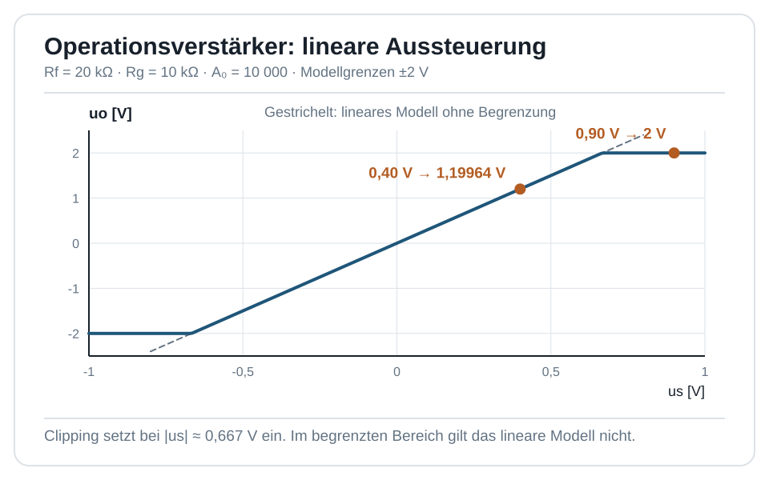

# M3-L4 – Operationsverstärker und analoge Signalaufbereitung {#L4}

**Kursbereich:** M3 – Bachelor: Halbleiter, analoge Elektronik und Digitaltechnik

**Niveau:** Bachelor

**Vorwissen:** [Belastung durch einen Eingang](M1-L2.md), [Ersatzquellen](M1-L4.md) und [Kleinsignalverstärkung](M3-L3.md).

**Lernziel:** Du berechnest die Verstärkung einer gegengekoppelten Operationsverstärkerschaltung und prüfst Eingangslast, Ausgangsstrom und Aussteuergrenzen an einem Sensorbeispiel.

## Drei Anschlüsse und eine Versorgung {#S1}

Ein Operationsverstärker besitzt einen nichtinvertierenden Eingang $u_+$, einen invertierenden Eingang $u_-$ und einen Ausgang $u_o$. Zusätzlich braucht er eine Versorgung. Das vereinfachte lineare Modell benutzt eine große Leerlaufverstärkung $A_0$ für die Differenz der Eingangsspannungen:

$$
u_o=A_0(u_+-u_-).
$$

Im idealisierten Modell fließt kein Strom in die Eingänge. Die Begrenzung des Ausgangshubs bleibt eine separate Bedingung. Liegt der berechnete Ausgang außerhalb seines Arbeitsbereichs, kann die lineare Gleichung dort nicht gelten. Auch bei realen Bausteinen sind Eingangsbereich und Ausgangshub zwei verschiedene Grenzen.

## Gegenkopplung einstellen {#S2}

Für einen nichtinvertierenden Verstärker liegt das Signal an $u_+$. Vom Ausgang führt $R_f$ zum invertierenden Eingang. Von dort führt $R_g$ zur Bezugserde. Weil im Modell kein Eingangsstrom fließt, gilt $u_-=\beta u_o$ mit $\beta=R_g/(R_f+R_g)$. Eine positive Ausgangsänderung erhöht $u_-$ und verringert damit die verstärkte Eingangsdifferenz. Das ist Gegenkopplung.

Einsetzen in die Ausgangsgleichung liefert für einen stabilen linearen Betrieb

$$
\frac{u_o}{u_+}=\frac{A_0}{1+A_0\beta}
\ \xrightarrow[A_0\beta\gg1]{}\ \frac1\beta=1+\frac{R_f}{R_g}.
$$

Die Näherung $u_+\approx u_-$ folgt in diesem Zustand aus der großen Verstärkung und der Gegenkopplung. Wenn diese Bedingungen fehlen, darf man sie nicht als allgemeine Eigenschaft der Eingänge verwenden.

## Beispiel: Eine Sensorquelle aufbereiten {#S3}

Eine Sensorquelle sei als ideale Spannung $u_s=0{,}40\,\mathrm V$ in Reihe mit $R_s=20\,\mathrm{k\Omega}$ modelliert. Der Folgeschaltkreis hat eine Last von $R_L=10\,\mathrm{k\Omega}$ gegen Masse. Bei direktem Anschluss liest er nur $0{,}40\,\mathrm V\cdot10/(20+10)\approx0{,}133\,\mathrm V$. Der resultierende Fehler entsteht durch den Spannungsteiler aus Quellwiderstand und Last.

Nun treibt die Sensorquelle $u_+$ eines nichtinvertierenden Verstärkers mit $R_f=20\,\mathrm{k\Omega}$, $R_g=10\,\mathrm{k\Omega}$ und $A_0=10^4$. Die Last kommt an den Ausgang. Aus dem idealen Eingang folgt $u_+=0{,}40\,\mathrm V$. Bei hoher Schleifenverstärkung liegt $u_o$ nahe $3u_+=1{,}20\,\mathrm V$. Mit endlichem $A_0$ liefert die Formel $u_o\approx1{,}19964\,\mathrm V$. Im Modell treibt der Ausgang dabei rund $120\,\mathrm{\mu A}$ durch die Last und $40\,\mathrm{\mu A}$ durch den Rückkopplungsteiler. Die Versorgung stellt die zusätzliche Energie bereit.

Der Modellverstärker kann nur Ausgangsspannungen zwischen $-2{,}0\,\mathrm V$ und $+2{,}0\,\mathrm V$ liefern. Steigt $u_s$ auf $0{,}90\,\mathrm V$, ergäbe die lineare Rechnung rund $2{,}70\,\mathrm V$. Tatsächlich begrenzt der angenommene Ausgang bei $+2{,}0\,\mathrm V$. In diesem Zustand liegt der invertierende Eingang bei etwa $0{,}667\,\mathrm V$. Damit ist auch zahlenmäßig klar, dass die Eingänge nicht mehr annähernd gleich sind.

{alt="Verstärkerkennlinie mit Steigung ungefähr drei, Ausgangsbegrenzung bei plus und minus zwei Volt und zwei markierten Sensorwerten."}

Die begrenzte Kennlinie ist ein statisches Modell. Der erste Sensorwert liegt im linearen Bereich; der zweite verlangt rechnerisch mehr Ausgangshub als verfügbar.

## Selbstkontrolle {#S4}

1. Welche lineare Ausgangsspannung ergibt sich bei $u_s=0{,}40\,\mathrm V$, wenn $R_f$ auf $22\,\mathrm{k\Omega}$ steigt? Verwende die Näherung für große Schleifenverstärkung.
2. Wann beginnt bei den ursprünglichen Widerständen näherungsweise die positive Begrenzung?
3. Zwischen Ausgang und Last kommt ein Schutzwiderstand von $1\,\mathrm{k\Omega}$. Die Rückkopplung bleibt wie zuvor am Ausgang vor dem Schutzwiderstand. Wie groß ist dann bei $u_o=1{,}20\,\mathrm V$ die Lastspannung?

### Lösungen

1. Die Verstärkung ist $1+22/10=3{,}2$. Die Ausgangsspannung ist $1{,}28\,\mathrm V$ und bleibt innerhalb der Grenze.
2. Bei ungefähr $u_s=2/3\,\mathrm V=0{,}667\,\mathrm V$. Oberhalb davon verlangt Verstärkung drei einen größeren Ausgangshub.
3. Der neue Teiler liefert $1{,}20\,\mathrm V\cdot10/11\approx1{,}09\,\mathrm V$. Die Gegenkopplung korrigiert den Abfall hinter ihrem Abgriff im gegebenen Modell nicht.

## Modellgrenzen und nächster Schritt {#S5}

Für dynamische Signale müssen Verstärkungsbandbreite, Signalfolgegeschwindigkeit und Stabilität betrachtet werden. Bei realen Sensoren kommen Eingangsbiasstrom, Offset, Rauschen und Eigenimpedanz hinzu. Das stationäre Beispielschema ist ein Modell, dessen Anschlusswerte und Laststrom vor jeder Verwendung geprüft werden. [Kombinatorische Logik](M3-L5.md) wechselt nun zur Abstraktion mit zwei logischen Werten. In [der Schnittstellenlektion](M3-L7.md) werden beide Sichtweisen verbunden.

## Quellen {#S6}

- [MIT OpenCourseWare, 6.002 „Circuits and Electronics“, Vorlesungen 19–20](https://ocw.mit.edu/courses/6-002-circuits-and-electronics-spring-2007/pages/lecture-notes/) · Operationsverstärkermodell und Gegenkopplung. · Zuletzt abgerufen: 2026-11-25
- [MIT OpenCourseWare, 6.071J „Introduction to Electronics, Signals, and Measurement“, Vorlesungen 28–29](https://ocw.mit.edu/courses/6-071j-introduction-to-electronics-signals-and-measurement-spring-2006/pages/lecture-notes/) · Grundschaltungen sowie Ein- und Ausgangsimpedanz. · Zuletzt abgerufen: 2026-11-25
