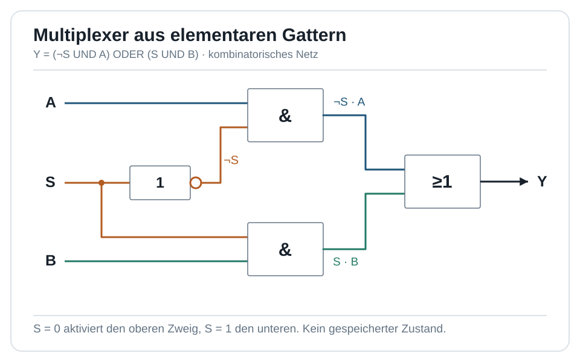

# M3-L5 – Boolesche Algebra und kombinatorische Logik {#L5}

**Kursbereich:** M3 – Bachelor: Halbleiter, analoge Elektronik und Digitaltechnik

**Niveau:** Bachelor

**Vorwissen:** Die Unterscheidung von [leitendem und sperrendem Transistormodell](M3-L3.md).

**Lernziel:** Du formulierst eine kombinatorische Funktion als Wahrheitstabelle und Booleschen Ausdruck, vereinfachst sie und setzt sie mit elementaren Gattern oder einem Multiplexer um.

## Die Entscheidung hängt von den Eingängen ab {#S1}

Zwei Sensoren liefern gültige logische Werte $A$ und $B$. Ein Auswahlbit $S$ bestimmt, welcher Wert am Ausgang $Y$ erscheint. Bei $S=0$ gilt $Y=A$, bei $S=1$ gilt $Y=B$. Derselbe Eingangszustand führt nach Ablauf der Gatterlaufzeiten stets zur selben Ausgabe. Dieses Verhalten heißt **kombinatorisch**. Es besitzt keinen gespeicherten Zustand.

In Booleschen Ausdrücken steht $\lnot A$ für NICHT und $A\land B$ für UND. Bei $A\lor B$ reicht mindestens ein wahrer Eingang. Dieses ODER umfasst auch den Fall, in dem beide Eingänge wahr sind. Das exklusive ODER $A\oplus B$ gilt bei zwei Eingängen genau dann, wenn sie verschieden sind.

## Die Wahrheitstabelle und ihre Terme {#S2}

Jede Zeile beschreibt eine mögliche Kombination. Drei Bits führen zu $2^3=8$ Zeilen.

| $S$ | $A$ | $B$ | $Y$ |
| ---: | ---: | ---: | ---: |
| 0 | 0 | 0 | 0 |
| 0 | 0 | 1 | 0 |
| 0 | 1 | 0 | 1 |
| 0 | 1 | 1 | 1 |
| 1 | 0 | 0 | 0 |
| 1 | 0 | 1 | 1 |
| 1 | 1 | 0 | 0 |
| 1 | 1 | 1 | 1 |

Eine systematische Konstruktion beginnt mit jeder Zeile, die $Y=1$ liefert. Der Term für $(S,A,B)=(0,1,0)$ ist $(\lnot S)\land A\land(\lnot B)$, weil ausschließlich diese Belegung alle drei Faktoren wahr macht. Bilde entsprechende Terme für die weiteren Einszeilen und verknüpfe sie mit ODER.

Die ersten beiden Einszeilen lassen sich zu $(\lnot S)\land A$ zusammenfassen, da sie sich nur im Wert für $B$ unterscheiden. Entsprechend ergibt sich für die beiden anderen Einszeilen $S\land B$. Die vereinfachte Funktion lautet

$$
Y=((\lnot S)\land A)\lor(S\land B).
$$

Das ist die Gleichung für einen Multiplexer mit zwei Datenleitungen. Als Gatternetz besteht er aus einem Inverter für $S$, zwei UND-Gattern und einem ODER-Gatter. Du kannst die Zuordnung direkt testen, indem du nacheinander $S=0$ und $S=1$ einsetzt.

{alt="Gatternetz aus Inverter, zwei UND-Gattern und einem ODER-Gatter, mit Datenleitungen A und B, Auswahl S und Ausgang Y."}

Das Auswahlbit wird in den oberen Zweig invertiert und in den unteren Zweig unverändert eingespeist. Die beiden UND-Ergebnisse werden am ODER-Gatter zusammengeführt. Die Zeichnung zeigt logische Verbindungen, keine physische Verdrahtung oder Laufzeiten.

## Beispiel: Freigabe und Umsetzung mit NAND {#S3}

Eine Freigabe $E$ soll den Ausgang bei $E=0$ auf null setzen. Dazu genügt $Z=E\land Y$. Wenn $E=1$ ist, bleibt die ursprüngliche Auswahl wirksam. Die Freigabe schaltet hier zwischen zwei logischen Ergebnissen. Der Ausgang bleibt elektrisch getrieben, auch wenn er null liefert.

Für eine Ausführung mit NAND-Gattern bezeichnet $\operatorname{NAND}(X,W)$ die Negation von $X\land W$. Die Regeln von De Morgan liefern für den Multiplexer

$$
\begin{aligned}
S_n &= \operatorname{NAND}(S,S),\\
N_A &= \operatorname{NAND}(S_n,A),\\
N_B &= \operatorname{NAND}(S,B),\\
Y &= \operatorname{NAND}(N_A,N_B).
\end{aligned}
$$

Die beiden inneren Ergebnisse sind die negierten UND-Terme. Ihre abschließende NAND-Verknüpfung stellt deshalb das ODER der ursprünglichen UND-Terme her.

## Selbstkontrolle {#S4}

1. Werte bei $A=0$ und $B=1$ beide Werte von $S$ aus. Was ergibt sich für $Z$, wenn die Freigabe ebenfalls berücksichtigt wird?
2. Welche der Ausdrücke $A\lor B$ und $A\oplus B$ liefern bei $A=B=1$ eine Eins?
3. Formuliere „kein einziger der Eingänge $A$ und $B$ ist gesetzt“ auf zwei gleichwertige Weisen.

### Lösungen

1. Bei $S=0$ ist $Y=0$, bei $S=1$ ist $Y=1$. Es gilt also $Y=S$ und $Z=E\land S$.
2. $A\lor B=1$, weil mindestens ein Eingang wahr ist. $A\oplus B=0$, weil die Eingänge gleich sind.
3. $\lnot(A\lor B)$ drückt die verneinte ODER-Verknüpfung aus. Gleichwertig ist $(\lnot A)\land(\lnot B)$.

## Modellgrenzen und nächster Schritt {#S5}

Eine Wahrheitstabelle beschreibt stabile Werte. Ändert sich $S$ bei $A=B=1$, bleibt der Sollwert für $Y$ konstant eins. In einer Gatterimplementierung können unterschiedlich lange Pfade trotzdem einen kurzen falschen Impuls erzeugen, wenn der eine UND-Zweig früher abschaltet, als der andere einschaltet. Auch ein elektrisch ungültiger Eingang hat in der Tabelle keinen zugesicherten Wert. [Die Lektion zu Speicher und Takt](M3-L6.md) zeigt, wie ein digitaler Wert zu festgelegten Zeiten übernommen und gehalten wird.

## Quellen {#S6}

- [MIT OpenCourseWare, 6.004 „Computation Structures“, Vorlesungen 2–4](https://ocw.mit.edu/courses/6-004-computation-structures-spring-2009/pages/lecture-notes/) · digitale Abstraktion, Gatter und Synthese. · Zuletzt abgerufen: 2026-11-25
- [Steve Ward, „Combinational Logic“, Computation Structures](https://computationstructures.org/notes/combinational_logic/notes.html) · Wahrheitstabellen, Boolesche Terme und Multiplexer. · Zuletzt abgerufen: 2026-11-25
