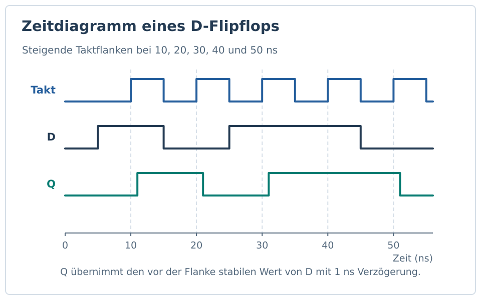

# M3-L6 – Speicher, Takt und endliche Automaten {#L6}

**Kursbereich:** M3 – Bachelor: Halbleiter, analoge Elektronik und Digitaltechnik

**Niveau:** Bachelor

**Vorwissen:** [Kombinatorische Logik und Gatterlaufzeiten](M3-L5.md).

**Lernziel:** Du unterscheidest Latch, Flipflop und Register, wertest ein Zeitdiagramm an aktiven Taktflanken aus und verfolgst die Zustände eines einfachen endlichen Automaten.

## Was die Schaltung behält {#S1}

Ein rückgekoppeltes Speicherelement kann Information über einen Eingangswert behalten, nachdem sich der Eingang geändert hat. Ein pegelgesteuertes D-Latch folgt seinem Dateneingang während der aktiven Freigabe und hält den zuletzt übernommenen Wert bei inaktiver Freigabe. Ein positiv flankengesteuertes D-Flipflop übernimmt den Dateneingang an der steigenden Flanke seines Takts. Danach hält sein Ausgang $Q$ den gespeicherten Wert bis zur nächsten Übernahme. Ein Register bündelt mehrere solche Speicherbits, typischerweise an einem gemeinsamen Takt.

## Eine Taktfolge lesen {#S2}

Der Taktraster des Beispiels hat eine Periode von $10\,\mathrm{ns}$ und seine steigenden Flanken liegen bei $10$, $20$, $30$, $40$ und $50\,\mathrm{ns}$. Ausgang $Q$ beginnt bei null. Die Werte des Dateneingangs $D$ unmittelbar vor diesen Flanken lauten $1,0,1,1,0$. Im Modell folgt $Q$ jeweils $1\,\mathrm{ns}$ nach der Flanke. Stabile Daten zwischen zwei Flanken können sich ändern, ohne sofort sichtbar zu werden. Bei $40\,\mathrm{ns}$ ergibt das Abtasten erneut eins, also findet am Ausgang kein sichtbarer Wechsel statt.

{alt="Zeitdiagramm eines D-Flipflops. D hat an den steigenden Taktflanken nacheinander die Werte eins, null, eins, eins und null. Q übernimmt sie mit einer Verzögerung von einer Nanosekunde."}

Im realen Zeitmodell muss $D$ während einer Vorhaltezeit $t_\mathrm{setup}$ vor der Flanke und einer Haltezeit $t_\mathrm{hold}$ danach stabil sein. Eine Verletzung kann einen unsicheren Abtastwert oder Metastabilität zur Folge haben. Die Laufzeit vom Takt zum Ausgang und die Laufzeit der verbundenen Gatter benötigen zusätzlich Platz im Zeitbudget.

Für eine synchrone Register-zu-Register-Strecke mit vernachlässigbarer Differenz der Taktankunftszeiten gilt als Setup-Abschätzung

$$
T_\mathrm{clk}\ge t_{\mathrm{cq,max}}+t_{\mathrm{pd,max}}+t_\mathrm{setup}.
$$

Mit $2\,\mathrm{ns}$, $5\,\mathrm{ns}$ und $1\,\mathrm{ns}$ ergibt sich idealisiert $T_\mathrm{clk}\ge8\,\mathrm{ns}$, entsprechend höchstens $125\,\mathrm{MHz}$. Die Haltebedingung prüft man zusätzlich mit minimalen Laufzeiten. Sie ist durch die maximale Frequenz allein nicht abgesichert.

## Beispiel: Zwei aufeinanderfolgende Einsen {#S3}

Ein Warnsignal soll erst erscheinen, wenn bei zwei aufeinanderfolgenden Taktflanken eine Eins abgetastet wurde. Ein endlicher Automat speichert dazu einen von drei Zuständen: $S_0$ für keine aufeinanderfolgende Eins, $S_1$ für eine Eins und $S_2$ für mindestens zwei Einsen. Ein Reset setzt $S_0$. Ein Zustandsregister hält eine Codierung des Zustands. Kombinatorische Logik berechnet den Folgezustand aus dem aktuell gespeicherten Zustand und dem Eingang $X$.

| Zustand vor der Flanke | Folgezustand bei $X=0$ | Folgezustand bei $X=1$ | Ausgang im Zustand |
| --- | --- | --- | ---: |
| $S_0$ | $S_0$ | $S_1$ | 0 |
| $S_1$ | $S_0$ | $S_2$ | 0 |
| $S_2$ | $S_0$ | $S_2$ | 1 |

Der Ausgang folgt dem aktuell gespeicherten Zustand. Diese Anordnung ist ein **Moore-Automat**. Bei der Eingangsfolge $1,0,1,1,1,0$ durchläuft er nach den Flanken $S_1,S_0,S_1,S_2,S_2,S_0$. Die beobachteten Ausgangswerte sind $0,0,0,1,1,0$.

## Selbstkontrolle {#S4}

1. Welche Zustände und Ausgangswerte folgen nach Reset für $1,1,0,1,1$?
2. Im Zeitbeispiel ändert sich $D$ bei $15\,\mathrm{ns}$. Warum ändert sich $Q$ zu diesem Zeitpunkt nicht?
3. Wie verändert sich die Grenze des Taktbudgets, wenn die maximale Gatterlaufzeit auf $7\,\mathrm{ns}$ steigt?

### Lösungen

1. Zustände: $S_1,S_2,S_0,S_1,S_2$. Der zugehörige Ausgang ist $0,1,0,0,1$.
2. $15\,\mathrm{ns}$ liegt zwischen den aktiven Flanken bei $10$ und $20\,\mathrm{ns}$. Der vorher gespeicherte Wert bleibt erhalten.
3. Es werden mindestens $2+7+1=10\,\mathrm{ns}$ benötigt. Das ergibt vor weiteren Sicherheitsmargen höchstens $100\,\mathrm{MHz}$.

## Modellgrenzen und nächster Schritt {#S5}

Das Zustandsmodell setzt gültige Bits bei jeder Übernahme voraus. Es enthält weder eine analoge Eingangsschwellwertauswertung noch einen Schutz gegen instabile Signale zwischen unterschiedlichen Taktdomänen. [Die nächste Lektion](M3-L7.md) verbindet den Automaten mit einem modellierten Sensorsignal und prüft die elektrische Gültigkeit der Schnittstelle.

## Quellen {#S6}

- [MIT OpenCourseWare, 6.004 „Computation Structures“, Vorlesungen 5–7](https://ocw.mit.edu/courses/6-004-computation-structures-spring-2009/pages/lecture-notes/) · sequenzielle Logik, Speicher, Automaten und Metastabilität. · Zuletzt abgerufen: 2026-11-25
- [Steve Ward, „Sequential Logic“, Computation Structures](https://computationstructures.org/notes/sequential_logic/notes.html) · Register und Zeitbedingungen. · Zuletzt abgerufen: 2026-11-25
