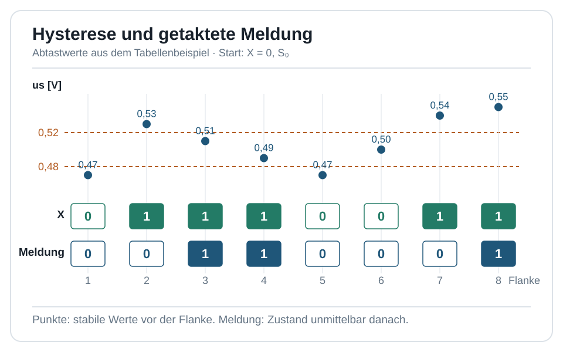

# M3-L7 – Digitale Schaltung und analoge Schnittstelle {#L7}

**Kursbereich:** M3 – Bachelor: Halbleiter, analoge Elektronik und Digitaltechnik

**Niveau:** Bachelor

**Vorwissen:** [Sensoraufbereitung und Gegenkopplung](M3-L4.md), [logische Verknüpfungen](M3-L5.md) und [getakteter Zustandsautomat](M3-L6.md).

**Lernziel:** Du kombinierst eine analoge Schwellwertentscheidung mit einem getakteten Automaten, prüfst Spannungspegel und erkennst, wann das Bitmodell seine Gültigkeit verliert.

## Vom Messwert zur Entscheidung {#S1}

Eine simulierte Überwachung soll melden, dass eine Sensorspannung anhaltend erhöht ist. Die Aufbereitung liefert eine analoge Spannung $u_s$. Ein Schwellwertglied erzeugt daraus ein logisches Signal $X$. Der bereits entwickelte Automat prüft, ob das Signal an mindestens zwei aufeinanderfolgenden Taktflanken den Wert eins hatte. Die Verarbeitung hat somit zwei Aufgaben: eine Entscheidung aus einem kontinuierlichen Messwert und eine Entscheidung aus einer zeitlichen Folge von Bits.

Bei einer einzigen Schwelle um $0{,}50\,\mathrm V$ kann schwaches Rauschen dazu führen, dass das Signal wiederholt umschaltet. Ein Schwellwertglied mit Hysterese benutzt zwei Grenzen: $U_\uparrow$ für die steigende und $U_\downarrow$ für die fallende Schwelle. Wir nehmen für das Beispiel $U_\uparrow=0{,}52\,\mathrm V$ und $U_\downarrow=0{,}48\,\mathrm V$ an.

| Spannung im Modell | Ausgang $X$ |
| --- | --- |
| $u_s\ge U_\uparrow$ | 1 |
| $u_s\le U_\downarrow$ | 0 |
| $U_\downarrow<u_s<U_\uparrow$ | letzter Zustand |

Diese beiden **Sensorspannungsschwellen** liegen vor der digitalen Schnittstelle. Die elektrischen Spannungsgrenzen, anhand derer der Empfänger den Ausgang als null oder eins erkennt, gehören zu einem anderen Teil der Schaltung.

## Elektrische Gültigkeit prüfen {#S2}

Für einen vereinfachten digitalen Empfänger bei einer Versorgung von $3{,}3\,\mathrm V$ nehmen wir an: Bis einschließlich $V_{\mathrm{IL,max}}=0{,}80\,\mathrm V$ muss er null erkennen. Ab $V_{\mathrm{IH,min}}=2{,}00\,\mathrm V$ muss er eins erkennen. Zwischen beiden Grenzen gibt es für den Eingang keinen zugesicherten Logikwert. Ein Messwert von $1{,}50\,\mathrm V$ ist deshalb ein elektrischer Fehlerfall für dieses Modell.

Der Schwellwerttreiber garantiert bei passender Last einen Low-Ausgang bis $V_{\mathrm{OL,max}}=0{,}20\,\mathrm V$ und einen High-Ausgang ab $V_{\mathrm{OH,min}}=3{,}00\,\mathrm V$. Damit bleiben statische Störabstände

$$
\begin{aligned}
N_L &= V_{\mathrm{IL,max}}-V_{\mathrm{OL,max}}=0{,}60\,\mathrm V,\\
N_H &= V_{\mathrm{OH,min}}-V_{\mathrm{IH,min}}=1{,}00\,\mathrm V.
\end{aligned}
$$

Beide Werte sind positiv. Diese Rechnung bezieht sich auf die angenommenen Aus- und Eingangsspezifikationen bei gleicher Bezugserde. Sie bewertet noch keine Flanken, Laufzeiten oder Belastung außerhalb des zugesicherten Bereichs.

## Beispiel: Messwerte und Zustände durchlaufen {#S3}

Ausgang und Automat starten bei null beziehungsweise $S_0$. Für das diskrete Beispiel sind alle angegebenen Werte die stabilen Werte unmittelbar vor aufeinanderfolgenden Taktflanken. Dazwischen unterstellen wir keine zusätzlichen Schwellwertübertritte, die den Zustand des Schwellwertglieds ändern würden.

| Taktflanke | $u_s$ in V | $X$ | Zustand nach Flanke | Meldung |
| ---: | ---: | ---: | --- | ---: |
| 1 | 0,47 | 0 | $S_0$ | 0 |
| 2 | 0,53 | 1 | $S_1$ | 0 |
| 3 | 0,51 | 1 | $S_2$ | 1 |
| 4 | 0,49 | 1 | $S_2$ | 1 |
| 5 | 0,47 | 0 | $S_0$ | 0 |
| 6 | 0,50 | 0 | $S_0$ | 0 |
| 7 | 0,54 | 1 | $S_1$ | 0 |
| 8 | 0,55 | 1 | $S_2$ | 1 |

Bei Flanke drei bleibt das Schwellwertglied trotz $0{,}51\,\mathrm V$ auf eins, weil die untere Grenze noch nicht unterschritten wurde. Dagegen hält es bei Flanke sechs den Wert null. Derselbe Zwischenbereich kann also wegen seiner Vorgeschichte verschiedene Ausgänge ergeben.

{alt="Acht Sensorwerte gegenüber den Schwellwerten 0,48 und 0,52 Volt; darunter die diskreten Werte X und Meldung je Taktflanke."}

Die Punkte sind einzelne Abtastwerte, keine Aussage über den Verlauf zwischen den Flanken. Die beiden Bitzeilen zeigen, wie Hysterese und zeitliche Entscheidung verschiedene Funktionen erfüllen.

## Selbstkontrolle {#S4}

1. Ein anderer Treiber liefert im ungünstigen High-Fall nur $1{,}80\,\mathrm V$. Bestimme seinen High-Störabstand und erkläre das Ergebnis.
2. Was ergeben $X$ und Meldung aus dem Reset für $u_s=(0{,}49;0{,}53;0{,}50;0{,}47)\,\mathrm V$?
3. Warum reicht der Nachweis gültiger statischer Pegel nicht für ein asynchron eintreffendes Eingangssignal?

### Lösungen

1. $N_H=1{,}80-2{,}00=-0{,}20\,\mathrm V$. Der Empfänger garantiert für diesen High-Ausgang keine Eins.
2. Das Schwellwertglied liefert $0,1,1,0$. Der Automat meldet nach den Flanken $0,0,1,0$.
3. Auch ein Übergang zwischen zwei gültigen Pegeln kann zu nahe an einer Taktflanke liegen und die Setup- oder Haltebedingung verletzen. Eine Synchronisation mit hintereinandergeschalteten Registern kann das Metastabilitätsrisiko senken und verursacht zusätzliche Verzögerung. Kurze Impulse erfordern außerdem eine passende Übertragungsstrategie.

## Grenzen und Rückblick {#S5}

Das Modell benutzt feste Schaltschwellen und simulierte Eingänge. Reale Schwellwerte ändern sich mit Bauteilprozess, Versorgung und Temperatur. Ein Schwellwertglied kann die Empfindlichkeit gegen kleine Signaländerungen verringern, während der Automat die Dauer eines logischen Zustands bewertet. Das sind zwei verschiedene Eigenschaften, die getrennt geprüft werden. Der [Studienweg](pages/studienweg.md) ordnet den nächsten Abschnitt zu elektromagnetischen Feldern und Wellen ein.

## Quellen {#S6}

- [MIT OpenCourseWare, 6.071J „Introduction to Electronics, Signals, and Measurement“, Vorlesung 33](https://ocw.mit.edu/courses/6-071j-introduction-to-electronics-signals-and-measurement-spring-2006/pages/lecture-notes/) · positive Rückkopplung und Schmitt-Trigger. · Zuletzt abgerufen: 2026-11-25
- [MIT OpenCourseWare, 6.004 „Computation Structures“, Vorlesungen 2 und 7](https://ocw.mit.edu/courses/6-004-computation-structures-spring-2009/pages/lecture-notes/) · spannungsbasierte Logikpegel, Synchronisation und Metastabilität. · Zuletzt abgerufen: 2026-11-25
