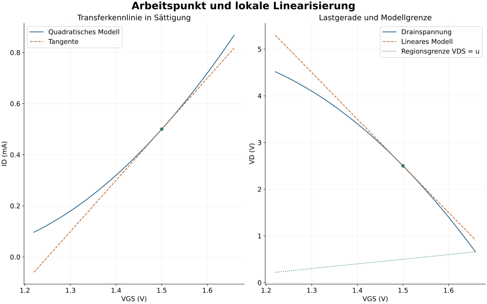

# M30-L1 – Arbeitspunkt und Kleinsignalmodell: Verstärkung, Eingangs- und Ausgangswiderstand {#L1}

**Kursbereich:** M30 – Bachelor–Master-Brücke: Übergang analoge und digitale Schaltungsentwicklung

**Niveau:** Bachelor · Bachelor–Master-Brücke

**Vorwissen:** [M3-L1](M3-L1.md), [M14-L1](M14-L1.md).

**Lernziel:** Einen Gleichstromarbeitspunkt bestimmen und daraus eine lokale lineare Verstärkerbeschreibung ableiten.

## Diagnostischer Selbsttest {#S1}

1. Wann darf eine nichtlineare Kennlinie durch eine Gerade ersetzt werden? 2. Warum darf der Gleichstromarbeitspunkt bei einer Wechselstromanalyse nicht einfach entfallen? 3. Warum ist eine Spannungsverstärkung ohne Aussage zur Belastung unvollständig? 4. Was bedeutet eine negative Verstärkung?

**Antworten:** 1. In einem ausreichend kleinen Bereich um den Arbeitspunkt. 2. Er bestimmt die lokalen Parameter. 3. Die Last bildet mit dem Ausgangswiderstand einen Spannungsteiler. 4. Ein kleines positives Eingangssignal erzeugt ein negatives Ausgangssignal. Bei Unsicherheit die genannten Grundlagen wiederholen.

## Gleichstromarbeitspunkt {#S2}

Wir betrachten einen idealisierten n-Kanal-MOSFET mit geerdeter Source, Drainwiderstand $R_D$ und Versorgung $V_{DD}$. Im Sättigungsbereich ($V_{GS}>V_T$, $V_{DS}\ge V_{GS}-V_T$) sei

$$I_D=\frac{k}{2}(V_{GS}-V_T)^2,\qquad V_D=V_{DD}-R_DI_D.$$

Das Modell vernachlässigt Kanallängenmodulation, Body-Effekt, Temperatur und Subthreshold-Strom. Die Einheit von $k$ ist A/V². Bei $V_{DD}=5\,\mathrm V$, $R_D=5\,\mathrm{k\Omega}$, $V_T=1\,\mathrm V$, $k=4\,\mathrm{mA/V^2}$ und $V_{GS}=1{,}5\,\mathrm V$ ergibt sich $I_D=0{,}5\,\mathrm{mA}$ und $V_D=2{,}5\,\mathrm V$. Da $2{,}5>0{,}5$, ist die gewählte Region konsistent. Die Drainverlustleistung ist 1,25 mW, ebenso die Verlustleistung in $R_D$; die Versorgung liefert 2,5 mW. Ein Modell, das die Regionsbedingung nicht erfüllt, darf nicht weiter zur Sättigungsanalyse verwendet werden.

## Ableitung der Kleinsignalgrößen {#S3}

Schreibe $v_{GS}=V_{GS}+\tilde v_{gs}$ und entwickle die Kennlinie um den Arbeitspunkt. Der Strom enthält eine konstante, eine lineare und eine quadratische Komponente:

$$i_D=I_D+g_m\tilde v_{gs}+\frac{k}{2}\tilde v_{gs}^2,\quad g_m=k(V_{GS}-V_T)=2\,\mathrm{mS}.$$

Bei einer Abweichung von 10 mV beträgt die lineare Stromänderung 20 µA, der quadratische Anteil 0,2 µA. Bei 100 mV sind es 200 µA und 20 µA. Der relative Anteil des quadratischen Terms an der linearen Änderung beträgt somit 1 bzw. 10 Prozent. Diese Abschätzung ist keine allgemeine Verzerrungsgrenze, sondern gehört zum gewählten Modell.

Die ideale Versorgung wird für Kleinsignale zur AC-Masse. Bei endlichem Transistorausgangswiderstand $r_o$ gilt $R_{out}=R_D\parallel r_o$ und $A_v=-g_m(R_D\parallel r_o\parallel R_L)$. Ohne Last und mit $r_o\to\infty$ folgt $A_v=-10$. Eine über einen ausreichend großen Koppelkondensator angeschlossene Last von 10 kΩ verändert den Gleichstromarbeitspunkt nicht, reduziert aber die Verstärkung auf -6,67 im betrachteten Durchlassbereich. Der ideale Gate-Eingang hat unendlichen Gleichstromwiderstand; ein Biasnetz aus zwei Widerständen bildet deren Parallelschaltung gegen AC-Masse. Bei hohen Frequenzen bestimmen Kapazitäten die Eingangsimpedanz.

{alt="MOSFET-Transferkennlinie mit Tangente am Arbeitspunkt und Ausgangsspannung des Common-Source-Verstärkers."}

## Arbeitspunktvariation und Modellgrenze {#S4}

Die Drainspannung folgt aus der Lastgeraden. Mit zunehmendem Eingangssignal kann sie die Sättigungsbedingung unterschreiten. Für den nichtnegativen Übersteuerungswert $u=V_{GS}-V_T$ liefert $5-10u^2=u$ die Grenze $u\approx0{,}659\,\mathrm V$. Jenseits davon muss ein Triodenmodell verwendet werden. Für kleine negative Abweichungen bleibt zunächst die Sättigungsannahme gültig, irgendwann fällt der Transistor jedoch in den Sperrbereich. Die Kleinsignalrechnung sagt weder die maximal mögliche Ausgangsamplitude noch das Verhalten beim Einschalten voraus.

Bei einer Schaltungsprüfung werden daher zuerst DC-Kennlinie und Arbeitspunkt, dann lokale Ableitung und AC-Last betrachtet. Ein SPICE-Modell mit realistischen Bauelementparametern wäre eine weitere, separate Prüfung.

## Übungen mit Lösungen {#S5}

1. Wie ändert sich $g_m$ bei $u=0{,}4$ V? **Lösung:** 1,6 mS; im Modell liegt der Drainstrom bei 0,32 mA und die Drainspannung bei 3,4 V.
2. Mit $r_o=50$ kΩ und $R_L=10$ kΩ: **Lösung:** $R_{out}=4{,}545$ kΩ, belastete Verstärkung etwa -6,25.
3. Berechne bei 20 mV Abweichung den quadratischen Stromanteil. **Lösung:** 0,8 µA gegenüber 40 µA linearer Änderung; 2 Prozent.
4. Welcher Test zeigt Clipping? **Lösung:** Eine Großsignal-Transientenanalyse mit variierter Eingangsgröße; eine AC-Analyse allein reicht nicht.

## Quellen {#S6}

- [MIT OpenCourseWare – 6.012 Microelectronic Devices and Circuits, Vorlesungsnotizen 17–23](https://ocw.mit.edu/courses/6-012-microelectronic-devices-and-circuits-fall-2009/pages/lecture-notes/) · Vorlesungen 17–18 (Übersicht): Verstärkerkennwerte, Arbeitspunkt und Zweitormodell. · Zuletzt abgerufen: 2026-11-25
- [ETH Zürich – Electronics and Photonics, Foundation Core (Curriculum G4)](https://www.vvz.ethz.ch/Vorlesungsverzeichnis/sucheLehrangebot.view?abschnittId=122815&ansicht=1&lang=en&seite=0&semkez=2026W) · Herbst 2026, Electronics and Photonics: 227-0166-00L Analog Integrated Circuits; nur curricularer Profilvergleich, kein Nachweis einzelner Gleichungen oder Versuche. · Zuletzt abgerufen: 2026-11-25
