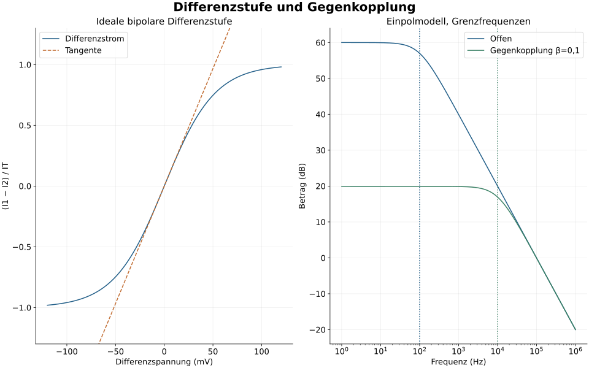

# M30-L2 – Analoge Verstärker: Differenzstufe, Rückkopplung und Bandbreite {#L2}

**Kursbereich:** M30 – Bachelor–Master-Brücke: Übergang analoge und digitale Schaltungsentwicklung

**Niveau:** Bachelor · Bachelor–Master-Brücke

**Vorwissen:** [M30-L1](M30-L1.md), [M3-L3](M3-L3.md).

**Lernziel:** Differenz- und Gleichtaktgrößen trennen, die Rückkopplung berechnen und Bandbreitengrenzen einordnen.

## Differenzsignal und Gleichtakt {#S1}

Eine Differenzstufe hat die Eingänge $v_+$ und $v_-$. Die beiden unabhängigen Größen sind $v_d=v_+-v_-$ und $v_{cm}=(v_++v_-)/2$. Ein lineares Modell beschreibt die Ausgabe als $v_o=A_dv_d+A_{cm}v_{cm}$. Ein idealer Differenzverstärker unterdrückt $v_{cm}$. Ein realer Verstärker verhält sich nur in seinem erlaubten Gleichtaktbereich so. Die Gleichtaktunterdrückung ist $\mathrm{CMRR}=20\log_{10}|A_d/A_{cm}|$ in dB. Bei $A_d=100$ und $A_{cm}=0{,}01$ ergibt sich 80 dB.

## Bipolare Differenzstufe {#S2}

Für zwei identische ideale Bipolartransistoren mit konstantem Schwanzstrom $I_T$ (Summenstrom) und vernachlässigtem Basisstrom gilt bei gleichem Emitterpotential aus dem Exponentialgesetz $I_1/I_2=\exp(v_d/U_T)$ und $I_1+I_2=I_T$. Daraus folgt

$$I_1-I_2=I_T\tanh\left(\frac{v_d}{2U_T}\right).$$

Mit $I_T=1\,\mathrm{mA}$ und $U_T=25{,}85\,\mathrm{mV}$ ist die lokale Steigung $I_T/(2U_T)=19{,}34\,\mathrm{mS}$. Bei zwei gleichen Kollektorwiderständen $R_C=2\,\mathrm{k\Omega}$ ergibt sich für $v_{o,d}=v_{C1}-v_{C2}$ eine Verstärkung von -38,68. Bei 10 mV Differenzeingang liefert die nichtlineare Kennlinie etwa 191 µA Differenzstrom, die Tangente 193 µA. Bei 100 mV nähert sich der Differenzstrom bereits dem Summenstrom. Die Versorgung muss genügend Spannung für aktiven Betrieb beider Transistoren und der Stromquelle bereitstellen. Die Formel allein überprüft das nicht.

## Negative Rückkopplung {#S3}

Ein idealisierter Spannungsverstärker mit komplexer offener Verstärkung $A(s)$ und Rückkopplungsfaktor $\beta$ erfüllt $v_o=A(s)(v_i-\beta v_o)$. Somit

$$G(s)=\frac{A(s)}{1+\beta A(s)}.$$

Für $A(s)=A_0/(1+s/\omega_p)$ und einen konstanten positiven Faktor $\beta$ ist

$$G(s)=\frac{A_0/(1+\beta A_0)}{1+s/[\omega_p(1+\beta A_0)]}.$$

Für $A_0=1000$, $f_p=100$ Hz und $\beta=0{,}1$ entstehen $G(0)=9{,}901$ und $f_{-3\mathrm{dB}}=10{,}1$ kHz. Bei hoher Schleifenverstärkung ist $G(0)\approx 1/\beta$, bei niedriger Schleifenverstärkung gilt diese Näherung nicht. Das Verstärkungs-Bandbreiten-Produkt dieses einfachen Modells bleibt 100 kHz. Zusätzliche Pole, Verzögerungen und kapazitive Lasten können die Phasenreserve verringern; die Einpolformel garantiert keine Stabilität einer beliebigen realen Schaltung.

{alt="Normierte Differenzstromkennlinie und Frequenzgang eines Einpolverstärkers mit und ohne Gegenkopplung."}

## Großsignalgrenzen und Signalpfad {#S4}

Ein vorgeschalteter Sensor liefert beispielsweise ±50 mV. Bei einem Verstärkungsfaktor nahe 10 entstehen ±0,5 V um eine Referenz von 1,65 V – geeignet für einen idealisierten 0–3,3-V-ADC. Ein Eingangsoffset von 1 mV verschiebt den Ausgang in einem idealisierten nichtinvertierenden Modell um rund 10 mV. Die ADC-Schrittweite bei 8 Bit ist 12,89 mV. Der Offset ist also nicht automatisch vernachlässigbar. Eine geforderte Ausgangssinusamplitude von 0,5 V bei 5 kHz benötigt zudem eine Slew Rate von mindestens $2\pi f\hat V=0{,}0157\,\mathrm{V/\mu s}$. Die Kleinsignalbandbreite allein begrenzt die Großsignaldynamik nicht vollständig.

Für den Entwurf müssen daher DC-Offset, Ausgangshub, Eingangsbereich, Rauschen, Bandbreite sowie Stabilität getrennt bewertet werden. In [M30-L5](M30-L5.md) wird ein bewusst statisches Verstärkermodell mit einer digitalen Entscheidungslogik gekoppelt; dort gelten langsam veränderliche und im Modell eingeschwungene Eingaben.

## Übungen mit Lösungen {#S5}

1. Bestimme die Einpol-Bandbreite bei $\beta=0{,}01$. **Lösung:** 1,1 kHz, DC-Verstärkung 90,91.
2. Wie groß ist die Amplitude bei der Grenzfrequenz des gegengekoppelten Systems? **Lösung:** DC-Amplitude geteilt durch $\sqrt2$, Phasenverschiebung -45°.
3. Bei $I_T=2$ mA: **Lösung:** lokaler Differenzleitwert 38,68 mS; der maximal mögliche Betrag des Differenzstroms ist 2 mA.
4. Warum muss ein Offset auch nach einer digitalen Filterung berücksichtigt werden? **Lösung:** Ein Offset ist ein Gleichanteil, den ein Tiefpass normalerweise nicht entfernt.

## Quellen {#S6}

- [MIT OpenCourseWare – 6.012 Microelectronic Devices and Circuits, Vorlesungsnotizen 17–23](https://ocw.mit.edu/courses/6-012-microelectronic-devices-and-circuits-fall-2009/pages/lecture-notes/) · Vorlesungen 19–24 (Übersicht): Differenzverstärker, mehrstufige Verstärker und Frequenzgang. · Zuletzt abgerufen: 2026-11-25
