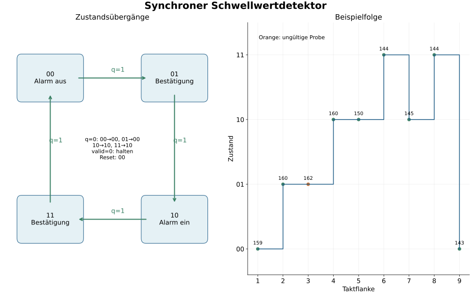

# M30-L3 – Synchroner Digitalentwurf: Register, kombinatorische Logik und Zustandsmaschine {#L3}

**Kursbereich:** M30 – Bachelor–Master-Brücke: Übergang analoge und digitale Schaltungsentwicklung

**Niveau:** Bachelor · Bachelor–Master-Brücke

**Vorwissen:** [M14-L3](M14-L3.md), [M15-L1](M15-L1.md).

**Lernziel:** Einen synchronen Zustandsautomaten von der Spezifikation bis zur Übergangstabelle entwickeln.

## Kombinatorisch und sequenziell {#S1}

Kombinatorische Logik berechnet Ausgänge aus den aktuellen Eingängen. Ein Register speichert einen Zustand; bei einem flankengesteuerten D-Flipflop wird $D$ an der aktiven Taktflanke übernommen. Zwischen den Flanken bleibt $Q$ (abgesehen von asynchronen Steuerungen) unverändert. In der Zustandsraumschreibweise eines synchronen Systems gilt

$$x[k+1]=F(x[k],u[k]),\qquad y[k]=G(x[k],u[k]).$$

Bei einem Moore-Automaten hängt der Ausgang nur vom Zustand ab, bei Mealy auch unmittelbar vom Eingang. Der Entwurf hier verwendet einen registrierten Alarmausgang. Alle Eingänge sind bereits taktsynchron; eine asynchrone Quelle benötigt eine geeignete Übergabe, bei mehrbitigen Daten beispielsweise einen Handshake oder asynchronen FIFO. Ein einzelner Synchronisierer pro Datenbit garantiert keinen kohärenten Worttransfer.

## Schwellwert mit Hysterese und Bestätigung {#S2}

Eine statische Schaltschwelle reagiert bei Rauschen in ihrer Nähe unter Umständen häufig. Wir definieren einen digitalen oberen Schwellwert 160 und einen unteren 144 für einen vorzeichenlosen 8-Bit-Code. Zum Einschalten sind zwei aufeinanderfolgende gültige Codes $c\ge160$ nötig, zum Ausschalten zwei gültige Codes $c\le144$. Ein gültiger nicht qualifizierender Code löscht die angefangene Bestätigung. Ungültige Takte werden ignoriert (auch eine angefangene Bestätigung bleibt). Der synchrone aktive High-Reset löscht beide Zustandsbits unabhängig von `valid`.

Die Bits $a$ (Alarm) und $p$ (eine qualifizierende Probe liegt vor) bilden vier Zustände. Die Qualifikation ist $q=(\neg a\land[c\ge160])\lor(a\land[c\le144])$. Bei gültigem Eingang und ohne Reset folgt die Tabelle:

| Zustand $(a,p)$ | $q=0$ | $q=1$ |
| --- | --- | --- |
| 00 | 00 | 01 |
| 01 | 00 | 10 |
| 10 | 10 | 11 |
| 11 | 10 | 00 |

Aus dieser Tabelle folgt $a^+=a\oplus(p\land q)$ und $p^+=q\land\neg p$ für gültige Proben. `valid=0` übersteuert beide Gleichungen mit dem alten Zustand; Reset hat höchste Priorität. Der Ausgang ist $a$. Die Untergrenze wird nur bei aktivem Alarm geprüft, die Obergrenze nur bei inaktivem Alarm.

{alt="Vier Zustände der Hysterese mit Bestätigung und das Signalverhalten an diskreten Taktflanken."}

## Beispiel entlang der Taktflanken {#S3}

| Code | valid | Zustand nach Flanke | Erläuterung |
| ---: | ---: | --- | --- |
| 159 | 1 | 00 | zu klein |
| 160 | 1 | 01 | erste hohe Probe |
| 162 | 0 | 01 | keine neue Probe |
| 160 | 1 | 10 | Alarm ein |
| 150 | 1 | 10 | Hysterese hält |
| 144 | 1 | 11 | erste niedrige Probe |
| 145 | 1 | 10 | Bestätigung verworfen |
| 144 | 1 | 11 | neue niedrige Probe |
| 143 | 1 | 00 | Alarm aus |

Initialisiert wurde mit einem Reset. Bei einer gültigen Probe je Takt schaltet der Alarm an der zweiten qualifizierenden Flanke. Bei Datenlücken ist die Latenz in physikalischer Zeit unbeschränkt, wenn keine maximale Zeit zwischen gültigen Proben garantiert ist.

## Schnittstelle und Anforderungen {#S4}

Die Eingabe ist der Code, nicht die Spannung selbst. Die Umsetzung der Spannung in einen Code ist Aufgabe der analogen Kette und des ADC. Bei Verlust der Datenquelle bleibt der Alarm in dieser Spezifikation eingefroren. Für eine sicherheitsgerichtete Anwendung wäre ein zusätzlicher Watchdog mit Fehlerzustand nötig; sein Verhalten müsste separat spezifiziert werden. Ein Reset bei aktivem Alarm löscht ihn hier explizit. Das darf nicht mit einem fehlersicheren Standardverhalten verwechselt werden. Der vorliegende Automat ist ein didaktischer Funktionsblock, keine Schutzschaltung.

Entwicklungsweg: Anforderungen mit inklusiven Grenzen aufschreiben, Übergangstabelle erstellen, Register und Logik ableiten, dann unabhängige Testfälle aus der Anforderung gewinnen. Besonders wichtig sind die Werte 144, 145, 159, 160 und die Kombinationen aus Reset und ungültiger Probe.

## Übungen mit Lösungen {#S5}

1. Anfang 00, gültige Folge 161, 159, 161, 161. **Lösung:** 01, 00, 01, 10.
2. Anfang 11, ungültige Probe mit Code 0. **Lösung:** 11 bleibt bestehen. Ein Reset an derselben Flanke ergibt 00.
3. Bei aktivem Alarm und 145, 144, 145 (alle gültig). **Lösung:** 10, 11, 10, falls die Anfangsbestätigung 0 war.
4. Wie viele Registerbits braucht die explizite Kodierung? **Lösung:** zwei; eine One-Hot-Kodierung bräuchte vier Zustandsbits.

## Quellen {#S6}

- [ETH Zürich – Electronics and Photonics, Foundation Core (Curriculum G4)](https://www.vvz.ethz.ch/Vorlesungsverzeichnis/sucheLehrangebot.view?abschnittId=122815&ansicht=1&lang=en&seite=0&semkez=2026W) · Herbst 2026, Electronics and Photonics: 227-0116-00L VLSI 1; nur curricularer Profilvergleich, kein Nachweis einzelner Gleichungen oder Versuche. · Zuletzt abgerufen: 2026-11-25
- [Icarus Verilog – Simulation Using Icarus Verilog](https://steveicarus.github.io/iverilog/usage/simulation.html) · Abschnitte Simulation models/test benches und Compilation and Elaboration: ausführbare Simulation und Verhaltensprüfung; kein Nachweis einer Ausführung des Kursbeispiels. · Zuletzt abgerufen: 2026-11-25
