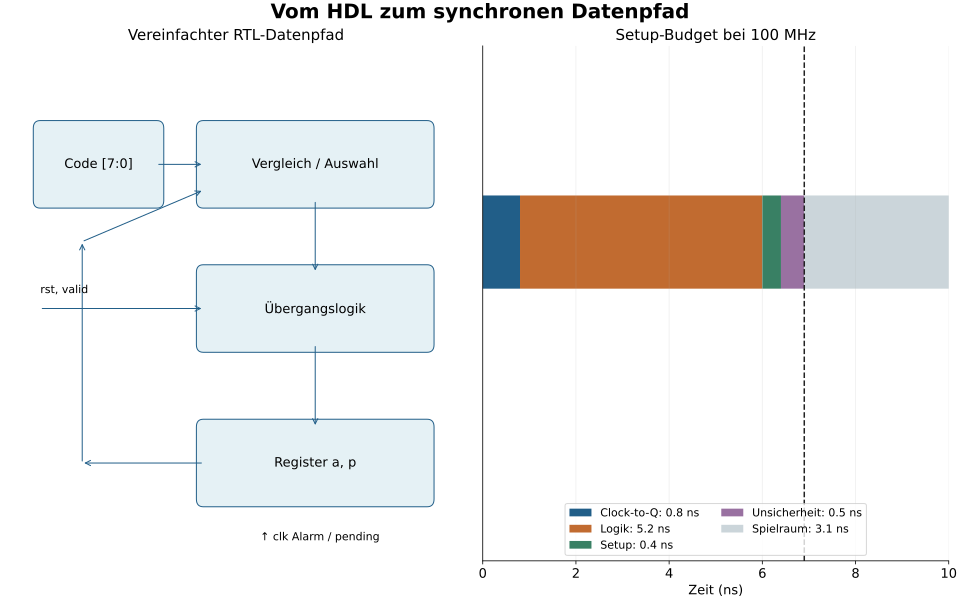

# M30-L4 – HDL und FPGA-Grundlagen: Beschreibung, Testbench, Synthese und Taktgrenzen {#L4}

**Kursbereich:** M30 – Bachelor–Master-Brücke: Übergang analoge und digitale Schaltungsentwicklung

**Niveau:** Bachelor · Bachelor–Master-Brücke

**Vorwissen:** [M30-L3](M30-L3.md), [M14-L4](M14-L4.md).

**Lernziel:** Eine synthesefähige RTL-Beschreibung lesen, Tests zeitlich korrekt ansteuern und Taktrestriktionen interpretieren.

## Hardwarebeschreibung statt Programmschleife {#S1}

Eine HDL-Datei beschreibt parallele Hardware. In SystemVerilog kennzeichnet `always_comb` kombinatorische Logik und `always_ff` flankengesteuerte Register. Blockierende Zuweisungen (`=`) liefern in einem prozeduralen Block sofort einen neuen Wert; nichtblockierende Zuweisungen (`<=`) übernehmen den ausgewerteten Wert in der vorgesehenen Simulationsregion. Die übliche Entwurfskonvention sind blockierende Zuweisungen für kombinatorische Berechnungen und nichtblockierende Zuweisungen für Register. Unvollständige kombinatorische Fallunterscheidungen können unbeabsichtigt Latches erzeugen.

## RTL des Detektors {#S2}

Die folgende vollständige Modulbeschreibung implementiert die Übergänge aus [M30-L3](M30-L3.md). Die zusätzliche Ausgabe `pending` ist ein Beobachtungspunkt für die Testbench.

```systemverilog
module detector(input logic clk, rst, valid,
                input logic [7:0] code,
                output logic alarm, pending);
  logic qualifies;
  assign qualifies = alarm ? (code <= 8'd144) : (code >= 8'd160);
  always_ff @(posedge clk) begin
    if (rst) begin
      alarm <= 1'b0;
      pending <= 1'b0;
    end else if (valid) begin
      if (!qualifies) pending <= 1'b0;
      else if (pending) begin
        alarm <= ~alarm;
        pending <= 1'b0;
      end else pending <= 1'b1;
    end
  end
endmodule
```

Nicht beschriebene Registerzuweisungen in diesem getakteten Block bedeuten Halten. Die Schwellenkonstanten sind ausdrücklich vorzeichenlose acht Bit breit. Die Schaltung benötigt keinen Addierer: Vergleicher, Multiplexer, Kombinationslogik und zwei Flipflops reichen aus. Die konkrete LUT- und Registerbelegung hängt vom FPGA und Synthesewerkzeug ab. Der Simulator kennt zu Beginn möglicherweise unbekannte Zustände; deshalb muss die Testbench einen Reset takten.

{alt="RTL-Datenpfad mit Vergleichern und Zustandsregistern sowie Setup- und Hold-Zeitbudget."}

## Zeitbudget und statische Timing-Analyse {#S3}

Eine Datenverbindung vom sendenden zum empfangenden Flipflop muss die Setup-Bedingung einhalten. Ohne Skew und Unsicherheit lautet sie

$$T_{clk}\ge t_{CQ,max}+t_{comb,max}+t_{setup}.$$

Mit einer zusätzlichen konservativen Unsicherheit von 0,5 ns, $t_{CQ,max}=0{,}8$ ns, $t_{comb,max}=5{,}2$ ns und $t_{setup}=0{,}4$ ns sind mindestens 6,9 ns nötig; das entspricht höchstens etwa 144,9 MHz für den betrachteten Pfad. Bei 100 MHz bleiben 3,1 ns Setup-Spielraum. Für Hold ist unabhängig davon bei ideal gleicher Taktankunft $t_{CQ,min}+t_{comb,min}\ge t_{hold}$ nötig. Bei 0,2 ns, 0,1 ns und 0,15 ns ergeben sich 0,15 ns Hold-Spielraum vor Skew/Unsicherheit. Ein längerer Takt beseitigt einen Hold-Fehler im Allgemeinen nicht.

Diese Zeiten sind reine Lehrwerte. Erst ein Timing-Report nach Synthese und Place-and-Route mit realen Takt-, Ein-/Ausgangs- und Pfadconstraints liefert gerätespezifische Ergebnisse. Ein bestandener funktionaler RTL-Test prüft keine analogen Setup-/Hold-Verletzungen, Metastabilität, Versorgungseffekte oder elektrische I/O-Pegel.

## Testbench und Syntheseablauf {#S4}

Die Testbench setzt Eingänge abseits der aktiven Flanke, beispielsweise an der fallenden Flanke, und prüft Ausgänge erst nach der nichtblockierenden Aktualisierung. Die in [M30-L5](M30-L5.md) enthaltene Testbench arbeitet mit 10 ns Periode und 1 ns Wartezeit nach der aktiven Flanke. Sie modelliert keine physikalische Verzögerung der Schaltung. Synthetisiert wird nur das Modul `detector`; Taktgenerator, `$fatal` und Testsequenzen sind Simulationshilfen.

Ein möglicher lokaler Ablauf: Modul und Testbench als `.sv` speichern; mit `iverilog -g2012 -s tb -o sim detector.sv tb.sv` übersetzen und mit `vvp sim` ausführen. Anschließend im FPGA-Werkzeug Synthese, Pin-/Taktconstraints, Platzierung, Routing und Timing-Analyse durchführen. Konfiguration eines konkreten Boards ist nicht Bestandteil des Beispiels. Icarus steht in der verwendeten Autorenumgebung nicht zur Verfügung; die RTL-Ausführung muss noch reproduziert werden.

## Übungen mit Lösungen {#S5}

1. Bei 200 MHz beträgt die Taktperiode 5 ns. **Lösung:** 1,9 ns negativer Setup-Spielraum beim genannten Pfad.
2. Welche Zuweisung soll im Registerprozess verwendet werden? **Lösung:** `<=`, damit parallele Register mit den alten Werten berechnet werden.
3. Kann die Testbench durch ein `#1` eine physikalische Hold-Verletzung ausschließen? **Lösung:** Nein, der funktionale Test prüft das nicht.
4. Was muss für einen 8-Bit-Eingang aus einer anderen Taktdomäne gelten? **Lösung:** Ein Protokoll zur kohärenten Datenübernahme, nicht nur unabhängige Bit-Synchronisierer.

## Quellen {#S6}

- [Icarus Verilog – Simulation Using Icarus Verilog](https://steveicarus.github.io/iverilog/usage/simulation.html) · Abschnitt Making and Using Libraries: Testbench und Entwurf gemeinsam übersetzen; Teilaspekt. · Zuletzt abgerufen: 2026-11-25
- [Icarus Verilog – Getting Started](https://steveicarus.github.io/iverilog/usage/getting_started.html) · Getting Started: Zählerbeispiel, Testbench und zweistufiger Ablauf iverilog/vvp. · Zuletzt abgerufen: 2026-11-25
