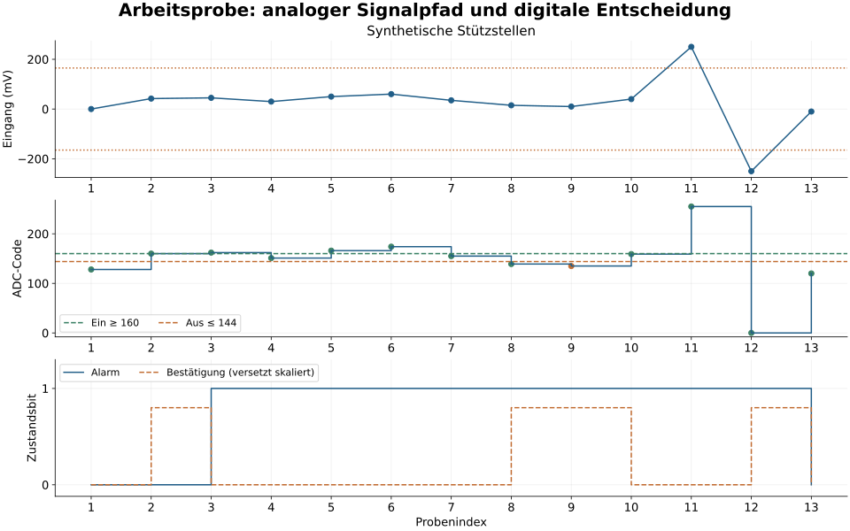

# M30-L5 – Arbeitsprobe: Verstärkerkennlinie und HDL-Simulation eines Schwellwertdetektors prüfen {#L5}

**Kursbereich:** M30 – Bachelor–Master-Brücke: Übergang analoge und digitale Schaltungsentwicklung

**Niveau:** Bachelor · Bachelor–Master-Brücke

**Vorwissen:** [M30-L1](M30-L1.md), [M30-L2](M30-L2.md), [M30-L3](M30-L3.md), [M30-L4](M30-L4.md).

**Lernziel:** Einen gemischt analog-digitalen Signalpfad numerisch prüfen und eine reproduzierbare RTL-Testbench vorbereiten.

## Aufgabe und Spezifikation {#S1}

Ein analoger Sensor liefert eine langsame Spannung $v_s$ relativ zu seiner Nullreferenz. Das Frontend hebt die Spannung auf den ADC-Bereich an; anschließend soll ein digitaler Block ab einem erhöhten Signal einen Alarm ausgeben. Verknüpfe das statische Verstärkermodell mit dem synchronen Schwellwertdetektor aus [M30-L3](M30-L3.md) und [M30-L4](M30-L4.md). Es wird ein didaktisches System untersucht, kein reales Mess- oder Schutzgerät.

$$v_o=\min(3{,}3,\max(0,1{,}65+10v_s)),\qquad c=\min(255,\max(0,\lfloor 256v_o/3{,}3\rfloor)).$$

Die Verstärkung 10 ist hier idealisiert (in [M30-L2](M30-L2.md) beträgt sie im Einpol-Beispiel 9,901). Der ADC tastet einen eingeschwungenen Ausgang ideal ab. Die Schrittweite ist $3{,}3/256=12{,}890625$ mV beziehungsweise 1,289 mV am Eingang. Am oberen Schwellwert $c\ge160$ liegt ideal $v_s\ge41{,}25$ mV vor; $c\le144$ gilt für $v_s<21{,}9140625$ mV. Die untere Grenze ist strikt, weil Code 145 bereits nicht mehr qualifiziert. Die Eingangshysterese beträgt rund 19,34 mV. Sättigung tritt für $|v_s|\ge165$ mV auf; die Codes allein zeigen nicht, wie weit die Eingangsspannung über den Bereich hinausging. Ein realer Wandler hat unter anderem Offset-, Gain-, Linearitäts- und Rauschfehler.

## Reproduzierbare Referenzrechnung {#S2}

Das folgende Python-Programm nutzt zwei unabhängig formulierte Übergangsbeschreibungen (bedingte Zustandsänderung und Fallauswahl). Es vergleicht alle binären Zustände, ADC-Codes, Valid- und Reset-Kombinationen sowie eine Signalfolge. Ausführung mit Python 3 und NumPy.

```python
import numpy as np
from itertools import product

def amp(v):
    return np.clip(1.65+10*np.asarray(v),0,3.3)
def adc(v):
    return np.clip(np.floor(256*np.asarray(v)/3.3),0,255).astype(int)
def step(alarm,pending,code,valid=True,reset=False):
    if reset: return 0,0
    if not valid: return alarm,pending
    qualifies = code<=144 if alarm else code>=160
    if not qualifies: return alarm,0
    if pending: return 1-alarm,0
    return alarm,1

def reference(a,p,c,v,r):
    if r: return (0,0)
    if not v: return (a,p)
    if (a==0 and c<160) or (a==1 and c>144): return (a,0)
    return [(a,1),(1-a,0)][p]
for a,p,c,v,r in product(range(2),range(2),range(256),range(2),range(2)):
    assert step(a,p,c,v,r)==reference(a,p,c,v,r)
vin=np.array([0,.042,.045,.03,.05,.06,.035,.015,.01,.04,.25,-.25,-.01])
valid=np.array([1,1,1,1,1,1,1,1,0,1,1,1,1],int)
codes=adc(amp(vin)); alarm=[]; pending=[]; a=p=0
for c,v in zip(codes,valid):
    a,p=step(a,p,int(c),bool(v));alarm.append(a);pending.append(p)
assert alarm==[0,0,1,1,1,1,1,1,1,1,1,1,0]
print('4096 Zustandstests; Codes:',codes,'Alarm:',alarm,'Pending:',pending)
```

Das Programm wurde ausgeführt. Die 4.096 Kombinationen stimmen in beiden Beschreibungen überein. Die folgende Tabelle gibt einige Grenzfälle und die vollständige Zeitfolge wieder. Alle Spannungswerte sind synthetische Stützstellen; eine zeitkontinuierliche Analogsimulation ist nicht Teil des Versuchs.

| Probe | Eingang (mV) | ADC-Code | valid | Alarm | Bestätigung |
| ---: | ---: | ---: | ---: | ---: | ---: |
| 1 | 0 | 128 | 1 | 0 | 0 |
| 2 | 42 | 160 | 1 | 0 | 1 |
| 3 | 45 | 162 | 1 | 1 | 0 |
| 4 | 30 | 151 | 1 | 1 | 0 |
| 5 | 50 | 166 | 1 | 1 | 0 |
| 6 | 60 | 174 | 1 | 1 | 0 |
| 7 | 35 | 155 | 1 | 1 | 0 |
| 8 | 15 | 139 | 1 | 1 | 1 |
| 9 | 10 | 135 | 0 | 1 | 1 |
| 10 | 40 | 159 | 1 | 1 | 0 |
| 11 | 250 | 255 | 1 | 1 | 0 |
| 12 | -250 | 0 | 1 | 1 | 1 |
| 13 | -10 | 120 | 1 | 0 | 0 |

{alt="Eingangsfolge und ADC-Codes mit Schwellwerten sowie simulierte Zustandsbits des Referenzmodells."}

## HDL-Testbench {#S3}

Speichere das RTL-Modul aus [M30-L4](M30-L4.md) als `detector.sv`. Speichere den folgenden Code als `tb.sv`. Die Testbench stellt zunächst jeden der vier Zustände über die öffentliche Schnittstelle her. Anschließend durchläuft sie für jeden Zustand alle Codes und beide Steuersignale. Die erwarteten Ausgänge folgen aus der Übergangstabelle und werden nach der Taktflanke geprüft. So werden auch Reset-Priorität, Halten ungültiger Proben und inklusive Grenzen geprüft.

```systemverilog
`timescale 1ns/1ps
module tb;
  logic clk=0, rst, valid;
  logic [7:0] code;
  logic alarm, pending;
  integer checks=0;
  detector dut(.*);
  always #5 clk=~clk;

  task automatic tick(input bit r, v, input logic [7:0] c,
                      input bit ea, ep);
    @(negedge clk); rst=r; valid=v; code=c;
    @(posedge clk); #1;
    if ({alarm,pending} !== {ea,ep})
      $fatal(1,"code=%0d rst=%b valid=%b got=%b%b want=%b%b",
             c,r,v,alarm,pending,ea,ep);
  endtask

  task automatic prepare(input bit a,p);
    tick(1,0,0,0,0);
    if (a) begin
      tick(0,1,160,0,1);
      tick(0,1,160,1,0);
      if (p) tick(0,1,144,1,1);
    end else if (p) tick(0,1,160,0,1);
  endtask

  initial begin
    rst=1; valid=0; code=0;
    for (int a=0; a<2; a++) begin
      for (int p=0; p<2; p++) begin
        for (int c=0; c<256; c++) begin
          for (int v=0; v<2; v++) begin
            for (int r=0; r<2; r++) begin
              bit ea, ep, q;
              prepare(a[0],p[0]);
              q = a ? (c<=144) : (c>=160);
              ea = a[0]; ep = p[0];
              if (r) begin ea=0; ep=0; end
              else if (v) begin
                ea = a[0] ^ (p[0] & q);
                ep = q & ~p[0];
              end
              tick(r[0],v[0],c[7:0],ea,ep);
              checks++;
            end
          end
        end
      end
    end
    $display("PASS: %0d transitions",checks);
    $finish;
  end
endmodule
```

Ausführung wie in [M30-L4](M30-L4.md#S4). Erwartete Abschlussmeldung: `PASS: 4096 transitions`. Der SystemVerilog-Code wurde gegen die Spezifikation redaktionell geprüft, aber nicht kompiliert oder in einem HDL-Simulator ausgeführt (Werkzeug nicht vorhanden); die Ausgabe ist ausdrücklich eine Erwartung, kein Ergebnisprotokoll. Das ausgeführte Python-Modell ersetzt diesen Test nicht. Nach der funktionalen RTL-Prüfung wären Synthese und Timing-Analyse separate Schritte.

## Auswertung und Fehlerbudget {#S4}

Erhöhe den analogen Ausgangsoffset um 20 mV. Der eingangsbezogene Fehler ist +2 mV. Die obere Eingangsschwelle sinkt von 41,25 auf 39,25 mV, die untere Grenze von 21,914 auf 19,914 mV. Der Code 160 bei Probe 2 liegt nahe an der idealen Schwelle. Schon ein kleiner negativer Offset beziehungsweise eine kleinere tatsächliche Verstärkung kann ihn unter die Schwelle drücken und damit den Alarm verzögern. Dass die RTL-Logik korrekt ist, garantiert nicht die korrekte physikalische Auslöseschwelle. Ein realer Test benötigt kalibrierte Eingänge, Messunsicherheit, Referenzspannungsmessung, definierte Abtastzeiten und ein Fehlerverhalten bei Datenverlust.

**Abnahmekriterien der Arbeitsprobe:** Reproduziere die Referenztabelle; untersuche die Grenzcodes 144/145/159/160; führe die HDL-Testbench lokal aus und bewahre deren Protokoll auf; dokumentiere das getrennte Timing- und Analogfehlerbudget. Ändere zunächst nur eine Modellannahme und protokolliere deren Auswirkung, damit Ursache und Ergebnis nachvollziehbar bleiben.

## Übungen mit Lösungen {#S5}

1. Welche Codes ergeben 0 und 250 mV am Eingang? **Lösung:** 128 und 255; der zweite Eingang führt zur Sättigung.
2. Wie ändert sich die obere analoge Schwelle bei einer Verstärkung 9,9 ohne Offsetabweichung? **Lösung:** $0{,}4125/9{,}9=41{,}667$ mV.
3. Werden zwei hohe Codes mit einer ungültigen Probe dazwischen bestätigt? **Lösung:** Ja; ungültige Takte verändern die Bestätigung nicht. Eine gültige Probe unter 160 würde sie dagegen löschen.
4. Erweitere den Entwurf um einen Timeout. **Lösungsskizze:** Zähler für aufeinanderfolgende ungültige Takte, Rücksetzen bei gültiger Probe; nach einer spezifizierten Frist separates Fehlerbit setzen. Der Umgang mit dem bisherigen Alarm muss als Anforderung ausdrücklich festgelegt werden. Die Lösung benötigt zusätzliche Register und eigene Grenzfalltests.

## Quellen {#S6}

- [MIT OpenCourseWare – 6.012 Microelectronic Devices and Circuits, Vorlesungsnotizen 17–23](https://ocw.mit.edu/courses/6-012-microelectronic-devices-and-circuits-fall-2009/pages/lecture-notes/) · Vorlesungen 17–23: Verstärkerkennwerte, Stufen und Frequenzgang; kein HDL-Simulationsbeleg; nur Vorlesungsverzeichnis. · Zuletzt abgerufen: 2026-11-25
- [Icarus Verilog – Simulation Using Icarus Verilog](https://steveicarus.github.io/iverilog/usage/simulation.html) · Abschnitt Making and Using Libraries: Testbench und Entwurf gemeinsam übersetzen; Teilaspekt. · Zuletzt abgerufen: 2026-11-25
- [Icarus Verilog – Getting Started](https://steveicarus.github.io/iverilog/usage/getting_started.html) · Getting Started: Zählerbeispiel, Testbench und zweistufiger Ablauf iverilog/vvp. · Zuletzt abgerufen: 2026-11-25
