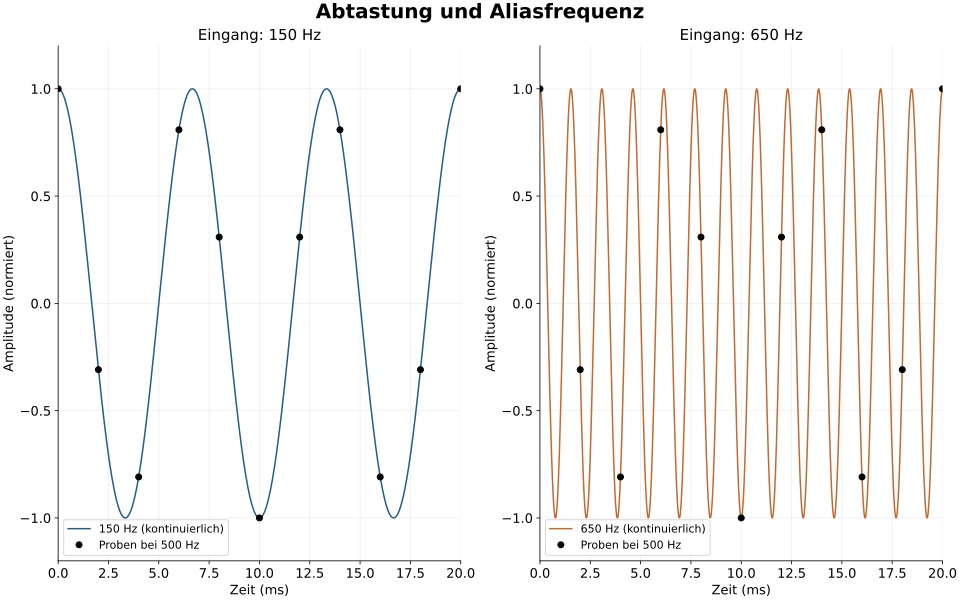

# M31-L1 – Abtastung und Rekonstruktion: Aliasing im Zeit- und Frequenzbereich erkennen {#L1}

**Kursbereich:** M31 – Bachelor–Master-Brücke: Digitale Signalverarbeitung

**Niveau:** Bachelor · Bachelor–Master-Brücke

**Vorwissen:** [M16-L3](M16-L3.md), [M5-L5](M5-L5.md), Fourier-Grundlagen.

**Lernziel:** Abtastfrequenz, Aliasfrequenz und Rekonstruktionsbedingungen berechnen.

## Diagnostischer Selbsttest {#S1}

1. Welche Frequenz besitzt die abgetastete Folge eines 650-Hz-Kosinus bei 500 Hz Abtastfrequenz? 2. Kann man nach der Digitalisierung zwischen 650 Hz und 150 Hz unterscheiden? 3. Worin unterscheidet sich Quantisierung von Abtastung? 4. Ist eine schnelle FFT bereits ein Verfahren zur Vermeidung von Aliasing?

**Antworten:** 1. 150 Hz im Basisband. 2. Ohne Zusatzinformation nicht. 3. Abtastung diskretisiert die Zeit, Quantisierung die Amplitude. 4. Nein; die FFT analysiert die bereits abgetasteten Werte. Bei Unsicherheit wiederhole [M16-L3](M16-L3.md) und [M5-L5](M5-L5.md).

## Abtastmodell {#S2}

Ein kontinuierliches Signal $x(t)$ wird ideal zu den Zeiten $nT_s$ gemessen. Dabei bezeichnet $T_s$ das Zeitintervall und $f_s=1/T_s$ die Abtastfrequenz. Die Folge ist $x[n]=x(nT_s)$. Für einen Kosinus gilt

$$x[n]=A\cos(2\pi f_0n/f_s+\varphi).$$

Die digitale Kreisfrequenz $\Omega=2\pi f_0/f_s$ hat die Einheit rad/Probe. Frequenzen, die sich um ganzzahlige Vielfache von $f_s$ unterscheiden, erzeugen bei gleicher Phase dieselbe komplexe Exponentialfolge. Bei reellen Kosinusfolgen ist zusätzlich das Vorzeichen der Frequenz bei entsprechend gespiegelter Phase mehrdeutig. Die vorzeichenbehaftete Basisbandfrequenz kann durch

$$f_a=((f_0+f_s/2)\bmod f_s)-f_s/2$$

berechnet werden. Für einen phasenlosen Kosinus ist die beobachtete positive Frequenz $|f_a|$.

**Beispiel:** $f_s=500$ Hz, $T_s=2$ ms. Sowohl 150 Hz als auch 650 Hz liefern $\cos(0{,}6\pi n)$, da $2\pi\cdot650/500=2\pi+0{,}6\pi$. Ein Kosinus bei 350 Hz führt ebenfalls zu 150 Hz, sofern die Phase null ist. Bei 250 Hz erhält man nur alternierende Werte; ein Sinus gleicher Frequenz und Phase null liefert ausschließlich Nullen. Die Nyquist-Grenzfrequenz ist deshalb kein robustes Ziel für eine reale Messung.

{alt="500-Hz-Abtastung zweier Kosinusfrequenzen mit identischen Proben für 150 und 650 Hz."}

## Spektrale Sicht und Rekonstruktion {#S3}

Mathematisch entspricht ideale Abtastung der Multiplikation mit einem Dirac-Kamm. Mit der Fourier-Konvention $X(f)=\int x(t)e^{-j2\pi ft}\,dt$ ergibt sich für das abgetastete Impulssignal

$$X_s(f)=f_s\sum_{k=-\infty}^{\infty}X(f-kf_s).$$

Ist das Signal auf $|f|\le B$ bandbegrenzt und gilt $f_s>2B$, überlappen sich die Kopien nicht. Ein idealer Tiefpass mit Verstärkung $1/f_s$ im Durchlassbereich und geeigneter Grenzfrequenz stellt $X(f)$ wieder her. Im Zeitbereich entspricht dies der Interpolation

$$x(t)=\sum_{n=-\infty}^{\infty}x[n]\,\operatorname{sinc}(t/T_s-n),\qquad \operatorname{sinc}(u)=\frac{\sin(\pi u)}{\pi u}.$$

Der ideale Filter ist nicht direkt kausal realisierbar. Endliche Daten, begrenzte Filterordnung, Taktjitter und Quantisierung erzeugen zusätzliche Fehler. Ein analoger Anti-Aliasing-Filter wird **vor** dem ADC eingesetzt. Ein digitales Filter danach kann eine bereits ins Nutzband gefaltete Störung nicht zuverlässig separieren.

## Messkette dimensionieren {#S4}

Eine Messung soll 0–180 Hz erfassen. Die Mindestbedingung für ein ideal bandbegrenztes Signal ist $f_s>360$ Hz. Bei 500 Hz bleiben bis zur Nyquist-Grenze 70 Hz Übergangsband. Eine höhere Rate von 1 kHz lässt 320 Hz Übergangsband und vereinfacht den analogen Tiefpass, erhöht aber Datenrate und Rechenlast. Die tatsächliche Filteranforderung wird aus tolerierbarer Reststörung und erwarteten Eingangsspektren bestimmt, nicht allein aus der Nyquist-Zahl. Wird später auf 500 Hz dezimiert, muss vor dem Weglassen jeder zweiten Probe ein digitales Anti-Aliasing-Filter die neue Grenze berücksichtigen.

Ein 12-Bit-ADC mit 0–3,3 V hat bei ideal gleichmäßiger Quantisierung $\Delta=3{,}3/4096\approx0{,}806$ mV Schrittweite. Bei 1 kHz und Speicherung in 16-Bit-Wörtern entstehen 2000 Byte/s ohne Protokoll-Overhead. Beide Größen sind unabhängig vom Aliasing, gehören aber zur Spezifikation der Messkette.

## Übungen und Kontrolle {#S5}

1. Eine 780-Hz-Störung wird mit 1 kHz abgetastet. **Lösung:** $f_a=-220$ Hz, Kosinus 220 Hz.
2. Ein Signal hat die höchste Frequenz 3,2 kHz. Genügen 6 kHz? **Lösung:** Nein, mindestens mehr als 6,4 kHz für das ideal bandbegrenzte Signal. Eine praktische Auslegung berücksichtigt Übergangsband und Dämpfung.
3. Warum unterscheiden sich 650 Hz und 150 Hz auch bei einer beliebig langen FFT derselben idealen Proben nicht? **Lösung:** Die Zeitfolgen sind identisch; dieselbe lineare Transformation ergibt dieselben Spektren.
4. Bei 1 kHz beträgt die Zeitunsicherheit 1 µs. Schätze den maximalen Amplitudenfehler eines 180-Hz-Sinus mit 1 V Spitze. **Lösung:** Mit $|dx/dt|\le2\pi fA$ folgt etwa 1,13 mV; dies ist eine lineare Näherung für kleinen Jitter.

## Quellen {#S6}

- [ETH Zürich – Core Courses and Specialisations (Bachelor)](https://ee.ethz.ch/studies/bachelor/bsc-eeit/third-year/core-courses.html) · Core Courses: Communication and Detection Theory, Signal Processing; curricularer Vergleich, kein Nachweis des konkreten Semesterangebots. · Zuletzt abgerufen: 2026-11-25
- [MIT OpenCourseWare – 2.161 Signal Processing: Continuous and Discrete, Lecture Notes](https://ocw.mit.edu/courses/2-161-signal-processing-continuous-and-discrete-fall-2008/pages/lecture-notes/) · Sitzung 10: Abtastung und DFT; nur Vorlesungsverzeichnis. · Zuletzt abgerufen: 2026-11-25
- [MIT OpenCourseWare – 6.341 Discrete-Time Signal Processing, Lecture Notes](https://ocw.mit.edu/courses/6-341-discrete-time-signal-processing-fall-2005/pages/lecture-notes/) · Vorlesungen 4–5 (Übersicht): Verarbeitung kontinuierlicher Signale und Abtastratenwandlung. · Zuletzt abgerufen: 2026-11-25
