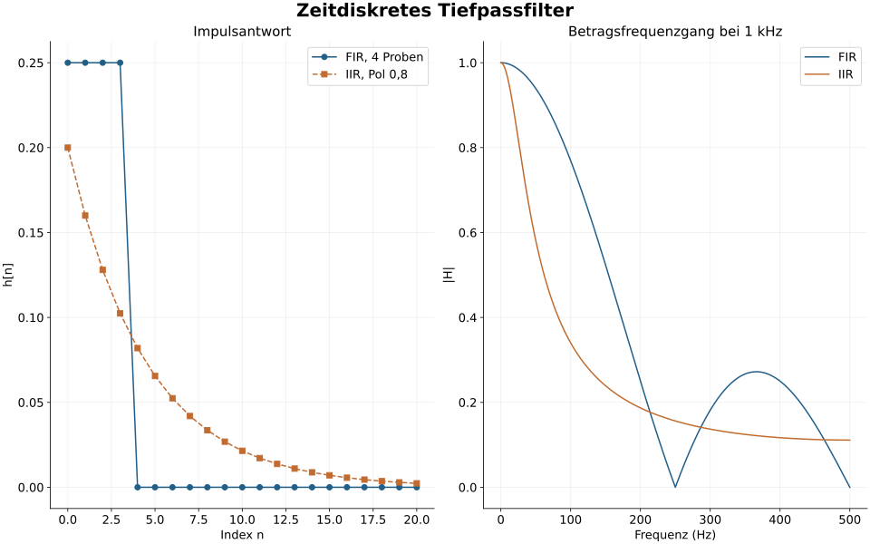

# M31-L2 – Fourier- und z-Transformation: Zeitdiskrete Systeme und Filter beschreiben {#L2}

**Kursbereich:** M31 – Bachelor–Master-Brücke: Digitale Signalverarbeitung

**Niveau:** Bachelor · Bachelor–Master-Brücke

**Vorwissen:** [M31-L1](M31-L1.md), [M5-L2](M5-L2.md).

**Lernziel:** Frequenzgang, Stabilität und Übertragungsfunktion einfacher zeitdiskreter Filter bestimmen.

## Von der Folge zum Spektrum {#S1}

Für eine absolut summierbare Folge ist die zeitdiskrete Fourier-Transformation (DTFT)

$$X(e^{j\Omega})=\sum_{n=-\infty}^{\infty}x[n]e^{-j\Omega n}.$$

Sie ist kontinuierlich in $\Omega$ und $2\pi$-periodisch. Die diskrete Fourier-Transformation (DFT) einer endlichen Folge mit $N$ Elementen berechnet dagegen endlich viele Werte:

$$X[k]=\sum_{n=0}^{N-1}x[n]e^{-j2\pi kn/N},\qquad x[n]=\frac1N\sum_{k=0}^{N-1}X[k]e^{j2\pi kn/N}.$$

Die FFT ist ein Algorithmus zur Berechnung der DFT, keine andere Transformation. Bei $f_s=1000$ Hz und $N=200$ ist der Abstand der Frequenzpunkte $\Delta f=5$ Hz. Eine 125-Hz-Schwingung liegt auf Index 25. Bei 127 Hz liegt die Schwingung zwischen zwei Punkten; das rechteckige Beobachtungsfenster erzeugt Leakage. Ein Hann-Fenster senkt Nebenkeulen, verbreitert aber die Hauptkeule. Zero Padding erzeugt mehr interpolierte Spektralpunkte, jedoch keine zusätzliche Messinformation.

## Faltung und Übertragungsfunktion {#S2}

Ein lineares zeitinvariantes System (LTI) ist durch seine Impulsantwort $h[n]$ beschrieben. Für Nullanfangsbedingungen gilt

$$y[n]=\sum_{m=-\infty}^{\infty}h[m]x[n-m].$$

Im Frequenzbereich wird Faltung zur Multiplikation: $Y(e^{j\Omega})=H(e^{j\Omega})X(e^{j\Omega})$. Ein kausaler gleitender Mittelwert über vier Proben besitzt $h[0..3]=1/4$. Seine Übertragungsfunktion ist

$$H(z)=\frac{1+z^{-1}+z^{-2}+z^{-3}}4.$$

Auf dem Einheitskreis folgt $H(e^{j\Omega})=e^{-j3\Omega/2}\sin(2\Omega)/(4\sin(\Omega/2))$ mit Grenzwert eins bei DC. Nullstellen bei $\Omega=\pi/2$ und $\pi$ unterdrücken bei 1 kHz die Frequenzen 250 Hz und 500 Hz. Die Gruppenlaufzeit beträgt im Durchlassbereich 1,5 Proben bzw. 1,5 ms. Eine blockweise DFT-Multiplikation liefert zunächst zyklische Faltung; für lineare Faltung zweier endlicher Folgen der Längen $N$ und $M$ ist eine Länge von mindestens $N+M-1$ erforderlich.

{alt="Impulsantwort und Betragsfrequenzgang für FIR- und IIR-Beispiele."}

## z-Transformation und Stabilität {#S3}

Die bilaterale z-Transformation lautet $X(z)=\sum x[n]z^{-n}$. Sie ist erst zusammen mit einem Konvergenzgebiet eindeutig. Für das rekursive System

$$y[n]=0{,}8y[n-1]+0{,}2x[n]$$

folgt unter Nullanfangsbedingungen $H(z)=0{,}2/(1-0{,}8z^{-1})$. Die kausale Impulsantwort $h[n]=0{,}2\cdot0{,}8^n$ für $n\ge0$ ist absolut summierbar; der Pol liegt bei 0,8 im Einheitskreis. Das Konvergenzgebiet $|z|>0{,}8$ enthält den Einheitskreis. Damit ist das System BIBO-stabil. Allgemein gilt bei kausalen rationalen Systemen nach Entfernung tatsächlicher Pol-Nullstellen-Kürzungen: Alle Pole müssen betragsmäßig kleiner als eins sein. Die reine Übertragungsfunktion sagt bei verborgenen Zuständen nicht zwingend etwas über interne Stabilität aus.

Bei einem Einheitssprung ab $n=0$ ist die Antwort $y[n]=1-0{,}8^{n+1}$. Für mindestens 95 % des Endwerts sind 14 Proben erforderlich ($n=13$). Ein FIR-Filter hat endliche Impulsantwort und ist bei endlichen Koeffizienten BIBO-stabil; ein IIR-Filter kann mit niedrigerer Ordnung eine starke Glättung erzielen, reagiert jedoch auf Rückkopplung und Koeffizientenfehler.

## Auswahl anhand der Anforderungen {#S4}

Ein Filter ist nicht allein wegen niedriger Restamplitude besser. Für ein Messsignal können Durchlassbandfehler, Stördämpfung, Phasenverlauf, Verzögerung und Rechenaufwand konkurrieren. Das Vierpunkt-FIR verwendet vier Werte und eliminiert die 250-Hz-Komponente exakt im idealen Modell. Das IIR benötigt nur den alten Ausgang und die aktuelle Probe, besitzt aber frequenzabhängige Gruppenlaufzeit. Rundung erzeugt in Festkommaimplementierungen möglicherweise einen Restfehler; Grenzzyklen sind bei rekursiven Filtern gesondert zu testen. Der hier gezeigte Frequenzgang ist ein Modell mit reellen Koeffizienten, keine Aussage über eine bestimmte Hardware.

## Übungen und Kontrolle {#S5}

1. $f_s=2$ kHz, 1000 Proben. **Lösung:** $\Delta f=2$ Hz, Beobachtungsdauer 0,5 s.
2. Bestimme die ersten drei Werte des gleitenden Mittels auf einen Einheitssprung mit Nullhistorie. **Lösung:** 0,25; 0,5; 0,75. Ab der vierten Probe ist der Wert eins.
3. Ersetze den IIR-Pol 0,8 durch 1,02 bei unverändertem Zähler. **Lösung:** Die kausale Impulsantwort wächst, ist nicht absolut summierbar und das System ist nicht BIBO-stabil.
4. Warum führt eine Verdopplung der FFT-Länge durch Nullen nicht zur halben physikalischen Auflösung? **Lösung:** Die Beobachtungszeit bleibt gleich. Nur das Frequenzraster wird dichter.

## Quellen {#S6}

- [ETH Zürich – Core Courses and Specialisations (Bachelor)](https://ee.ethz.ch/studies/bachelor/bsc-eeit/third-year/core-courses.html) · Core Courses: Communication and Detection Theory, Signal Processing; curricularer Vergleich, kein Nachweis des konkreten Semesterangebots. · Zuletzt abgerufen: 2026-11-25
- [MIT OpenCourseWare – 2.161 Signal Processing: Continuous and Discrete, Lecture Notes](https://ocw.mit.edu/courses/2-161-signal-processing-continuous-and-discrete-fall-2008/pages/lecture-notes/) · Sitzungen 10–15: DFT, z-Transformation und diskrete Systemantwort; nur Vorlesungsverzeichnis. · Zuletzt abgerufen: 2026-11-25
- [MIT OpenCourseWare – 6.341 Discrete-Time Signal Processing, Lecture Notes](https://ocw.mit.edu/courses/6-341-discrete-time-signal-processing-fall-2005/pages/lecture-notes/) · Vorlesungen 7–9 und 15–16 (Übersicht): Filter und diskrete Fourier-Transformation; Teilaspekt. · Zuletzt abgerufen: 2026-11-25
