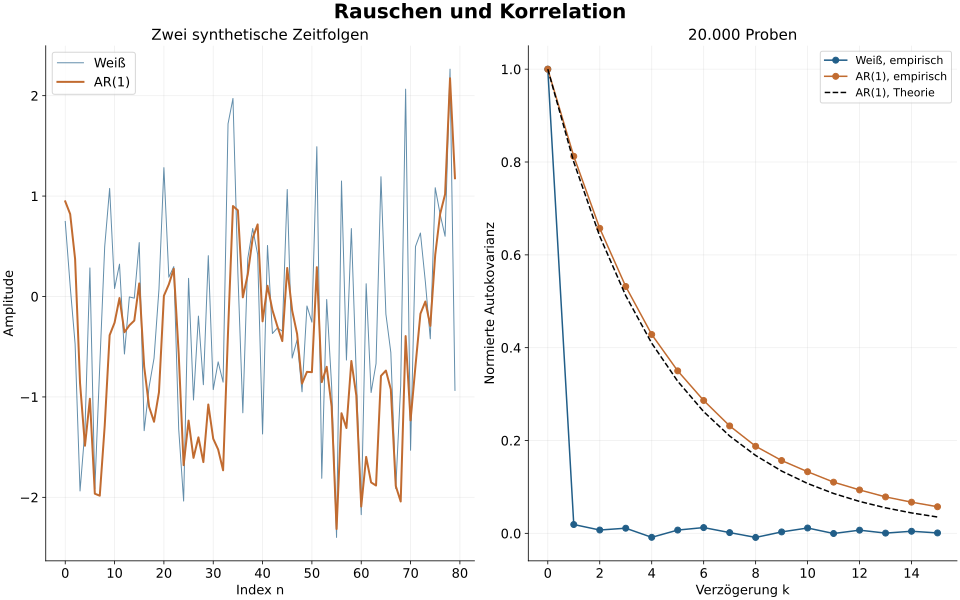

# M31-L3 – Zufallssignale, Korrelation und Rauschen: Vom Modell zur Messgröße {#L3}

**Kursbereich:** M31 – Bachelor–Master-Brücke: Digitale Signalverarbeitung

**Niveau:** Bachelor · Bachelor–Master-Brücke

**Vorwissen:** [M2-L6](M2-L6.md), [M31-L2](M31-L2.md); ergänzend Universitätsmathematik [M1-L7](index.html?course=university_mathematics&module=M1&lesson=L7&syslang=de&doclang=de&theme=light) und [M2-L9](index.html?course=university_mathematics&module=M2&lesson=L9&syslang=de&doclang=de&theme=light) gemäß Curriculum.

**Lernziel:** Mittelwert, Varianz, Autokorrelation und Rauschleistung aus Modell und Daten bestimmen.

## Zufallsvariable und Zufallsprozess {#S1}

Eine Zufallsvariable beschreibt einen unsicheren Zahlenwert. Ein zeitdiskreter Zufallsprozess $X[n]$ beschreibt eine Folge solcher Variablen. Jede Realisierung ist eine konkrete Messfolge; mehrere Realisierungen können unterschiedlich aussehen und dennoch demselben Modell folgen. Der Mittelwert $\mu[n]=E[X[n]]$ und die Varianz $\sigma^2[n]=E[(X[n]-\mu[n])^2]$ charakterisieren die ersten beiden Momente.

Ein im weiteren Sinne stationärer reeller Prozess (WSS) besitzt konstanten endlichen Mittelwert und eine nur von der Zeitdifferenz abhängige Autokorrelation $R_X[k]=E[X[n]X[n-k]]$. Die Autokovarianz ist $C_X[k]=R_X[k]-\mu^2$. Stationarität ist keine Garantie für Ergodizität; Zeitmittel aus einer einzelnen Realisierung dürfen nur unter geeigneten Bedingungen als Schätzer von Ensemblemitteln interpretiert werden.

Für eine endliche Stichprobe $x[0],\ldots,x[N-1]$ können Mittelwert und Varianz durch $\bar x=\sum x[n]/N$ und $s^2=\sum (x[n]-\bar x)^2/(N-1)$ geschätzt werden. Der zweite Ausdruck ist unter i.i.d.-Annahmen ein unverzerrter Varianzschätzer. Bei zeitlicher Korrelation kann diese Eigenschaft verloren gehen. Für $0\le k<N$ ist ein einfacher Autokovarianzschätzer

$$\hat C[k]=\frac1N\sum_{n=k}^{N-1}(x[n]-\bar x)(x[n-k]-\bar x).$$

Bei hohen Verzögerungen stehen weniger Produkte zur Verfügung. Der Faktor $1/N$ erzeugt einen Randbias; eine Division durch $N-k$ hebt den Faktor bei bekanntem Mittelwert auf, kann aber die Varianz erhöhen. Beide Varianten sind bei geschätztem Mittelwert mit Vorsicht zu interpretieren.

## Weißes Rauschen und Leistungsdichte {#S2}

Weißes, mittelwertfreies Rauschen hat Autokorrelation $R_W[k]=\sigma_w^2\delta[k]$. Weiß bedeutet unkorreliert, nicht automatisch gaußverteilt oder unabhängig. Sind die Zufallsgrößen gemeinsam gaußverteilt, folgt aus fehlender Korrelation Unabhängigkeit. Die Leistungsdichtespektralform ist die DTFT der Autokorrelation (Wiener-Khinchin-Beziehung bei WSS):

$$S_X(e^{j\Omega})=\sum_{k=-\infty}^{\infty}R_X[k]e^{-j\Omega k},\qquad R_X[0]=\frac1{2\pi}\int_{-\pi}^{\pi}S_X(e^{j\Omega})d\Omega.$$

Für weißes Rauschen ist $S_W=\sigma_w^2$ in dieser normierten Frequenzkonvention. In physikalischen Hz gilt für die zweiseitige Dichte $S_f(f)=S_X(e^{j2\pi f/f_s})/f_s$ mit Einheit etwa V²/Hz. Ein einseitiges Spektrum eines reellen Signals verdoppelt die Dichte für positive Frequenzen (nicht die DC- und gegebenenfalls Nyquist-Punkte einer DFT).

## Farbiges Rauschen als Prozessmodell {#S3}

Ein einfaches autoregressives Modell ist $X[n]=aX[n-1]+W[n]$ mit $|a|<1$ und unabhängigen Innovationen $W[n]$ mit Mittelwert null und Varianz $\sigma_w^2$. Für eine stationäre Lösung folgt aus der Varianzgleichung $\sigma_x^2=a^2\sigma_x^2+\sigma_w^2$ und damit

$$\sigma_x^2=\frac{\sigma_w^2}{1-a^2},\quad R_X[k]=\sigma_x^2a^{|k|},\quad S_X(e^{j\Omega})=\frac{\sigma_w^2}{|1-ae^{-j\Omega}|^2}.$$

Für $a=0{,}8$ und $\sigma_w=0{,}6$ ergibt sich Varianz eins; die normierte Korrelation bei Abstand 2 ist 0,64. Gegenüber weißem Rauschen derselben Varianz sind benachbarte Proben häufig ähnlich. Die Grafik nutzt synthetische Realisierungen mit verworfenem Einschwingabschnitt; sie ist keine Messung eines realen Sensors.

{alt="Synthetisches weißes Rauschen, AR(1)-Prozess und empirische sowie theoretische Autokorrelation."}

## Filterung und Messunsicherheit {#S4}

Für ein stabiles LTI-System ist $S_Y=|H|^2 S_X$. Bei unabhängigen Proben mit Varianz $\sigma^2$ reduziert ein Mittel über $M$ Proben die Varianz auf $\sigma^2/M$. Bei korrelierten Proben wird

$$\operatorname{Var}(\bar X)=\frac{1}{M^2}\left(MR_X[0]+2\sum_{k=1}^{M-1}(M-k)R_X[k]\right)$$

für ein mittelwertfreies stationäres Signal benötigt. Vier unabhängige Proben mit Varianz eins ergeben 0,25; beim AR(1)-Modell oben ergibt sich $(4+2(3\cdot0{,}8+2\cdot0{,}64+0{,}512))/16=0{,}774$. Ein Mittelwert kann also bei farbigem Rauschen wesentlich weniger wirksam sein. Ein zusätzlicher Gleichanteil verschiebt den Mittelwert, wird durch Mittelung aber nicht beseitigt. Bei der Angabe von SNR ist die Bandbreite zu dokumentieren: Leistung von Nutzsignal und Rauschen müssen für dieselbe Messkette bestimmt sein.

## Übungen und Kontrolle {#S5}

1. Ein Rauschen von 2 mV RMS wird aus neun unabhängigen Proben gemittelt. **Lösung:** 0,667 mV RMS.
2. Für $a=0{,}5$ soll Varianz eins entstehen. **Lösung:** Innovationsvarianz 0,75; Standardabweichung etwa 0,866.
3. Was unterscheidet eine empirische Korrelationskurve von der theoretischen? **Lösung:** Endliche Stichproben streuen, Mittelwertschätzung und Randbehandlung beeinflussen die Werte; Modellabweichungen sind ebenfalls möglich.
4. Ein sinusförmiger Nutzanteil hat 1 V RMS, das Rauschen 10 mV RMS. **Lösung:** $10\log_{10}(1^2/0{,}01^2)=40$ dB unter derselben Impedanz und Bandbreite.

## Quellen {#S6}

- [ETH Zürich – Core Courses and Specialisations (Bachelor)](https://ee.ethz.ch/studies/bachelor/bsc-eeit/third-year/core-courses.html) · Core Courses: Communication and Detection Theory, Signal Processing; curricularer Vergleich, kein Nachweis des konkreten Semesterangebots. · Zuletzt abgerufen: 2026-11-25
- [MIT OpenCourseWare – 2.161 Signal Processing: Continuous and Discrete, Lecture Notes](https://ocw.mit.edu/courses/2-161-signal-processing-continuous-and-discrete-fall-2008/pages/lecture-notes/) · Sitzungen 21–23: Zufallssignale, Korrelation und Spektralschätzung; nur Vorlesungsverzeichnis. · Zuletzt abgerufen: 2026-11-25
- [MIT OpenCourseWare – 6.450 Principles of Digital Communication I, Lecture Notes](https://ocw.mit.edu/courses/6-450-principles-of-digital-communication-i-fall-2009/pages/lecture-notes/) · Sitzungen 13–15: Zufallsprozesse, gaußsches Rauschen und Filterung; nur Vorlesungsverzeichnis. · Zuletzt abgerufen: 2026-11-25
