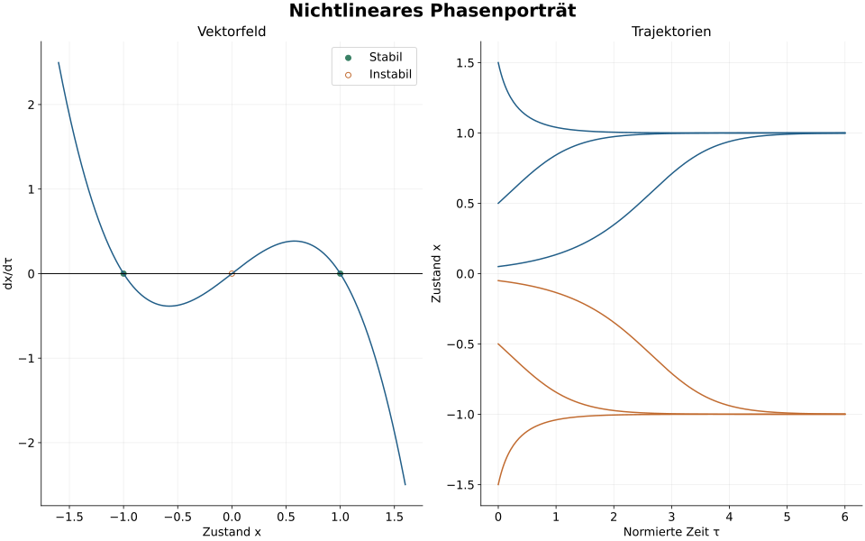

# M32-L1 – Nichtlineare Dynamik: Gleichgewichte, lokale Linearisierung und Phasenporträt {#L1}

**Kursbereich:** M32 – Masterprofil: Nichtlineare und modellprädiktive Regelung

**Niveau:** Master · Masterprofil

**Vorwissen:** [M28-L1](M28-L1.md), [M28-L2](M28-L2.md), [M12-L2](M12-L2.md).

**Lernziel:** Gleichgewichte und lokale Stabilität bestimmen, einen Phasenraum interpretieren und die Reichweite einer Linearisierung begründen.

## Nichtlineares Zustandsmodell {#S1}

Ein lineares Modell kann Schwingungen, Speicher und Kopplungen beschreiben, aber keine zustandsabhängigen Koeffizienten oder Sättigungen in einem einzigen globalen linearen Ansatz erfassen. In einem elektrischen oder thermischen System sind Materialwerte oft temperaturabhängig. Die Zustandsform lautet

$$\dot x=f(x,u),\qquad y=h(x,u).$$

Ein Gleichgewicht bei konstantem Eingang $u_e$ erfüllt $f(x_e,u_e)=0$. Mehrere Gleichgewichte sind möglich. Der Zustand ist eine minimale (oder zumindest hinreichende) Information zur Vorhersage unter gegebenem Eingang; die Messgröße $y$ muss ihn nicht vollständig wiedergeben. Es ist sinnvoll, dimensionsbehaftete Größen vor numerischen Analysen zu skalieren.

**Modellbeispiel:** $x$ sei eine dimensionslose Abweichung, $\tau$ eine mit einer Referenzzeit normierte Zeit. Das autonome System

$$\frac{dx}{d\tau}=x-x^3=x(1-x^2)$$

besitzt die stationären Punkte −1, 0 und +1. Die Vorzeichen von $f$ in den vier offenen Intervallen lauten +, −, +, −. Bei $x=0$ bleibt ein exakt dort gestarteter Zustand ohne Anregung; eine kleine Abweichung wächst zunächst. Die beiden äußeren Gleichgewichte ziehen jeweils die Zustände ihrer Seite an. Das Modell ist eine mathematische Normalform, keine gemessene Kennlinie eines konkreten Geräts.

{alt="Normiertes kubisches Vektorfeld und Trajektorien zu den stabilen Gleichgewichten −1 und +1."}

## Lokale Linearisierung {#S2}

Setze $\delta x=x-x_e$, $\delta u=u-u_e$. Die Taylorentwicklung erster Ordnung liefert

$$\delta\dot x=A\delta x+B\delta u+O(\|(\delta x,\delta u)\|^2),\quad A=\left.\frac{\partial f}{\partial x}\right|_e,\quad B=\left.\frac{\partial f}{\partial u}\right|_e.$$

Analog werden $C=\partial h/\partial x$ und $D=\partial h/\partial u$ berechnet. Im kubischen System gilt $A=1-3x_e^2$: bei ±1 ist $A=-2$, bei null $A=+1$. Die lineare Antwort lautet $\delta x(\tau)=\delta x(0)e^{A\tau}$. Negative Realteile aller Eigenwerte garantieren bei glattem autonomem System lokale exponentielle Stabilität; ein Eigenwert mit positivem Realteil zeigt Instabilität. Eigenwerte auf der imaginären Achse allein entscheiden den allgemeinen nichtlinearen Fall nicht (z. B. $\dot x=-x^3$ versus $\dot x=x^3$).

**Rechenprobe:** Bei $x_e=1$, $\delta x=0{,}2$ liefert die lineare Ableitung −0,4, das Original −0,528. Der lineare Fehler beträgt 0,128 in der normierten Ableitung. Bei $\delta x=0{,}02$ beträgt der Fehler nur 0,001208. Die Abweichung fällt annähernd quadratisch, nicht linear, mit kleiner werdender Störung.

## Phasenebene für zwei Zustände {#S3}

Für ein Pendel seien $\theta$ Winkel (rad) und $\omega$ Winkelgeschwindigkeit (rad/s). Ein idealisiertes Modell mit Dämpfung lautet

$$\dot\theta=\omega,\quad \dot\omega=-\frac{g}{l}\sin\theta-b\omega+\frac{u}{J},$$

mit $g$ Erdbeschleunigung, $l$ Länge, $b$ normiertem Dämpfungskoeffizienten (1/s), $J$ Trägheitsmoment und $u$ Drehmoment (Nm). Bei $u=0$ liegen Gleichgewichte bei $(k\pi,0)$. Die Matrix

$$A=\begin{pmatrix}0&1\\-g\cos\theta_e/l&-b\end{pmatrix}$$

hat für $\theta_e=0$ und $b>0$ nur Eigenwerte mit negativem Realteil. Bei $\theta_e=\pi$ ist die Determinante negativ; ein Eigenwert ist positiv. Im Phasenporträt erscheinen die Trajektorien als Kurven, deren Tangenten durch das Zustandsfeld festgelegt sind. Die Darstellung eines Feldes ist keine Zeitachse. Die gesamte Kurve beschreibt, welche Zustände nacheinander erreicht werden; Richtung und Geschwindigkeit folgen aus dem Vektorfeld.

## Numerische Untersuchung {#S4}

Für eine Karte der erreichbaren Zustände starte Integration aus mehreren Punkten. Verwende unterschiedliche Anfangswerte in unmittelbarer Nähe zu instabilen Gleichgewichten und mindestens zwei Schrittweiten. Eine scheinbar kreuzende Trajektorie kann ein Zeichen zu grober Integration oder inkonsistenter Eingänge sein. Eindeutige Lösungen eines glatten autonomen Systems kreuzen sich im vollständigen Zustandsraum nicht. Projektionen eines höherdimensionalen Systems können sich dagegen kreuzen. Siehe [M12-L3](M12-L3.md) und [M32-L2](M32-L2.md).

## Übungen und Kontrolle {#S5}

1. Bestimme alle Gleichgewichte von $\dot x=2x-x^3$. **Lösung:** $0,\pm\sqrt2$; die Ableitungen sind $2,-4,-4$.
2. Was meldet die Linearisierung bei $\dot x=-x^3$ am Ursprung? **Lösung:** $A=0$; sie entscheidet die Stabilität nicht. Für $x\ne0$ zeigt das Vorzeichen jedoch stets zum Ursprung.
3. Berechne Pendel-Eigenwerte für $g/l=4$ s⁻² und $b=2$ s⁻¹ an der unteren Lage. **Lösung:** $-1\pm j\sqrt3$ s⁻¹.
4. Warum ist eine Regelung um $x_e=+1$ nicht automatisch geeignet, von $x=-1$ dorthin zu gelangen? **Lösung:** Andere Gleichgewichtslage, nichtlineares Feld, eventuell Eingangsbeschränkungen. Ein lokaler Entwurf garantiert keine globale Bahn.

## Quellen {#S6}

- [ETH Zürich – Master Electrical Engineering and Information Technology](https://ethz.ch/en/studies/master/degree-programmes/engineering-sciences/electrical-engineering-and-information-technology.leftnav.html) · Specialisations: Systems and Control; curricularer Profilvergleich, kein Nachweis einzelner Lehrveranstaltungen. · Zuletzt abgerufen: 2026-11-25
- [Russ Tedrake, MIT – Underactuated Robotics, Nonlinear Planning and Control / Lyapunov Analysis](https://underactuated.mit.edu/) · Kapitel 2: einfaches Pendel und nichtlineare Dynamik; nur Inhaltsverzeichnis. · Zuletzt abgerufen: 2026-11-25
