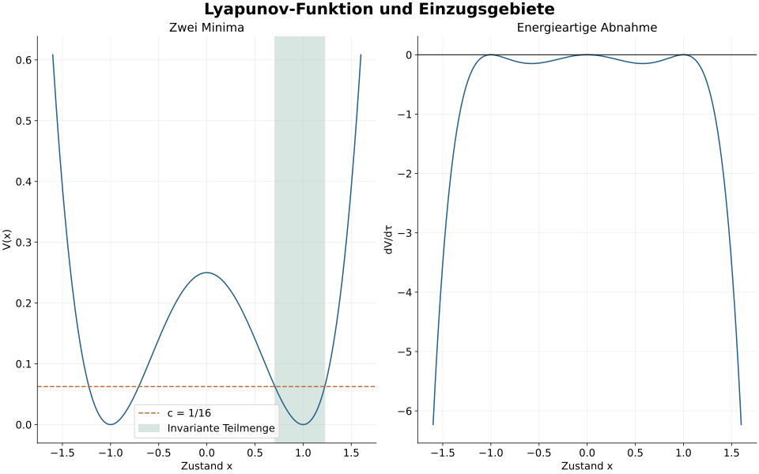

# M32-L2 – Stabilitätsanalyse mit Lyapunov-Funktionen und Einzugsgebieten {#L2}

**Kursbereich:** M32 – Masterprofil: Nichtlineare und modellprädiktive Regelung

**Niveau:** Master · Masterprofil

**Vorwissen:** [M32-L1](M32-L1.md), [M28-L2](M28-L2.md).

**Lernziel:** Eine Lyapunov-Funktion prüfen, eine invariante Teilmenge herleiten und lokale von globaler Stabilität trennen.

## Stabilität als Eigenschaft von Trajektorien {#S1}

Ein stabiler Gleichgewichtspunkt nach Lyapunov bleibt bei genügend kleinen Anfangsabweichungen in jeder vorgegebenen Umgebung. Asymptotische Stabilität verlangt zusätzlich Konvergenz zum Gleichgewicht aus einer Umgebung. Exponentielle Stabilität beschränkt die Abweichung durch eine abklingende Exponentialfunktion. Die Begriffe beziehen sich auf ein definiertes Modell, Eingänge und Zeitintervall; eine gemessene ruhige Kurve allein beweist sie nicht.

Für $\dot x=f(x)$ und Gleichgewicht null sei $V$ stetig differenzierbar, $V(0)=0$ und $V(x)>0$ für $x\ne0$ in einer Umgebung. Die Ableitung entlang der Lösung ist

$$\dot V(x)=\nabla V(x)^\mathsf{T}f(x).$$

Gilt $\dot V\le0$, folgt unter diesen lokalen Voraussetzungen Stabilität; streng negatives $\dot V$ außerhalb des Ursprungs liefert asymptotische Stabilität. Für globale Aussagen sind zusätzliche Bedingungen nötig, etwa eine global positive definite, radial unbeschränkte Funktion mit global negativer Ableitung. Radial unbeschränkt bedeutet $V(x)\to\infty$ für $\|x\|\to\infty$. Bei nur semidefiniter Ableitung kann das Invarianzprinzip von LaSalle auf einer kompakten positiv invarianten Menge die Konvergenz zur größten invarianten Teilmenge von $\dot V=0$ zeigen.

## Einzugsgebiet im kubischen Modell {#S2}

Für [M32-L1](M32-L1.md#S1) wähle

$$V(x)=\tfrac14(x^2-1)^2,\quad \frac{dV}{dx}=x^3-x,\quad \dot V=-(x^3-x)^2.$$

Die Funktion ist nicht global positiv definit relativ zu $+1$, da sie auch bei −1 null ist. Beschränke die Analyse auf $x>0$. Für jedes $0<c<1/4$ liegt die Zusammenhangskomponente der Subniveaumenge $V\le c$ um +1 vollständig in $x>0$. Aus $|x^2-1|\le2\sqrt c$ folgen die Grenzen

$$\sqrt{1-2\sqrt c}\le x\le\sqrt{1+2\sqrt c}.$$

Beispiel $c=1/16$: ungefähr 0,707 bis 1,225. Wegen $\dot V\le0$ kann eine Lösung dieses Intervall nicht verlassen. In ihm ist +1 die einzige Nullstelle der Ableitung; damit folgt Konvergenz nach +1. Das exakte Einzugsgebiet ist hier die ganze positive Halbachse, wie aus den Vorzeichen von $f$ folgt. Eine nachgewiesene Subniveaumenge ist allgemein nur eine innere Abschätzung, keine exakte Grenze.

{alt="Doppeltopfpotential des kubischen Systems und negative zeitliche Ableitung zwischen den Gleichgewichten."}

## Mechanische Energiefunktion {#S3}

Beim gedämpften Pendel ohne Antrieb aus L1 gilt für die normierte mechanische Energie

$$V(\theta,\omega)=\tfrac12\omega^2+\frac{g}{l}(1-\cos\theta),\qquad \dot V=-b\omega^2.$$

Die Größe hat die Einheit s⁻² bei dimensionslosen rad. Multiplikation mit $J$ ergibt die physikalische Energie am idealisierten Punktmassenpendel. Für $b>0$ ist die Ableitung nur semidefinit. Ein Zustand mit $\omega=0$ bleibt dort nur, wenn auch $\sin\theta=0$. Für eine zusammenhängende Energie-Subniveaumenge um die untere Lage mit Energieniveau kleiner als $2g/l$ ist das obere Gleichgewicht ausgeschlossen; LaSalle liefert Konvergenz zur unteren Lage. Die Energiegrenze bezieht sich auf dieses Modell ohne äußeres Drehmoment. Bei $u\ne0$ tritt ein zusätzlicher Term $\omega u/J$ auf; die Energie kann wachsen.

## Quadratische Funktionen für lineare Systeme {#S4}

Für $\dot x=Ax$ mit Hurwitz-Matrix $A$ (alle Eigenwerte im offenen linken Halbplan) lässt sich zu jedem symmetrischen $Q\succ0$ eine eindeutige symmetrische Matrix $P\succ0$ aus

$$A^\mathsf{T}P+PA=-Q$$

bestimmen. Für $V=x^\mathsf{T}Px$ folgt $\dot V=-x^\mathsf{T}Qx$. Beispiel $A=\operatorname{diag}(-1,-2)$ und $Q=I$: $P=\operatorname{diag}(1/2,1/4)$. Für ein nichtlineares System mit Restterm $r(x)$ kommt $2x^\mathsf{T}Pr(x)$ hinzu. Mit $\|r(x)\|\le L\|x\|^2$ in einer Umgebung gilt

$$\dot V\le-\lambda_{\min}(Q)\|x\|^2+2\|P\|L\|x\|^3.$$

Innerhalb einer hinreichend kleinen Kugel bleibt die Ableitung streng negativ. Eine eingeschlossene Subniveaumenge liefert eine invariante lokale Abschätzung. Eine bloße numerische Stichprobe von $\dot V$ beweist keine Ungleichung zwischen den Stichpunkten.

## Übungen und Kontrolle {#S5}

1. Für $\dot x=-3x$ und $V=x^2/2$ bestimme $\dot V$. **Lösung:** $-3x^2$, global asymptotisch und exponentiell stabil.
2. Warum scheitert eine positive-definite globale Interpretation von $V=(x^2-1)^2/4$ um +1? **Lösung:** Zusätzliches Minimum bei −1.
3. Wähle im Pendel $g/l=4$ s⁻² und $\theta_0=0$. Welche Anfangsgeschwindigkeiten liegen strikt unter der Energiebarriere? **Lösung:** $\omega_0^2/2<8$, also $|\omega_0|<4$ rad/s.
4. Ist $\dot V=0$ an einem einzelnen Punkt bereits ein stationärer Zustand? **Lösung:** Nein; im Pendel ist die Ableitung bei $\omega=0$ null, aber bei $\sin\theta\ne0$ entsteht unmittelbar Beschleunigung.

## Quellen {#S6}

- [ETH Zürich – Master Electrical Engineering and Information Technology](https://ethz.ch/en/studies/master/degree-programmes/engineering-sciences/electrical-engineering-and-information-technology.leftnav.html) · Specialisations: Systems and Control; curricularer Profilvergleich, kein Nachweis einzelner Lehrveranstaltungen. · Zuletzt abgerufen: 2026-11-25
- [Russ Tedrake, MIT – Underactuated Robotics, Nonlinear Planning and Control / Lyapunov Analysis](https://underactuated.mit.edu/) · Kapitel 9: Lyapunov-Funktionen, Invarianz und Einzugsgebiete; nur Inhaltsverzeichnis. · Zuletzt abgerufen: 2026-11-25
