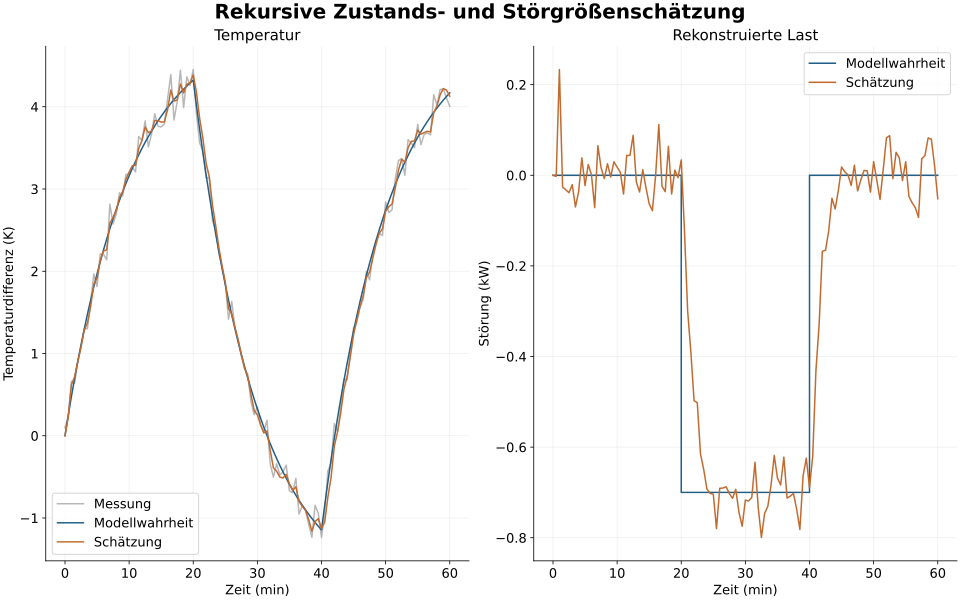

# M32-L3 – Zustands- und Störgrößenschätzung: Rekursive Filter und Modellunsicherheit {#L3}

**Kursbereich:** M32 – Masterprofil: Nichtlineare und modellprädiktive Regelung

**Niveau:** Master · Masterprofil

**Vorwissen:** [M28-L4](M28-L4.md), [M31-L3](M31-L3.md), [M32-L1](M32-L1.md).

**Lernziel:** Diskrete Kalman-Rekursion herleiten, Prozess- und Messunsicherheit unterscheiden und eine konstante Störung als zusätzlichen Zustand modellieren.

## Vom Beobachter zur stochastischen Schätzung {#S1}

Ein Zustandsbeobachter verbindet Modell und Messung. Für das diskrete lineare Modell

$$x_{k+1}=Ax_k+Bu_k+w_k,\qquad y_k=Hx_k+v_k$$

seien $w_k,v_k$ mittelwertfrei, zeitlich weiß, gegenseitig und vom Anfangsschätzfehler unabhängig, mit Kovarianzen $Q,R$. $Q$ beschreibt die Prozessunsicherheit pro Schritt; $R$ die Messunsicherheit pro Probe. Diese Matrizen besitzen quadratische Einheiten der zugehörigen Zustands- und Messgrößen. Die tatsächlichen Modellfehler müssen nicht weiß sein: In diesem Fall ist die gewählte Kovarianz ein Modell, kein Beleg für reale Statistik.

## Kalman-Filter {#S2}

Der Index $k|k-1$ bezeichnet die Prognose aus den Messungen bis $k-1$, $k|k$ die korrigierte Schätzung. Mit $P$ als Fehlerkovarianz ergibt sich

$$\hat x_{k|k-1}=A\hat x_{k-1|k-1}+Bu_{k-1},\qquad P^-=AP^+_{k-1}A^\mathsf{T}+Q,$$

$$S=HP^-H^\mathsf{T}+R,\quad K=P^-H^\mathsf{T}S^{-1},\quad \hat x_{k|k}=\hat x_{k|k-1}+K(y_k-H\hat x_{k|k-1}).$$

Die Innovation ist die Differenz zwischen tatsächlicher und vorhergesagter Messung. Die Joseph-Form der neuen Kovarianz lautet

$$P^+=(I-KH)P^-(I-KH)^\mathsf{T}+KRK^\mathsf{T}.$$

Sie erhält die positive Semidefinitheit besser in endlicher Arithmetik. Numerisch sollte man ein lineares Gleichungssystem lösen, statt $S^{-1}$ explizit zu bilden. Unter linearem Modell und gaußschen Anfangs- und Rauschverteilungen ist der Filter der bedingte Mittelwertschätzer; ohne Gaußannahme ist er unter den Zweitmomentannahmen der optimale lineare Schätzer.

**Skalarbeispiel:** $P^-=0{,}16$ K², $R=0{,}04$ K², $H=1$. Dann $K=0{,}8$. Eine Prognose 24,0 °C und eine Messung 24,5 °C ergeben 24,4 °C Schätzung, $P^+=0{,}032$ K². Eine höhere angenommene Messvarianz senkt typischerweise das Gewicht der Innovation.

## Störung als zusätzlicher Zustand {#S3}

Das thermische Beispiel aus [M32-L6](M32-L6.md) lässt sich mit $x=T-20\,\mathrm{^\circ C}$ als Temperaturdifferenz in K und unbekannter Wärmeleistung $d$ in kW diskret schreiben:

$$x_{k+1}=ax_k+b(u_k+d_k),\qquad d_{k+1}=d_k+\eta_k.$$

Setzt man $z=(x,d)^\mathsf{T}$, so sind

$$A_z=\begin{pmatrix}a&b\\0&1\end{pmatrix},\quad B_z=\begin{pmatrix}b\\0\end{pmatrix},\quad H_z=(1\quad0).$$

Die Beobachtbarkeitsmatrix $\begin{pmatrix}1&0\\a&b\end{pmatrix}$ hat Rang zwei, wenn $b\ne0$. Eine konstante Last kann damit im idealen Modell aus der Temperaturfolge rekonstruiert werden. Das bedeutet nicht, dass jeder reale Wärmeverlust von jedem Sensorbias oder falschen Modellparameter eindeutig trennbar ist. Fügt man weitere unbekannte Zustände hinzu, muss die Beobachtbarkeit neu geprüft werden.

{alt="Synthetische Temperaturmessung mit Rauschen, rekonstruierte Temperatur und Schätzung einer unbekannten Wärmeleistung."}

Die Grafik verwendet ein synthetisches Beispiel mit 30 s Abtastzeit, $a=e^{-0{,}05}$ und $b=(1-a)/0{,}1$ K/kW. Die Heizleistung beträgt 0,5 kW, die unbekannte Last springt von 0 auf −0,7 kW und später zurück. Die Messung ist mit unabhängigen normalverteilten Fehlern der Standardabweichung 0,15 K überlagert (Seed 2603). Die gewählten Filterkovarianzen sind $Q=\operatorname{diag}(0{,}0025,0{,}004)$ und $R=0{,}0225$ K², $P_0=\operatorname{diag}(1,0{,}25)$, $\hat z_0=(0,0)^\mathsf{T}$. Die Störschätzung folgt verzögert: Das Random-Walk-Modell erwartete keine exakt bekannten Sprungzeitpunkte.

## Nichtlineare Schätzer und Validierung {#S4}

Beim Extended Kalman Filter (EKF) verwendet man für die Vorhersage das nichtlineare $f$ und für die Kovarianz dessen lokale Jacobimatrix am aktuellen Schätzwert. Auch der Messoperator wird lokal linearisiert. Der EKF ist damit ein approximatives Verfahren; bei Mehrdeutigkeit, großer Unsicherheit oder stark nichtlinearen Messungen kann er schlecht konvergieren. Alternative Ansätze sind Unscented Kalman Filter oder Partikelfilter, mit höheren Rechen- und Modellierungsanforderungen.

Prüfe die mittlere Innovation, ihre Autokorrelation, die normierte Innovationsquadratsumme $\nu^\mathsf{T}S^{-1}\nu$ und, sofern unabhängige Referenzzustände vorliegen, den tatsächlichen Schätzfehler. Ein plausibles Kovarianzsignal ist nicht automatisch ein kalibrierter Fehlerbalken. Die Schätzgüte kann mit steigender Prozesskovarianz für Sprünge besser, für stationäre Phasen aber schlechter werden.

## Übungen und Kontrolle {#S5}

1. Berechne $K$ für $P^-=0{,}09$ K² und $R=0{,}09$ K². **Lösung:** 0,5; beide Informationen haben gleiche Varianz.
2. Was passiert im skalar beobachtbaren Fall bei $R\to0$ und $P^->0$? **Lösung:** $K\to1$; die Schätzung übernimmt die perfekte Messung.
3. Warum ist $d$ bei $b=0$ nicht beobachtbar? **Lösung:** Es beeinflusst die gemessene Temperatur nicht; der Rang sinkt auf eins.
4. Warum kann ein vom Modell unabhängiger Temperatursensor zur Validierung sinnvoll sein? **Lösung:** Sonst kann derselbe Bias Messung und scheinbare Referenz verschieben.

## Quellen {#S6}

- [ETH Zürich – Master Electrical Engineering and Information Technology](https://ethz.ch/en/studies/master/degree-programmes/engineering-sciences/electrical-engineering-and-information-technology.leftnav.html) · Specialisations: Systems and Control; curricularer Profilvergleich, kein Nachweis einzelner Lehrveranstaltungen. · Zuletzt abgerufen: 2026-11-25
- [Stanford EE363 – Linear Dynamical Systems, Lecture Slides: LQR und Kalman-Filter](https://ee363.stanford.edu/lectures.html) · EE363, Vorlesungsübersicht 12, 21 und 22: Schätzung und Kalman-Filter; Folien nicht geprüft. · Zuletzt abgerufen: 2026-11-25
