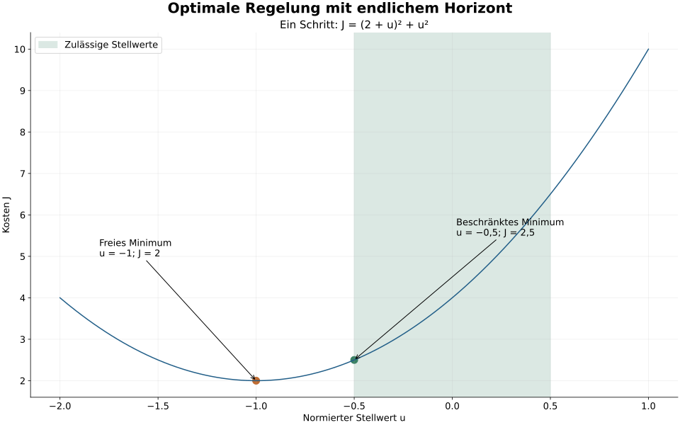

# M32-L4 – Optimale Regelung mit endlichem Horizont und Stellgrößenbeschränkungen {#L4}

**Kursbereich:** M32 – Masterprofil: Nichtlineare und modellprädiktive Regelung

**Niveau:** Master · Masterprofil

**Vorwissen:** [M28-L4](M28-L4.md), [M32-L1](M32-L1.md); ergänzend Universitätsmathematik [M3-L12](index.html?course=university_mathematics&module=M3&lesson=L12&syslang=de&doclang=de&theme=light) gemäß Curriculum.

**Lernziel:** Ein endliches quadratisches Optimalsteuerungsproblem ausformulieren und den unbeschränkten sowie beschränkten Fall unterscheiden.

## Kosten und Horizont {#S1}

Bei der optimalen Regelung werden Ziele als Kosten dargestellt. Sei $x_{k+1}=Ax_k+Bu_k$. Für einen Nullreferenzzustand, Horizont $N$ und Gewichte $Q\succeq0,R\succ0,Q_f\succeq0$ ist

$$J=\sum_{k=0}^{N-1}(x_k^\mathsf{T}Qx_k+u_k^\mathsf{T}Ru_k)+x_N^\mathsf{T}Q_fx_N.$$

Die Kosten können dimensionslos durch Normierung der Größen auf charakteristische Skalen gebildet werden; sonst tragen die Gewichte passende inverse quadratische Einheiten. Bei Referenzverfolgung verwendet man Abweichungen von einer zulässigen stationären Kombination $(x_r,u_r)$, die $x_r=Ax_r+Bu_r$ erfüllt. Das Gewicht $R$ begrenzt die Stellaktivität, ersetzt aber keine physikalische Stellgrenze. Eine Leistungsquadratsumme ist nicht automatisch verbrauchte Energie; letztere hängt von der physikalisch definierten Leistung und der Zeit ab.

## Dynamische Programmierung und Riccati-Rekursion {#S2}

Für den unbeschränkten Fall setze die optimale Restkostenfunktion $V_k(x)=x^\mathsf{T}P_kx$ mit $P_N=Q_f$ an. Dann

$$V_k(x)=\min_u\{x^\mathsf{T}Qx+u^\mathsf{T}Ru+(Ax+Bu)^\mathsf{T}P_{k+1}(Ax+Bu)\}.$$

Ableitung nach $u$ und Nullsetzen ergeben

$$K_k=(R+B^\mathsf{T}P_{k+1}B)^{-1}B^\mathsf{T}P_{k+1}A,\qquad u_k^*=-K_kx_k.$$

Einsetzen liefert rückwärts

$$P_k=Q+A^\mathsf{T}P_{k+1}A-A^\mathsf{T}P_{k+1}BK_k.$$

Für hinreichende Bedingungen (unter anderem Stabilisierbarkeit und geeignete Detektierbarkeit) konvergiert der LQR mit unendlichem Horizont zur stabilisierenden Lösung der algebraischen Riccati-Gleichung. Bei endlichem Horizont ist der optimale Gewinn im Allgemeinen zeitabhängig; ein kurzer Horizont ohne passendes Endgewicht kann unvorteilhaft sein.

## Stellgrenze im skalaren Fall {#S3}

Betrachte das normierte Modell $x_1=x_0+u_0$, $x_0=2$, also $N=1$. Die Kosten $J=(2+u)^2+u^2$ haben das unbeschränkte Optimum $u=-1$. Bei $-0{,}5\le u\le0{,}5$ ist die Lösung $u=-0{,}5$; die Kosten wachsen von 2 auf 2,5. Dies folgt aus $dJ/du=4+4u$ und der Konvexität. Für mehrere Schritte darf man nicht einfach jeden unbeschränkten Eingabewert unabhängig begrenzen: Die optimale Folge hängt über die Zustandsdynamik zusammen.

{alt="Skalare quadratische Zielfunktion mit unbeschränktem Minimum und verschobener Lösung bei Eingangsgrenze."}

## Von der Dynamik zum quadratischen Programm {#S4}

Stapele $X=(x_1^\mathsf{T},\dots,x_N^\mathsf{T})^\mathsf{T}$ und $U=(u_0^\mathsf{T},\dots,u_{N-1}^\mathsf{T})^\mathsf{T}$. Durch wiederholtes Einsetzen gilt

$$X=Fx_0+GU,\quad F=\begin{pmatrix}A\\A^2\\\vdots\\A^N\end{pmatrix},\quad G=\begin{pmatrix}B&0&\cdots&0\\AB&B&\cdots&0\\\vdots&\vdots&\ddots&\vdots\\A^{N-1}B&A^{N-2}B&\cdots&B\end{pmatrix}.$$

Mit Blockgewichten $\bar Q$ für die gestapelten Zustände und $\bar R$ für die Eingänge sind die Kosten bis auf konstanten Anteil $U^\mathsf{T}(G^\mathsf{T}\bar QG+\bar R)U+2x_0^\mathsf{T}F^\mathsf{T}\bar QGU$. Eingangsbeschränkungen und lineare Zustandsgrenzen ergeben lineare Ungleichungen in $U$. Bei $\bar R\succ0$ ist die Zielfunktion strikt konvex: Wenn die zulässige Menge nicht leer ist, gibt es ein eindeutiges Optimum. Für ein konvexes quadratisches Programm genügen erfüllte KKT-Bedingungen zur Optimalität. Bei nur Boxgrenzen kann als Test das Residuum $U-\Pi_{[U_{min},U_{max}]}(U-\alpha\nabla J(U))$ mit beliebigem festen $\alpha>0$ benutzt werden. Exakt null bedeutet stationär bezüglich der zulässigen Menge. Ein schwellenbasiertes numerisches Residuum ist kein exakter Beweis.

## Übungen und Kontrolle {#S5}

1. Berechne im Ein-Schritt-Beispiel mit $x_0=2$ und Kosten $(2+u)^2+3u^2$ das freie Optimum. **Lösung:** $u=-0{,}5$, $J=3$.
2. Was geschieht bei $R\to\infty$ im skalaren Beispiel? **Lösung:** $u\to0$; die Stellaktivität wird teurer als die Abweichung.
3. Ist eine Zustandsgrenze $x_1\le1$ unter $x_0=2,u\ge-0{,}5$ möglich? **Lösung:** Nein; der kleinste erreichbare Zustand ist 1,5.
4. Wozu dient ein Endgewicht? **Lösung:** Es bewertet den Zustand am Ende des begrenzten Horizonts und kann langfristige Kosten approximieren. Stabilität folgt nicht automatisch aus einem beliebigen Endgewicht.

## Quellen {#S6}

- [ETH Zürich – Master Electrical Engineering and Information Technology](https://ethz.ch/en/studies/master/degree-programmes/engineering-sciences/electrical-engineering-and-information-technology.leftnav.html) · Specialisations: Systems and Control; curricularer Profilvergleich, kein Nachweis einzelner Lehrveranstaltungen. · Zuletzt abgerufen: 2026-11-25
- [Stanford EE363 – Linear Dynamical Systems, Lecture Slides: LQR und Kalman-Filter](https://ee363.stanford.edu/lectures.html) · EE363, Vorlesungsübersicht 16: LQR mit endlichem Horizont; Teilaspekt, Folien nicht geprüft. · Zuletzt abgerufen: 2026-11-25
- [Rawlings/Mayne/Diehl – Model Predictive Control: Theory, Computation, and Design](https://sites.engineering.ucsb.edu/~jbraw/mpc/) · 2. Auflage, 6. Druck, §§ 1.2.5, 1.3.1–1.3.3, 2.2–2.3 (S. 6, 11–18, 91–107); Inhaltsverzeichnis S. xv–xvi visuell geprüft, kein vollständiger Aussagenabgleich. · Zuletzt abgerufen: 2026-11-25
