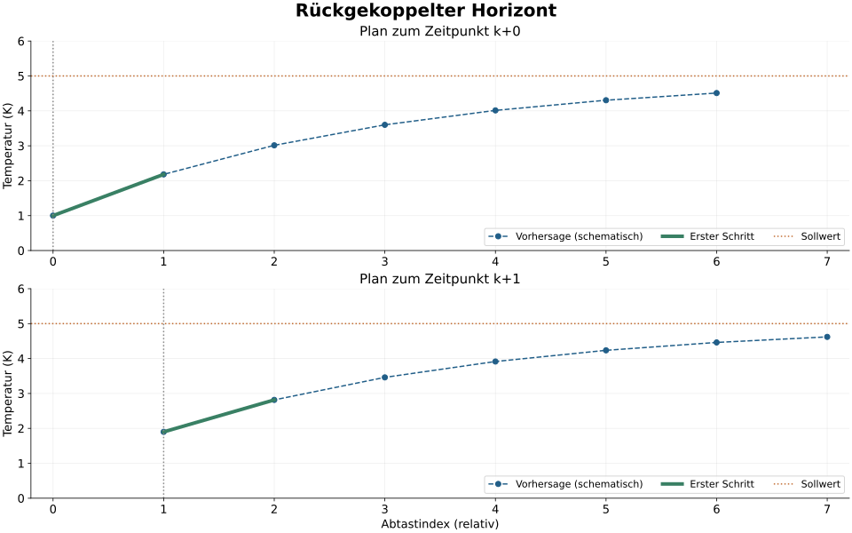

# M32-L5 – Modellprädiktive Regelung: Rückgekoppelter Horizont, Nebenbedingungen und Robustheitsgrenzen {#L5}

**Kursbereich:** M32 – Masterprofil: Nichtlineare und modellprädiktive Regelung

**Niveau:** Master · Masterprofil

**Vorwissen:** [M32-L3](M32-L3.md), [M32-L4](M32-L4.md).

**Lernziel:** Die Online-Rekursion eines MPC formulieren, Machbarkeit und Stabilität unterscheiden und den Umgang mit Störungen und Rechenzeit einordnen.

## Regelung durch erneute Optimierung {#S1}

Die optimale Steuerfolge aus L4 ist zunächst nur ein Plan. Modellprädiktive Regelung (Model Predictive Control, MPC) schließt den Kreis, indem der Plan nach jeder neuen Information erneut berechnet wird. Bei Zeit $k$ prognostiziert das Modell Zustände $x_{k+i|k}$, wobei der zweite Index den Zeitpunkt der Planerstellung angibt. Es werden $N$ Stellwerte $u_{k|k},\dots,u_{k+N-1|k}$ berechnet, aber nur $u_{k|k}$ umgesetzt. Dann erhält der Regler einen neuen Zustand oder Schätzwert und wiederholt das Problem.

$$\min_U\sum_{i=0}^{N-1}\ell(x_{k+i|k},u_{k+i|k})+V_f(x_{k+N|k})$$

unter

$$x_{k|k}=\hat x_k,\quad x_{k+i+1|k}=f(x_{k+i|k},u_{k+i|k},d_{k+i|k}),\quad (x,u)\in\mathcal Z.$$

Die Störung $d$ kann vorhergesagt, als konstant angenommen oder durch einen Beobachter geschätzt werden. Eine Eingabeprognose ist nicht identisch mit der tatsächlichen zukünftigen Eingabe. Für ein lineares Modell und konvexe quadratische Kosten mit linearen Grenzen entsteht ein QP; bei nichtlinearem $f$ typischerweise ein nichtlineares Optimierungsproblem, möglicherweise mit lokalen Minima. Auch bei einem linearen Modell können nichtkonvexe Nebenbedingungen das Problem nichtkonvex machen.

{alt="Vorhersagehorizonte an zwei aufeinanderfolgenden Abtastzeitpunkten; je nur der erste Stellwert wird umgesetzt."}

## Harte und weiche Grenzen {#S2}

Ein maximaler Stellstrom ist eine harte Grenze, die in der Optimierung nicht überschritten werden darf. Eine Komforttemperatur kann als weiche Grenze formuliert werden: $x\le x_{max}+s$, $s\ge0$, mit einer Strafe $\lambda s$ oder $\lambda s^2$. Die weiche Grenze kann die Machbarkeit verbessern, garantiert aber gerade nicht ihre Einhaltung. Eine reale Sicherheitsabschaltung bleibt unabhängig von der Optimierung nötig. Für unzulässige oder numerisch gescheiterte Probleme ist ein definierter Rückfallregler erforderlich.

**Beispiel:** Bei $x_{k+1}=0{,}9x_k+0{,}2u_k$, $x_k=5$, $0\le u\le2$, kann die Forderung $x_{k+1}\ge5$ nicht erfüllt werden. Maximal erreichbar sind 4,9. Mit einer weichen Untergrenze ist mindestens $s=0{,}1$ nötig. Dies ist ein physikalischer Mangel an Stellreserve, nicht ein Versagen des numerischen Optimierers.

## Rekursive Machbarkeit und Stabilität {#S3}

Eine einmal gefundene zulässige Folge sagt nichts darüber aus, ob nach einer tatsächlichen Störung erneut eine zulässige Folge existiert. Im nominalen Fall kann man mit terminaler invarianter Menge $\mathcal X_f$ und lokalem zulässigem Endregler eine verschobene alte Folge plus Endaktion als Kandidat am nächsten Schritt konstruieren. Wenn die terminale Kostenfunktion zusätzlich die passende Abnahmeungleichung erfüllt, kann die optimale Kostenfunktion unter weiteren Voraussetzungen als Lyapunov-Funktion dienen. Ohne solche Voraussetzungen hängt Stabilität unter anderem vom Horizont, den Gewichten, der Modellgüte und der Menge zulässiger Zustände ab. Ein numerisch erfolgreich gelöstes QP allein ist keine Stabilitätsgarantie.

## Modellfehler und Störlast {#S4}

MPC berücksichtigt prognostizierte Dynamik, jedoch nur gemäß dem verwendeten Modell. Eine konstante unbekannte Last kann einen stationären Fehler verursachen, wenn der Zielzustand mit einer falschen Gleichgewichtseingabe kombiniert wird. Offsetfreie MPC-Verfahren ergänzen beispielsweise ein Störmodell wie in [M32-L3](M32-L3.md#S3) und berechnen aus der Schätzung ein neues zulässiges stationäres Ziel. Auch ein PI-Regler mit integralem Zustand kann konstante Störungen ausregeln, sofern genug Stellreserve vorhanden ist. Eine unbekannte Last kann nicht vor ihrem Eintritt vollständig ausgeregelt werden.

Robuste MPC arbeitet beispielsweise mit Unsicherheitsmengen und engeren nominalen Schranken (Tube MPC) oder Minimax-Kriterien. Stochastische MPC formuliert unter Modellannahmen Wahrscheinlichkeitsgrenzen. Beide verlangen explizite Unsicherheitsannahmen; ein beliebiger Sicherheitszuschlag beweist keine Robustheit. Für die Implementierung zählt auch das Abtastintervall: Schätzung, Optimierung, Prüfung und Ausgabe müssen vor der Frist erfolgen. Eine gute Lösung nach der Frist kann für den realen Regelkreis unbrauchbar sein. Die folgende Arbeitsprobe untersucht nur simulierte diskrete Regelung, keine Echtzeitgarantie.

## Übungen und Kontrolle {#S5}

1. Bei 30 s Abtastzeit und $N=12$ wie lang ist die Prognose? **Lösung:** 360 s; umgesetzt wird zunächst nur der erste Wert für 30 s.
2. Ist ein weicher Grenzwert eine Sicherheitsgarantie? **Lösung:** Nein, eine Abweichung ist ausdrücklich erlaubt und wird nur bestraft.
3. Was bedeutet rekursive Machbarkeit? **Lösung:** Aus einer anfangs zulässigen Situation bleibt das nächste Optimierungsproblem unter den vorgesehenen Bedingungen zulässig.
4. Nenne zwei Ursachen eines stationären MPC-Regelfehlers. **Lösung:** Nicht modellierte konstante Störung oder falsches stationäres Modell; ein unerreichbarer Sollwert kann ebenfalls bleibenden Fehler erzwingen.

## Quellen {#S6}

- [ETH Zürich – Master Electrical Engineering and Information Technology](https://ethz.ch/en/studies/master/degree-programmes/engineering-sciences/electrical-engineering-and-information-technology.leftnav.html) · Specialisations: Systems and Control; curricularer Profilvergleich, kein Nachweis einzelner Lehrveranstaltungen. · Zuletzt abgerufen: 2026-11-25
- [Rawlings/Mayne/Diehl – Model Predictive Control: Theory, Computation, and Design](https://sites.engineering.ucsb.edu/~jbraw/mpc/) · 2. Auflage, 6. Druck, §§ 2.2, 2.4–2.6 und 3.1–3.2 (S. 91, 112–144, 193–209); Inhaltsverzeichnis S. xv–xvi visuell geprüft, kein vollständiger Aussagenabgleich. · Zuletzt abgerufen: 2026-11-25
