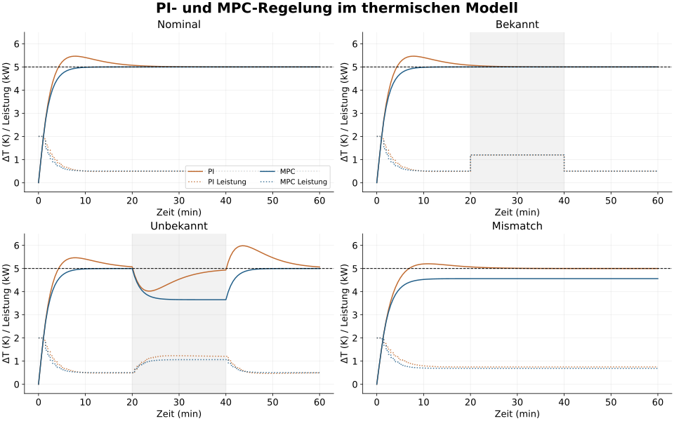

# M32-L6 – Profilprojekt: Linearen Regler und MPC für ein thermisches System unter Störungen vergleichen {#L6}

**Kursbereich:** M32 – Masterprofil: Nichtlineare und modellprädiktive Regelung

**Niveau:** Master · Masterprofil

**Vorwissen:** [M32-L1](M32-L1.md) bis [M32-L5](M32-L5.md); [M28-L5](M28-L5.md).

**Lernziel:** Einen fair dokumentierten Reglervergleich unter definierten Modellabweichungen reproduzieren und die Leistungs- und Robustheitsgrenzen diskutieren.

## Versuchsplan {#S1}

Ein kleiner idealisierter thermischer Raum mit konstanter Außentemperatur 20 °C soll von 20 auf 25 °C gebracht werden. Die Temperaturdifferenz $x=T-20\,\mathrm{^\circ C}$ wird in Kelvin angegeben, die Heizleistung $u$ in kW. Ein idealisiertes thermisches Einknotenmodell lautet

$$C\dot x=-Gx+u+d.$$

$C=60$ kJ/K ist die Wärmekapazität, $G=0{,}1$ kW/K der Wärmeleitwert, $d$ eine zusätzliche Wärmeleistung in kW. Ein negatives $d$ ist ein Wärmeentzug. Für konstante Eingänge während $\Delta t=30$ s gilt exakt

$$x_{k+1}=ax_k+b(u_k+d_k),\qquad a=e^{-G\Delta t/C},\quad b=(1-a)/G.$$

Nominal sind $a\approx0{,}951229$, $b\approx0{,}487706$ K/kW. Stationär bei $x=5$ K benötigt das Modell $u=0{,}5-d$ kW. In allen Fällen sind $0\le u\le2$ kW und die perfekte Temperaturmessung gleich; die Regler verwenden die tatsächlichen Parameter in den ersten drei Fällen. Es gibt 120 Intervalle (60 min), Anfangstemperatur 20 °C, Sollwert 25 °C. Vier Szenarien:

| Fall | Pflanze | Information für beide Regler |
| --- | --- | --- |
| Nominal | Nominale Parameter, $d=0$ | $d_m=0$ |
| Bekannt | $d=-0{,}7$ kW in Intervallen 40–79 (20–40 min) | Aktuelles $d_m=d$, keine Vorschau auf Sprungende |
| Unbekannt | Gleicher Wärmeentzug | $d_m=0$ |
| Mismatch | $G=0{,}15$ kW/K, $C=75$ kJ/K, $d=0$ | Nominalmodell, $d_m=0$ |

Die Eingabebeschränkung betrifft die Heizleistung; keine harte Temperaturgrenze wird beansprucht. Das Modell ist synthetisch, nicht aus einem realen Gebäude identifiziert.

## Zwei Regler und Zielfunktion {#S2}

PI mit Vorsteuerung: $e_k=5-x_k$, $u_{raw}=0{,}1\cdot5-d_m+0{,}45e_k+I_k$, $u_k=\operatorname{clip}(u_{raw},0,2)$. Der Integrator wächst pro Intervall um $0{,}035 e_k$ kW, außer wenn die Sättigung dadurch verstärkt würde (bedingte Integration). Der proportionale Gewinn hat die Einheit kW/K, der diskrete Integralgewinn kW/K je Aktualisierung. Anfangswert null. Das Vorsteuersignal ist in beiden Reglern dasselbe nominale stationäre Signal.

MPC nutzt $N_p=12$, 360 s Horizont. Es nimmt das aktuelle $d_m$ für alle künftigen Schritte konstant an. Mit $F_i=a^i$ und $B_{ij}=ba^{i-j}$ für $1\le j\le i\le N_p$ prognostiziert es $X=Fx_k+B(U+d_m\mathbf1)$. Die Kosten sind

$$J(U)=\sum_{i=1}^{N_p}w_i(x_{k+i|k}-5)^2+3\sum_{i=0}^{N_p-1}(u_{k+i|k}-(0{,}5-d_m))^2,$$

mit $w_i=1$ und $w_{N_p}=4$. Numerisch werden Temperatur in K und Leistung in kW verwendet; die Gewichte entsprechen einer Normierung auf 1 K und 1 kW. Der Gradient ist $2[B^\mathsf{T}W(X-r\mathbf1)+3(U-u_{ff}\mathbf1)]$. Das strikt konvexe Boxproblem wird mit L-BFGS-B gelöst. Die Prüfung des projizierten Gradienten kontrolliert die KKT-Bedingung näherungsweise. Das Verfahren ist hier eine einfache QP-Lösung, nicht als allgemein echtzeitgeeigneter Solver zu verstehen.

## Reproduzierbarer Programmcode {#S3}

Benötigt Python 3, NumPy und SciPy. Die Simulation verwendet keine Zufallszahlen. `run` liefert Zustands-, Stell- und Störfolgen; die Ausgabe berechnet mittleren absoluten Temperaturfehler (nach jedem Schritt), größte gerichtete Sollwertabweichung nach oben, Heizenergie und Endabweichung. Eine negative maximale Abweichung bedeutet, dass der Sollwert nie erreicht wurde. Für die folgende Tabelle wird die Überschreitung auf mindestens null begrenzt. Die Energie ist die Summe der ideal zugeführten Heizleistungen über die Zeit, keine Messung des elektrischen Anlagenverbrauchs.

```python
import numpy as np
from scipy.optimize import minimize
from math import exp

DT, H, N = 30., 12, 120
G, C = .1, 60.
a = exp(-DT*G/C); b = (1-a)/G
F = a**np.arange(1,H+1)
B = np.array([[b*a**(i-j) if j<=i else 0.
               for j in range(H)] for i in range(H)])
W = np.ones(H); W[-1] = 4.
rho = 3.

def mpc(x,r,d):
    ff = G*r-d
    c = F*x+B@np.full(H,d)-r
    def obj(u):
        e = c+B@u; v = u-ff
        return np.dot(W*e,e)+rho*np.dot(v,v), 2*(B.T@(W*e)+rho*v)
    res = minimize(obj,np.full(H,np.clip(ff,0,2)),jac=True,
                   bounds=[(0.,2.)]*H,method='L-BFGS-B',
                   options={'ftol':1e-13,'gtol':1e-8,'maxiter':500})
    assert res.success, res.message
    u=res.x; grad=obj(u)[1]
    assert np.max(abs(u-np.clip(u-grad,0,2))) < 2e-4
    return u[0]

def run(case,ctl):
    g,cap = (.15,75.) if case=='Mismatch' else (G,C)
    ap = exp(-DT*g/cap); bp = (1-ap)/g
    x=np.zeros(N+1); u=np.zeros(N); ds=np.zeros(N); integ=0.
    for k in range(N):
        d = -.7 if case in ('Bekannt','Unbekannt') and 40<=k<80 else 0.
        ds[k]=d; dm=d if case=='Bekannt' else 0.
        r=5.; e=r-x[k]
        if ctl=='PI':
            raw=G*r-dm+.45*e+integ
            u[k]=np.clip(raw,0,2)
            if 0<=raw<=2 or (raw>2 and e<0) or (raw<0 and e>0):
                integ+=.035*e
        else:
            u[k]=mpc(x[k],r,dm)
        x[k+1]=ap*x[k]+bp*(u[k]+d)
    assert np.all((u>=0)&(u<=2))
    assert np.max(abs(x[1:]-ap*x[:-1]-bp*(u+ds)))<1e-12
    return x,u,ds

if __name__=='__main__':
    for case in ('Nominal','Bekannt','Unbekannt','Mismatch'):
        for ctl in ('PI','MPC'):
            x,u,d=run(case,ctl)
            print(case,ctl,*(f'{q:.5f}' for q in (
                np.mean(abs(x[1:]-5)),np.max(x)-5,
                np.sum(u)*DT/3600,x[-1]-5)))
```

Die Prüfung verlangt Stellwerte innerhalb der Box, kleine diskrete Modellresiduen und erfolgreiche Optimierung mit kleiner projizierter Gradientenabweichung. Das Modellresiduum allein ist keine unabhängige physikalische Validierung. Ein zusätzlicher Test vergleicht die freie Lösung im nicht gesättigten Bereich mit dem linearen Gleichungssystem der quadratischen Kosten.

## Ergebnisse und Interpretation {#S4}

| Fall | Regler | MAE (K) | Max. Überschreitung (K) | Heizenergie (kWh) | Endfehler (K) |
| --- | --- | ---: | ---: | ---: | ---: |
| Nominal | PI | 0,18674 | 0,46398 | 0,57791 | 0,00001 |
| Nominal | MPC | 0,13544 | 0,00000 | 0,56772 | -0,00000 |
| Bekannt | PI | 0,18674 | 0,46398 | 0,81125 | 0,00001 |
| Bekannt | MPC | 0,13544 | 0,00000 | 0,80106 | -0,00000 |
| Unbekannt | PI | 0,49458 | 0,98242 | 0,81182 | 0,06512 |
| Unbekannt | MPC | 0,58480 | 0,00000 | 0,75612 | -0,00001 |
| Mismatch | PI | 0,19812 | 0,20332 | 0,83250 | 0,00001 |
| Mismatch | MPC | 0,58583 | 0,00000 | 0,75432 | -0,43917 |

{alt="Vier Temperaturverläufe und Heizleistungsverläufe für PI und MPC bei idealem Modell, gemessener und unbekannter Last sowie Parameterabweichung."}

Im ungestörten Fall ist MPC bei dieser Gewichtung schneller und vermeidet Überschwingen. Bei bekannter Last kompensieren beide die gemessene Störung im Modell über die Vorsteuerung; die zusätzliche Energie beträgt in beiden Fällen 0,7 kW × 20 min = 0,23333 kWh. Bei unbekannter Störung hat PI in diesem Versuch geringeren absoluten Fehler, jedoch deutliches Überschwingen nach der Lastabschaltung. MPC ohne Störschätzung kann den temporären Wärmeentzug nicht stationär vollständig kompensieren. Bei Parameterabweichung hat der einfache MPC trotz fortlaufender neuer Optimierung einen bleibenden Endfehler von ungefähr −0,439 K; PI passt die stationäre Heizleistung durch Integration an. Der geringere Energiebedarf von MPC im Mismatch-Fall bedeutet also nicht automatisch bessere Effizienz, weil die Solltemperatur schlechter erreicht wird.

Die beiden Regler wurden nicht auf jedem Szenario nachoptimiert. Dies ist ein Vergleich zweier nachvollziehbarer Parametrierungen, keine allgemeine Rangfolge. Ein anderer Horizont, Gewicht oder PI-Gewinn kann Ergebnisse ändern. Auch ein MPC mit Störschätzer kann stationären Fehler verringern. Für eine aussagekräftige reale Prüfung sind unabhängig ermittelte Modellparameter, Temperatur- und Leistungsdaten, Unsicherheit der Sensorik, Ausführungsfristen und reale Stellgrenzen erforderlich. Ein realer Betrieb braucht unabhängige Temperaturbegrenzung. Das Beispiel ist keine Bau- oder Betriebsanleitung.

## Abgabe, Erweiterungen und Kontrolle {#S5}

Reproduziere die acht Fälle und dokumentiere Softwareversionen, Stellgrenzen, Anfangswerte, Einheiten und Metriken. Ändere jeweils nur eine Größe: Horizont (z. B. 6 statt 12), Stellgewicht (z. B. 6 statt 3) oder die modellierte Störung. Ergänze danach den Schätzer aus [M32-L3](M32-L3.md#S3), damit der stationäre Sollwert-Eingang angepasst wird. Vergleiche Überschwingung, Fehler, Energie und Rechenaufwand; untersuche auch Stellreserven und einen unerreichbaren Sollwert. Bewerte den Erfolg nicht nur anhand einer besonders günstigen Kurve.

1. Was ist die stationäre Heizung bei $G=0{,}15$ kW/K und $x=5$ K? **Lösung:** 0,75 kW, nicht 0,5 kW.
2. Kann $x=5$ K bei nominalem Modell mit $d=-1{,}8$ kW gehalten werden? **Lösung:** Nein; benötigt würden 2,3 kW, maximal möglich sind 2 kW. Stationär erreichbar sind höchstens 2 K.
3. Warum ist der Energievergleich bei verschiedener Endtemperatur problematisch? **Lösung:** Andere gespeicherte Wärme und andere integrierte Wärmeverluste. Vergleiche gleiche Versorgungsgüte oder berichte Fehler und Energie gemeinsam.
4. Welche Modellinformation nutzt MPC im Fall Bekannt nicht? **Lösung:** Den zukünftigen Zeitpunkt des Lastendes. Es hält die aktuelle Störung in der Prognose konstant.

## Quellen {#S6}

- [ETH Zürich – Master Electrical Engineering and Information Technology](https://ethz.ch/en/studies/master/degree-programmes/engineering-sciences/electrical-engineering-and-information-technology.leftnav.html) · Specialisations: Systems and Control; curricularer Profilvergleich, kein Nachweis einzelner Lehrveranstaltungen. · Zuletzt abgerufen: 2026-11-25
- [Rawlings/Mayne/Diehl – Model Predictive Control: Theory, Computation, and Design](https://sites.engineering.ucsb.edu/~jbraw/mpc/) · 2. Auflage, 6. Druck, §§ 1.3, 1.5, 2.5.1–2.5.4 (S. 11, 46–49, 132–136); Inhaltsverzeichnis S. xv–xvi visuell geprüft, kein vollständiger Aussagenabgleich. · Zuletzt abgerufen: 2026-11-25
- [Stanford EE363 – Linear Dynamical Systems, Lecture Slides: LQR und Kalman-Filter](https://ee363.stanford.edu/lectures.html) · Frühjahr 2026, Vorlesungen 16–18: LQR mit endlichem und unendlichem Horizont; 22: Kalman-Filter bei Bedarf; nur Verzeichnis, kein Nachweis der thermischen Projektergebnisse. · Zuletzt abgerufen: 2026-11-25
