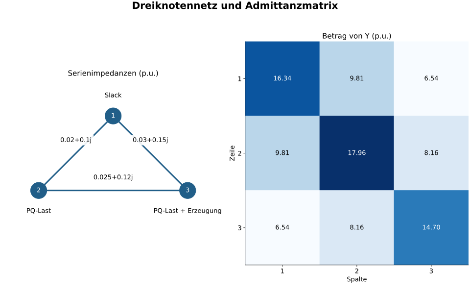

# M33-L1 – Netzmodellierung, Per-Unit-System und Knotenadmittanzmatrix {#L1}

**Kursbereich:** M33 – Masterprofil: Analyse moderner Energienetze und Leistungselektronik

**Niveau:** Master · Masterprofil

**Vorwissen:** [M10-L2](M10-L2.md), [M29-L1](M29-L1.md).

**Lernziel:** Ein Mehrknotennetz auf gemeinsame Bezugsgrößen bringen, die Admittanzmatrix aufbauen und die Verlustbilanz ableiten.

## Bezugsgrößen und Transformatoren {#S1}

Ein symmetrisches Dreiphasensystem lässt sich im stationären Grundschwingungsbetrieb durch ein einphasiges Ersatznetz beschreiben. Für die Bezugsleistung $S_B$ (dreiphasig) und die verkettete Effektivspannung $U_B$ gelten

$$I_B=\frac{S_B}{\sqrt3 U_B},\qquad Z_B=\frac{U_B^2}{S_B},\qquad Y_B=1/Z_B.$$

Die komplexen Phasenspannungen werden auf $U_B/\sqrt3$ bezogen. Damit gilt für die dreiphasige komplexe Leistung in p.u. direkt $s=v i^*$, ohne zusätzlichen Faktor drei. Eine Impedanz wird als $z=Z/Z_B$ angegeben. Hat ein idealer Transformator auf beiden Seiten zur Übersetzung passende Spannungsbasen und dieselbe Leistungsbasis, hat er im p.u.-Modell das Übersetzungsverhältnis eins. Seine Streuimpedanz bleibt erhalten. Bei einem Basiswechsel gilt

$$z_{neu}=z_{alt}\frac{S_{B,neu}}{S_{B,alt}}\left(\frac{U_{B,alt}}{U_{B,neu}}\right)^2.$$

Beispiel: 1 MVA, 20 kV ergibt 28,87 A und 400 Ω. Auf der 400-V-Seite entsprechen 1 p.u. 1443,38 A und 0,16 Ω. Der unterschiedliche Strom bei gleicher Leistung ist kein Energiegewinn.

## Leitungsmodell und Matrixbildung {#S2}

Die Serienadmittanz sei $y_{ij}=1/z_{ij}$. Ein Zweig ohne Querkapazität hat $i_{ij}=y_{ij}(v_i-v_j)$. In der Knotenmatrix wird $y_{ij}$ an beiden Diagonalen addiert und an beiden Nebendiagonalen subtrahiert. Mit einem π-Ersatzglied kommt je eine halbe Queradmittanz hinzu. Für das Projekt aus [L6](M33-L6.md) werden die Querelemente bewusst weggelassen:

| Zweig | z (p.u.) |
| --- | --- |
| 1–2 | 0,02 + j0,10 |
| 1–3 | 0,03 + j0,15 |
| 2–3 | 0,025 + j0,12 |

$$Y=\begin{bmatrix}y_{12}+y_{13}&-y_{12}&-y_{13}\\-y_{12}&y_{12}+y_{23}&-y_{23}\\-y_{13}&-y_{23}&y_{13}+y_{23}\end{bmatrix}.$$

{alt="Dreiecknetz mit drei Serienimpedanzen und Beträgen der zugehörigen Knotenadmittanzen."}

Ohne Querzweige ist die Zeilensumme null; die Matrix ist singulär. Nach Festlegung einer Referenzspannung wird die reduzierte lineare Matrix für ein verbundenes passives Netz mit geeigneten Impedanzen regulär. Beim Lastfluss sind die Lastströme selbst spannungsabhängig, daher reicht ein linearer Matrixsolve nicht aus.

## Abweichende Übersetzung und Phasendrehung {#S3}

Für einen idealisierten komplexen Abgriff $t=\tau e^{j\phi}$ auf der i-Seite eines Zweigs und Serienadmittanz y lauten dessen Matrixbeiträge ohne Querzweige

$$Y_{ii}=y/|t|^2,\quad Y_{ij}=-y/t^*,\quad Y_{ji}=-y/t,\quad Y_{jj}=y.$$

Eine Phasendrehung kann die Symmetrie der Matrix aufheben. Ein nicht idealer Transformator hat darüber hinaus Verluste und Magnetisierung. Das einfache Netz berücksichtigt keine Stufenschalter, Sättigung oder Oberschwingungen.

## Leistungsbilanz {#S4}

Die Einspeiseleistung (positiv in das Netz) ist $s_i=v_i(Yv)_i^*$. Die Summe der beiden gerichteten Zweigleistungen ergibt

$$s_{ij}+s_{ji}=z_{ij}|i_{ij}|^2.$$

Realteil: ohmsche Verluste; Imaginärteil: induktive Blindleistungsaufnahme. Für eine rein kapazitive Queradmittanz wäre der Blindleistungsbeitrag negativ. Durch Summieren über alle Zweige erhält man eine unabhängige Kontrolle der Knotenbilanz.

## Übungen und Kontrolle {#S5}

1. Wie groß ist die Impedanzbasis bei 10 MVA und 20 kV? **Lösung:** 40 Ω.
2. Eine 0,1-p.u.-Impedanz auf 1 MVA wird auf 2 MVA bei identischer Spannung umgerechnet. **Lösung:** 0,2 p.u.
3. Berechne $y_{12}$. **Lösung:** etwa 1,923 − j9,615 p.u.; der Offdiagonalwert ist das Negative davon.
4. Welchen Wirkleistungsverlust erzeugt 0,5 p.u. Zweigstrom bei r = 0,02? **Lösung:** 0,005 p.u., auf 1 MVA also 5 kW.

## Quellen {#S6}

- [ETH Zürich – Master Electrical Engineering and Information Technology](https://ethz.ch/en/studies/master/degree-programmes/engineering-sciences/electrical-engineering-and-information-technology.leftnav.html) · Specialisations: Electric Energy Engineering; curricularer Profilvergleich, kein Nachweis einzelner Lehrveranstaltungen. · Zuletzt abgerufen: 2026-11-25
- [MATPOWER – AC Power Flow, Benutzerhandbuch](https://matpower.app/manual/matpower/ACPowerFlow.html) · Handbuch §4.1: AC-Leistungsbilanz und Knotentypen; Grenzen des gewöhnlichen Lastflusses, methodischer Teilaspekt. · Zuletzt abgerufen: 2026-11-25
- [MIT OpenCourseWare – 6.061, Introduction to Symmetrical Components](https://ocw.mit.edu/courses/6-061-introduction-to-electric-power-systems-spring-2011/resources/mit6_061s11_ch4/) · Kapitel 4: symmetrische Komponenten; nur weiterführende Lektüre, kein Hauptbeleg für Per-Unit-System oder Ybus. Fachbelege: Kapitel 3 § 8 und MATPOWER § 3.6. · Zuletzt abgerufen: 2026-11-25
- [J. L. Kirtley, MIT 6.061, Polyphase Networks](https://ocw.mit.edu/courses/6-061-introduction-to-electric-power-systems-spring-2011/c6393a58319200a5344752de0cf47ec4_MIT6_061S11_ch3.pdf) · Kapitel 3, §§ 8.1–8.4, S. 20–22: Bezugsgrößen, Drehstrom, Transformatoren und Basiswechsel; PDF-Text geprüft. · Zuletzt abgerufen: 2026-11-25 · Inhaltlich geprüft: 2026-11-25
- [MATPOWER – Network Equations](https://matpower.app/manual/matpower/NetworkEquations.html) · § 3.6, Gleichung 3.8: Knotenadmittanzmatrix und Strombilanz, anschließend komplexe Leistungsbilanz. · Zuletzt abgerufen: 2026-11-25 · Inhaltlich geprüft: 2026-11-25
