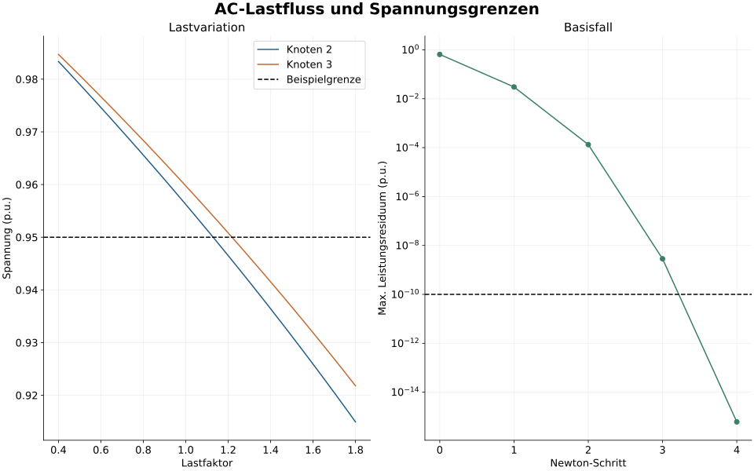

# M33-L2 – AC-Lastfluss: Knotenarten, Newton-Raphson-Verfahren und Spannungsgrenzen {#L2}

**Kursbereich:** M33 – Masterprofil: Analyse moderner Energienetze und Leistungselektronik

**Niveau:** Master · Masterprofil

**Vorwissen:** [M33-L1](M33-L1.md), [M10-L3](M10-L3.md).

**Lernziel:** Ein Newton-System für PQ- und PV-Knoten formulieren sowie Konvergenz von Betriebszulässigkeit unterscheiden.

## Knotenarten und Freiheitsgrade {#S1}

Mit $Y=G+jB$ und $v_i=V_i e^{j\theta_i}$ folgen aus $s_i=v_i(Yv)_i^*$ die Gleichungen

$$P_i=V_i\sum_j V_j(G_{ij}\cos\theta_{ij}+B_{ij}\sin\theta_{ij}),$$
$$Q_i=V_i\sum_j V_j(G_{ij}\sin\theta_{ij}-B_{ij}\cos\theta_{ij}),$$

wobei $\theta_{ij}=\theta_i-\theta_j$. Erzeugung minus Verbrauch ist die positive Nettoeinspeisung. Der Referenzknoten (Slack) gibt V und θ vor; er übernimmt die verbleibenden P- und Q-Bilanzen. Am PQ-Knoten sind P,Q vorgegeben; am PV-Knoten P,V. „PV“ als Knotenart bedeutet nicht notwendigerweise Photovoltaik. Ist der Blindleistungsbedarf an einem PV-Knoten außerhalb seiner Erzeugungsgrenzen, kann er vorübergehend als PQ-Knoten mit festem Q behandelt werden.

## Newton-Verfahren {#S2}

Für $n_{PQ}$ PQ-Knoten und $n_{PV}$ PV-Knoten sind $n_{PQ}+n_{PV}$ Winkel und $n_{PQ}$ Spannungsbeträge unbekannt. Mit $F(x)$ als berechneter minus spezifizierter Leistung und $J=\partial F/\partial x$ lautet der Schritt

$$J(x_k)\Delta x=-F(x_k),\qquad x_{k+1}=x_k+\Delta x.$$

Die Jacobi-Matrix besteht aus vier Blöcken $\partial P/\partial\theta$, $\partial P/\partial V$, $\partial Q/\partial\theta$, $\partial Q/\partial V$. Beispielsweise für $i\ne j$ gilt $\partial P_i/\partial\theta_j=V_i V_j(G_{ij}\sin\theta_{ij}-B_{ij}\cos\theta_{ij})$. Diagonale: $\partial P_i/\partial\theta_i=-Q_i-B_{ii}V_i^2$. Zentrale Differenzen wie in L6 sind für kleine Lernmodelle übersichtlich; große Netze nutzen analytische dünnbesetzte Matrizen.

## Rechenbeispiel {#S3}

Für das Netz L1 seien $s_2=-0,65-j0,30$, $s_3=-0,35-j0,15$ und $v_1=1$. Der flache Start setzt alle Winkel auf null und alle Beträge auf eins. Die Anfangsresiduen sind dann 0,65; 0,35; 0,30; 0,15. Nach vier Newton-Schritten liegt die maximale Leistungsabweichung unter $10^{-10}$ p.u. Die Spannungen betragen ungefähr 0,9562 und 0,9597 p.u.; Leitungsverluste 15,80 kW. Die unabhängige Lösung in kartesischen Spannungskoordinaten liefert dieselbe Hochspannungslösung. Die Kurve zeigt, wie höhere Lasten die Spannung reduzieren.

{alt="Spannungsbeträge entlang einer Lastvariation und Newton-Konvergenz für den Basisfall."}

## Betriebsgrenzen und Mehrdeutigkeit {#S4}

Eine Gleichungslösung muss zusätzlich zulässige Spannungen, Leitungsströme, Transformatorleistungen und Erzeugungsgrenzen einhalten. Lastfluss ist keine dynamische Stabilitätsprüfung. Nahe einer Spannungsstabilitätsgrenze kann die Jacobi-Matrix schlecht konditioniert werden. Ein fehlgeschlagener Newton-Lauf beweist allein noch keine Unlösbarkeit; Startpunkt, Skalierung und Schrittbegrenzung sind relevant. Umgekehrt ist eine gefundene Lösung nicht notwendigerweise eindeutig oder stabil. Fortsetzungsverfahren verfolgen den Lösungszweig mit einem zusätzlichen Lastparameter; ein gewöhnlicher Lastsweep wie in der Grafik ist kein vollständiges Fortsetzungsverfahren.

## Übungen und Kontrolle {#S5}

1. Ein Slack-, zwei PV- und drei PQ-Knoten: Wie viele Unbekannte? **Lösung:** fünf Winkel und drei Beträge, insgesamt acht.
2. Ein PV-Knoten fordert +0,3 p.u. Q, kann aber maximal +0,2 liefern. **Lösung:** Als PQ mit Q = +0,2 (bei keiner lokalen Q-Last) neu lösen; der Spannungsbetrag ist nicht mehr vorgeschrieben.
3. Residuum $10^{-12}$, kleinster Spannungsbetrag 0,92 und Grenze 0,95. **Lösung:** numerisch konvergiert, betrieblich nicht zulässig.
4. Warum ist im Netz mit Widerständen die Summe der Nettoeinspeisungen positiv? **Lösung:** Sie deckt die realen ohmschen Verluste, sofern keine anderen Leistungsabflüsse modelliert sind.

## Quellen {#S6}

- [ETH Zürich – Master Electrical Engineering and Information Technology](https://ethz.ch/en/studies/master/degree-programmes/engineering-sciences/electrical-engineering-and-information-technology.leftnav.html) · Specialisations: Electric Energy Engineering; curricularer Profilvergleich, kein Nachweis einzelner Lehrveranstaltungen. · Zuletzt abgerufen: 2026-11-25
- [MATPOWER – AC Power Flow, Benutzerhandbuch](https://matpower.app/manual/matpower/ACPowerFlow.html) · § 4.1: Referenz-, PV- und PQ-Knoten; Teilaspekt. · Zuletzt abgerufen: 2026-11-25
