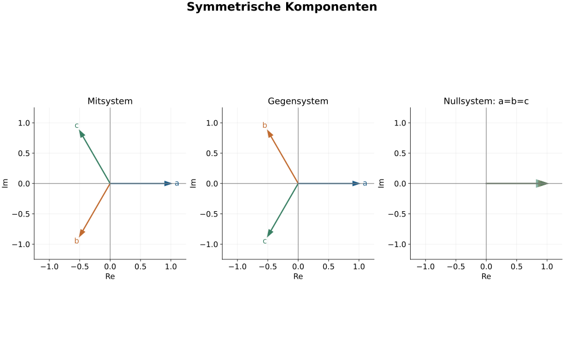

# M33-L3 – Unsymmetrische Netze: Symmetrische Komponenten und Fehlerrechnung im Modell {#L3}

**Kursbereich:** M33 – Masterprofil: Analyse moderner Energienetze und Leistungselektronik

**Niveau:** Master · Masterprofil

**Vorwissen:** [M33-L1](M33-L1.md), [M10-L4](M10-L4.md).

**Lernziel:** Unsymmetrische Zeiger transformieren und einen einpoligen Fehler mit drei Sequenznetzen berechnen.

## Fortescue-Transformation {#S1}

Bei Phasenfolge abc und $a=e^{j2\pi/3}$ zerlegt man beliebige komplexe Phasenzeiger in Null-, Mit- und Gegenkomponente:

$$\begin{bmatrix}v_a\\v_b\\v_c\end{bmatrix}=A\begin{bmatrix}v_0\\v_1\\v_2\end{bmatrix},\quad A=\begin{bmatrix}1&1&1\\1&a^2&a\\1&a&a^2\end{bmatrix},\qquad A^{-1}=A^H/3.$$

Mitkomponente 1 hat die normale Phasenfolge; Gegenkomponente 2 die umgekehrte. Nullkomponenten sind gleichphasig. Für Ströme gilt $i_a+i_b+i_c=3i_0$. Eine Nullkomponente benötigt einen Rückweg (Neutralleiter, Erde oder geeignete Wicklungsverbindung). Die Leistung in tatsächlichen Phasengrößen ist $S=3(v_0i_0^*+v_1i_1^*+v_2i_2^*)$. Im dreiphasig definierten p.u.-System entfällt der Faktor drei.

{alt="Mit-, Gegen- und Nullsystem als getrennte Zeigergruppen mit gleicher Skalierung."}

## Sequenzimpedanzen {#S2}

Bei zyklisch symmetrischen Netzelementen diagonalisiert die Transformation deren Phasenimpedanzmatrix. Die drei Sequenznetze lassen sich unabhängig lösen, solange sie nicht etwa durch eine Fehlerbedingung gekoppelt werden. Bei nicht transponierten Leitungen und ungleichen Phasenimpedanzen sind Kopplungsterme möglich. Transformator-Schaltgruppen beeinflussen Nullsystempfade und Phasenverschiebungen. Die pauschale Annahme $z_0=z_1=z_2$ ist insbesondere für Erdfehler ungeeignet.

## Einpoliger Kurzschluss {#S3}

Am Fehlerort sei die Phase a über $z_f$ mit Erde verbunden. Die Bedingungen sind $i_b=i_c=0$, $v_a=z_f i_a$. Folglich $i_0=i_1=i_2=i_a/3$. Für einen symmetrischen Vorfehlerzustand mit Thévenin-Mitspannung $e_1$ und den Sequenzimpedanzen $z_0,z_1,z_2$ gilt

$$i_a=\frac{3e_1}{z_0+z_1+z_2+3z_f}.$$

Mit $e_1=1$, $z_1=z_2=j0,2$, $z_0=j0,4$, $z_f=0$ erhält man $i_a=-j3,75$ p.u. Der symmetrische dreipolige Fehler liefert dagegen $i_1=e_1/z_1=-j5$ p.u., $i_0=i_2=0$. Bei 1 MVA, 20 kV entspricht der einpolige Effektivstrom 108,25 A. Diese Modellwerte sind nicht für die Auslegung einer realen Schutzanlage geeignet.

## Modellgrenzen bei Umrichtern {#S4}

Synchronmaschinen werden für bestimmte Zeitbereiche durch passende Ersatzreaktanzen abgebildet. Netzgeführte oder netzbildende Umrichter können hingegen durch Strombegrenzung und Regelstrategie ganz andere Fehlerbeiträge liefern. Eine konstante Spannungsquelle hinter einer Reaktanz bildet das nur begrenzt ab. Auch der Gleichstromanteil des Fehlerstroms, Schaltvorgänge, Sättigung und Schutzreaktionen fehlen im stationären Sequenzmodell. Für eine reale Schutzkoordination sind validierte dynamische Modelle, Herstellerdaten und die anwendbaren Schutzvorschriften erforderlich.

## Übungen und Kontrolle {#S5}

1. Transformiere $(1,a^2,a)$. **Lösung:** $(0,1,0)$.
2. Was ergibt die Transformation von $(3,0,0)$? **Lösung:** $(1,1,1)$.
3. Erhöhe im Fehlerbeispiel $z_f$ auf 0,1 p.u. **Lösung:** $3/(0,3+j0,8)$; Betrag etwa 3,51 p.u.
4. Wie verhält sich das Modell für $|z_0|\to\infty$ bei ansonsten festen Impedanzen? **Lösung:** Der einpolige Fehlerstrom geht gegen null. Kapazitive Rückwege eines realen Netzes wären separat zu berücksichtigen.

## Quellen {#S6}

- [ETH Zürich – Master Electrical Engineering and Information Technology](https://ethz.ch/en/studies/master/degree-programmes/engineering-sciences/electrical-engineering-and-information-technology.leftnav.html) · Specialisations: Electric Energy Engineering; curricularer Profilvergleich, kein Nachweis einzelner Lehrveranstaltungen. · Zuletzt abgerufen: 2026-11-25
- [MIT OpenCourseWare – 6.061, Introduction to Symmetrical Components](https://ocw.mit.edu/courses/6-061-introduction-to-electric-power-systems-spring-2011/resources/mit6_061s11_ch4/) · Kapitel 4 §§ 2, 7.1, Gleichungen 58–59 und Abb. 11: Transformation und einpoliger Erdschluss; gedruckte S. 1, 9–11. Ressourcenseite und PDF-Text geprüft, Titelseite visuell betrachtet. · Zuletzt abgerufen: 2026-11-25
