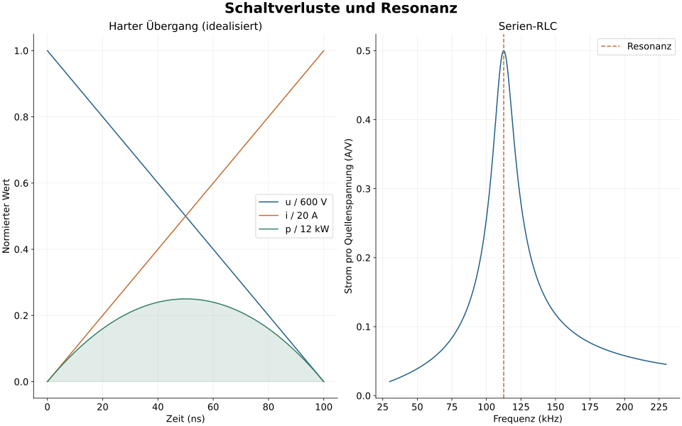

# M33-L4 – Leistungselektronische Systeme: Schaltverluste, Resonanz und Soft Switching {#L4}

**Kursbereich:** M33 – Masterprofil: Analyse moderner Energienetze und Leistungselektronik

**Niveau:** Master · Masterprofil

**Vorwissen:** [M9-L2](M9-L2.md), [M29-L2](M29-L2.md).

**Lernziel:** Verlustanteile eines Umrichters abschätzen und Bedingungen für verlustärmere Kommutierung begründen.

## Verluste zeitlich und energetisch trennen {#S1}

Ein MOSFET erzeugt in der leitenden Phase näherungsweise $P_{cond}=R_{DS,on}I_{rms}^2$ (Effektivwert über die gesamte Periode einschließlich Sperrzeit). Der Widerstand hängt von Sperrschichttemperatur und Ansteuerung ab. Für ein Bauteil mit einem Ein- und Ausschalten pro Periode gilt $P_{sw}=f_s(E_{on}+E_{off})$. Die Energien werden durch Integration der gleichzeitigen Spannung und des Stroms während des Schaltens bestimmt:

$$E=\int_{t_0}^{t_1}u(t)i(t)dt.$$

Wenn während 100 ns die Spannung linear von 600 V auf null fällt und der Strom idealisiert linear von null auf 20 A steigt, ist $E=UI\Delta t/6=0,2$ mJ. Bei konstanter Stromstärke während des Spannungsabfalls wäre es $UI\Delta t/2=0,6$ mJ. Die Verluste hängen also vom Verlauf ab, nicht nur von der Umschaltzeit. Die Rechnung ist keine Messung eines realen Halbleiters.

## Resonanter Energietransfer {#S2}

Eine Serien-RLC-Schaltung hat die Impedanz $Z=R+j(\omega L-1/(\omega C))$ und die Eigenkreisfrequenz $\omega_0=1/\sqrt{LC}$. Bei Resonanz kompensieren sich die Reaktanzen. Die gespeicherten Energien sind $W_L=Li^2/2$ und $W_C=Cu^2/2$. Für L = 20 µH, C = 100 nF, R = 2 Ω ergibt sich $f_0\approx112,54$ kHz und $Q=\omega_0 L/R\approx7,07$. Der sinusförmige Strom erreicht bei konstanter Anregung im Serienkreis sein Maximum bei Resonanz. Einzelne Bauteilspannungen können dabei die Quellenspannung übersteigen.

{alt="Idealisiert lineare Spannungs- und Stromverläufe beim harten Einschalten sowie RLC-Serienresonanz."}

## ZVS und ZCS {#S3}

Zero Voltage Switching (ZVS) zielt auf sehr kleine Schalterspannung bei Einschaltbeginn; Zero Current Switching (ZCS) auf sehr kleinen Schalterstrom beim relevanten Übergang. Ein Resonanzzweig oder eine passend geführte Laststromkommutierung kann die Ausgangskapazität vor dem Einschalten umladen. Grobe notwendige Energiebilanz bei ideal konstantem C: $LI^2/2\ge CU^2/2$. Für L = 10 µH, C = 1 nF, U = 600 V ergibt dies I ≥ 6 A. Das ist lediglich eine energetische Untergrenze; reale nichtlineare Kapazitäten, parasitäre Induktivitäten, Stromrichtung und Totzeit können die Kommutierung verhindern. Mit $C$ konstant und I ≈ konstant ist die Umladezeit $CU/I$, hier bei 6 A etwa 100 ns.

## Bewertung im Betriebspunkt {#S4}

Ein resonanter Umrichter ist nicht automatisch verlustärmer. Zirkulierende Ströme erhöhen Leitverluste; Dioden-Reverse-Recovery, Gate-Treiber, Magnetik und Filter erzeugen weitere Verluste. Eine höhere Frequenz erlaubt oft kleinere passive Bauelemente, erhöht aber frequenzabhängige Verluste. Eine Effizienzkarte muss Eingangsspannung, Strom, Temperatur und Schaltstrategie enthalten. Im Projekt L6 wird deshalb ein bewusst einfaches Aggregatmodell benutzt. Es trifft keine Aussage über sicheren Halbleiterbetrieb oder die tatsächlich erreichte ZVS-Kommutierung.

## Übungen und Kontrolle {#S5}

1. $E_{on}+E_{off}=2$ mJ, 10 kHz. **Lösung:** 20 W pro Schalter.
2. Verdopple C bei gleicher L. **Lösung:** $f_0$ sinkt um den Faktor $1/\sqrt2$.
3. Bei 40 A effektiv und 5 mΩ: **Lösung:** 8 W Leitverlust.
4. Weshalb reicht ein ZVS-Nachweis bei Nennlast nicht aus? **Lösung:** Umladestrom und Totzeit ändern sich mit der Last; bei Teillast kann die Bedingung verletzt sein.

## Quellen {#S6}

- [ETH Zürich – Master Electrical Engineering and Information Technology](https://ethz.ch/en/studies/master/degree-programmes/engineering-sciences/electrical-engineering-and-information-technology.leftnav.html) · Specialisations: Electric Energy Engineering; curricularer Profilvergleich, kein Nachweis einzelner Lehrveranstaltungen. · Zuletzt abgerufen: 2026-11-25
- [MIT OpenCourseWare – 6.622, Power Electronics, Lectures 33–36](https://ocw.mit.edu/courses/6-622-power-electronics-spring-2023/video_galleries/video-lectures/) · Videovorlesungen 15 und 33–37 (Übersicht): Schaltverluste, Soft Switching und Resonanzwandler. · Zuletzt abgerufen: 2026-11-25
