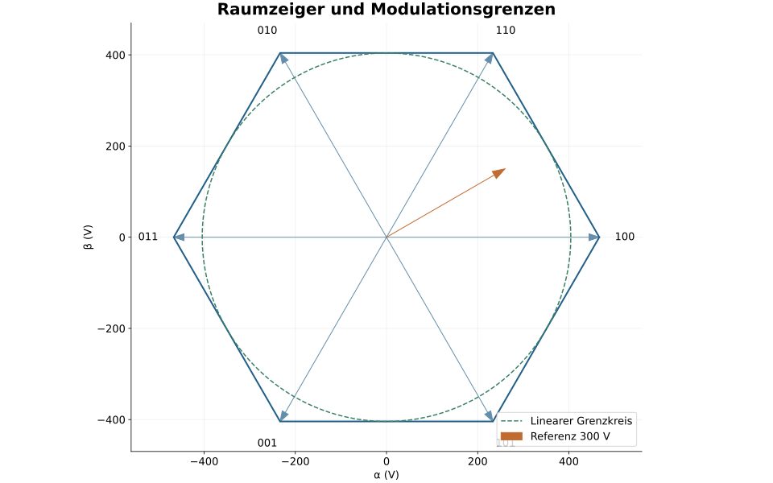

# M33-L5 – Dreiphasige Umrichter: Raumzeigermodulation und Bewertung von Modulationsgrenzen {#L5}

**Kursbereich:** M33 – Masterprofil: Analyse moderner Energienetze und Leistungselektronik

**Niveau:** Master · Masterprofil

**Vorwissen:** [M9-L4](M9-L4.md), [M33-L4](M33-L4.md).

**Lernziel:** Aktive Schaltvektoren, Verweilzeiten und lineare Spannungsgrenzen eines Zweipunktumrichters herleiten.

## Schaltvektoren der Zweipunktbrücke {#S1}

Die drei oberen Schaltzustände seien $s_a,s_b,s_c\in\{0,1\}$. Bei ideal komplementärer Ansteuerung und Zwischenkreisspannung $U_{dc}$ lautet der amplitudeninvariante Raumzeiger

$$\underline u=\frac23 U_{dc}(s_a+a s_b+a^2 s_c),\qquad a=e^{j2\pi/3}.$$

Gemeinsame Spannungsanteile verschwinden aus diesem Zeiger. Sechs aktive Vektoren besitzen Betrag $2U_{dc}/3$ und sind um 60° gegeneinander gedreht. Zwei Schaltzustände (000 und 111) ergeben den Nullvektor. Die beiden Zustände erzeugen jedoch unterschiedliche Gleichtaktspannungen.

{alt="Sechseck der aktiven Schaltvektoren, linearer Grenzkreis und Spannungsreferenz im ersten Sektor."}

## Verweilzeiten als gewichtetes Mittel {#S2}

Ein Referenzvektor im ersten Sektor mit Betrag U und Winkel $\phi\in[0,\pi/3]$ wird im idealen Mittel über eine Schaltperiode $T_s$ durch die Nachbarvektoren und den Nullvektor synthetisiert. Auflösen nach den Komponenten ergibt

$$\frac{T_1}{T_s}=\frac{\sqrt3 U}{U_{dc}}\sin(\pi/3-\phi),\quad \frac{T_2}{T_s}=\frac{\sqrt3 U}{U_{dc}}\sin\phi,$$
$$T_0=T_s-T_1-T_2.$$

Eine symmetrische Folge ist beispielsweise 000–100–110–111–110–100–000 mit passend aufgeteilten Verweilzeiten. Die Bedingung $T_0\ge0$ beschreibt das Sechseck. Der größte vollständig enthaltene Kreis besitzt Radius $U_{dc}/\sqrt3$. Dieser Radius begrenzt eine verzerrungsfreie rotierende Grundschwingungsreferenz im idealen linearen Bereich.

## Effektivwerte und Vergleich {#S3}

Der Raumzeigerbetrag entspricht bei symmetrischem Sinussystem der Phasen-Spitzenamplitude. Die verkettete Grundschwingungs-Effektivspannung ist $U_{LL}=\sqrt{3/2}U$. Für sinusförmige PWM ohne Nullsystemeinspeisung ist $U\le U_{dc}/2$; bei SVM $U\le U_{dc}/\sqrt3$. Das Verhältnis der Grenzwerte ist $2/\sqrt3$ (15,47 % mehr). Damit gilt für SVM

$$U_{LL,max}=U_{dc}/\sqrt2.$$

700 V Zwischenkreis erlauben ideal bis 494,97 V verkettet effektiv. Für 400 V werden mindestens 565,69 V benötigt, noch ohne Filterspannungsabfall. Beispiel U = 300 V, Winkel 30°, Udc = 700 V, Ts = 100 µs: T1 = T2 ≈ 37,12 µs, T0 ≈ 25,77 µs.

## Netzgekoppelter Umrichter {#S4}

Ein netzseitiger Umrichter speist Strom über Filter und Transformator ein. Bei Einspeisestrom $i_c$ in Richtung Netz ergibt sich $v_f=v_{PCC}+z_fi_c$ als erforderlicher interner Spannungszeiger. Der komplexe Strom folgt aus $s_c=v_{PCC}i_c^*$. Blindleistung erhöht bei konstantem P typischerweise den Betrag des Stroms. Zwischenkreismarge, Stromgrenze und thermische Grenze müssen gleichzeitig erfüllt sein. Überschreitet der erforderliche Spannungsvektor den linearen Bereich, ist der verlangte sinusförmige stationäre Betrieb unter diesen Annahmen nicht erreichbar. Übermodulation verändert die Grundschwingung und die Oberschwingungen; sie ist kein kostenloser Ausweg. Totzeit, Mindestimpulse und Spannungsschwankungen reduzieren die praktisch nutzbare Reserve.

## Übungen und Kontrolle {#S5}

1. Aktiver Vektor bei Udc = 600 V? **Lösung:** Betrag 400 V.
2. Maximale verkettete SVM-Effektivspannung? **Lösung:** 424,26 V bei 600 V DC.
3. Was geschieht bei $T_0<0$? **Lösung:** Die Referenz liegt außerhalb des für diesen Sektor konvex synthetisierbaren Dreiecks.
4. Warum kann trotz ausreichendem Udc die Einspeisung scheitern? **Lösung:** Strom-, Temperatur-, Regler- oder Netzgrenzen können unabhängig davon verletzt sein.

## Quellen {#S6}

- [ETH Zürich – Master Electrical Engineering and Information Technology](https://ethz.ch/en/studies/master/degree-programmes/engineering-sciences/electrical-engineering-and-information-technology.leftnav.html) · Specialisations: Electric Energy Engineering; curricularer Profilvergleich, kein Nachweis einzelner Lehrveranstaltungen. · Zuletzt abgerufen: 2026-11-25
- [Imperix – Space Vector Modulation, TN145](https://imperix.com/doc/implementation/space-vector-modulation) · TN145, Active and zero space vectors und Voltage synthesis: Schaltzustände und Spannungsvektoren des Zweipunktumrichters. · Zuletzt abgerufen: 2026-11-25
