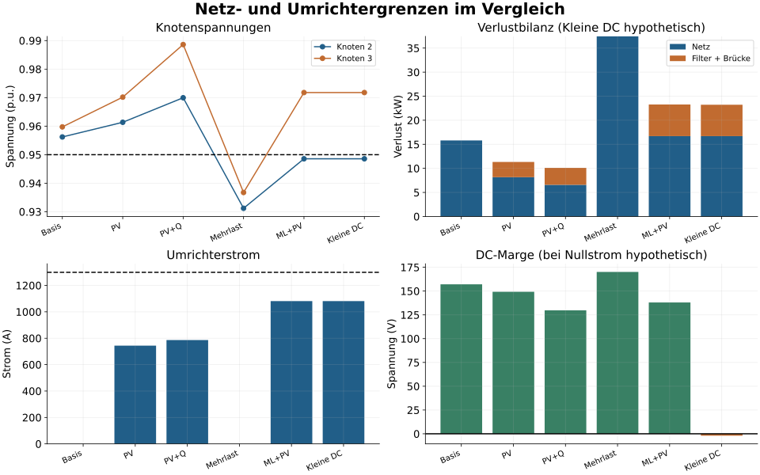

# M33-L6 – Profilprojekt: Umrichtergespeiste Einspeisung in einem kleinen Testnetz mit Last- und Verlustszenarien {#L6}

**Kursbereich:** M33 – Masterprofil: Analyse moderner Energienetze und Leistungselektronik

**Niveau:** Master · Masterprofil

**Vorwissen:** [M33-L1](M33-L1.md) bis [M33-L5](M33-L5.md).

**Lernziel:** Sechs stationäre Szenarien reproduzierbar berechnen, Verluste und Grenzen unterscheiden und eine technische Entscheidung begründen.

## Fragestellung und Modellgrenze {#S1}

In einem dreiphasigen 20-kV-Netz soll eine lokale Erzeugung am Knoten 3 die Bezugsleistung des übergeordneten Netzes reduzieren. Untersucht wird, ob die Einspeisung auch Spannungsprobleme bei höherer Last beseitigt und ob der Umrichter sie realisieren könnte. Das Netz aus L1 hat 1 MVA Basis, einen Slack-Knoten mit 1 p.u. und zwei PQ-Knoten. Die Lasten sind konstante komplexe Leistungen von 650 + j300 kVA und 350 + j150 kVA. Die Erzeugung stellt P und Q unabhängig vorgegeben bereit (PQ-Einspeisung); eine dynamische Regelung wird nicht simuliert. Umrichter und Netz sind durch einen idealen Transformator (400 V / 20 kV) und eine auf die gemeinsame Basis bezogene Serienfilterimpedanz $z_f=0,005+j0,08$ verbunden.

Modellgrenzen: mindestens 0,95 p.u. Knotenspannung, höchstens 0,9 p.u. Umrichterstrom und nichtnegative Zwischenkreismarge. Die Grenzwerte sind frei gewählte didaktische Kriterien. Netzbetriebsmittel haben hier keine Stromgrenzen; reale Zulässigkeit lässt sich aus diesen drei Kriterien nicht ableiten.

## Rechenweg und Verluste {#S2}

Für jeden Fall wird die Nettoeinspeisung der PQ-Knoten gebildet und der AC-Lastfluss iterativ gelöst. Danach werden Strom und erforderlicher Brückenspannungszeiger berechnet:

$$i_c=(s_c/v_3)^*,\quad v_f=v_3+z_f i_c,\quad U_{dc,min}=\sqrt2\,400\,|v_f|.$$

Die Netzverluste sind $\sum r_{ij}|i_{ij}|^2S_B$. Filterverluste entsprechen $0,005|i_c|^2 S_B$. Als illustrative Brückenverlustfunktion werden 1 mΩ effektiver Pfadwiderstand je Phase und 2 mJ Schaltenergie pro Bauteil und Schaltperiode bei 500 A (Phasen-Effektivwert), 700 V und 10 kHz verwendet. Die Energie skaliert im Modell linear mit Strom- und Spannungsbetrag; sechs Schalter werden angesetzt. Es handelt sich um synthetische Aggregatkoeffizienten, nicht um ein Datenblattmodell oder einen Halbleiterentwurf. Bei aktiver Einspeisung ist die DC-Wirkleistung $P_{dc}=P_c+P_{Filter}+P_{Brücke}$. Bei Nullstrom werden die Verluste auf null gesetzt; Standby- und Magnetisierungsverluste fehlen. Der berechnete Mindestzwischenkreis ist dann nur ein hypothetischer Spannungsabgleich, keine Anforderung an ein abgeschaltetes Gerät.

## Reproduzierbarer Rechenkern {#S3}

Python 3 mit NumPy und SciPy. Das Newton-Verfahren in Polarkoordinaten wird zusätzlich gegen eine kartesische Nullstellensuche geprüft. Die komplexe Leistungsbilanz wird unabhängig aus den Zweigströmen kontrolliert. Beide numerischen Verfahren verwenden dieselben Modellannahmen; ihre Übereinstimmung ist Verifikation, keine physikalische Validierung.

```python
import numpy as np
from scipy.optimize import root

# 1 MVA, 20 kV grid / 400 V converter base; all grid quantities pu.
lines=[(0,1,.02+.10j),(0,2,.03+.15j),(1,2,.025+.12j)]
Y=np.zeros((3,3),complex)
for i,j,z in lines:
    Y[i,i]+=1/z; Y[j,j]+=1/z
    Y[i,j]-=1/z; Y[j,i]-=1/z

def volt(x):
    return np.r_[1, x[2:]*np.exp(1j*x[:2])]

def mismatch(x,s):
    e=(volt(x)*np.conj(Y@volt(x)))[1:]-s
    return np.r_[e.real,e.imag]

def solve(s):
    x=np.array([0.,0.,1.,1.])
    for k in range(30):
        f=mismatch(x,s)
        if np.max(abs(f))<1e-10: break
        J=np.column_stack([(mismatch(x+v,s)-mismatch(x-v,s))/2e-6
                           for v in np.eye(4)*1e-6])
        x-=np.linalg.solve(J,f)
    else: raise RuntimeError('Newton failed')
    v=volt(x)
    # Independent Cartesian root check of the same physical model.
    def cart(w):
        u=np.r_[1,w[:2]+1j*w[2:]]
        e=(u*np.conj(Y@u))[1:]-s
        return np.r_[e.real,e.imag]
    r=root(cart,[1,1,0,0],tol=1e-10)
    assert np.max(abs(cart(r.x)))<1e-9
    assert np.max(abs(v[1:]-(r.x[:2]+1j*r.x[2:])))<1e-8
    loss=sum(z*abs((v[i]-v[j])/z)**2 for i,j,z in lines)
    assert abs(sum(v*np.conj(Y@v))-loss)<1e-9
    return v,loss,k

# load multiplier, converter P (MW), Q (Mvar), DC voltage (V)
cases=[('Basis',1,0,0,700),('PV',1,.5,0,700),('PV+Q',1,.5,.2,700),
       ('Mehrlast',1.5,0,0,700),('Mehrlast+PV',1.5,.7,.2,700),
       ('Kleine DC',1.5,.7,.2,560)]
def evaluate(case):
    name,l,p,q,udc=case
    s=np.array([l*(-.65-.30j),l*(-.35-.15j)+p+1j*q])
    v,loss,k=solve(s)
    # Ideal transformer, converter current into bus; simple series filter.
    ic=np.conj((p+1j*q)/v[2]); vf=v[2]+(.005+.08j)*ic
    amps=abs(ic)*1e6/(np.sqrt(3)*400)
    req=np.sqrt(2)*400*abs(vf) # linear SVM min DC voltage
    # Aggregate illustrative per-phase filter R and device loss model.
    filter_kw=.005*abs(ic)**2*1000
    cond_kw=3*amps**2*.001/1000
    sw_kw=6*10000*.002*(amps/500)*(udc/700)/1000
    total=filter_kw+cond_kw+sw_kw
    margin=udc-req
    ok=(min(abs(v))>=.95 and abs(ic)<=.9 and margin>=0)
    return v,loss,k,amps,req,total,ok

if __name__=='__main__':
    for c in cases:
        v,loss,k,amps,req,total,ok=evaluate(c)
        print(f'{c[0]:14s} {abs(v[1]):.4f} {abs(v[2]):.4f} '
              f'{loss.real*1000:7.2f} {amps:7.1f} {req:6.1f} '
              f'{total:6.2f} {k} {ok}')
```

## Ergebnisse {#S4}

| Fall | $V_2$ (p.u.) | $V_3$ (p.u.) | Netzverlust (kW) | Umrichterstrom (A) | $U_{dc,min}$ (V) | Zusatzverluste (kW) | Kriterien |
| --- | ---: | ---: | ---: | ---: | ---: | ---: | ---: | --- |
| Basis | 0,9562 | 0,9597 | 15,80 | 0,0 | 542,9 | 0,00 | erfüllt |
| PV | 0,9614 | 0,9702 | 8,17 | 743,9 | 550,8 | 3,17 | erfüllt |
| PV+Q | 0,9700 | 0,9886 | 6,58 | 786,2 | 570,3 | 3,53 | erfüllt |
| Mehrlast | 0,9312 | 0,9367 | 37,44 | 0,0 | 529,9 | 0,00 | Spannung |
| Mehrlast+PV | 0,9486 | 0,9718 | 16,70 | 1081,3 | 562,0 | 6,57 | Spannung |
| Kleine DC | 0,9486 | 0,9718 | 16,70 | 1081,3 | 562,0 | 6,52 | Spannung, DC |

PV bezeichnet hier die lokale Erzeugung, nicht den PV-Knotentyp. Mehrlast entspricht Faktor 1,5; PV = 0,5 MW im Normalbetrieb, 0,7 MW bei Mehrlast. Q = +0,2 Mvar in den drei Q-Fällen. Kleine DC reduziert Udc von 700 auf 560 V. Alle Lastflüsse benötigen vier Newton-Schritte; sämtliche Leistungsresiduen liegen unter der gewählten Toleranz. Bei kleiner DC ist die vorgegebene Einspeisung mathematisch lösbar, aber nicht als linear modulierter Betrieb umsetzbar; die Verluste dieses Falls sind nur hypothetisch. Ein tatsächlicher Betrieb erfordert einen neuen Arbeitspunkt.

{alt="Knotenspannungen, Netzverluste und Zwischenkreismargen der sechs synthetischen Szenarien."}

Der Normalfall mit PV+Q spart gegenüber Basis 9,22 kW Netzverluste, fügt aber 3,53 kW Zusatzverluste hinzu; die modellierte Gesamtersparnis beträgt damit 5,69 kW. Die Vergleichsgrenze umfasst Netz, Filter und Brücke, nicht Erzeugung und übergeordnetes Netz. Bei Mehrlast verbessert lokale Einspeisung den Spannungsbetrag und senkt Verluste deutlich, beseitigt jedoch die Unterspannung an Knoten 2 nicht. Ein konvergierter Lastfluss ist kein Betriebsfreigabekriterium. Mögliche Abhilfen sind Netzverstärkung, andere Blindleistungsaufteilung oder eine angepasste Einspeise-/Laststrategie. Diese müssten erneut berechnet und anhand realer Grenzen geprüft werden.

## Arbeitsauftrag und Bewertung {#S5}

1. Reproduziere die sechs Fälle und protokolliere die maximale Residualnorm. **Kontrolle:** Beide Verfahren stimmen auf besser als $10^{-8}$ p.u. Spannungsabweichung überein; die komplexe Bilanz schließt auf $10^{-9}$ p.u.
2. Halbiere den Schaltfrequenzparameter. **Kontrolle:** Nur der modellierte Schaltverlust halbiert sich; der aus dem festen PQ-Arbeitspunkt berechnete Lastfluss bleibt gleich. Reale Filter- und Stromrippelwirkungen werden nicht erfasst.
3. Bestimme im Fall PV+Q die DC-Leistung. **Lösung:** ungefähr 503,53 kW; der Umrichter speist 500 kW netto ins Netz ein. Die Blindleistung wird nicht einfach zur DC-Wirkleistung addiert.
4. Begründe, warum im Fall Kleine DC nicht einfach der geringere modellierte Schaltverlust als Effizienzgewinn gelten kann. **Lösung:** Der angenommene Arbeitspunkt ist bei 560 V außerhalb der linearen Modulationsgrenze. Eine Verlustbewertung setzt einen realisierbaren Arbeitspunkt voraus.
5. Ergänze mindestens eine eigene Variante mit geänderter Q-Einspeisung, protokolliere Spannung, Strom und DC-Marge und beschreibe fehlende Modellbestandteile. **Bewertung:** nachvollziehbarer Parametersatz, reproduzierbarer Code, geprüfte Bilanz, explizite Trennung numerischer und realer Zulässigkeit. Eine reale Netz- oder Schutzfreigabe ist nicht Teil des Projekts.


## Quellen {#S6}

- [ETH Zürich – Master Electrical Engineering and Information Technology](https://ethz.ch/en/studies/master/degree-programmes/engineering-sciences/electrical-engineering-and-information-technology.leftnav.html) · Specialisations: Electric Energy Engineering; curricularer Profilvergleich, kein Nachweis einzelner Lehrveranstaltungen. · Zuletzt abgerufen: 2026-11-25
- [MATPOWER – AC Power Flow, Benutzerhandbuch](https://matpower.app/manual/matpower/ACPowerFlow.html) · Handbuch §4.1: AC-Leistungsbilanz und Knotentypen; Grenzen des gewöhnlichen Lastflusses, methodischer Teilaspekt. · Zuletzt abgerufen: 2026-11-25
- [MIT OpenCourseWare – 6.622, Power Electronics, Lectures 33–36](https://ocw.mit.edu/courses/6-622-power-electronics-spring-2023/video_galleries/video-lectures/) · Videovorlesungen 15 und 21–23 (Übersicht): Verluste und Dreiphasensysteme; Teilaspekt. · Zuletzt abgerufen: 2026-11-25
- [Imperix – Space Vector Modulation, TN145](https://imperix.com/doc/implementation/space-vector-modulation) · TN145, Active and zero space vectors und Voltage synthesis: Schaltzustände und Spannungsvektoren des Zweipunktumrichters. · Zuletzt abgerufen: 2026-11-25
