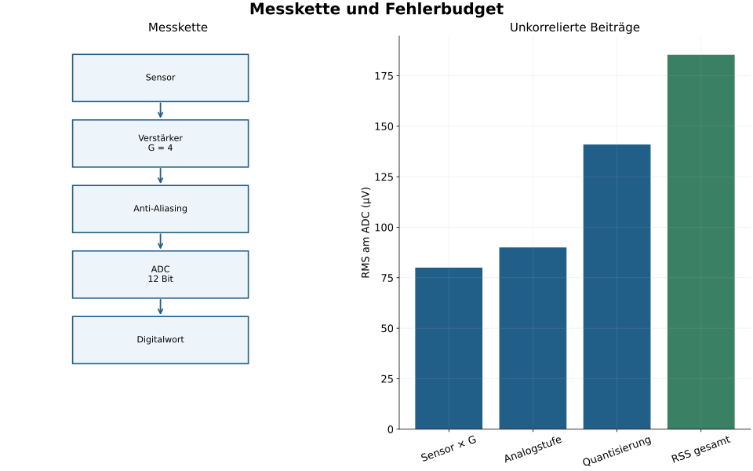

# M34-L1 – Spezifikation einer gemischt analog-digitalen Messkette: Rausch- und Fehlerbudget {#L1}

**Kursbereich:** M34 – Masterprofil: Entwurf elektronischer Systeme und integrierter Schaltungen

**Niveau:** Master · Masterprofil

**Vorwissen:** [M30-L2](M30-L2.md), [M16-L4](M16-L4.md), [M31-L3](M31-L3.md).

**Lernziel:** Ein Fehlerbudget von der Sensorquelle bis zum digitalen Ergebnis herleiten und deterministische Fehler von Rauschen trennen.

## Vom Messziel zur Schnittstelle {#S1}

Ein Mixed-Signal-System verbindet kontinuierliche elektrische Größen mit diskreten Codes. Die Schnittstelle ist erst definiert, wenn Messbereich, Bandbreite, zulässiger Fehler, Aktualisierungsrate und maximale Latenz bekannt sind. Für eine virtuelle Messkette wählen wir einen bipolaren ADC mit 2 V Gesamtspanne, 12 Bit, 100 kS/s und eine Eingangssinusamplitude von 0,8 V. Die Werte sind Modellannahmen, keine Produktauswahl. Ein analoger Verstärker nutzt den Bereich aus; ein Tiefpass begrenzt Rauschen und Aliasing. Die digitale Seite verarbeitet Codes und Übersteuerungsstatus.

{alt="Signalfluss vom Sensor zum digitalen Wort sowie Beiträge zum eingangsbezogenen RMS-Rauschen."}

## Rauschbudget und Bezugsebene {#S2}

Ein Verstärker mit Verstärkung $G$ überträgt Eingangssignal und eingangsbezogenes Rauschen. Unkorrelierte Fehlerleistungen addieren sich, nicht die RMS-Amplituden. Bei einer eingangsbezogenen Spannung von $\sigma_s$ und einem nachgeschalteten Beitrag $\sigma_a$ gilt am ADC-Eingang

$$\sigma_{\mathrm{tot}}^2=G^2\sigma_s^2+\sigma_a^2+q^2/12,\qquad q=V_{\mathrm{FS}}/2^N.$$

Die Quantisierungsnäherung setzt ausreichend verteilte Quantisierungsphasen, keine Übersteuerung und gleich breite Stufen voraus. Für $G=4$, $\sigma_s=20\,\mu\mathrm V$, $\sigma_a=90\,\mu\mathrm V$ und $q=488,28\,\mu\mathrm V$ ergeben sich rund 185,3 µV RMS am ADC beziehungsweise 46,3 µV bezogen auf den Sensoreingang. Ein sinusförmiges Signal mit 0,8 V Spitze liefert damit ungefähr 69,7 dB SNR. Bei korrelierten Quellen sind zusätzlich Kovarianzen zu berücksichtigen.

Für einen Widerstand $R$ bei Temperatur $T$ ist die einseitige thermische Leerlauf-Spannungsrauschdichte $4k_BT R$ in V²/Hz. Ein RC-Tiefpass mit Grenzfrequenz $f_c$ besitzt die äquivalente Rauschbandbreite $\pi f_c/2$, nicht einfach $f_c$. Ein 10-kΩ-Widerstand bei 300 K mit 10 kHz Grenzfrequenz ergibt ungefähr 1,61 µV RMS, sofern nur seine Rauschquelle betrachtet wird.

## Systematische Abweichungen {#S3}

Ein linearer Fehleransatz lautet $y=(1+\epsilon_g)x+b+e$. Bei einem Offset $b=0,6$ mV und Verstärkungsfehler $\epsilon_g=0,001$ ist der maximale statische Fehler bei 0,8 V Eingangsbetrag 1,4 mV vor weiteren Beiträgen. Bei bekannten Vorzeichen kann sich ein Fehler teilweise kompensieren; ein Worst-Case-Budget darf diese Kompensation nicht voraussetzen. Unbekannte gleichgerichtete systematische Fehler werden nicht als unabhängige Zufallsgrößen behandelt.

Eine Zweipunktkalibrierung schätzt Offset und Steigung aus bekannten Referenzspannungen. Sie korrigiert keine gekrümmte Kennlinie, keinen Zeitversatz und keine Sättigung. Eine Kalibrierung mit denselben Daten zu bewerten, mit denen sie bestimmt wurde, ist kein unabhängiger Test.

## Spezifikationsmatrix {#S4}

| Kriterium | Modellziel | Prüfverfahren |
| --- | --- | --- |
| Gesamtspanne | −1 bis +1 V | Rampentest, Grenzwerte |
| Abtastung | 100 kS/s | Zeitbudget |
| Dynamische Qualität bei ca. 1 kHz | SINAD mindestens 65 dB | kohärenter Sinustest |
| Unkalibrierter Gesamtabstand | RMS höchstens 1 mV | Vergleich mit idealem Eingang |
| Übersteuerung | keine im Nennbetrieb | Eingang und Codegrenzen |
| Konversion plus Erfassung | höchstens 10 µs | Zeitmodell |

Das RMS-Gesamtfehlerziel erfasst Offset, Verstärkung und Phase, die im Sinusfit teilweise entfernt werden. Das SINAD-Ziel allein ist deshalb keine absolute Genauigkeitsspezifikation. Die Grenzwerte werden in [M34-L6](M34-L6.md) explizit geprüft.

## Übungen und Kontrolle {#S5}

1. Verdopple G auf 8 bei unveränderten Rauschquellen. **Lösung:** Eingangsbezogen sinkt der Beitrag der nachgeschalteten Quellen; am ADC steigt das Rauschen auf etwa 231 µV. Der Sensorbereich muss aber halbiert werden, wenn die ADC-Spanne unverändert bleibt.
2. Addiere zwei vollständig gleichgerichtete Offsets von 0,4 mV und 0,6 mV. **Lösung:** 1 mV, nicht 0,72 mV.
3. Warum ersetzt eine hohe Abtastrate keinen analogen Anti-Aliasing-Filter? **Lösung:** Frequenzen außerhalb des nutzbaren Nyquist-Bereichs können sich in den Messbereich falten; eine nachträgliche digitale Trennung ist im Allgemeinen nicht möglich.

## Quellen {#S6}

- [ETH Zürich – Electronics and Photonics (Curriculum G4)](https://www.vvz.ethz.ch/Vorlesungsverzeichnis/sucheLehrangebot.view?abschnittId=122815&ansicht=1&lang=en&seite=0&semkez=2026W) · Herbst 2026, Electronics and Photonics: 227-0146-00L Data Conversion System Design; nur curricularer Profilvergleich, kein Nachweis einzelner Gleichungen oder Versuche. · Zuletzt abgerufen: 2026-11-25
- [Analog Devices – Defining and Testing Dynamic Parameters in High-Speed ADCs](https://www.analog.com/en/resources/technical-articles/defining-and-testing-dynamic-parameters-in-highspeed-adcs-part-1.html) · Abschnitte SINAD und ENOB: SINAD-Umrechnung korrekt; erste RMS-Fehlerformel widerspricht dem Begleittext. ENOB-Umrechnung separat gegengeprüft (NI). · Zuletzt abgerufen: 2026-11-25
