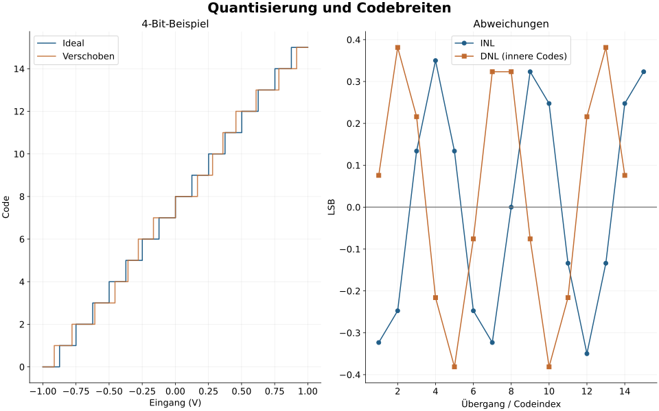

# M34-L2 – Datenwandler: Abtasten, Quantisierung, Linearitätsfehler und effektive Auflösung {#L2}

**Kursbereich:** M34 – Masterprofil: Entwurf elektronischer Systeme und integrierter Schaltungen

**Niveau:** Master · Masterprofil

**Vorwissen:** [M34-L1](M34-L1.md), [M31-L1](M31-L1.md).

**Lernziel:** Codeübergänge und dynamische ADC-Kennzahlen berechnen, Testmethoden unterscheiden und Jittergrenzen herleiten.

## Abtastung und Codezuordnung {#S1}

Der Sample-and-Hold speichert eine analoge Spannung für die Konversion. Ein idealer bipolarer N-Bit-Wandler mit Gesamtspanne $V_{\mathrm{FS}}$ hat $2^N$ Codes und Schrittweite $q=V_{\mathrm{FS}}/2^N$. Bei Mittelpunktrekonstruktion gilt für $-V_{\mathrm{FS}}/2\le x<V_{\mathrm{FS}}/2$:

$$c=\left\lfloor\frac{x+V_{\mathrm{FS}}/2}{q}\right\rfloor,\qquad \hat x=-V_{\mathrm{FS}}/2+(c+1/2)q.$$

Außerhalb des Bereichs begrenzen wir auf die Endcodes; die Fehlergrenze von $q/2$ gilt dort nicht. Bei 12 Bit und 2 V ist $q=0,48828125$ mV. Für $x=0,1$ V entsteht Code 2252 und der rekonstruierte Wert 99,8535 mV.

{alt="Ideale und verschobene Übergänge, DNL und INL eines monotonen Kennlinienmodells."}

## Statische Kennlinienabweichungen {#S2}

Seien $T_k$ die Übergänge von Code $k-1$ zu Code $k$. Für die inneren Codebreiten $w_k=T_{k+1}-T_k$ gilt

$$\mathrm{DNL}_k=w_k/q-1,\qquad \mathrm{INL}_k=(T_k-T_{k,\mathrm{ref}})/q.$$

Die Referenzgerade und Offset-/Gain-Behandlung müssen genannt werden, weil Endpunkt- und Best-Fit-Definition verschiedene Zahlen liefern. Ein innerer Code mit Breite null ist fehlend (DNL = −1). Ein Modell mit streng steigenden Übergängen ist monoton; nichtmonotone reale Wandler können eine allgemeinere Beschreibung brauchen. Beim DAC werden stattdessen analoge Ausgangsstufen und deren Differenzen ausgewertet.

Beispiel: Übergangsabweichungen +0,1, +0,4, −0,2 LSB relativ zur idealen Geraden ergeben für die beiden dazwischenliegenden Codes DNL +0,3 und −0,6 LSB.

## Dynamische Kennzahlen {#S3}

Für einen statistisch gleichverteilten Quantisierungsfehler in $[-q/2,q/2]$ ist

$$\sigma_q^2=\frac1q\int_{-q/2}^{q/2}e^2\,de=q^2/12.$$

Ein voll ausgesteuerter Sinus hat RMS $V_{\mathrm{FS}}/(2\sqrt2)$. Daraus folgt die idealisierte Beziehung $\mathrm{SNR}=6,02N+1,76$ dB. Bei kleinerer Amplitude A ist $20\log_{10}(2A/V_{\mathrm{FS}})$ zu addieren. Bei 0,8 V Spitze und 12 Bit sind rund 72,1 dB zu erwarten. SINAD enthält zusätzlich harmonische Verzerrung, DC wird ausgeschlossen. Die übliche Umrechnung

$$\mathrm{ENOB}=(\mathrm{SINAD}-1,76)/6,02$$

ist auf Vollaussteuerung bezogen; bei kleinerer Testamplitude ist diese Angabe ausdrücklich als nicht amplitudenkorrigierter Wert zu kennzeichnen. THD beschreibt nur harmonische Anteile, SFDR den Abstand zum stärksten Störton. Ein Sinusfit oder eine kohärente FFT ohne Leckeffekte ermöglicht reproduzierbare Tests.

## Abtastjitter und Einschwingen {#S4}

Für einen sinusförmigen Eingang $x=A\sin(2\pi ft)$ und kleinen unabhängigen Zeitfehler $\delta t$ folgt durch Taylor-Entwicklung $e\approx x'(t)\delta t$. Daher ist die jitterbegrenzte SNR näherungsweise

$$\mathrm{SNR}_j=-20\log_{10}(2\pi f\sigma_t).$$

Bei 40 kHz und 50 ns RMS sind es rund 38 dB. Eine höhere nominelle Auflösung kann diesen Fehler nicht beseitigen. Bei einem RC-Erfassungsglied ergibt sich dagegen aus einem konstanten Spannungssprung $\Delta V$ die Restabweichung $\Delta V\exp(-t_a/RC)$. Beide Mechanismen verlangen unterschiedliche Gegenmaßnahmen.

## Übungen und Kontrolle {#S5}

1. Berechne q für 16 Bit und 2 V. **Lösung:** 30,52 µV.
2. Ein 12-Bit-ADC erreicht bei Vollaussteuerung 62 dB SINAD. **Lösung:** ENOB rund 10,01 Bit.
3. Welche Jittergrenze ergibt 70 dB bei 40 kHz? **Lösung:** rund 1,26 ns RMS, wenn ausschließlich Jitter wirkt.
4. Warum sind 12 ausgegebene Bits keine Garantie für 12 Bit Genauigkeit? **Lösung:** Offset, Gain, INL, Rauschen, Jitter und Verzerrung bleiben getrennte Fehlerquellen.

## Quellen {#S6}

- [ETH Zürich – Electronics and Photonics (Curriculum G4)](https://www.vvz.ethz.ch/Vorlesungsverzeichnis/sucheLehrangebot.view?abschnittId=122815&ansicht=1&lang=en&seite=0&semkez=2026W) · Herbst 2026, Electronics and Photonics: 227-0146-00L Data Conversion System Design; nur curricularer Profilvergleich, kein Nachweis einzelner Gleichungen oder Versuche. · Zuletzt abgerufen: 2026-11-25
- [Analog Devices – Defining and Testing Dynamic Parameters in High-Speed ADCs](https://www.analog.com/en/resources/technical-articles/defining-and-testing-dynamic-parameters-in-highspeed-adcs-part-1.html) · Abschnitte SINAD und ENOB: SINAD-Umrechnung korrekt; erste RMS-Fehlerformel widerspricht dem Begleittext. ENOB-Umrechnung separat gegengeprüft (NI). · Zuletzt abgerufen: 2026-11-25
- [NI – cDAQ Effective Number of Bits (ENOB)](https://knowledge.ni.com/KnowledgeArticleDetails?id=kA00Z000000P6wbSAC&l=en-US) · Abschnitt Solution: SINAD-Umrechnung und Abhängigkeit von Signalpegel und Frequenz; begrenzter Formelnachweis. · Zuletzt abgerufen: 2026-11-25 · Inhaltlich geprüft: 2026-11-25
