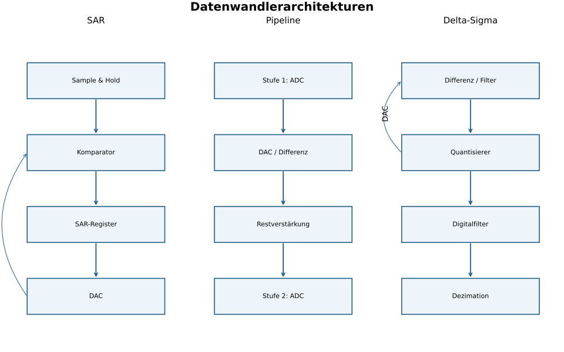

# M34-L3 – Architekturen für ADC und DAC: SAR-, Pipeline- und Delta-Sigma-Ansätze vergleichen {#L3}

**Kursbereich:** M34 – Masterprofil: Entwurf elektronischer Systeme und integrierter Schaltungen

**Niveau:** Master · Masterprofil

**Vorwissen:** [M34-L2](M34-L2.md), [M31-L2](M31-L2.md).

**Lernziel:** Wandlungsarchitekturen anhand von Durchsatz, Latenz, Bandbreite und Einschwingzeit vergleichen.

## SAR als binäre Suche {#S1}

Ein SAR-ADC (Successive Approximation Register) speichert den Eingang, prüft zunächst das höchstwertige Bit und verfeinert die Entscheidung bis zum niederwertigsten Bit. DAC, Komparator und Register bilden einen Rückkopplungspfad. Bei idealen Übergängen entspricht die Entscheidung der binären Suche nach dem größten Schwellenwert, der nicht über dem Eingang liegt. Ein 4-Bit-ADC mit 0–1 V und 0,70 V Eingang prüft nacheinander Codes 8, 12, 10, 11. Die Schwellen sind 0,5, 0,75, 0,625, 0,6875 V; Ergebnis 11. Jeder Schritt benötigt DAC-Einschwingzeit und eine sichere Komparatorentscheidung.

{alt="Binäre SAR-Entscheidung, Pipeline mit Restwert und Delta-Sigma-Schleife mit Dezimation."}

## Pipeline und Flash {#S2}

Ein Flash-ADC vergleicht parallel mit mehreren Schwellen; ein einfaches N-Bit-Flash-Schema benötigt $2^N-1$ Komparatoren. Bei der Pipeline bestimmt eine Stufe eine grobe Teilinformation, wandelt sie zurück, subtrahiert sie vom Eingang und verstärkt den Rest. Ein idealisiertes Stufenmodell ist

$$r_{j+1}=G_j(r_j-D_j(c_j)).$$

Digitale Korrektur und kalibrierte Stufen können Fehler reduzieren, benötigen aber redundante Bereiche beziehungsweise zusätzliche Informationen. Nach dem Füllen der Pipeline kann jede Taktperiode einen neuen Wert liefern, obwohl ein einzelner Wert mehrere Stufen durchläuft. Vier Stufen mit 10 ns je Stufe ergeben im vereinfachten Modell 40 ns Latenz und 100 MS/s Durchsatz. Register- und Ausrichtungszeiten sind hier nicht eingerechnet.

## Delta-Sigma und DAC {#S3}

Ein Delta-Sigma-Wandler kodiert das Signal mit hoher interner Rate, Schleifenfilter und Rückkopplungs-DAC. Im linearisierten Modell eines einfachen Modulators wird der Quantisierungsfehler durch $1-z^{-1}$ hochpassgeformt. Ein digitaler Tiefpass mit Dezimation reduziert hochfrequente Fehler und die Datenrate. Für weißes Quantisierungsrauschen und idealen Filter ist bei erster Ordnung, großer Oversampling Ratio (OSR), näherungsweise

$$\sigma_{q,\mathrm{band}}^2\approx(q^2/12)\frac{\pi^2}{3\,\mathrm{OSR}^3}.$$

Diese Beziehung ist keine Stabilitäts- oder Qualitätsgarantie für den realen nichtlinearen Modulator; Idle Tones, Überlastung, nichtideale Filter und thermisches Rauschen können dominieren. Eine Änderung der OSR von 16 auf 32 senkt im Modell die Rauschleistung um Faktor 8, etwa 9 dB.

Ein DAC kann eine R-2R-Leiter, kapazitive Ladungsumverteilung oder Stromquellen verwenden. Die digitale Zahl setzt einen analogen Ausgangswert; Glitches beim Übergang 0111→1000 und endliche Einschwingzeit sind dynamische Fehler, die eine reine statische Kennlinie nicht erfasst. Der Rückkopplungs-DAC eines ADC unterliegt denselben prinzipiellen Grenzen.

## Architekturentscheidung {#S4}

| Ansatz | Vorteil | Zu prüfende Grenze |
| --- | --- | --- |
| SAR | direkter Einzelwert, effiziente binäre Suche | Erfassungs- und DAC-Einschwingzeit |
| Pipeline | hoher kontinuierlicher Durchsatz | Latenz, Stufenfehler, Leistungsaufnahme |
| Delta-Sigma | hohe In-Band-Auflösung bei begrenzter Bandbreite | Filterlatenz, Einschwingen bei Kanalwechsel |
| Flash | parallele Entscheidung | exponentieller Komparatoraufwand |

Für die Messkette aus L1 wählen wir SAR: Nennrate 100 kS/s, 12 Entscheidungen plus zwei modellierte Taktzyklen Overhead, 2 µs Erfassungszeit. Bei 2 MHz SAR-Takt ergibt sich 9 µs Gesamtzeit, bei 1 MHz 16 µs. Ein ausreichend schnelles Wandlungsmodell garantiert noch nicht das Einschwingen der Eingangsschaltung.

## Übungen und Kontrolle {#S5}

1. Wie viele Komparatoren benötigt ein idealer 8-Bit-Flash? **Lösung:** 255.
2. Welche minimale SAR-Taktfrequenz ergibt sich für das Zeitbudget? **Lösung:** $14/(10-2)\,\mu\mathrm s^{-1}=1,75$ MHz.
3. Ein Dezimationsfilter benötigt fünf Ausgabewerte bis zur Einschwinggenauigkeit. Bei 1 kS/s entsprechen fünf Perioden 5 ms. **Kontrolle:** Nicht mit der internen Modulatorperiode verwechseln; die genaue Latenz hängt von Filter und Startdefinition ab.

## Quellen {#S6}

- [ETH Zürich – Electronics and Photonics (Curriculum G4)](https://www.vvz.ethz.ch/Vorlesungsverzeichnis/sucheLehrangebot.view?abschnittId=122815&ansicht=1&lang=en&seite=0&semkez=2026W) · Herbst 2026, Electronics and Photonics: 227-0146-00L Data Conversion System Design; nur curricularer Profilvergleich, kein Nachweis einzelner Gleichungen oder Versuche. · Zuletzt abgerufen: 2026-11-25
- [Analog Devices – Analog-to-Digital Converter Architectures and Choices for System Design](https://www.analog.com/en/resources/analog-dialogue/articles/analog-to-digital-converter-architectures-and-choices.html) · Einleitung und Architekturvergleich: Auswahlkriterien für ADCs. · Zuletzt abgerufen: 2026-11-25
- [Analog Devices – Understanding SAR ADCs](https://www.analog.com/en/resources/technical-articles/2022/07/16/07/42/successive-approximation-registers-sar-and-flash-adcs.html) · Abstract und Einleitung: SAR-Wandler mit binärer Suche, Vergleich der Wandlerarchitekturen. · Zuletzt abgerufen: 2026-11-25
