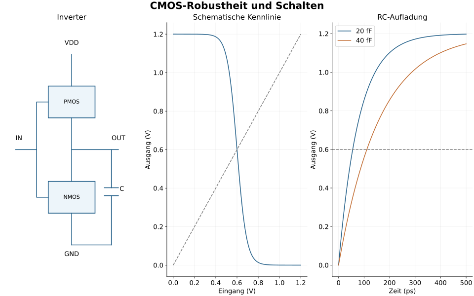

# M34-L4 – CMOS-Logik auf Transistorebene: Robustheit, Schaltenergie und Verzögerung {#L4}

**Kursbereich:** M34 – Masterprofil: Entwurf elektronischer Systeme und integrierter Schaltungen

**Niveau:** Master · Masterprofil

**Vorwissen:** [M14-L1](M14-L1.md), [M30-L3](M30-L3.md).

**Lernziel:** Logikpegel, dynamische Energie und RC-Verzögerungen für eine CMOS-Stufe quantitativ bewerten.

## Komplementäre Transistoren {#S1}

Der CMOS-Inverter verbindet einen p-Kanal-MOSFET zwischen Versorgung und Ausgang mit einem n-Kanal-MOSFET zwischen Ausgang und Masse. Beide Gates erhalten dasselbe Eingangssignal. Im stabilen binären Zustand ist idealerweise nur einer der Pull-up- und Pull-down-Pfade leitend. Während des Übergangs können beide leiten; Leckstrom und Kurzschlussstrom bleiben auch ohne kapazitive Last reale Verlustmechanismen.

Für NAND liegen die NMOS im Pull-down in Serie und die PMOS im Pull-up parallel. Für NOR ist es umgekehrt. Die leitenden Pfade müssen für jeden gültigen Eingangsvektor überprüft werden. Zusätzliche Serienwiderstände verändern die Verzögerung, weshalb dasselbe logische Verhalten nicht dieselbe elektrische Performance bedeutet.

{alt="NMOS/PMOS-Inverter mit Lastkapazität, idealisierte statische Kennlinie und RC-Schaltantwort."}

## Pegel und Störabstand {#S2}

Die statische Übertragungskennlinie $V_o(V_i)$ liefert die Grenzen der gültigen Eingangsbereiche. Beim Inverter werden oft die Punkte mit $dV_o/dV_i=-1$ als $V_{IL}$ und $V_{IH}$ gewählt. Die garantierten Ausgangsgrenzen $V_{OL}$ und $V_{OH}$ sind unter definierten Last- und Prozessbedingungen anzugeben.

$$NM_L=V_{IL}-V_{OL},\qquad NM_H=V_{OH}-V_{IH}.$$

Für $V_{DD}=1,2$ V, $V_{IL}=0,40$ V, $V_{IH}=0,80$ V, $V_{OL}=0,05$ V und $V_{OH}=1,15$ V ergeben sich beide Störabstände zu 0,35 V. Das sind angenommene garantierte Abstraktionsgrenzen, nicht Messwerte der Abbildung. Ein positiver statischer Störabstand verhindert weder zeitliche Fehler noch jede Form elektromagnetischer Störung.

## Energie pro Schaltzyklus {#S3}

Beim Laden einer Kapazität C von 0 auf $V_{DD}$ liefert die ideale Spannungsquelle $CV_{DD}^2$. Davon wird die Hälfte gespeichert, die andere Hälfte am resistiven Ladepfad dissipiert. Beim Entladen wird die gespeicherte Hälfte dissipiert. Für eine vollständige 0→1→0-Folge folgt $E=CV_{DD}^2$. Definiert man $\alpha$ als mittlere Anzahl von 0→1-Flanken je Taktperiode, ist

$$P_{dyn}=\alpha C V_{DD}^2 f.$$

Für C = 20 fF, 1,2 V, 100 MHz und $\alpha=0,2$ sind es 0,576 µW an einem Knoten. Versorgungssenkung reduziert den quadratischen Term, kann aber die Schaltverzögerung und Empfindlichkeit erhöhen. Dieser Ausdruck erfasst keine Leck- und Kurzschlussleistungen.

## Verzögerung und parasitäre Last {#S4}

Ein Ersatzwiderstand $R_{on}$ und die gesamte Lastkapazität ergeben eine erste Abschätzung der Ausgangssprungantwort. Der 50-%-Zeitpunkt ist $t_{50}=\ln(2)R_{on}C$. Für 4 kΩ und 20 fF ergibt sich 55,5 ps, bei doppelter Last 111 ps. Die 10–90-%-Anstiegszeit ist $\ln(9)RC$. Die Zeit bis zu garantiert gültigen Logikpegeln kann vom 50-%-Zeitpunkt abweichen.

Die Näherung setzt konstanten Schaltwiderstand und konzentrierte Kapazität voraus. Real ändern sich Leitfähigkeit und Kapazität über die Spannung; Leitungswiderstand, Kopplung, Fanout und Prozessstreuung beeinflussen die Flanken. Für einen echten Chipentwurf sind Transistormodelle, Standardzellen und extrahierte Parasitika nötig.

## Übungen und Kontrolle {#S5}

1. Senke die Versorgung von 1,2 auf 1,0 V bei unverändertem C, f und Aktivitätsfaktor. **Lösung:** dynamische Leistung sinkt auf 69,4 %; die Verzögerung darf nicht als unverändert angenommen werden.
2. Berechne die 10–90-%-Anstiegszeit für 4 kΩ und 20 fF. **Lösung:** rund 176 ps.
3. Wie wirkt die Verdopplung der Lastkapazität im RC-Modell? **Lösung:** Verzögerung und dynamische Energie verdoppeln sich.
4. Warum ist die statische CMOS-Kennlinie nicht hinreichend für die Entscheidung über eine Taktfrequenz? **Lösung:** Sie enthält keine Laufzeit, Kapazitätsladung, Setup- oder Hold-Vorgaben.

## Quellen {#S6}

- [ETH Zürich – Electronics and Photonics (Curriculum G4)](https://www.vvz.ethz.ch/Vorlesungsverzeichnis/sucheLehrangebot.view?abschnittId=122815&ansicht=1&lang=en&seite=0&semkez=2026W) · Herbst 2026, Electronics and Photonics: 227-0147-10L VLSI 3; nur curricularer Profilvergleich, kein Nachweis einzelner Gleichungen oder Versuche. · Zuletzt abgerufen: 2026-11-25
- [MIT OCW – 6.012, CMOS inverter, Lecture 14](https://ocw.mit.edu/courses/6-012-microelectronic-devices-and-circuits-fall-2005/resources/lec14/) · Vorlesung 14 (Ressourcenbeschreibung): CMOS-Inverter, Störabstände, Verzögerung und dynamische Leistung. · Zuletzt abgerufen: 2026-11-25
