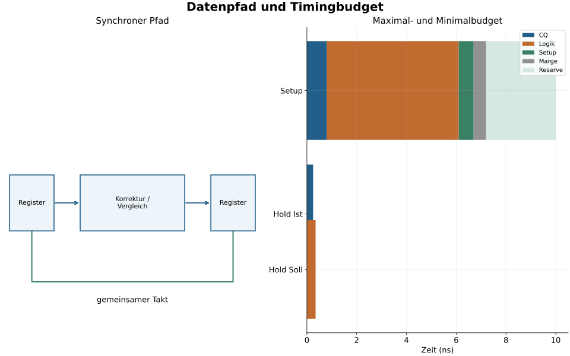

# M34-L5 – Integrierter Digitalentwurf: Datenpfade, kritische Pfade und Layout-Parasiten {#L5}

**Kursbereich:** M34 – Masterprofil: Entwurf elektronischer Systeme und integrierter Schaltungen

**Niveau:** Master · Masterprofil

**Vorwissen:** [M34-L4](M34-L4.md), [M30-L4](M30-L4.md).

**Lernziel:** Synchronen Datenpfad bewerten, Setup- und Hold-Restriktionen trennen und Layout-Einflüsse in einem Budget nachvollziehen.

## Register und Datenpfade {#S1}

Ein synchroner Digitalentwurf besteht aus gespeicherten Zuständen und kombinatorischen Funktionen, die innerhalb eines Taktzyklus ausgewertet werden. Für die ADC-Schnittstelle führen Register das Codewort und dessen Gültigkeitskennzeichen. Zwischen ihnen liegen etwa Vorzeichenerweiterung, Korrektur, Begrenzung und Alarmvergleich. Die Funktion allein genügt nicht: Das Gültigkeitssignal muss zum richtigen Datenwort gehören, auch nach Reset und bei Datenlücken.

{alt="Register-Logik-Register-Datenpfad sowie maximale und minimale Zeitbedingungen."}

## Setup und kritischer Pfad {#S2}

Bezeichne die Verzögerung vom Sendetakt bis zum Datenausgang mit $t_{CQ}$, die kombinatorische Maximalverzögerung mit $t_{pd}$ und die Setup-Zeit des Empfängerregisters mit $t_s$. Ohne Taktskew und mit ausdrücklich separater Sicherheitsmarge $m$ gilt

$$T_{clk}\ge t_{CQ,max}+t_{pd,max}+t_s+m.$$

Für 0,8 ns, 5,3 ns, 0,6 ns und 0,5 ns ergibt sich eine Periode von mindestens 7,2 ns, entsprechend höchstens 138,9 MHz. Bei 100 MHz beträgt die Setup-Reserve 2,8 ns. Der kritische Pfad ist der Pfad mit der kleinsten Reserve; nicht zwingend der mit den meisten logischen Gattern.

Die Hold-Bedingung verwendet dagegen die Minimalverzögerung:

$$t_{CQ,min}+t_{cd,min}\ge t_h+m_h.$$

Für 0,15 ns + 0,10 ns bei einer Anforderung von 0,35 ns (inklusive Marge) entsteht eine Hold-Verletzung von 0,10 ns. Langsamerer Takt beseitigt sie im Modell nicht. Ein positiver Empfängerskew (Empfängerflanke später als Senderflanke) hilft dem Setup-Pfad, verschärft aber Hold. In realer Analyse werden Skew, Unsicherheit und Timing-Ecken systematisch behandelt.

## Pipeline und Schnittstellenlatenz {#S3}

Eine Trennstelle im kombinatorischen Pfad kann den maximalen Aufwand pro Stufe reduzieren. Werden die 5,3 ns in 2,8 und 2,5 ns aufgeteilt, ergibt sich bei unveränderten Registerzeiten und Marge eine längste Periode von 4,7 ns, also rund 212,8 MHz. Der Wert wird nun erst nach zwei statt einer Registerübertragung verfügbar. Bei 200 MHz liegen zwischen den beiden Übertragungen insgesamt zwei Perioden bzw. 10 ns vom Start bis zur Empfangsflanke. Parallele Pfade und gültige Daten müssen entsprechend verzögert werden.

Eine ADC-Schnittstelle arbeitet häufig mit einem anderen Takt als das Verarbeitungssystem. Ein einzelnes asynchrones Steuersignal kann synchronisiert werden, aber eine unabhängig synchronisierte Bitfolge eines mehrbitigen Wortes kann inkonsistent werden. Kontrollierte Handshakes oder asynchrone FIFOs lösen das Problem auf Schnittstellenebene; die Metastabilitätswahrscheinlichkeit ist damit nicht exakt null.

## Von RTL zum Layout {#S4}

| Entwurfsphase | Ziel | Beispielprüfung |
| --- | --- | --- |
| RTL | Funktion und Taktstruktur | Testbench, Referenzmodell |
| Synthese | Logiknetz und Zieltechnologie | Äquivalenz, Flächenbudget |
| Platzierung/Leitungsführung | Physische Verbindungen | Auslastung, DRC |
| Extraktion und Timing | Parasitäre R/C, PVT-Ecken | Setup, Hold, Übergangszeiten |
| Sign-off | Konsistenz aller Freigabekriterien | technologieabhängige Prüfungen |

PVT steht für Prozess, Versorgungsspannung und Temperatur. Ein einfaches RC-Leitungsmodell mit 1 kΩ und 100 fF ergibt 69,3 ps bis 50 %. Eine gleichmäßig verteilte Leitung weist andere Zeitkonstanten auf; Kopplung hängt zudem von der Aktivität der Nachbarleitungen ab. Die berechnete Reserve darf deshalb nicht als Sign-off gelten.

## Übungen und Kontrolle {#S5}

1. Ein zusätzlicher Maximalpfad von 1,4 ns entsteht im ursprünglichen 100-MHz-Design. **Lösung:** Setup-Reserve sinkt von 2,8 auf 1,4 ns.
2. Ergänze den kurzen Hold-Pfad um mindestens 0,10 ns Minimalverzögerung. **Kontrolle:** Hold erfüllt rechnerisch die Grenze; Setup muss erneut geprüft werden.
3. Vergleiche Pipeline und Einzelstufe unter identischer Abtastrate. **Lösung:** Pipeline bietet potenziell höheren Durchsatz, aber zusätzliche Register und Latenz; bei 100 kS/s kann auch der langsamere Datenpfad ausreichend sein.
4. Benenne drei fehlende Voraussetzungen für eine reale Timingfreigabe. **Lösung:** technologiebezogene Zellen/Netzliste, extrahierte Parasitika, vollständige Clock/PVT- und Timing-Constraints.

## Quellen {#S6}

- [ETH Zürich – Electronics and Photonics (Curriculum G4)](https://www.vvz.ethz.ch/Vorlesungsverzeichnis/sucheLehrangebot.view?abschnittId=122815&ansicht=1&lang=en&seite=0&semkez=2026W) · Herbst 2026, Electronics and Photonics: 227-0147-10L VLSI 3; nur curricularer Profilvergleich, kein Nachweis einzelner Gleichungen oder Versuche. · Zuletzt abgerufen: 2026-11-25
- [MIT OCW – 6.004, Sequential Logic](https://ocw.mit.edu/courses/6-004-computation-structures-spring-2017/pages/c5/c5s1/) · 5.1, kommentierte Folien: Setup-/Hold-Zeit und Taktperiodenbedingungen; nur digitales Timing. · Zuletzt abgerufen: 2026-11-25
- [MIT OCW – 6.004, Performance Measures and Pipelining](https://ocw.mit.edu/courses/6-004-computation-structures-spring-2017/pages/c7/c7s1/) · 7.1, kommentierte Folien: ausgewogene Pipeline-Stufen, kritischer Signalpfad, Durchsatz und Latenz; keine Layoutparasitik. · Zuletzt abgerufen: 2026-11-25
