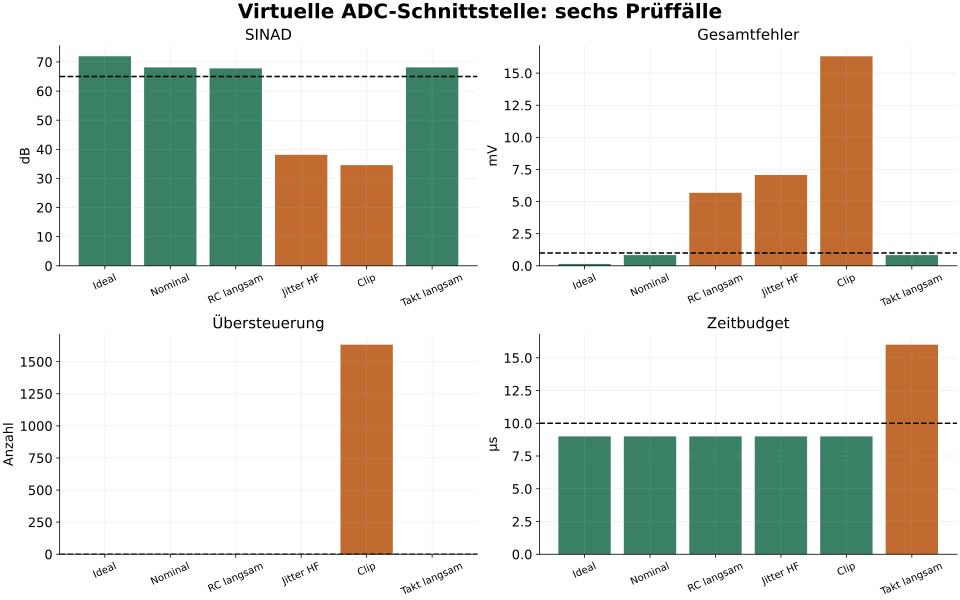

# M34-L6 – Profilprojekt: Eine virtuelle Datenwandlerschnittstelle von der Spezifikation bis zur Verifikation {#L6}

**Kursbereich:** M34 – Masterprofil: Entwurf elektronischer Systeme und integrierter Schaltungen

**Niveau:** Master · Masterprofil

**Vorwissen:** [M34-L1](M34-L1.md) bis [M34-L5](M34-L5.md).

**Lernziel:** Eine synthetische SAR-Messkette reproduzierbar implementieren, Fehlerbilder isolieren und Akzeptanzgrenzen anhand unabhängiger Prüfungen bewerten.

## Projektauftrag und Abnahmekriterien {#S1}

Die Messkette aus L1 erhält ein virtuelles analoges Eingangssignal und bildet es auf 12 Bit ab. Ziel ist nicht ein konkreter ADC-Chip, sondern eine überprüfbare Spezifikation mit getrennten Fehlerkennzahlen. Nennbedingungen: 2 V Gesamtspanne, 100 kS/s, etwa 1 kHz Sinus mit 0,8 V Spitze. Für die folgenden didaktischen Tests verwenden wir mindestens 65 dB SINAD, höchstens 1 mV unkalibrierten RMS-Gesamtfehler, null übersteuerte Stichproben und ein Zeitbudget von 10 µs. Der HF-Test ist ein absichtlicher Stresstest außerhalb der Nennfrequenz.

{alt="SINAD, Gesamtfehler, Übersteuerung und Konversionszeit für sechs Modellfälle."}

## Modell und unabhängige Referenz {#S2}

Wir erzeugen 8192 Werte bei 100 kHz; die Frequenz ist kohärent zur Beobachtungsdauer: $f=k f_s/N$ mit k=83 (1013,18 Hz) beziehungsweise 3277 (40 002,44 Hz). Das Modell besitzt unabhängige gaußsche Amplituden- und Zeitfehler. Für den Erfassungskondensator verwenden wir einen während der Erwerbszeit konstant gehaltenen Eingangs-Sollwert. Mit $r=\exp(-t_a/\tau)$ gilt

$$v_n=r v_{n-1}+(1-r)x_n.$$

Das ist eine diskrete RC-Erfassung mit Gedächtnis, kein kontinuierlicher Sensor-/Treiber-SPICE-Ersatz. Ein linearer Offset und Gain werden hinzugefügt; die Schwellen sind um eine sinusförmige INL von maximal 0,35 LSB verschoben, bezogen auf die ideale Kennlinie. Der SAR-Algorithmus prüft zwölf Bits nacheinander. `searchsorted` dient als unabhängige Codezuordnungsreferenz für die gleichen streng monotonen Übergänge. Eine Verletzung der Zeitvorgabe wird registriert, nicht als künstliche Konversion in Echtzeit simuliert.

Die Sinusfit-Metrik trennt DC und Grundschwingung vom Rest. Der Vergleich mit kohärenter FFT überprüft die SINAD-Rechnung; der direkte Vergleich mit dem idealen Eingang erfasst zusätzlich lineare Fehler. Der ENOB-Wert verwendet hier bewusst die Vollaussteuerungsformel ohne Amplitudenkorrektur. Der Wert ist daher nur bei genanntem Testpegel sinnvoll vergleichbar.

## Reproduzierbares Experiment {#S3}

Python 3 und NumPy genügen. Gleicher Seed für vergleichbare Störungen; Rausch- und Verzerrungsbewertung aus einer endlichen Stichprobe. Das Experiment speichert alle Codes im RAM und modelliert weder CDC noch reale Ausgabeprotokolle.

```python
import numpy as np
FS=100_000.; N=8192; B=12; VFS=2.; Q=VFS/2**B; TACQ=2e-6
# name, amplitude V, coherent bin, noise rms V, jitter rms s, RC s, offset V, gain error, INL amplitude LSB, SAR clock Hz
cases=[('Ideal',.8,83,0,0,0,0,0,0,2e6),('Nominal',.8,83,120e-6,2e-9,.15e-6,.0006,.001,.35,2e6),('RC langsam',.8,83,120e-6,2e-9,1e-6,.0006,.001,.35,2e6),('Jitter HF',.8,3277,120e-6,50e-9,.15e-6,.0006,.001,.35,2e6),('Uebersteuerung',1.05,83,120e-6,2e-9,.15e-6,.0006,.001,.35,2e6),('Takt langsam',.8,83,120e-6,2e-9,.15e-6,.0006,.001,.35,1e6)]
def sar(x,thresholds):
    code=np.zeros(len(x),dtype=int)
    for b in range(B-1,-1,-1):
        trial=code+(1<<b)
        code=np.where(x>=thresholds[trial-1],trial,code)
    return code

def simulate(case):
    name,a,k,noise,jitter,tau,offset,gain,inl,clk=case
    rng=np.random.default_rng(2801); t=np.arange(N)/FS; phase=2*np.pi*k*FS/N*t
    x=a*np.sin(phase); v=a*np.sin(phase+2*np.pi*k*FS/N*rng.normal(0,jitter,N))+rng.normal(0,noise,N)
    if tau:
        r=np.exp(-TACQ/tau); prev=0.
        for j in range(N):
            prev=(1-r)*v[j]+r*prev; v[j]=prev
    v=v*(1+gain)+offset
    edges=-VFS/2+Q*np.arange(1,2**B); edges+=inl*Q*np.sin(2*np.pi*edges/VFS*3)
    assert np.all(np.diff(edges)>0)
    code=sar(v,edges); assert np.array_equal(code,np.searchsorted(edges,v,side='right'))
    y=-VFS/2+Q*(code+.5); clipped=np.count_nonzero((v<-VFS/2)|(v>=VFS/2))
    M=np.column_stack([np.ones(N),np.sin(phase),np.cos(phase)])
    fit=np.linalg.lstsq(M,y,rcond=None)[0]; resid=y-M@fit
    signal=np.hypot(fit[1],fit[2])/np.sqrt(2); err=np.sqrt(np.mean(resid**2)); sinad=20*np.log10(signal/err)
    assert np.isclose(np.mean((y-fit[0])**2),signal**2+err**2,rtol=1e-10)
    # FFT reference: coherent tone, DC excluded, Parseval; fundamental plus remaining bins
    spec=np.abs(np.fft.rfft(y))**2; spec[1:-1]*=2
    fft_sinad=10*np.log10(spec[k]/(spec[1:].sum()-spec[k])); assert abs(fft_sinad-sinad)<1e-6
    rms=np.sqrt(np.mean((y-x)**2)); timing=TACQ+(B+2)/clk
    return dict(x=x,y=y,resid=resid,sinad=sinad,enob=(sinad-1.76)/6.02,rms=rms,gain=np.hypot(fit[1],fit[2])/a,phase=np.degrees(np.arctan2(fit[2],fit[1])),clip=clipped,timing=timing,offset=fit[0],code=code)
if __name__=='__main__':
    for c in cases:
        r=simulate(c)
        print(f"{c[0]:16s} {r['sinad']:6.2f} dB {r['enob']:5.2f} bit {r['rms']*1e3:7.3f} mV {100*(r['gain']-1):7.3f} % {r['phase']:7.3f} deg {r['clip']:4d} {r['timing']*1e6:5.1f} us")
```

## Ergebnisse und Interpretation {#S4}

| Fall | SINAD (dB) | ENOB* (Bit) | RMS gesamt (mV) | Gainfehler (%) | Phase (°) | Clip | Zeit (µs) |
| --- | ---: | ---: | ---: | ---: | ---: | ---: | ---: | ---: |
| Ideal | 71,96 | 11,66 | 0,143 | 0,000 | 0,000 | 0 | 9,0 |
| Nominal | 68,13 | 11,03 | 0,829 | 0,094 | -0,001 | 0 | 9,0 |
| RC langsam | 67,78 | 10,97 | 5,681 | 0,057 | -0,571 | 0 | 9,0 |
| Jitter HF | 38,12 | 6,04 | 7,068 | 0,092 | -0,003 | 0 | 9,0 |
| Uebersteuerung | 34,57 | 5,45 | 16,317 | -1,190 | -0,000 | 1632 | 9,0 |
| Takt langsam | 68,13 | 11,03 | 0,829 | 0,094 | -0,001 | 0 | 16,0 |

*ENOB ohne Amplitudenkorrektur, auch beim übersteuerten Test lediglich rechnerisch; dessen Ergebnis ist keine gültige Nennspezifikation.

Ideal und Nominal erfüllen alle Modellziele. Die langsamere Erfassung bleibt über 65 dB SINAD, verursacht durch lineare Phase und den Anfangstransienten jedoch einen viel größeren Gesamtfehler. Der HF-Jitterfall stimmt in der Größenordnung mit der theoretischen 38-dB-Grenze überein. Übersteuerung verfälscht die Amplitude und erzeugt Harmonische. Der langsame SAR-Takt erzeugt denselben virtuellen Codeverlauf wie Nominal, ist aber zeitlich nicht realisierbar: Ein 16-µs-Zyklus kann bei diesem seriellen Modell keine 100 kS/s liefern. Nur bei einem abweichenden Architekturmodell mit parallelen Wandlern könnte das anders sein.

## Übungen und Kontrolle {#S5}

1. Führe den Code aus und vergleiche die sechs Fälle. **Kontrolle:** Alle SAR-Codes stimmen mit der sortierten Schwellenreferenz überein; FFT und Sinusfit liefern auf besser als $10^{-6}$ dB gleiche SINAD-Werte.
2. Entferne im Nominalfall Offset und Gain. **Kontrolle:** Der absolute RMS-Abstand sollte sinken; SINAD reagiert auf reine lineare Skalierung deutlich weniger als diese absolute Fehlermetrik (Quantisierung und INL können sich dabei ändern).
3. Berechne den maximal möglichen seriellen Durchsatz beim langsamen Takt. **Lösung:** 62,5 kS/s, ohne weitere Wartezeiten.
4. Ergänze einen Sweep über die Erfassungszeit und leite einen Kompromiss zwischen Restfehler und Konversionszeit ab. **Bewertung:** reproduzierbarer Parametersatz, beide Kriterien getrennt prüfen, Stresstests nicht als Nennmessung deklarieren.
5. Erstelle eine digitale Schnittstellenspezifikation mit `data`, `valid`, Reset und expliziter Fehleranzeige; definiere jeweils zwei Tests für Übersteuerung und fehlende Frist. **Kontrolle:** Keine stille Weiterverarbeitung alter Daten als neues gültiges Ergebnis; Regeln für Reset und Datenverlust sind eindeutig.

Eine echte Verifikation verlangt Referenzspannungen, einen geeigneten Testaufbau, reale Takt- und Temperaturbedingungen, Hardware-/RTL-Prüfung, Treibermodelle sowie extrahierte Schaltungsparameter. Diese Arbeitsprobe überprüft ausschließlich das dokumentierte virtuelle Modell.

## Quellen {#S6}

- [ETH Zürich – Electronics and Photonics (Curriculum G4)](https://www.vvz.ethz.ch/Vorlesungsverzeichnis/sucheLehrangebot.view?abschnittId=122815&ansicht=1&lang=en&seite=0&semkez=2026W) · Herbst 2026, Electronics and Photonics: 227-0146-00L Data Conversion System Design und 227-0116-00L VLSI 1; nur curricularer Profilvergleich, kein Nachweis einzelner Gleichungen oder Versuche. · Zuletzt abgerufen: 2026-11-25
- [Analog Devices – Defining and Testing Dynamic Parameters in High-Speed ADCs](https://www.analog.com/en/resources/technical-articles/defining-and-testing-dynamic-parameters-in-highspeed-adcs-part-1.html) · Abschnitte SINAD und ENOB: SINAD-Umrechnung korrekt; erste RMS-Fehlerformel widerspricht dem Begleittext. ENOB-Umrechnung separat gegengeprüft (NI). · Zuletzt abgerufen: 2026-11-25
- [Analog Devices – Understanding SAR ADCs](https://www.analog.com/en/resources/technical-articles/2022/07/16/07/42/successive-approximation-registers-sar-and-flash-adcs.html) · Abstract und Einleitung: SAR-Wandler mit binärer Suche, Vergleich der Wandlerarchitekturen. · Zuletzt abgerufen: 2026-11-25
- [MIT OCW – 6.004, Sequential Logic](https://ocw.mit.edu/courses/6-004-computation-structures-spring-2017/pages/c5/c5s1/) · 5.1, kommentierte Folien: Setup-/Hold-Zeit und Taktperiodenbedingungen; nur digitales Timing. · Zuletzt abgerufen: 2026-11-25
- [NI – cDAQ Effective Number of Bits (ENOB)](https://knowledge.ni.com/KnowledgeArticleDetails?id=kA00Z000000P6wbSAC&l=en-US) · Abschnitt Solution: SINAD-Umrechnung und Abhängigkeit von Signalpegel und Frequenz; begrenzter Formelnachweis. · Zuletzt abgerufen: 2026-11-25 · Inhaltlich geprüft: 2026-11-25
