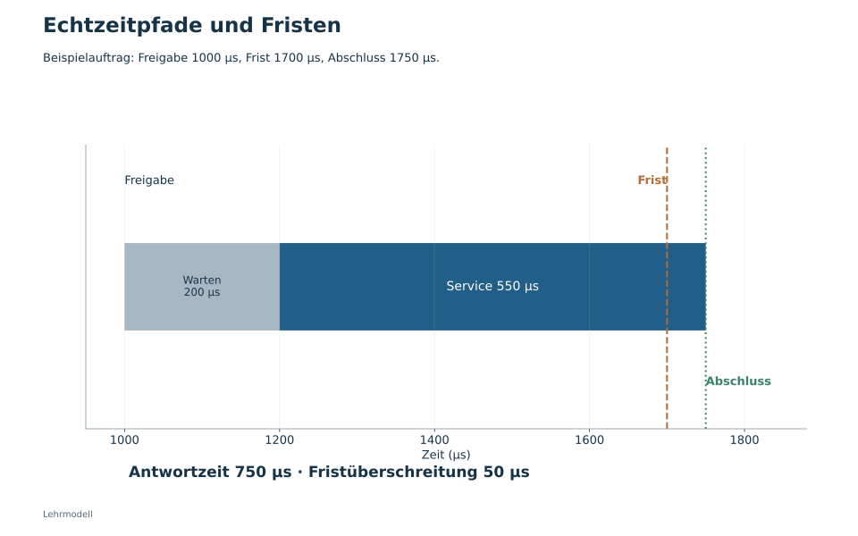

# M35-L1 – Eingebettete Regelung unter Zeitrestriktionen: Latenzpfade und Teststrategien {#L1}

**Kursbereich:** M35 – Master: Zeitkritische eingebettete Regelung

**Niveau:** Master · Masterprofil

**Vorwissen:** [M13-L5](M13-L5.md), [M28-L4](M28-L4.md), [M16-L3](M16-L3.md).

**Lernziel:** Fristverletzung, Überlast und Abtastverzögerung getrennt erfassen und Teststrategien begründen.

## Vom Zeitpunkt der Messung zum Stellwert {#S1}

Eine diskrete Regelung benötigt nicht nur eine korrekte Rechenfunktion, sondern auch den richtigen Zeitpunkt. Zwischen physikalischem Messzeitpunkt und Aktorausgabe liegen Erfassung, Übertragung, Scheduling, Rechenzeit und Ausgabewartezeit. Der Begriff Latenz benötigt daher einen definierten Start- und Endpunkt. Für einen Block, der im vorangegangenen Abtastfenster gesammelt wurde, sind die ältesten Daten beim Freigabezeitpunkt bereits älter als die neuesten.

Im Nennprojekt sei der letzte Messwert zum Zeitpunkt $r_k=kP$ verfügbar. Die Frist für die Ausgabe ist $r_k+D$. Der Ausführungsbeginn $s_k$ kann später liegen, weil eine ältere Verarbeitung noch läuft. Dann gilt mit Servicezeit $C_k$ und Abschlusszeit $f_k$

$$f_k=s_k+C_k,\qquad R_k=f_k-r_k,\qquad W_k=s_k-r_k.$$

Für akzeptierte Aufträge ist $R_k=W_k+C_k$. Ein verlorener Auftrag hat kein $f_k$ und darf deshalb weder als null Latenz noch als erfolgreicher Auftrag eingehen. Die Frist ist eingehalten, wenn $f_k\le r_k+D$; ein späterer Abschluss ist im Modell verspätet, auch wenn der berechnete Zahlenwert richtig ist.

{alt="Freigabe, Warteschlange, Abschluss und Frist sowie Auswirkungen auf den Regelkreis."}

## Zeitbudget und Regelkreisdynamik {#S2}

Eine konstante Verzögerung $\tau$ multipliziert die Übertragungsfunktion im Frequenzbereich mit $e^{-j\omega\tau}$. Der Betrag bleibt eins, die zusätzliche Phase ist $-\omega\tau$. Bei 100 Hz und 555 µs entstehen ungefähr −20,0°, bei 218 µs ungefähr −7,85°. Das ist eine Rechnung für die reine Verarbeitungslatenz, nicht die Gesamtschleife mit Abtastung und Halteglied. Bei derselben Frequenz würde eine zusätzliche Verzögerung von 350 µs weitere −12,6° beitragen. Ob der Regelkreis stabil bleibt, hängt von der Strecke, der Reglerauslegung und allen Verzögerungspfaden ab. Variable Verzögerungen und Ausfälle lassen sich nicht generell durch einen einzigen Phasenwinkel erfassen.

Ein lineares zeitdiskretes Modell mit einer Verzögerung von einem vollständigen Zeitschritt kann beispielsweise als $x_{k+1}=a x_k+b u_{k-1}$ beschrieben werden. Der fehlende aktuelle Stellwert wird zu einem zusätzlichen Zustand $z_k=u_{k-1}$, mit $z_{k+1}=u_k$. Für $u_k=-Kx_k$ ergibt sich

$$\begin{bmatrix}x_{k+1}\\z_{k+1}\end{bmatrix}=\begin{bmatrix}a&b\\-K&0\end{bmatrix}\begin{bmatrix}x_k\\z_k\end{bmatrix}.$$

Bei $a=0{,}9$, $b=0{,}2$ und $K=5$ ist ohne Verzögerung der Pol −0,1, mit einem Zeitschritt Verzögerung gilt $\lambda^2-0{,}9\lambda+1=0$: beide komplexen Pole haben Betrag 1. Das Beispiel ist grenzstabil im idealen linearen Modell, nicht asymptotisch stabil. [M35-L2](M35-L2.md) simuliert dagegen keine physikalische Regelstrecke, sondern die Verarbeitungskette; eine solche Stabilitätsanalyse wäre ein anschließendes eigenes Experiment.

## Überlast und Überwachung {#S3}

Bei einem periodischen seriellen Server mit konstantem $C$ und $P<C$ steigt der Rückstand pro Auftrag um $C-P$, bis der Puffer voll wird. Mit zwei Auftragsplätzen einschließlich des aktiven Auftrags führt fortgesetzte Überlast zu Verwerfungen. Die Wahl der Strategie (ältester oder neuester Auftrag, Zusammenfassen, sicherer Ersatzwert) ist eine Systemanforderung. [M35-L2](M35-L2.md) verwendet Drop-new, also Verwerfen des neuen Auftrags bei vollem Puffer. Das ist nicht automatisch die beste Regelungsstrategie, weil ältere Daten länger wirksam werden können.

Ein Watchdog und ein plausibilisierter Stellwert können Teil eines Fehlermanagements sein. Für sicherheitskritische Funktionen ist unabhängig zu spezifizieren, welche Ausgabe bei veralteten Messdaten erlaubt ist. Ein Test der Frist alleine genügt dann nicht. Auch Aktivierungsverzug, Prioritätsinversion, Busarbitrierung und ungünstige Cachezustände sind zu berücksichtigen. Für feste Prioritäten und unabhängige periodische Aufgaben auf einem präemptiven Einzelkern lautet eine klassische Antwortzeititeration $R_i=C_i+B_i+\sum_{j\in hp(i)}\lceil R_i/T_j\rceil C_j$ unter geeigneten Modellannahmen. Mit $C_i=2$, $B_i=0{,}5$, einem höherprioren Auftrag $C_j=1$, $T_j=4$ (alle in ms) konvergiert die Iteration bei 3,5 ms. Bus- und Mehrkerneffekte benötigen zusätzliche Behandlung.

## Testplan {#S4}

| Test | Zweck |
| --- | --- |
| Nennlast | Werte und Antwortzeiten gegen Referenz |
| CPU-Störlast | Scheduling- und Wartezeitfolgen |
| Bus-Störlast | Transferengpass sichtbar machen |
| erhöhte Freigaberate | Durchsatz und Pufferfüllung |
| Überlast | Verlustzählung und Wiederanlauf |
| Kombination | Wechselwirkung von Wartezeiten und Fristen |

Erfasse Freigabe- und Abschlusszeitstempel in einer einheitlichen Zeitbasis sowie Sequenznummern. Ein Zeitmessgerät, Logger oder Tracing verändert möglicherweise das Verhalten und muss selbst kalibriert werden. Die maximale gemessene Latenz ist nur eine Untergrenze für die unbekannte Worst-Case-Latenz; deterministische Garantien benötigen ein abgesichertes Zeitmodell oder andere geeignete Nachweise.

## Übungen und Kontrolle {#S5}

1. Freigabe bei 1000 µs, Beginn bei 1200 µs, Service 550 µs und Frist 700 µs nach Freigabe. **Lösung:** 750 µs Antwortzeit, somit 50 µs zu spät.
2. Berechne die Phase einer reinen Verzögerung von 1 ms bei 50 Hz. **Lösung:** −18°.
3. Warum darf man bei einem überlasteten System nur die mittlere Latenz der abgeschlossenen Aufträge nicht als Erfolgskennzahl verwenden? **Lösung:** Verlorene Aufträge fehlen in der Stichprobe; eine aggressive Verwerfung könnte den Mittelwert verbessern, obwohl die Funktion schlechter wird.

## Quellen {#S6}

- [ETH Zürich – Computers and Networks (Curriculum G5)](https://www.vvz.ethz.ch/Vorlesungsverzeichnis/sucheLehrangebot.view?abschnittId=122815&ansicht=1&lang=en&seite=0&semkez=2026W) · Herbst 2026, Computers and Networks: 227-0124-00L Embedded Systems; curricularer Profilvergleich, kein Nachweis einzelner Gleichungen oder Versuche. · Zuletzt abgerufen: 2026-11-25
- [ETH Zürich – Embedded Control Systems, Institute for Dynamic Systems and Control](https://idsc.ethz.ch/education/lectures/embedded-control-systems.html) · Abstract und Subjects covered in lectures and practical lab exercises: Abtastung, ADC und Timer-Interrupts; curricularer Kontext, kein Nachweis der Projektergebnisse. · Zuletzt abgerufen: 2026-11-25
- [MIT OCW – 6.004, Lecture Notes: Pipelining, Memory Hierarchy, Parallel Processing](https://ocw.mit.edu/courses/6-004-computation-structures-spring-2009/pages/lecture-notes/) · Vorlesungen 8, 15–16, 19, 22–24: Latenz, Speicherhierarchie, Interrupts und Pipelining; kein Versuchsnachweis. · Zuletzt abgerufen: 2026-11-25
