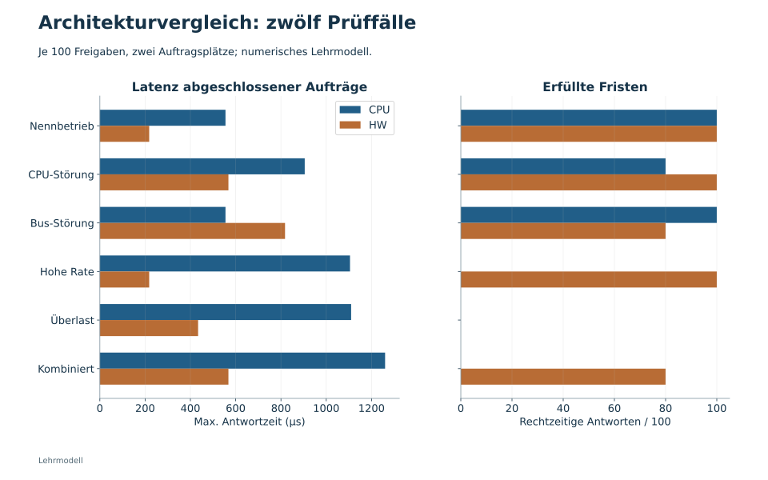

# M35-L2 – Profilprojekt: Zwei Architekturen für eine Sensor-Regler-Kette vermessen und vergleichen {#L2}

**Kursbereich:** M35 – Master: Zeitkritische eingebettete Regelung

**Niveau:** Master · Masterprofil

**Vorwissen:** [M16-L3](M16-L3.md), [M34-L5](M34-L5.md), [M35-L1](M35-L1.md).

**Lernziel:** Zwei Architekturmodelle mit identischen Eingängen und getrennten Zeit-, Verlust- und Ressourcenkennzahlen reproduzierbar vergleichen.

## Projektauftrag und Annahmen {#S1}

Ein virtueller Sensor liefert pro Freigabe einen vollständigen Block aus 64 unsigned 12-Bit-Werten (16-Bit-Speicherformat). Ein einfacher proportionaler Stellwert wird aus dem ganzzahligen Blockmittel berechnet. Verglichen werden die reine CPU-Verarbeitung und die CPU mit spezialisiertem Beschleuniger. Die folgenden expliziten Annahmen bilden ein bewusst vereinfachtes, deterministisches Zeitmodell, keinen Benchmark eines konkreten Controllers. Die Daten repräsentieren eine synthetische Eingangswelle, keine echte Messung und keine rückgekoppelte physikalische Strecke.

{alt="Maximale Antwortzeit, CPU-Bedarf, Fristverletzungen und Datenverluste im Referenzmodell."}

Ziel im Nennbetrieb: alle 100 Aufträge abschließen, keine Fristverletzung bei 700 µs ab Freigabe und bitgenaue numerische Gleichheit. Bei Störung oder Überlast werden Verluste und Verspätungen explizit ausgewertet, nicht verborgen. CPU-Bedarf, Beschleuniger-Nutzdaten und abgeschlossene Aufträge sind getrennte Metriken.

## Modellgrenzen und Referenz {#S2}

Eine Freigabe enthält n=64 Werte; es gibt zwei Plätze einschließlich des gerade bearbeiteten Blocks. Beide Modelle arbeiten FIFO, nicht überlappt zwischen Aufträgen. Bei gleichzeitigem Abschluss und neuer Freigabe wird der alte Platz zuerst frei. Ein voller Puffer verwirft die neue Freigabe. Ein noch laufender Auftrag wird selbst nach Fristablauf zu Ende bearbeitet; nach dem letzten Freigabeintervall wird der Puffer geleert. Die Beobachtungsdauer ist das Maximum aus 100 Perioden und letztem Abschlusszeitpunkt.

Für die Anzahl $N_{\mathrm{ok}}$ fristgerechter Antworten gilt $N_{\mathrm{ok}}=N_{\mathrm{fertig}}-N_{\mathrm{spaet}}$. CPU-Service 555 µs, Hardware-Service 218 µs, CPU-Zeit des Hardwarepfads 73 µs. Die Modellwerte folgen aus der im Programm angegebenen Servicefunktion: CPU 25 + 8·64 + 18 = 555 µs; Beschleuniger 25 + 20 + 16 + 128 + 10 + 1 + 18 = 218 µs, davon 25 + 20 + 10 + 18 = 73 µs CPU-Arbeit. DMA (Direct Memory Access) bezeichnet den modellierten Datentransfer durch eine gesonderte Einheit; Buswartezeiten sind zusätzliche Modellparameter. Bei jedem fünften Auftrag ab Index 0 kann zusätzliche CPU-Blockierung bzw. pro DMA-Transfer zusätzliche Buswartezeit auftreten. Die künstliche Störung ist an Auftragsindizes gekoppelt und wird hier als zusätzliche Servicezeit ohne eigene CPU-Arbeit modelliert. Sie ist kein schedulergenaues Betriebssystemmodell. Angezeigte CPU-Zeitanteile zählen nur modellierte Nutzarbeit, nicht fremde CPU-Last. Der zusätzliche Beschleuniger-Datenverkehr berücksichtigt 132 Nutzbytes pro abgeschlossenem Auftrag; CPU- und Sensor-Speicherverkehr sind nicht erfasst.

Die Ereignislösung speichert künftige Abschlusszeitpunkte akzeptierter Aufträge; die unabhängige Referenz schreitet in ganzzahligen Mikrosekunden voran und verwaltet einen aktiven Auftrag und eine echte Warteschlange. Beide verwenden dasselbe Zeitgesetz, prüfen also die Warteschlangenimplementierung, nicht die physikalische Richtigkeit der Parameter. Die numerische CPU-Summe und die gruppenweise Hardware-Reduktion werden separat auf gleichen Eingaben verglichen.

## Reproduzierbarer Python-Versuch {#S3}

Python 3 mit Standardbibliothek genügt. Das Zeitraster von 1 µs ist für die ganzzahligen Servicezeiten und Freigaben exakt. Die Simulation erzeugt keine realen DMA-Transaktionen. `COUNT` und `Q` sind für die Auswertung festgelegt. Ausgabe: abgeschlossen, verworfen, davon verspätet (bezogen auf abgeschlossene), mittlere und maximale Antwortzeit in µs, CPU-Nutzzeit in Prozent, Beschleuniger-Nutzbytes und Durchsatz in Aufträgen/s.

```python
from math import ceil, sin, pi
from statistics import mean
from collections import deque
N=64; COUNT=100; Q=2  # including active frame
# name, period, deadline (us), CPU blocking every fifth frame, extra DMA time per transfer
CASES=[('Nennbetrieb',1000,700,0,0),('CPU-Stoerung',1000,700,350,0),('Bus-Stoerung',1000,700,0,300),('Hohe Rate',400,400,0,0),('Ueberlast',180,180,0,0),('Kombiniert',400,400,150,100)]
def frame(k):
    return [int(2048+1000*sin(2*pi*(64*k+j)/901)) for j in range(N)]
def cpu_control(x):
    s=0
    for v in x: s+=v
    return min(4095,max(0,2048+2*(2048-s//len(x))))
def accel_control(x):
    partial=[sum(x[i:i+8]) for i in range(0,len(x),8)]
    return min(4095,max(0,6144-2*(sum(partial)//len(x))))
def service(arch,k,block,bus):
    b=block if k%5==0 else 0; d=bus if k%5==0 else 0
    if arch=='CPU': return 25+8*N+18+b,25+8*N+18,0
    return 25+20+ceil(2*N/8)+2*N+10+ceil(4/8)+18+b+2*d,25+20+10+18,2*N+4

def simulate(arch,case):
    _,period,deadline,block,bus=case; end=deque(); rows=[]
    for k in range(COUNT):
        release=k*period
        while end and end[0]<=release: end.popleft()
        if len(end)>=Q: rows.append((k,None,0,0)); continue
        duration,cpu,traffic=service(arch,k,block,bus)
        finish=max(release,end[-1] if end else release)+duration; end.append(finish)
        rows.append((k,finish,cpu,traffic))
    return rows

def tick_reference(arch,case):
    _,p,_,block,bus=case; ready=deque(); active=None; finish={}; now=0; k=0
    while k<COUNT or ready or active is not None:
        if active is not None and active[1]==now:
            finish[active[0]]=now; active=None
        if k<COUNT and now==k*p:
            if len(ready)+(active is not None)<Q: ready.append(k)
            k+=1
        if active is None and ready:
            j=ready.popleft(); active=(j,now+service(arch,j,block,bus)[0])
        now+=1
    return [finish.get(j) for j in range(COUNT)]

def metrics(rows,case):
    _,p,d,_,_=case
    lat=[f-k*p for k,f,_,_ in rows if f is not None]
    dropped=COUNT-len(lat); late=sum(l>d for l in lat)
    horizon=max(COUNT*p,max(f for _,f,_,_ in rows if f is not None))
    return len(lat),dropped,late,mean(lat),max(lat),sum(c for _,_,c,_ in rows)/horizon*100,sum(b for _,_,_,b in rows),len(lat)*1e6/horizon

if __name__=='__main__':
    for k in range(COUNT): assert cpu_control(frame(k))==accel_control(frame(k))
    for case in CASES:
        for arch in ('CPU','HW'):
            rows=simulate(arch,case)
            assert [r[1] for r in rows]==tick_reference(arch,case)
            m=metrics(rows,case); assert m[0]+m[1]==COUNT
            print(case[0],arch,*[f'{x:.2f}' if isinstance(x,float) else x for x in m])
```

## Ergebnisse und Entscheidung {#S4}

| Szenario (P/D in µs) | Pfad | Fertig | Verlust | Spät | Mittel / Max. (µs) | CPU (%) | DMA (B) | Aufträge/s |
| --- | --- | ---: | ---: | ---: | ---: | ---: | ---: | ---: |
| Nennbetrieb (1000/700) | CPU | 100 | 0 | 0 | 555,00 / 555 | 55,50 | 0 | 1000,00 |
| Nennbetrieb (1000/700) | HW | 100 | 0 | 0 | 218,00 / 218 | 7,30 | 13200 | 1000,00 |
| CPU-Störung (1000/700) | CPU | 100 | 0 | 20 | 625,00 / 905 | 55,50 | 0 | 1000,00 |
| CPU-Störung (1000/700) | HW | 100 | 0 | 0 | 288,00 / 568 | 7,30 | 13200 | 1000,00 |
| Bus-Störung (1000/700) | CPU | 100 | 0 | 0 | 555,00 / 555 | 55,50 | 0 | 1000,00 |
| Bus-Störung (1000/700) | HW | 100 | 0 | 20 | 338,00 / 818 | 7,30 | 13200 | 1000,00 |
| Hohe Rate (400/400) | CPU | 73 | 27 | 73 | 902,12 / 1105 | 100,00 | 0 | 1801,80 |
| Hohe Rate (400/400) | HW | 100 | 0 | 0 | 218,00 / 218 | 18,25 | 13200 | 2500,00 |
| Überlast (180/180) | CPU | 34 | 66 | 34 | 1003,68 / 1110 | 100,00 | 0 | 1801,80 |
| Überlast (180/180) | HW | 83 | 17 | 83 | 342,51 / 434 | 33,49 | 10956 | 4587,16 |
| Kombiniert (400/400) | CPU | 67 | 33 | 67 | 996,87 / 1260 | 92,53 | 0 | 1667,29 |
| Kombiniert (400/400) | HW | 100 | 0 | 20 | 321,60 / 568 | 18,25 | 13200 | 2500,00 |

Im Nennbetrieb erfüllen beide Varianten das Ziel; die Hardwarevariante reduziert die Antwortzeit und den CPU-Nutzzeitanteil, benötigt aber einen zusätzlichen Datenpfad. Die CPU-Störung verletzt bei der CPU-Variante 20 Fristen, die Hardwarevariante bleibt im Modell rechtzeitig. Die Bus-Störung wirkt umgekehrt: Nur der Beschleunigerpfad benutzt die hier betrachtete DMA-Strecke und 20 Aufträge werden zu spät. Bei 400 µs Freigabeperiode erfüllt nur der nicht zusätzlich gestörte Beschleuniger die Frist zuverlässig für alle Modellaufträge. Bei 180 µs sind beide seriellen Server überlastet; keine angenommene Architektur erfüllt die Anforderung. Die kombinierte Last zeigt, dass nominal niedrige Servicezeit allein nicht genügt.

Die Anzahl fristgerechter Antworten ergibt sich aus abgeschlossen minus verspätet, nicht aus 100 minus verspätet. Im Überlastfall sinkt sie bei beiden auf null; die Datenverluste kommen hinzu. Eine alternative Drop-old-Strategie oder eine echte Pipeline kann die Antwortalter verändern, erfordert aber eine neue Schnittstellen- und Modellprüfung. Energie, Chipfläche und reale Speicherbandbreite wurden nicht ermittelt; eine endgültige Hardwareentscheidung ist damit noch nicht begründet.

## Vertiefung und Abgabe {#S5}

1. **Grenzfall:** Stelle nur den Nennfall auf 555 µs Periode und Frist 555 µs. **Erwartung:** CPU genau an der Grenze, ohne zusätzliche Last und bei korrekter Gleichzeitigkeit alle rechtzeitig. Führe beide Modelle erneut aus.
2. **Puffer:** Erhöhe die Pufferplätze auf vier. **Erwartung:** zeitweise weniger Verwerfungen, aber möglicherweise höhere Antwortzeiten; bei dauerhafter Überlast keine dauerhafte Kapazitätssteigerung.
3. **Numerik:** Verwende einen Block aus 0 bzw. 4095 als Grenztest. **Lösung:** 4095 bzw. 0; die Implementierungen müssen übereinstimmen. Ändere die Akkumulatorbreite in einer zusätzlichen Hardware-Emulation bewusst auf 16 Bit und finde ein Gegenbeispiel.
4. **Hardwaretransfer:** Definiere ein späteres Messprotokoll mit Zeitstempeln für Freigabe, DMA-Start, Transferende, Rechenende und Ausgabe. Ergänze Pufferverluste, Messunsicherheit und Energie pro Auftrag. Nenne die konkrete Plattform und Konfiguration erst, wenn sie ausgewählt ist.

Abgabe: Modellparameter, unverändertes Referenzprogramm, sechs Arbeitslastvarianten für beide Architekturen, Tabelle, Latenz-/Verlustgrafik und eine begründete Entscheidung für die konkrete Arbeitslast. Die Software- und Hardwarearchitektur sind gleichberechtigte Entwurfsalternativen; das Ergebnis darf auch lauten, dass keine die Anforderung erfüllt.

## Quellen {#S6}

- [ETH Zürich – Computers and Networks (Curriculum G5)](https://www.vvz.ethz.ch/Vorlesungsverzeichnis/sucheLehrangebot.view?abschnittId=122815&ansicht=1&lang=en&seite=0&semkez=2026W) · Herbst 2026, Computers and Networks: 227-0124-00L Embedded Systems; curricularer Profilvergleich, kein Nachweis einzelner Gleichungen oder Versuche. · Zuletzt abgerufen: 2026-11-25
- [ETH Zürich – Embedded Control Systems, Institute for Dynamic Systems and Control](https://idsc.ethz.ch/education/lectures/embedded-control-systems.html) · Abstract und Subjects covered in lectures and practical lab exercises: Abtastung, ADC und Timer-Interrupts; curricularer Kontext, kein Nachweis der Projektergebnisse. · Zuletzt abgerufen: 2026-11-25
- [MIT OCW – 6.004, Lecture Notes: Pipelining, Memory Hierarchy, Parallel Processing](https://ocw.mit.edu/courses/6-004-computation-structures-spring-2009/pages/lecture-notes/) · Vorlesungen 8, 15–16, 19, 22–24: Latenz, Speicherhierarchie, Interrupts und Pipelining; kein Versuchsnachweis. · Zuletzt abgerufen: 2026-11-25
- [Linux Kernel – Dynamic DMA mapping Guide (6.12)](https://docs.kernel.org/6.12/core-api/dma-api-howto.html) · Abschnitt CPU and DMA addresses: Adressräume und DMA-Zuordnung unter Linux; weiterführender Spezialfall. · Zuletzt abgerufen: 2026-11-25
- [Arm – Memory Systems, Ordering, and Barriers, v1.0 (PDF)](https://documentation-service.arm.com/static/62a304f231ea212bb662321d) · §§ 5–6, S. 12–14: DMB und DSB, Reihenfolge und Abschluss von Speicherzugriffen; ergänzende Architekturgrundlagen. · Zuletzt abgerufen: 2026-11-25
