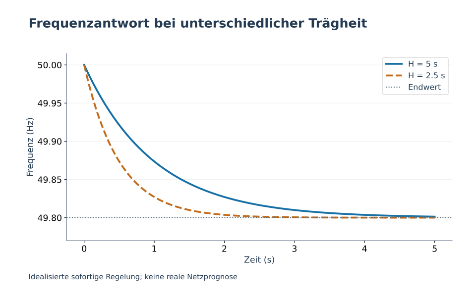

# M36-L1 – Netzdynamik und Frequenzregelung {#L1}

**Kursbereich:** M36 – Masterprofil: Erweiterte Energiesysteme und Netzschutz

**Niveau:** Master · Wahlpflicht

**Vorwissen:** [M33-L2](M33-L2.md).

**Lernziel:** Aus einer Leistungsbilanz Frequenzgradient, stationäre Abweichung und Grenzen der Reserve ableiten.

## Energiebilanz und Trägheit {#S1}

In einem vereinfachten synchronen Netz wird die gemeinsame Frequenz durch die Bilanz von Erzeugung und Verbrauch beeinflusst. Wird plötzlich mehr Leistung entnommen als eingespeist, liefert die gespeicherte Rotationsenergie zunächst die Differenz. Mit der Bezugsleistung $S_B$, der Trägheitskonstante $H=E_{kin,0}/S_B$ in Sekunden und der Nennfrequenz $f_0$ ergibt die Linearisierung von $E_{kin}=HS_B(f/f_0)^2$ um $f_0$:

$$\frac{2H}{f_0}\frac{d\Delta f}{dt}=\Delta p_m-\Delta p_L-D\Delta f$$

Alle Leistungen sind auf $S_B$ bezogen (pu); $D$ ist eine lineare Lastdämpfung in pu/Hz. Die Gleichung setzt eine kohärente Frequenz und kleine Abweichungen voraus. Lokal können sich Winkel und Frequenz anders entwickeln. Die anfängliche Änderungsrate (RoCoF) hängt von der zum Störzeitpunkt verfügbaren Energiereserve ab.

## Primärregelung als Lehrmodell {#S2}

Eine proportionale frequenzabhängige Leistungsanpassung $\Delta p_m=-K\Delta f$ mit $K>0$ liefert bei konstanter Zusatzlast $\Delta p_L$ die Lösung:

$$\Delta f(t)=-\frac{\Delta p_L}{K+D}\left(1-e^{-t/\tau}\right),\qquad \tau=\frac{2H}{f_0(K+D)}$$

Fiktiv: $f_0=50$ Hz, $H=5$ s, $\Delta p_L=0{,}04$, $K=0{,}18$ pu/Hz, $D=0{,}02$ pu/Hz. Direkt nach der Störung beträgt der Gradient −0,2 Hz/s; stationär verbleiben −0,2 Hz, die Zeitkonstante beträgt 1 s. Die Regelung liefert dann 0,036 pu, die Lastdämpfung 0,004 pu. Bei halber Trägheit verdoppelt sich der Anfangsgradient, der Endwert bleibt gleich. Das Modell unterstellt eine verzögerungsfreie, ungesättigte Regelung; die monotone Kurve besitzt daher keinen transienten Frequenznadir unterhalb des Endwerts.

*Abbildung: Eigene schematische Darstellung fiktiver Modelldaten.*

## Reserve, Wiederherstellung und Modellgrenzen {#S3}

Frequenzhaltung begrenzt die Abweichung; ein separater Wiederherstellungsprozess kann den Leistungsfehler und damit die bleibende Frequenzabweichung beseitigen. In realen Systemen beeinflussen Turbinen-, Regler- und Messdynamik sowie Leistungs- und Energielimits den Verlauf. Bei einer verfügbaren Reserve von nur 0,03 pu ist der errechnete proportionale Endpunkt nicht erreichbar; das lineare Lastmodell allein würde mit 0,01/0,02 = 0,5 Hz negativer Restabweichung ausgleichen. Dies ist keine Vorhersage für ein echtes Netz. Vergleiche Modelle mit Stellgliedverzögerung und Sättigung, protokolliere Minimum, Gradient und Erholungszeit, und unterscheide Leistungsreserve (MW) von Energie (MWh).

## Selbstkontrolle {#S4}

### Aufgaben

1. Bestimme die anfängliche RoCoF bei H=2,5 s.
2. Berechne die stationäre Frequenz bei K=0,18 und D=0,02 pu/Hz.
3. Warum kann das Modell mit sofortiger Regelung keinen realen Frequenznadir prognostizieren?

::: {.lc-solutions data-lc-section="S4"}
1. −0,4 Hz/s.
2. 49,8 Hz.
3. Verzögerung, Sättigung und räumliche Dynamik fehlen; die Lösung ist monoton.
:::

## Quellen (extern) {#S5}

- [NLR – Fast Frequency Response Concepts and Bulk Power System Reliability Needs](https://www.nlr.gov/grid/ieee-standard-1547/bulk-power-reliability-needs) · HTML 37–50: Trägheit, Frequenzgradient und schnelle Leistungsantwort · Zuletzt abgerufen: 2026-11-25 · Inhaltlich geprüft: 2026-11-25
- [ENTSO-E – Frequency Containment Reserves](https://www.entsoe.eu/network_codes/eb/fcr/) · HTML 153–165: FCR-Terminologie · Zuletzt abgerufen: 2026-11-25 · Inhaltlich geprüft: 2026-11-25
