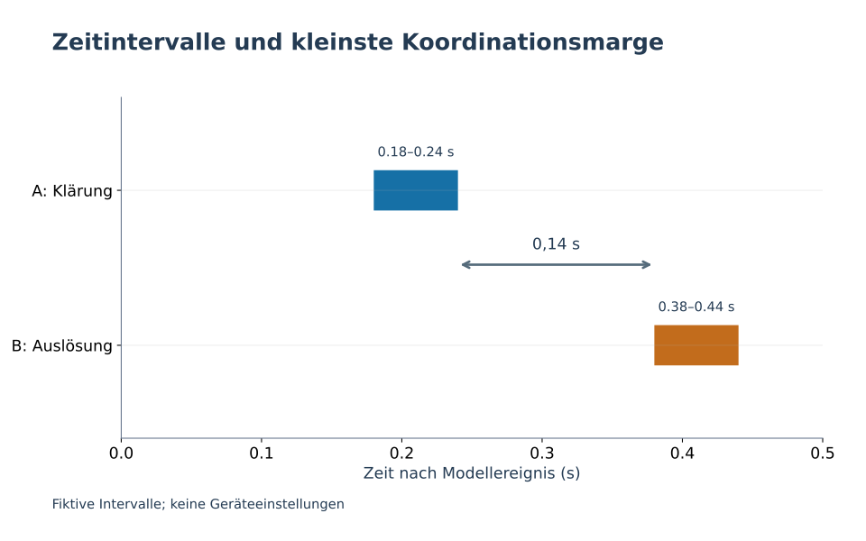

# M36-L2 – Schutzkoordination und Selektivität {#L2}

**Kursbereich:** M36 – Masterprofil: Erweiterte Energiesysteme und Netzschutz

**Niveau:** Master · Wahlpflicht

**Vorwissen:** [M36-L1](M36-L1.md).

**Lernziel:** Schutzbereiche, Auslösezeiten und Unsicherheitsmargen anhand eines abstrakten Modells bewerten.

## Schutzaufgaben und Zonen {#S1}

Netzschutz soll fehlerhafte Betriebsmittel vom übrigen System trennen, ohne unnötig gesunde Bereiche abzuschalten. Selektivität beschreibt diese räumliche Zuordnung. Primärschutz wirkt für den vorgesehenen Bereich; Reserveschutz übernimmt, falls die primäre Wirkung ausbleibt. Schnelligkeit, Empfindlichkeit, Sicherheit gegen Fehlauslösung und Verfügbarkeit stehen teilweise im Konflikt. Überstromschutz nutzt Strommessgrößen, Differenzialschutz vergleicht Ströme an den Grenzen einer Zone, Distanzschutz bewertet eine aus Spannungs- und Stromgrößen abgeleitete Impedanz. Messwandlerfehler, Sättigung und veränderte Einspeisungen können die Zuordnung beeinflussen.

## Zeitkoordination und Worst-Case-Marge {#S2}

Wir betrachten zwei abstrakte Schutzfunktionen A (primär) und B (Reserve), die für dasselbe simulierte Fehlerereignis ansprechen. Sei $t_{A,max}$ die späteste vollständige Fehlerklärung durch A (einschließlich Schaltgerät) und $t_{B,min}$ die früheste Auslösung durch B. Eine konservative Zeitmarge lautet:

$$m=t_{B,min}-t_{A,max}$$

Fiktiv: A klärt nach 0,18–0,24 s, B löst nach 0,38–0,44 s aus. Die garantierte Marge im angenommenen Intervall ist 0,14 s, nicht die Differenz der Mittelwerte (0,20 s). Beträgt eine zusätzlich vorgegebene Lehrmarge 0,10 s, verbleiben 0,04 s Spielraum. Die Zahlen sind frei gewählte Simulationsdaten, keine Einstellwerte oder Normgrenzen.

*Abbildung: Eigene schematische Darstellung fiktiver Modelldaten.*

## Nachweis über mehrere Zustände {#S3}

Eine positive Zeitmarge allein belegt noch keine Selektivität. Beide Funktionen müssen die vorgesehenen Fehler erfassen; für externe Fehler und normale Betriebszustände ist unerwünschte Auslösung zu vermeiden. Bei inversen Kennlinien variiert die Zeit mit der Messgröße; deshalb sind vollständige Unsicherheitsbänder über den gesamten betrachteten Bereich zu vergleichen. In vermaschten Netzen oder bei Umrichtereinspeisung reichen Annahmen eines einseitig gespeisten Netzes oft nicht. Eine Testmatrix unterscheidet Normalbetrieb, internen und externen Modellfehler sowie Ausfall der primären Funktion. Dokumentiere pro Fall die erwartete Zone, die modellierte Reaktion, den Toleranzbereich und das Ergebnis. Ein Fachnachweis an realen Anlagen erfordert qualifizierte Planung, geeignete Herstellerdaten und gültige Regelwerke.

## Selbstkontrolle {#S4}

### Aufgaben

1. Berechne die Worst-Case-Marge aus den angegebenen Zeitintervallen.
2. Wie ändert sich die Marge, wenn A bis 0,30 s benötigt?
3. Welche beiden Prüfziele fehlen bei alleiniger Betrachtung der Zeitmarge?

::: {.lc-solutions data-lc-section="S4"}
1. 0,38 − 0,24 = 0,14 s.
2. 0,08 s; die fiktive Anforderung von 0,10 s wird verfehlt.
3. Erfassung vorgesehener Fehler und Vermeidung unerwünschter Auslösungen.
:::

## Quellen (extern) {#S5}

- [SEL – Distribution](https://selinc.com/industries/utilities/distribution/) · HTML 72–97: Koordinationsmargen und Abschnittsbildung; Herstellerinformation (Prüfung auf belegten Teilumfang begrenzt) · Zuletzt abgerufen: 2026-11-25 · Inhaltlich geprüft: 2026-11-25
