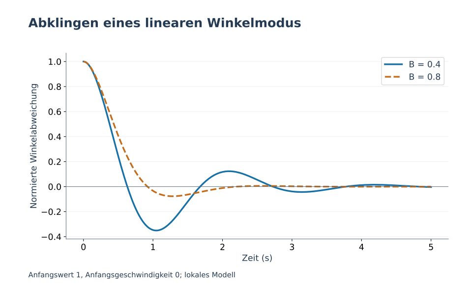

# M36-L3 – Umrichterinteraktion und Stabilität {#L3}

**Kursbereich:** M36 – Masterprofil: Erweiterte Energiesysteme und Netzschutz

**Niveau:** Master · Wahlpflicht

**Vorwissen:** [M36-L1](M36-L1.md).

**Lernziel:** Netzfolgende und netzbildende Konzepte unterscheiden und ein lineares Interaktionsmodell auswerten.

## Regelungsprinzipien {#S1}

Netzfolgende Umrichter orientieren ihre Einspeisung an der vorhandenen Netzspannung, häufig mithilfe einer Phasenregelschleife (PLL). Netzbildende Konzepte stellen eine interne Spannungsreferenz mit eigener Winkeldynamik bereit; ihr Verhalten wird auch durch Strombegrenzung, Energiequelle und Regelung bestimmt. Netzbildend bedeutet deshalb weder unbegrenzte Leistung noch automatisch stabilen Inselbetrieb. Bei mehreren Umrichtern wirken Regelkreise über Netzimpedanzen aufeinander. Die Stabilität eines einzeln geprüften Geräts ist keine Garantie für die Stabilität der Kombination.

## Kleinsignalmodell eines Winkelmodus {#S2}

Für einen verlustlosen induktiven Kopplungszweig mit Spannungsbeträgen $E,V$ und Reaktanz $X$ gilt im stationären Zeigermodell $P=(EV/X)\sin\delta$. Die Linearisierung um $\delta_0$ liefert $\Delta P=K_s\Delta\delta$, mit $K_s=(EV/X)\cos\delta_0$. Ein didaktischer gedämpfter Winkelmodus mit positiver effektiver Trägheit $M$ lautet:

$$M\Delta\ddot\delta+B\Delta\dot\delta+K_s\Delta\delta=0$$

Die Größen sind konsistent auf pu-Leistung und Winkel in rad bezogen. Fiktiv: $M=0{,}2$, $B=0{,}4$, $K_s=2$ in entsprechenden Modell-Einheiten. Die Pole von $s^2+2s+10$ sind $-1\pm j3$ pro Sekunde; der Modus klingt schwingend ab. Mit $B=0{,}8$ ergibt sich $s=-2\pm j\sqrt{6}$. Die stärkere Dämpfung verkürzt den Abklingvorgang. Ein negativer Dämpfungskoeffizient würde in diesem Modell Energie zuführen und instabil werden.

*Abbildung: Eigene schematische Darstellung fiktiver Modelldaten.*

## Modellhierarchie und Verifikation {#S3}

Das Winkelmodell beschreibt nur einen lokalen Modus. Stromregler, PLL, Filterresonanzen, Spannungsregler und Schaltvorgänge sind ausgeblendet. Eine Eigenwertanalyse erfordert ein konsistent linearisiertes Mehrgrößenmodell an jedem relevanten Betriebspunkt; eine positive Stabilitätsreserve in einem Punkt sagt wenig über große Störungen aus. Für schnelle Wechselwirkungen können frequenzabhängige Impedanzmodelle und elektromagnetische Transientensimulationen nötig sein. Definiere einen Vergleich zwischen zwei Modellstufen, kontrolliere Vorzeichen, Basen, Abtastung und Modellgültigkeit und protokolliere abweichende Resultate. Sättigung und Strombegrenzung sind gesonderte nichtlineare Fälle.

## Selbstkontrolle {#S4}

### Aufgaben

1. Berechne die Pole für M=0,2, B=0,4, K_s=2.
2. Bestimme den Dämpfungsgrad B/(2√(MK_s)).
3. Warum ersetzt dieses Modell keine EMT-Studie?

::: {.lc-solutions data-lc-section="S4"}
1. −1 ± j3 s⁻¹.
2. Etwa 0,316.
3. Es enthält weder schnelle elektrische Regelkreise noch nichtlineare Grenzen und beschreibt nur einen lokalen Modus.
:::

## Quellen (extern) {#S5}

- [NLR – Grid-Forming Inverter Controls](https://www.nlr.gov/grid/grid-forming-inverter-controls) · HTML 99–113: netzfolgende und netzbildende Regelung · Zuletzt abgerufen: 2026-11-25 · Inhaltlich geprüft: 2026-11-25
- [Sajadi et al. – Dynamics and Stability of Power Systems With High Shares of Grid-Following Inverter-Based Resources: A Tutorial](https://research-hub.nlr.gov/en/publications/dynamics-and-stability-of-power-systems-with-high-shares-of-grid--4/) · HTML 24–34: Abstract zu Kleinsignal- und Großsignalstabilität; nur Abstract geprüft (Prüfung auf belegten Teilumfang begrenzt) · Zuletzt abgerufen: 2026-11-25 · Inhaltlich geprüft: 2026-11-25
