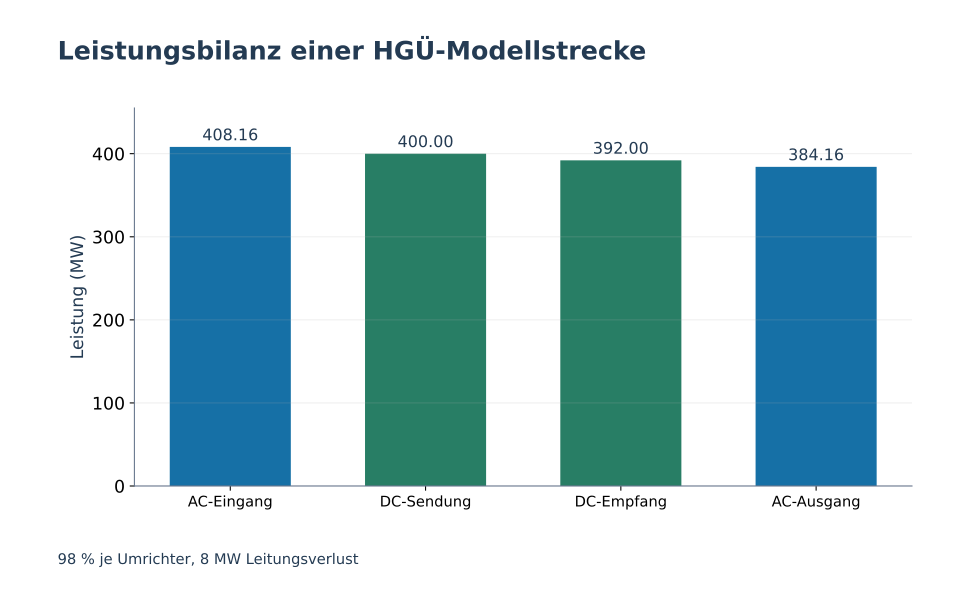

# M36-L4 – HGÜ und flexible AC-Systeme {#L4}

**Kursbereich:** M36 – Masterprofil: Erweiterte Energiesysteme und Netzschutz

**Niveau:** Master · Wahlpflicht

**Vorwissen:** [M33-L5](M33-L5.md).

**Lernziel:** Übertragungsverluste und den Nutzen von HGÜ sowie FACTS anhand idealisierter Leistungsmodelle vergleichen.

## Gleichstromübertragung und Umrichterstationen {#S1}

Hochspannungs-Gleichstrom-Übertragung (HGÜ) koppelt Wechselstromnetze über Umrichterstationen und eine Gleichstromstrecke. Die DC-Leitung führt im stationären Zustand keinen kapazitiven Wechselstrom; dennoch entstehen ohmsche Leitungs- und Umrichterverluste. Netzgeführte Umrichter (LCC) sind auf die Kommutierung durch das AC-Netz angewiesen; selbstgeführte Spannungszwischenkreisumrichter (VSC) bieten andere Möglichkeiten der Wirk- und Blindleistungsregelung. Auch bei VSC sind Strom, Spannung und verfügbare Energie begrenzt. HGÜ kann asynchrone AC-Netze koppeln; ein genereller wirtschaftlicher Vorteil gegenüber AC folgt daraus nicht.

## Verlustrechnung einer fiktiven DC-Strecke {#S2}

Die Spannung $U_d$ bezeichnet die Spannung zwischen Hin- und Rückleiter, $R_\Sigma$ den gesamten Schleifenwiderstand. Bei eingespeister DC-Leistung $P_d=U_d I_d$ ist der ohmsche Verlust $I_d^2R_\Sigma$. Für $P_d=400$ MW, $U_d=400$ kV und $R_\Sigma=8\,\Omega$ folgt $I_d=1000$ A und $P_{loss}=8$ MW. Am DC-Empfangsende bleiben 392 MW. Bei jeweils 98 % Umrichterwirkungsgrad beträgt die AC-Eingangsleistung $400/0{,}98=408{,}16$ MW und die AC-Ausgangsleistung $392\cdot0{,}98=384{,}16$ MW. Der Gesamtwirkungsgrad ist etwa 94,12 %. Das Modell unterstellt feste Wirkungsgrade und feste Sendeendspannung; tatsächliche Verluste sind last- und technologieabhängig.

*Abbildung: Eigene schematische Darstellung fiktiver Modelldaten.*

## FACTS und Grenzen der AC-Übertragung {#S3}

Flexible AC Transmission Systems (FACTS) beeinflussen AC-Netzgrößen mittels Kompensation oder Leistungselektronik. Parallelkompensation (z. B. STATCOM) stützt Spannung durch geregelten Blindstromaustausch; Serienkompensation verändert die wirksame Übertragungsreaktanz. Für zwei ideale Knoten mit $V_1=V_2=1$ pu und Winkelunterschied 20° liefert $P=(V_1V_2/X)\sin\delta$ bei $X=0{,}5$ pu etwa 0,684 pu und bei $X=0{,}4$ pu etwa 0,855 pu. Die Rechnung ist keine Erlaubnis zur Erhöhung einer realen Leitungsauslastung: Stromgrenzen, Schutz, Resonanzen und Stabilität bleiben zu prüfen. Vergleiche HGÜ und AC anhand eines vollständigen Verlust-, Verfügbarkeits- und Kostenmodells über die Betriebsdauer.

## Selbstkontrolle {#S4}

### Aufgaben

1. Berechne den DC-Leitungsverlust bei 800 A und 8 Ω.
2. Wie groß ist der Gesamtwirkungsgrad im 400-MW-Beispiel?
3. Welche Größe beeinflusst ein STATCOM primär?

::: {.lc-solutions data-lc-section="S4"}
1. 5,12 MW.
2. 384,16/408,16 ≈ 94,12 %.
3. Blindstrom bzw. Blindleistung und damit die Spannung am Anschlusspunkt.
:::

## Quellen (extern) {#S5}

- [Hitachi Energy – Life-cycle management](https://www.hitachienergy.com/us/en/products-and-solutions/hvdc/hvdc-services/life-cycle-management) · HTML 231–251: LCC, VSC, Umrichterstationen; Herstellerinformation (Prüfung auf belegten Teilumfang begrenzt) · Zuletzt abgerufen: 2026-11-25 · Inhaltlich geprüft: 2026-11-25
- [Hitachi Energy – Flexible AC Transmission Systems (FACTS)](https://www.hitachienergy.com/products-and-solutions/facts) · HTML 174–188: Blindleistungsregelung und Serienkompensation; Herstellerinformation (Prüfung auf belegten Teilumfang begrenzt) · Zuletzt abgerufen: 2026-11-25 · Inhaltlich geprüft: 2026-11-25
