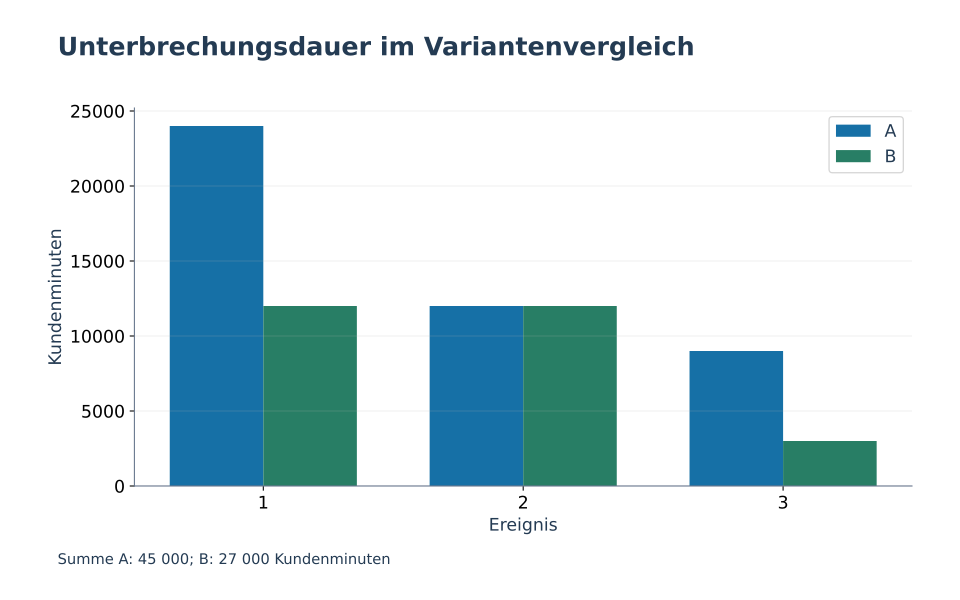

# M36-L5 – Zuverlässigkeits- und Schutzprojekt {#L5}

**Kursbereich:** M36 – Masterprofil: Erweiterte Energiesysteme und Netzschutz

**Niveau:** Master · Wahlpflicht

**Vorwissen:** [M36-L2](M36-L2.md).

**Lernziel:** Ein virtuelles Schutz- und Zuverlässigkeitsprojekt mit Kennzahlen, Sensitivität und reproduzierbaren Nachweisen durchführen.

## Aufgabenstellung und Messgrößen {#S1}

Untersuche ein vollständig fiktives Verteilnetz mit 1000 Kunden. Ziel ist nicht die Auslegung einer realen Anlage, sondern der nachvollziehbare Vergleich zweier Schutz- und Wiederherstellungskonzepte. Für ein Jahr mit $N$ Kunden, Ereignissen $i$, betroffenen Kunden $n_i$ und Unterbrechungsdauer $d_i$ in Minuten gelten die vereinfachten kundenbezogenen Kennzahlen:

$$SAIFI=\frac{\sum_i n_i}{N},\qquad SAIDI=\frac{\sum_i n_id_i}{N},\qquad CAIDI=\frac{SAIDI}{SAIFI}$$

CAIDI ist nur bei positiver Unterbrechungshäufigkeit definiert. Alle betrachteten Ereignisse seien nicht-momentane Unterbrechungen. Bei Vergleichen sind Erfassungszeitraum, Abgrenzung der Kunden, Ereignisklassen und Ausschlussregeln identisch zu halten.

## Virtueller Datensatz und Vergleich {#S2}

| Ereignis | Konzept A: Kunden × min | Konzept B: Kunden × min |
|---|---:|---:|
| 1 | 400 × 60 | 200 × 60 |
| 2 | 100 × 120 | 100 × 120 |
| 3 | 300 × 30 | 300 × 10 |

A: 800 Kundenunterbrechungen und 45000 Kundenminuten ergeben SAIFI=0,8, SAIDI=45 min und CAIDI=56,25 min. B: 600 Kundenunterbrechungen und 27000 Kundenminuten ergeben SAIFI=0,6, SAIDI=27 min und CAIDI=45 min. Die Reduktion von SAIDI beträgt 40 %. Wenn Ereignis 1 in B tatsächlich 100 statt 60 Minuten dauert, steigt SAIDI auf 35 min; die relative Verbesserung gegenüber A sinkt auf rund 22,2 %. Diese Sensitivität verhindert eine Überinterpretation der nominellen Kennzahl.

*Abbildung: Eigene schematische Darstellung fiktiver Modelldaten.*

## Projektnachweis und Bewertung {#S3}

Erstelle eine CSV mit Ereignis-ID, Variante, Kundenanzahl und Dauer. Lege Annahmen und Auswerteskript versioniert ab. Reproduziere die Referenzwerte, führe einen Nullereignis-Test (SAIDI und SAIFI null, CAIDI undefiniert) und einen Grenzwerttest durch. Ergänze eine abstrakte Schutz-Testmatrix nach [M36-L2](M36-L2.md) mit erwarteten Zonen und Ergebnissen, jedoch ohne reale Geräteparameter. Prüfe, ob die schnellere Wiederherstellung mit den angenommenen Schutzanforderungen vereinbar ist; kennzeichne dies andernfalls als offene Modellfrage. Die Bewertungsrubrik gewichtet Reproduzierbarkeit 30 %, korrekte Kennzahlen 30 %, begründete Sensitivität 20 % und kritische Diskussion 20 %. Ein gutes Ergebnis legt Unsicherheiten offen. Ein realer Zuverlässigkeitsnachweis erfordert repräsentative Daten, geeignete statistische Modelle und unabhängige Validierung.

## Selbstkontrolle {#S4}

### Aufgaben

1. Berechne SAIDI und SAIFI für Konzept B.
2. Wie groß ist CAIDI bei SAIDI=35 min und SAIFI=0,6?
3. Was muss bei null Ereignissen im Bericht stehen?

::: {.lc-solutions data-lc-section="S4"}
1. 27 min pro Kunde und Jahr; 0,6 Unterbrechungen pro Kunde und Jahr.
2. Etwa 58,33 min pro Unterbrechung.
3. SAIDI=0, SAIFI=0; CAIDI nicht definiert.
:::

## Quellen (extern) {#S5}

- [EIA – Electric Power Annual, Table 11.2](https://www.eia.gov/electricity/annual/html/epa_11_02.html) · HTML 79–86: Definitionen SAIDI, SAIFI, CAIDI und Ereignisabgrenzung · Zuletzt abgerufen: 2026-11-25 · Inhaltlich geprüft: 2026-11-25
- [SEL – Distribution](https://selinc.com/industries/utilities/distribution/) · HTML 72–97: Koordinationsmargen und Abschnittsbildung; Herstellerinformation (Prüfung auf belegten Teilumfang begrenzt) · Zuletzt abgerufen: 2026-11-25 · Inhaltlich geprüft: 2026-11-25
