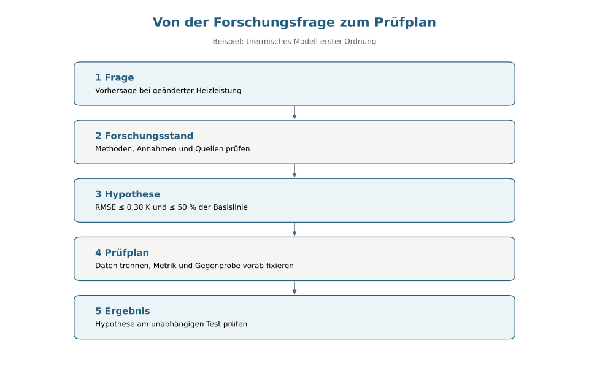

# M37-L1 – Forschungsfrage, Literatur und überprüfbare Hypothese {#L1}

**Kursbereich:** M37 – Optionales Forschungs- und Abschlussprojekt

**Niveau:** Master · Forschungs- und Abschlussprojekt

**Vorwissen:** [M32-L6](M32-L6.md) oder ein anderes abgeschlossenes Masterprofil.

**Lernziel:** Eine begrenzte Forschungsfrage mit falsifizierbarer Hypothese, Vergleich und dokumentiertem Literaturstand entwickeln.

## Vom technischen Problem zur Frage {#S1}

Ein Forschungsprojekt beginnt nicht mit der Wahl einer Programmiersprache, sondern mit einer Frage, deren Antwort noch nicht feststeht. Ein Entwicklungsprojekt kann eine funktionierende Lösung zum Ziel haben; eine wissenschaftliche Untersuchung muss darüber hinaus zeigen, unter welchen Bedingungen diese Lösung funktioniert, wie sie sich von Alternativen unterscheidet und welche Unsicherheiten verbleiben. Beide Aufgaben können in einem Projekt zusammenfallen.

Wähle eine aus dem bisherigen Studium bekannte Domäne. Aus „Ich will eine bessere Temperaturregelung bauen“ wird beispielsweise „Wie gut sagt ein thermisches Modell erster Ordnung die Temperatur nach einer Änderung der Heizleistung voraus, wenn es nur anhand einer einzigen Leistung identifiziert wurde?“ Diese Frage begrenzt den Untersuchungsgegenstand auf ein Modell, einen Eingang, eine Ausgangsgröße und einen Testbereich. Sie lässt sich bearbeiten, selbst wenn keine Laborhardware vorhanden ist. Das folgende Modul benutzt synthetische Daten und prüft Methoden, keine reale Anlage.

{alt="Fünf Schritte von der Fragestellung über die Hypothese zum vorab festgelegten Prüfplan."}

## Forschungsstand und Literaturarbeit {#S2}

Beginne mit zwei bis drei präzisen Suchbegriffen, etwa `first order thermal system identification step response` und `least squares residual validation`. Suche Lehrbücher für Grundlagen, Übersichtsarbeiten zur Orientierung und Originalarbeiten für spezifische Verfahren. Dokumentiere Suchdatum, Suchbegriffe, Datenbank, Ein- und Ausschlussregeln. Verfolge Zitate vorwärts und rückwärts; prüfe, ob sich eine Behauptung tatsächlich auf die angegebenen Randbedingungen bezieht. Ein Abstract reicht nicht für Details eines Experiments. Ein Hochschulcurriculum belegt die Lehrorientierung, ein Methodenhandbuch den Rechenweg; keines ersetzt den eigenen Versuch.

| Belegfrage | Geeignete Fundstelle | Eigene Prüfung |
| --- | --- | --- |
| Welche Abgaben gehören zu einem Hochschulprojekt? | ETH-Projektbeschreibung | Bericht und Vortrag vorsehen |
| Wie schätzt man Modellparameter? | Methodenliteratur zu kleinsten Quadraten | Fehlerfunktion und Identifizierbarkeit prüfen |
| Was macht eine Rechnung nachvollziehbar? | The Turing Way | Code, Daten, Versionen und Ausführung festhalten |

Eine eigene Literaturmatrix sollte Autor, Jahr, Fundstelle, Aussage, Annahmen, Methode und Relevanz enthalten. Paraphrasen brauchen ebenso einen Nachweis wie Zitate. Bei widersprüchlichen Ergebnissen vergleicht man Einsatzbereich und Methode, statt nur die gewünschte Aussage auszuwählen.

## Hypothese und Gegenprobe {#S3}

Unser Beispiel vergleicht das dynamische Modell $y(t)=KP(1-e^{-t/\tau})$ mit einer statischen Basislinie $y(t)=K_sP$. Dabei ist $y$ die Temperaturerhöhung in K, $P$ die konstante Heizleistung in W, $K$ der stationäre thermische Gewinn in K/W und $\tau$ eine Zeitkonstante in s. Beide Modelle sollen aus demselben 3-W-Versuch geschätzt werden.

Die technische Hypothese: Im unveränderten System erzielt das dynamische Modell auf einem unabhängigen 5-W-Testlauf einen RMSE von höchstens 0,30 K und höchstens die Hälfte des RMSE der statischen Basislinie. Als Gegenprobe erhöht ein zusätzlicher Test die Zeitkonstante; hier darf das Modell scheitern. Diese Grenzwerte sind didaktisch gewählt, keine Normvorgabe und kein statistischer Signifikanztest. Die Zeitreihe enthält auch den Zeitpunkt null, daher stellt die dynamikfreie Basislinie einen bewusst einfachen Vergleich dar.

## Eigene Themenwahl {#S4}

| Profil | Frage als Ausgangspunkt | Kontrollgröße |
| --- | --- | --- |
| [M32](M32-L6.md) | Bringt MPC unter veränderten Parametern noch Vorteile? | Regelabweichung und Stellgrenzen |
| [M33](M33-L6.md) | Wie empfindlich ist ein Lastfluss gegenüber lokalen Einspeisungen? | Leistungsbilanz, Spannung |
| [M34](M34-L6.md) | Wann dominiert Jitter statt Quantisierung? | SINAD, ENOB |
| [M35](M35-L2.md) | Ab welcher Datenrate lohnt sich ein Beschleuniger? | Latenz, Fristverletzung |
| [M36](M36-L5.md) | Wie verändern unterschiedliche Ausfallannahmen die erwartete Versorgungsunterbrechung? | Erwartete nicht gelieferte Energie, Unsicherheit |

Definiere, was außerhalb des Projekts liegt. Ein simulierter Zeitbedarf erlaubt keine direkte Behauptung über reale Hardware; eine modellierte Ausfallstatistik keine Garantie für ein reales Netz. Fixiere vor der Hauptauswertung Frage, Primärmetrik, Datenteilung und Akzeptanzregel. Spätere explorative Änderungen sind erlaubt, müssen aber als solche erkennbar sein.

## Übungen und Kontrolle {#S5}

1. Formuliere eine Frage zu deinem Profil mit Eingang, Ausgang und Vergleich. **Kontrolle:** Die Antwort könnte auch negativ sein; der Testbereich ist benannt.
2. Was passiert, wenn das Modell nur 0,31 K RMSE erreicht, aber doppelt so gut wie die Basislinie ist? **Lösung:** Die zusammengesetzte Akzeptanzregel ist nicht erfüllt.
3. Ist ein simulierter Test mit geänderten Parametern eine physische Messung? **Lösung:** Nein; er prüft die Reaktion innerhalb des gewählten Modells.

## Quellen {#S6}

- [ETH Zürich – Projects and Master’s Thesis (Curriculum G8)](https://ee.ethz.ch/studies/master-s-programmes/main-master/projects-and-master-thesis.html) · Abschnitt Semester projects: Betreuung, schriftlicher Bericht und Vortrag; kein Beleg für eine bestimmte Forschungsmethode. · Zuletzt abgerufen: 2026-11-25
- [The Turing Way – Guide for Reproducible Research](https://book.the-turing-way.org/reproducible-research/reproducible-research/) · Guide for Reproducible Research, Einleitung: reproduzierbare Datenanalyse durch verfügbare Daten und Code; methodischer Teilaspekt. · Zuletzt abgerufen: 2026-11-25
- [NIST/SEMATECH – Engineering Statistics Handbook, Process Modeling](https://www.itl.nist.gov/div898/handbook/pmd/pmd.htm) · Kapitel 4, Einleitung und Zweck der Modellbildung; methodische Einordnung. · Zuletzt abgerufen: 2026-11-25
