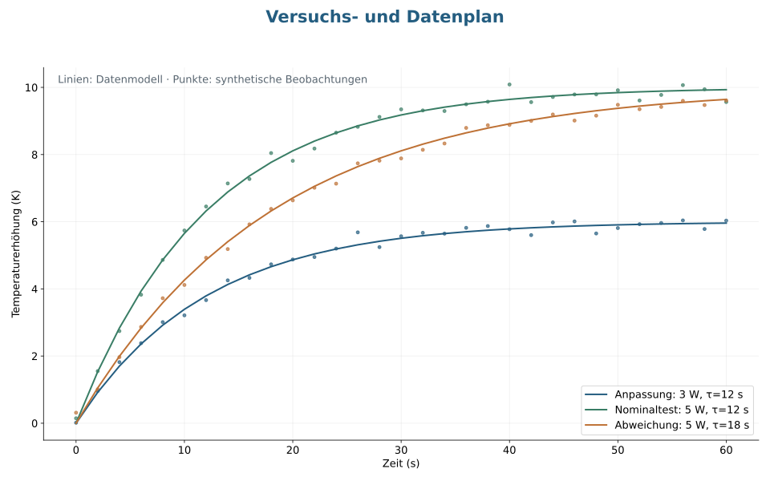

# M37-L2 – Experiment- oder Simulationsplan mit Metriken und Referenzverfahren {#L2}

**Kursbereich:** M37 – Optionales Forschungs- und Abschlussprojekt

**Niveau:** Master · Forschungs- und Abschlussprojekt

**Vorwissen:** [M37-L1](M37-L1.md), [M12-L3](M12-L3.md).

**Lernziel:** Versuchsbedingungen, unabhängige Prüfdaten, Metriken und Kontrollrechnungen festlegen.

## Experimentdesign {#S1}

Ein guter Plan macht vorher klar, welche Eingänge aktiv verändert, welche Einflüsse konstant gehalten und welche Ausgänge ausgewertet werden. Für eine Messung gehören dazu Anschlussplan, kalibrierte Instrumente, sichere Betriebsgrenzen und Umgebungsbedingungen. Bei einer Simulation sind Modellgleichungen, Parameter und Anfangsbedingungen die Entsprechung. Ein Referenzverfahren sollte nicht dieselbe mögliche Implementierungsstörung wie die untersuchte Methode enthalten.

Für unser thermisches System gelten $y(0)=0$ und ein konstanter Leistungssprung bei $t=0$. Das Modell $\tau\dot y+y=KP$ ist die normierte Wärmebilanz mit $K=R_{th}$ und $\tau=R_{th}C_{th}$. Die synthetische Beobachtung $z_i=y(t_i)+\epsilon_i$ verwendet unabhängiges normalverteiltes Rauschen mit Standardabweichung $\sigma=0{,}15$ K. Eine reale Messreihe kann auch Offset, Drift, thermische Verzögerung des Sensors und korreliertes Rauschen enthalten; das wird hier nicht behauptet oder modelliert.

| Fall | P (W) | Wahres K (K/W) | Wahres τ (s) | Seed | Funktion |
| --- | ---: | ---: | ---: | ---: | --- |
| Anpassung | 3 | 2 | 12 | 3101 | Parameter bestimmen |
| Nominaltest | 5 | 2 | 12 | 3102 | Akzeptanz prüfen |
| Abweichung | 5 | 2 | 18 | 3103 | Gültigkeitsgrenze prüfen |

Je Versuch 31 Werte, Zeiten 0 bis 60 s in Schritten von 2 s. Alle Werte sind synthetisch. Die Modellparameter werden nur mit dem Anpassungsdatensatz geschätzt; nominaler Test und Abweichung bleiben getrennt. Der letzte Versuch dient nicht der nachträglichen Verbesserung des Modells.

{alt="Drei getrennte Versuche: Anpassung, nominale Prüfung und Prüfung bei Modellabweichung."}

## Vergleichsmetriken {#S2}

Für Beobachtung $z_i$ und Vorhersage $\hat y_i$ heißt $e_i=z_i-\hat y_i$ Residuum. Der mittlere Fehler $\bar e=\sum_i e_i/n$ zeigt eine gerichtete Abweichung. Der RMSE lautet

$$\mathrm{RMSE}=\sqrt{\frac1n\sum_{i=1}^n e_i^2}.$$

Er hat dieselbe Einheit wie die Messgröße (K), gewichtet große Abweichungen überproportional und kann bei einer zeitlich korrelierten Reihe allein wichtige Muster verdecken. Für Fehler $-1,0,1$ K ergibt sich $\bar e=0$ K, jedoch RMSE $\sqrt{2/3}=0{,}816$ K. Ergänze bei Bedarf Maximalfehler, mittleren Absolutfehler und Residuen über der Zeit; verwende keine Prozentfehler bei Temperaturerhöhungen nahe null.

## Referenzrechnung und Kontrollen {#S3}

Die analytische Lösung eines konstanten Eingangs lautet $y(t)=KP(1-e^{-t/\tau})$. Als zweites Rechenverfahren dient die exakte diskrete Rekursion bei konstantem Eingang innerhalb eines Zeitintervalls $h$:

$$a=e^{-h/\tau},\qquad y_{i+1}=ay_i+(1-a)KP.$$

Vergleiche beide Verfahren bei denselben Parametern. Bei $h=2$ s und $\tau=12$ s ist $a\approx0{,}84648$. Der erste Schritt bei 3 W und $K=2$ K/W beträgt rund 0,9211 K. Diese Übereinstimmung prüft die Umsetzung, nicht die Gültigkeit des physikalischen Modells. Zusätzlich muss bei $P=0$ und $y(0)=0$ jeder rauschfreie Wert null sein; bei langen Zeiten nähert sich die Antwort $KP$.

## Datenteilung und Fehlerquellen {#S4}

Eine zufällige Teilung benachbarter Zeitpunkte kann bei realen, korrelierten Daten zu überoptimistischen Ergebnissen führen. Halte ganze Versuchsläufe oder unabhängige Betriebsbedingungen zurück. Wenn du Modellstruktur, Parameterbereich oder Akzeptanzgrenze aufgrund der Testdaten änderst, wird dieser Test zum Entwicklungsdatensatz; beschaffe eine neue unabhängige Prüfung. Eine Wiederholung mit demselben Seed prüft die Reproduzierbarkeit, eine Wiederholung mit anderem Seed die Empfindlichkeit gegen Zufallseinflüsse. Im Labor sind Reihenfolge, Erwärmung, Drift und Wiederholbarkeit zusätzlich zu planen. Bei sicherheitskritischen, Netzspannungs- oder Hochenergieversuchen ist fachliche Laboraufsicht nötig; dieses Selbstlernprojekt bleibt bei der Simulation.

## Übungen und Kontrolle {#S5}

1. Warum darf das 5-W-Testprofil bei der Parameteroptimierung nicht genutzt werden? **Lösung:** Die Vorhersageprüfung würde ihre Unabhängigkeit verlieren.
2. Berechne den stationären Wert bei 5 W. **Lösung:** 10 K Temperaturerhöhung.
3. Entwirf eine weitere Gegenprobe. **Kontrolle:** Beispielsweise eine Folge mehrerer Leistungssprünge mit exakter Rekursion; vorab Szenario und Metrik definieren.

## Quellen {#S6}

- [NIST/SEMATECH – Engineering Statistics Handbook, Process Modeling](https://www.itl.nist.gov/div898/handbook/pmd/pmd.htm) · Kapitelübersicht 4.3: Versuchsplanung und Bewertung; Unterkapitel nicht vollständig geprüft. · Zuletzt abgerufen: 2026-11-25
- [NIST/SEMATECH – Least Squares](https://www.itl.nist.gov/div898/handbook/pmd/section4/pmd431.htm) · §4.4.3.1: Parameterschätzung durch Minimierung quadratischer Residuen; Teilaspekt. · Zuletzt abgerufen: 2026-11-25
- [The Turing Way – Guide for Reproducible Research](https://book.the-turing-way.org/reproducible-research/reproducible-research/) · Guide for Reproducible Research, Einleitung: reproduzierbare Datenanalyse durch verfügbare Daten und Code; methodischer Teilaspekt. · Zuletzt abgerufen: 2026-11-25
