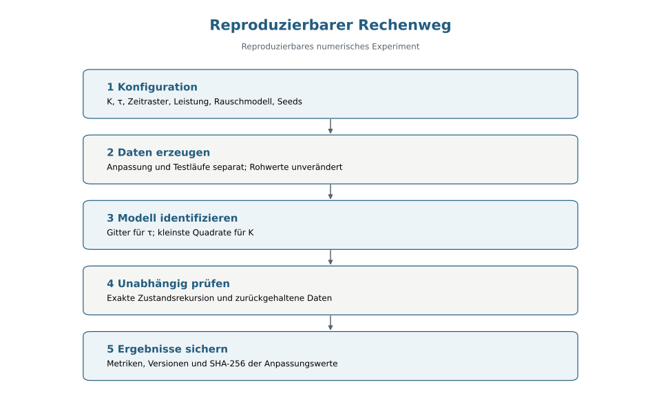

# M37-L3 – Reproduzierbare Umsetzung: Datenherkunft, Versuchsprotokoll, Konfiguration und Auswertung {#L3}

**Kursbereich:** M37 – Optionales Forschungs- und Abschlussprojekt

**Niveau:** Master · Forschungs- und Abschlussprojekt

**Vorwissen:** [M37-L2](M37-L2.md), Python und elementare lineare Algebra.

**Lernziel:** Die Daten und Parameter eines Modellvergleichs reproduzieren und eine unabhängige numerische Kontrolle ausführen.

## Rechenarchiv statt einzelner Ergebnisgrafik {#S1}

Ein fremder Bearbeiter soll erkennen, welche Eingangsdaten, Programmversionen und Einstellungen ein Ergebnis erzeugt haben. Halte Rohdaten unverändert, trenne die Verarbeitung davon und erzeuge Tabellen und Diagramme aus demselben Datenstand. Bei synthetischen Daten wird auch der Generator Teil der Methode. Für Messdaten ergänze Einheiten, Sensoridentität, Abtastzeit, Kalibrierung, fehlende Werte und deren Behandlung. Prüfsummen können unbeabsichtigte Änderungen erkennen, beweisen aber nicht, dass Daten richtig erhoben wurden.

Ein minimales Projekt kann die Dateien `README.md`, `config.json`, `data/raw/`, `run.py`, `results/`, `report.md` und eine Versionsliste enthalten. Dieser Lehrversuch ist bewusst als ein ausführbarer Codeblock implementiert; seine Konfiguration steht am Anfang und in `main()`. Für eine eigene Arbeit sollten die Daten und Ergebnisse zusätzlich exportiert und die erzeugten Dateien mit ihrer Herkunft dokumentiert werden.

{alt="Datenfluss von Modellparametern und Zufalls-Seed über Schätzung bis zu Ergebnis und Prüfsumme."}

## Parameterschätzung {#S2}

Die unbekannten Parameter $K,\tau$ werden durch Minimierung der quadratischen Fehler auf dem Anpassungsdatensatz bestimmt. Für jede feste Kandidatenzeitkonstante $\tau$ ist $g_i=P(1-e^{-t_i/\tau})$ bekannt und das Problem linear in $K$:

$$Q(K|\tau)=\sum_i(z_i-Kg_i)^2,\qquad \hat K(\tau)=\frac{\sum_i g_iz_i}{\sum_i g_i^2}.$$

Aus $\partial Q/\partial K=0$ folgt die Formel, sofern $\sum_i g_i^2>0$. Wir setzen $\tau$ auf ein Gitter zwischen 4 und 30 s in 0,1-s-Schritten und wählen den kleinsten Fehler. Das ist ein kontrollierbarer Suchraum mit bekannter Auflösung; bei Randtreffern oder konkurrierenden Minima muss die Schätzung näher untersucht werden. Der statische Vergleich minimiert $\sum_i(z_i-K_sP)^2$ und ergibt $\hat K_s=\bar z/P$. Beide Verfahren bekommen dieselben Daten.

## Vollständiger Rechenversuch {#S3}

Speichere den folgenden Block als `run.py` und führe `python run.py` aus. Die Redaktion hat ihn mit Python 3.13.5 und NumPy 2.3.5 geprüft. Die Seeds sind fest und die Größen in SI-nahen Einheiten angegeben. Numerische Rundungsabweichungen können durch Bibliotheks- oder Plattformwechsel entstehen.

```python
import numpy as np
from hashlib import sha256
T = np.arange(0., 62., 2.)
TAUS = np.arange(40, 301)/10
SIGMA = .15

def response(p, k, tau):
    return k*p*(-np.expm1(-T/tau))

def data(p, tau, seed):
    return response(p, 2., tau) + np.random.default_rng(seed).normal(0, SIGMA, T.size)

def fit(p, y):
    basis = p*(-np.expm1(-T[None,:]/TAUS[:,None]))
    ks = (basis @ y)/np.sum(basis*basis, axis=1)
    sse = np.sum((basis*ks[:,None]-y)**2, axis=1)
    i = np.argmin(sse)
    return ks[i], TAUS[i]

def rmse(y, pred):
    return np.sqrt(np.mean((y-pred)**2))

def main():
    train = data(3., 12., 3101)
    k, tau = fit(3., train)
    static = train.mean()/3
    print('fit', k, tau, static)
    # Independent exact discrete state recursion, no closed-form response used here.
    x = [0.]
    a = np.exp(-2/tau)
    for _ in T[1:]:
        x.append(a*x[-1] + (1-a)*k*5.)
    assert np.max(np.abs(np.array(x)-response(5.,k,tau))) < 1e-12
    rows=[]
    for name,p,true_tau,seed in [('fit',3.,12.,3101),('test',5.,12.,3102),('shift',5.,18.,3103)]:
        y = data(p,true_tau,seed)
        pred = response(p,k,tau)
        stat = np.full(T.size,p*static)
        rows.append((name,rmse(y,pred),rmse(y,stat),np.mean(y-pred)))
        print(name,*[f'{v:.6f}' for v in rows[-1][1:]])
    samples = np.array([fit(3.,data(3.,12.,s)) for s in range(3200,3400)])
    print('quantiles',np.quantile(samples,[.025,.5,.975],axis=0))
    print('train_sha256', sha256(train.astype('<f8').tobytes()).hexdigest())
    assert rows[1][1] <= .3 and rows[1][1] <= .5*rows[1][2]
    assert rows[2][1] > .3
    return k,tau,static,rows,samples

if __name__ == '__main__':
    main()
```

Die Prüfsumme ist auf die 31 Anpassungswerte im Little-Endian-Float64-Format bezogen, nicht auf eine CSV-Datei. Der Code trennt das Erzeugen des jeweiligen Testfalls von der Parameterschätzung. Die Rückgabe von `main()` ermöglicht Folgeauswertungen ohne Kopieren von gerundeten Ergebnissen; `rows` enthält die drei Fälle, `samples` die Wiederholungsschätzungen.

## Protokoll der Referenzausführung {#S4}

| Größe | Berechneter Wert |
| --- | ---: |
| Dynamischer Gewinn K | 1,999979 K/W |
| Zeitkonstante τ | 11,9 s |
| Statischer Gewinn Ks | 1,585786 K/W |
| RMSE Anpassung, dynamisch | 0,128308 K |
| RMSE Nominaltest, dynamisch | 0,167320 K |
| RMSE Nominaltest, statisch | 2,634260 K |

Die analytische Vorhersage und die exakte Zustandsrekursion stimmen laut Assertion bis auf weniger als $10^{-12}$ K überein. Die Datenprüfsumme lautet `6e7dca46941ea6879197265aeda97df4707cf47176da602efdb9f30313c44681`. Der statische Gewinn ist geringer als der tatsächliche stationäre Gewinn, weil er die gesamte Übergangsphase mit einem einzigen konstanten Wert approximiert. Die dynamische Anpassung trifft das synthetische Modell gut; sie schätzt nicht unabhängig nach, ob eine reale Anlage zweiter Ordnung wäre.

## Übungen und Kontrolle {#S5}

1. Halbierte Gitterweite: Was ändert sich? **Kontrolle:** Die Schätzung kann feiner ausfallen, die Information in den Daten nimmt nicht zu. Dokumentiere eine neue Ausführung.
2. Warum genügt eine Prüfsumme allein nicht? **Lösung:** Sie sichert die Identität der Bytefolge, nicht die fachliche Korrektheit.
3. Entferne gedanklich alle Zeiten nach 2 s. **Lösung:** Für frühe Zeiten gilt näherungsweise $y\approx KP t/\tau$; K und τ werden schwer getrennt identifizierbar.

## Quellen {#S6}

- [NIST/SEMATECH – Least Squares](https://www.itl.nist.gov/div898/handbook/pmd/section4/pmd431.htm) · §4.4.3.1: Parameterschätzung durch Minimierung quadratischer Residuen; Teilaspekt. · Zuletzt abgerufen: 2026-11-25
- [The Turing Way – Guide for Reproducible Research](https://book.the-turing-way.org/reproducible-research/reproducible-research/) · Guide for Reproducible Research, Einleitung: reproduzierbare Datenanalyse durch verfügbare Daten und Code; methodischer Teilaspekt. · Zuletzt abgerufen: 2026-11-25
- [The Turing Way – Research Compendia](https://book.the-turing-way.org/reproducible-research/compendia/) · Research Compendia, Summary und Motivation: Zusammenführung von Daten, Code und Forschungsdokumentation. · Zuletzt abgerufen: 2026-11-25
