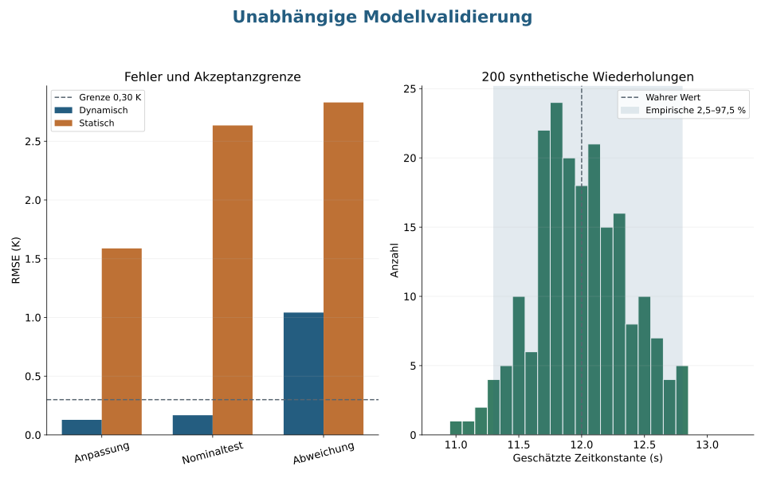

# M37-L4 – Validierung, Unsicherheit und kritische Diskussion der Ergebnisse {#L4}

**Kursbereich:** M37 – Optionales Forschungs- und Abschlussprojekt

**Niveau:** Master · Forschungs- und Abschlussprojekt

**Vorwissen:** [M37-L3](M37-L3.md), [M16-L5](M16-L5.md).

**Lernziel:** Testfehler, Zufallseinfluss und strukturelle Modellabweichung auseinanderhalten und die Gültigkeit begrenzen.

## Was wird tatsächlich nachgewiesen? {#S1}

Verifikation untersucht, ob die gewählten Gleichungen und Rechenschritte korrekt umgesetzt sind. Validierung fragt, ob die Annahmen für den geplanten Einsatz ausreichend sind. Eine unabhängige analytische Rechnung kann numerische Fehler entdecken, aber keine fehlende Physik ersetzen. Bei synthetischen Prüfdaten bedeutet Validierung hier nur einen Test relativ zur bekannten simulierten Datenentstehung; für die reale Anlage wäre ein unabhängiger Versuch nötig.

Das Modell aus L3 erfüllt beim nominalen Test die beiden Kriterien aus L1: 0,1673 K liegt unter 0,30 K und unter der Hälfte der statischen 2,6343 K. Bei geänderter Zeitkonstante werden die Kriterien nicht gemeinsam erfüllt. Gerade diese Gegenprobe macht die Modellgrenze sichtbar.

| Datensatz | RMSE dynamisch (K) | RMSE statisch (K) | Mittleres Residuum dynamisch (K) |
| --- | ---: | ---: | ---: |
| Anpassung | 0,128308 | 1,587489 | 0,001674 |
| Nominaltest | 0,167320 | 2,634260 | −0,015644 |
| Abweichung | 1,041416 | 2,829938 | −0,927214 |

Die Abweichung hat einen negativen mittleren Fehler $z-\hat y$, weil das schnellere Modell die Erwärmung überschätzt. In einer echten Messung wäre die Ursache nicht automatisch bekannt; sie könnte etwa eine veränderte thermische Kapazität oder zusätzliche Dynamik sein.

{alt="Fehlervergleich in drei Fällen und empirische Streuung der Zeitkonstante über 200 Wiederholungen."}

## Streuung der Parameterschätzung {#S2}

Für 200 neue synthetische Anpassungsläufe (Seeds 3200 bis 3399) wurde dieselbe Schätzung wiederholt. K und τ der Datenentstehung blieben unverändert. Die empirischen Quantile aus L3 lauten:

| Parameter | 2,5 % | Median | 97,5 % |
| --- | ---: | ---: | ---: |
| K (K/W) | 1,96510 | 2,00052 | 2,03390 |
| τ (s) | 11,3 | 12,0 | 12,8 |

Die Quantile beschreiben die Verteilung der Schätzungen in dieser bekannten Simulation. Sie sind weder ein aus einer einzelnen realen Messung gewonnenes Konfidenzintervall noch eine Abdeckungsgarantie für andere Störmodelle. Wenn die Datenentstehung unbekannt ist, muss ein geeignetes Unsicherheitsverfahren mit begründeten Annahmen verwendet werden, etwa ein parametrisches Modell oder bei abhängigen Beobachtungen ein angepasstes Resampling-Verfahren. Die Wiederholungen prüfen nur die Zufallsstreuung, nicht systematische Verzerrung.

## Sensitivität und Modellgrenzen {#S3}

Für $y=KP(1-e^{-t/\tau})$ ist

$$\frac{\partial y}{\partial K}=P(1-e^{-t/\tau}),\qquad \frac{\partial y}{\partial \tau}=-\frac{KPt}{\tau^2}e^{-t/\tau}.$$

Zum Zeitpunkt null sind beide Ableitungen null. Spät im Versuch ist die τ-Sensitivität klein, die K-Sensitivität nähert sich P. Der Betrag der τ-Ableitung ist bei festem τ maximal für $t=\tau$. Bei $K=2$, $P=5$ und $t=\tau=12$ s ergibt sich rund −0,3066 K/s. Die Zeitkonstante beeinflusst daher besonders den Übergang. Ein Datensatz mit früher Übergangsphase und später Annäherung an den Endwert ermöglicht eine deutlich bessere gemeinsame Schätzung als ausschließlich stationäre Daten.

Bei kleinen Parameterunsicherheiten kann mit der Kovarianzmatrix $\Sigma_\theta$ und dem Gradienten $J$ der Vorhersage die linearisierte Varianz $J\Sigma_\theta J^T$ geschätzt werden. Bei einem neuen Messwert kommt bei unabhängigem additivem Rauschen dessen Varianz hinzu. Bei großen Abweichungen und falscher Modellstruktur ist eine lineare Unsicherheitsfortpflanzung kein Ersatz für neue Tests.

## Diskussion und Entscheidung {#S4}

Reportiere negative Resultate ebenso wie positive. Schreibe nicht „Modell ist validiert“ ohne Bezugsbereich. Eine geeignete Aussage lautet: Der dynamische Ansatz erfüllt die vorab festgelegten Kriterien für den nominalen synthetischen 5-W-Fall, nicht aber bei τ=18 s. Für Anwendung außerhalb dieses Bereichs sind weitere Daten und möglicherweise eine erneute Identifikation oder erweiterte Modellstruktur nötig. Residuen auf Trends prüfen; eine geringe mittlere Abweichung schließt periodische Fehler nicht aus. Prüfe bei realen Versuchen zusätzlich Instrumentenauflösung, Offset, Wiederholbarkeit, Temperaturbereich und Datenabhängigkeit.

## Übungen und Kontrolle {#S5}

1. Wie groß ist die relative RMSE-Reduktion im nominalen Test? **Lösung:** $1-0{,}167320/2{,}634260\approx93{,}65\%$.
2. Warum ist das Scheitern im Abweichungsfall wertvoll? **Lösung:** Es begrenzt den Einsatzbereich; eine kleine statistische Streuung im Nominalmodell sagt darüber nichts aus.
3. Welche Informationen fehlen für die Unsicherheit eines realen Temperaturwertes? **Kontrolle:** Kalibrierung, Gerätedaten, zeitliche Korrelation, Umwelteinflüsse und Modellabweichungen gehören dazu.

## Quellen {#S6}

- [NIST/SEMATECH – Engineering Statistics Handbook, Process Modeling](https://www.itl.nist.gov/div898/handbook/pmd/pmd.htm) · Kapitelübersicht 4.4: Modellwahl, Anpassung und Validierung; Unterkapitel nicht vollständig geprüft. · Zuletzt abgerufen: 2026-11-25
- [NIST/SEMATECH – Prediction](https://itl.nist.gov/div898/handbook/pmd/section1/pmd132.htm) · §4.1.3.2: Vorhersage und Abgrenzung der Vorhersageunsicherheit. · Zuletzt abgerufen: 2026-11-25
- [The Turing Way – Guide for Reproducible Research](https://book.the-turing-way.org/reproducible-research/reproducible-research/) · Guide for Reproducible Research, Einleitung: reproduzierbare Datenanalyse durch verfügbare Daten und Code; methodischer Teilaspekt. · Zuletzt abgerufen: 2026-11-25
