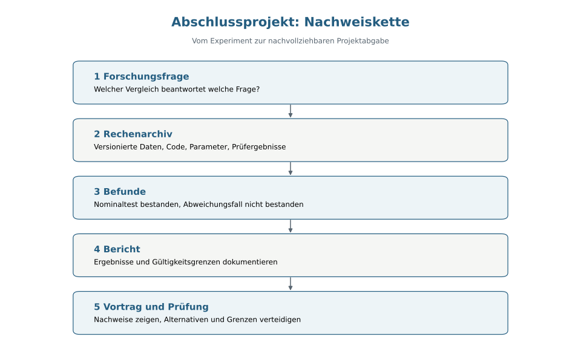

# M37-L5 – Technischer Bericht, Vortrag und fachliche Selbstbewertung {#L5}

**Kursbereich:** M37 – Optionales Forschungs- und Abschlussprojekt

**Niveau:** Master · Forschungs- und Abschlussprojekt

**Vorwissen:** [M37-L1](M37-L1.md) bis [M37-L4](M37-L4.md).

**Lernziel:** Eine wissenschaftlich nachvollziehbare Projektabgabe mit Bericht, Präsentation und selbstkritischer Bewertung erstellen.

## Technischer Bericht {#S1}

Ein wissenschaftlicher Bericht ist keine chronologische Aufzeichnung jeder Arbeitsstunde. Er führt den Leser von der Frage über die Methode zu den Belegen und Schlussfolgerungen. Hochschulprojekte können Bericht und mündliche Darstellung verlangen (Curriculum G8/G9). Das freie Learning-Courses-Projekt übernimmt diese Arbeitsformen, vergibt aber keinen Hochschulabschluss, keine Note einer Hochschule und keine Leistungspunkte.

| Teil | Inhalt und Kontrollfrage |
| --- | --- |
| Titel und Kurzfassung | Was wurde untersucht und was kam heraus? |
| Einleitung und Stand | Warum ist die Frage relevant? Welche Arbeiten sind Grundlage? |
| Methoden | Kann jemand die Ausführung mit Daten, Gleichungen und Parametern nachvollziehen? |
| Ergebnisse | Welche Metriken und Kontrollen wurden ermittelt? |
| Diskussion | Welche alternativen Erklärungen und Grenzen bestehen? |
| Schluss | Welche Antwort lässt sich aus den Befunden ableiten? |
| Quellen und Anhang | Sind Publikationen, Daten, Skripte und Versionen auffindbar? |

Diagramme brauchen Achsen mit Einheiten, lesbare Legenden, korrekte Skalierung und einen Bezug im Fließtext. Tabellen sollten unmittelbar vergleichbare Größen darstellen. Ergebnisse und Interpretation lassen sich getrennt schreiben; im Ergebnisteil beschreiben wir beispielsweise 1,041 K RMSE beim geänderten Modell, in der Diskussion erklären wir das als Folge der bewusst geänderten Zeitkonstante.

{alt="Verknüpfung zwischen Forschungsfrage, Rechenarchiv, Ergebnissen, Bericht und Verteidigung."}

## Muster-Kurzfassung des durchgeführten Lehrversuchs {#S2}

Untersucht wurde, ob ein dynamisches thermisches Modell erster Ordnung gegenüber einer statischen Basislinie die Temperaturerhöhung nach geändertem Leistungssprung besser vorhersagt. Beide Modelle wurden an 31 synthetischen Beobachtungen bei 3 W geschätzt und an einem getrennten 5-W-Versuch geprüft. Das dynamische Modell erreichte 0,167 K RMSE gegenüber 2,634 K für die Basislinie und erfüllte beide vorab definierten Grenzwerte. Bei geänderter Zeitkonstante stieg der Fehler auf 1,041 K; damit wurde die absolute Akzeptanzgrenze überschritten. Eine analytische und eine rekursive Berechnung stimmten numerisch überein; 200 synthetische Wiederholungen quantifizierten die Streuung der Parameterschätzung im Nominalmodell. Die Studie weist die Eignung der Methode unter den angenommenen Bedingungen nach, nicht die Gültigkeit für eine reale thermische Anlage.

## Kurzpräsentation und Verteidigung {#S3}

Als eigenes Übungsformat sind zehn Minuten plus Fragen sinnvoll, unabhängig von den Formvorgaben einer Hochschule. Verwende zum Beispiel sechs Folien: (1) Problem und Frage, (2) Modell und Annahmen, (3) Versuch und Datenaufteilung, (4) Ergebnisvergleich, (5) Gegenprobe und Unsicherheit, (6) Schluss und nächste Schritte. Eine Folie soll eine überprüfbare Aussage vermitteln; Gleichungen nur zeigen, wenn sie zur Interpretation benötigt werden. Erkläre die Zahlen in ihrer Einheit und benenne die Mess- oder Simulationsbedingungen. Halte die Daten und Rechenbefehle für Rückfragen bereit.

Mögliche Prüfungsfragen: Warum ist die Basislinie fair, obwohl sie keine Dynamik enthält? Unter welchen Eingängen wird das Modell schlecht identifizierbar? Wie unterscheiden sich die nominalen Testdaten von neuen realen Messdaten? Wäre ein Modell zweiter Ordnung sinnvoll und wie würde man es prüfen? Eine gute Antwort benennt jeweils sowohl den Nachweis als auch dessen Grenze.

## Selbstbewertung und Abgabe {#S4}

| Kriterium | Punkte (max.) | Nachweis |
| --- | ---: | --- |
| Frage, Hypothese und Literatur | 20 | Eindeutiger Gegenstand und Quellenbezug |
| Methode und Versuchsplan | 20 | Vergleich, Randbedingungen, Metrik |
| Reproduzierbarkeit | 20 | Code, Daten, Einstellungen, Ausführungsprotokoll |
| Validierung und Diskussion | 25 | Unabhängige Gegenprobe, Unsicherheit, Grenzen |
| Bericht und Kurzvortrag | 15 | Lesbarkeit, Argumentation, fachliche Fragen |

Das Raster ist eine vorgeschlagene Selbstbewertung, keine Hochschulprüfung. Vergib Punkte für belegte Arbeitsleistungen, nicht für ein erwünschtes positives Ergebnis. Ein fehlgeschlagenes Experiment kann sehr gut bewertet werden, wenn Durchführung, Erklärung und Grenzen nachvollziehbar sind. Erfinde keine Messungen und verschweige keine unvollständigen Tests. Dokumentiere fremden Code, Lizenzen und KI-Unterstützung gemäß den Regeln deiner Institution bzw. des Veröffentlichungsortes.

## Übungen und Kontrolle {#S5}

1. Erstelle eine eigene Abgabe mit Forschungsfrage, Literaturmatrix, Versuchsplan, ausführbarem Modell oder Datensatz, Referenzvergleich, Bericht und Kurzpräsentation. **Kontrolle:** Verwende das Raster oben und verweise auf konkrete Belegstellen.
2. Gib einer zweiten Person nur das Rechenarchiv und die Anleitung. **Kontrolle:** Kann sie die wichtigsten Zahlen ohne manuelle Übertragung erzeugen? Wenn kein unabhängiger Bearbeiter verfügbar ist, dokumentiere die eigene Neu-Ausführung und markiere die Fremdprüfung als offen.
3. Formuliere eine Schlussaussage mit Gültigkeitsgrenze. **Muster:** Das dynamische Modell erfüllt die Fehlergrenze für den nominalen synthetischen Test, aber nicht bei veränderter Zeitkonstante; eine reale Messvalidierung bleibt ausstehend.

Damit endet der deutschsprachige Studienweg. Die eigene Projektarbeit ist ein neuer, selbstständiger Lernschritt und nicht automatisch durch das Lesen dieser Lektionen abgeschlossen.

## Quellen {#S6}

- [ETH Zürich – Projects and Master’s Thesis (Curriculum G8)](https://ee.ethz.ch/studies/master-s-programmes/main-master/projects-and-master-thesis.html) · Abschnitt Semester projects: schriftlicher Bericht und mündlicher Vortrag; Hochschulbeispiel. · Zuletzt abgerufen: 2026-11-25
- [The Turing Way – Research Compendia](https://book.the-turing-way.org/reproducible-research/compendia/) · Research Compendia, Summary und Motivation: Zusammenführung von Daten, Code und Forschungsdokumentation. · Zuletzt abgerufen: 2026-11-25
- [The Turing Way – Guide for Reproducible Research](https://book.the-turing-way.org/reproducible-research/reproducible-research/) · Guide for Reproducible Research, Einleitung: reproduzierbare Datenanalyse durch verfügbare Daten und Code; methodischer Teilaspekt. · Zuletzt abgerufen: 2026-11-25
